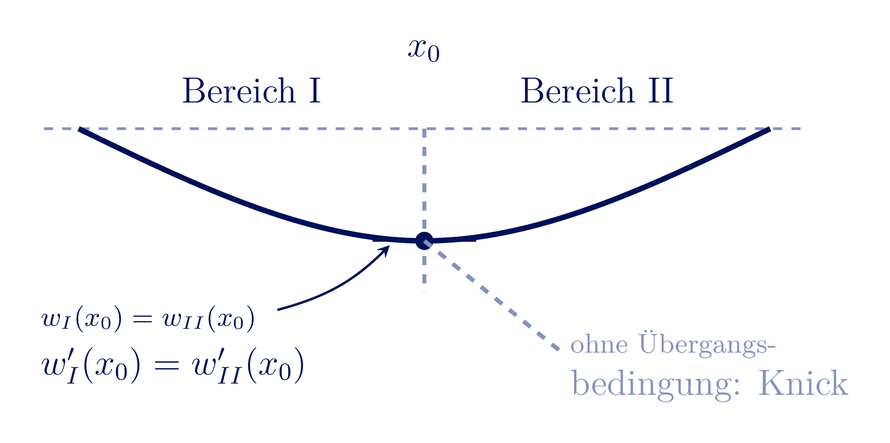

<!-- _class: lead -->
# Die Differentialgleichung der Biegelinie 2. Ordnung
## Herleitung, Lösung und Anwendung

Prof. Dr.-Ing. Christian Willberg
28.10.2026

---

## Auslegung eines Bauteils

- bisher Momentenverläufe und daraus abgeleitet Spannungen und Dehnungen
- Fokus auf Materialversagen und Bewertung nach Festigkeit
- **immer** für das statisch bestimmte System

---

# Warum interessiert uns die Durchbiegung eines Balkens?

---

## Beispiel 1: Windturbine

- Rotorblätter biegen sich unter Windlast zum Turm hin durch
- **Turmfreigang** (Tower Clearance) begrenzt die zulässige Durchbiegung
- Zu weiche Auslegung $\Rightarrow$ Kollisionsgefahr Blatt/Turm - unabhängig von Festigkeit des Blattes

<!-- _footer: 'Bild: Vinaceus, Wikimedia Commons (CC BY-SA 4.0)' -->

---

## Beispiel 2: Flugzeug U-2

- Höhenaufklärer U-2: extrem leichte, lange Tragflächen für große Flughöhen
- Flügel so biegeweich, dass er am Boden auf Stützrädern ("Pogo-Sticks") ruht
- Bewusste Auslegungsentscheidung - nicht durch Festigkeit, sondern durch Steifigkeit/Gewicht getrieben

<!-- _footer: 'Bild: US Air Force (PD) · u2egypt.brown.edu' -->

---

## Beispiel 3: Blattfeder

- Fahrzeugfederung: großer Federweg bei moderater Kraft
- Hier ist **geringe** Steifigkeit die gewünschte Funktion
- $\Rightarrow$ Steifigkeit ist in allen drei Fällen ein eigenständiges, von Festigkeit & Ermüdung unabhängiges Auslegungskriterium

<!-- _footer: 'Bild: Jim Gill, Wikimedia Commons (public domain)' -->

---

## Warum die Biegelinie? Quantitativ

- Durchbiegungen sind beispielsweise durch Normen begrenzt 
- Funktionen werden durch Durchbiegung beeinträchtigt 
- Frage: Wie groß ist $w(x)$ an jeder Stelle des Balkens - nicht nur der Maximalwert?

<!-- _footer: 'Diese Vorlesung: lineare Elastizität, kleine Verformungen, ebene Biegung' -->

---

## Verformung im 1D-Fall: Zugstab

- Kraft $F$, Querschnittsfläche $A$ $\Rightarrow$ Spannung $\sigma = F/A$
- Hookesches Gesetz: $\varepsilon = \sigma/E$
- Verlängerung: $u = \varepsilon L = \dfrac{FL}{EA}$

---

<!-- _class: cols-2 -->
## Was ist der Unterschied beim Balken?

- Beim Balken wirkt am Querschnitt ein **Biegemoment** $M(x)$ statt nur einer Normalkraft
- Schnittgrößen: $F_q(x)$ (Querkraft), $M_b(x)$ (Biegemoment)
- Gleichgewicht am Element: 
$\dfrac{dF_q}{dx} = -q(x) \qquad\dfrac{dM_b}{dx} = F_q(x)$
- Die Biegespannung und Dehnung ist **nicht** konstant über den Querschnitt$\sigma(x,z)$

$$\sigma(x,z) = \frac{M_b(x)}{I}\,z$$

---

## Wie kommt man von der Spannung zur Deformation?

- Beim Zugstab: $\sigma \to \varepsilon \to \delta$ - direkt, konstant über den Querschnitt
- Beim Balken: $\sigma(x,z) \to \varepsilon(x,z) \to\ ?$
- Die Dehnung variiert über $z$ $\Rightarrow$ der Balken **krümmt sich**

---

## Die Biegelinie $w(x)$

- $x$ - Balkenachse (unverformt)
- $w(x)$ - Durchbiegung, gemessen in $z$-Richtung
- $w'(x) = \tan\varphi$ - Neigung der Tangente
- $\rho$ - Krümmungsradius an der Stelle $x$

---

**Krümmung**
$$\rho = \dfrac{ds}{d\varphi}$$

**Biegelinie als Funktion $w(x)$**
$$\frac{1}{\rho} = \frac{w''(x)}{\left(1+w'(x)^2\right)^{3/2}}$$
Annahme: **kleine Durchbiegungen** $w'(x) \ll 1$ (typisch $< 5°$ Neigung)
$\rightarrow 1 + w'(x)^2 \approx 1$

$$\boxed{\frac{1}{\rho} \approx w''(x)}$$

---

## Spannungsverteilung über die Querschnittshöhe

- An jeder Stelle $x$: Spannung linear über $z$, Null an der neutralen Faser
- Zug auf der einen Seite, Druck auf der anderen

---

## Elastizitätsgesetz der Biegung

Drei bekannte Zutaten zusammenführen:

1. **Biegespannung**: $\sigma(x,z) = \dfrac{M_b(x)}{I}\,z$
2. **Hookesches Gesetz:** $\varepsilon = \dfrac{\sigma}{E}$ $\;\Rightarrow\;$ $\varepsilon(x,z) = \dfrac{M_b(x)}{EI}\,z$
3. **Geometrie** (vorige Folie): $\varepsilon(x,z) = \dfrac{z}{\rho(x)}$

Gleichsetzen von (2) und (3):

$$\frac{M_b(x)}{EI}\,z = \frac{z}{\rho(x)} \quad\Rightarrow\quad \boxed{\frac{1}{\rho(x)} = \frac{M_b(x)}{EI}}$$

---

## Die Differentialgleichung der Biegelinie 2. Ordnung

Kombination von Geometrie und Werkstoffgesetz:

$$\frac{1}{\rho(x)} \approx w''(x) \qquad \text{und} \qquad \frac{1}{\rho(x)} = \frac{M_b(x)}{EI}$$

$$\boxed{EI\,w''(x) = -M_b(x)}$$

Das Vorzeichen folgt aus der gewählten Koordinatenkonvention ($z$ nach unten, $M_b$ positiv wenn es die Biegelinie "nach oben" krümmt - hier: Minuszeichen bei $z$ nach unten) $\rightarrow$ $w(x)$ positiv in $z$ für positive $M_b$

---

## Zweifache Integration

$$EI\,w''(x) = -M_b(x)$$

1. Erste Integration: $EI\,w'(x) = -\int M_b(x)\,dx + C_1$ (Neigung)
2. Zweite Integration: $EI\,w(x) = -\int\!\!\int M_b(x)\,dx\,dx + C_1 x + C_2$ (Durchbiegung)

- Zwei Integrationskonstanten $C_1$, $C_2$ **pro Bereich** mit eigener $M_b(x)$-Funktion
- Bestimmung über **Randbedingungen** (an den Lagern) und **Übergangsbedingungen** (zwischen Bereichen)

---

## Randbedingungen an Lagern

- **Festlager / Loslager:** $w = 0$ (keine Durchbiegung)
- **Einspannung:** $w = 0$ **und** $w' = 0$ (keine Durchbiegung, keine Neigung)
- **Freies Ende:** $M = 0$ (und $F_q=0$, falls keine Einzellast)

---

## Übergangsbedingungen zwischen Bereichen

- **Durchbiegung stetig:** $w_I(x_0) = w_{II}(x_0)$
- **Neigung stetig:** $w_I'(x_0) = w_{II}'(x_0)$

---

# Beispiel - Kragträger

## Kragarm mit konstanter Streckenlast $q_0$

- Dasselbe Beispiel wie zuvor: Einspannung bei $x=0$, freies Ende bei $x=\ell$, Streckenlast $q_0$
- Gesucht: $w(x)$, insbesondere $w(\ell)$

---

- Querkraft: 
$F_q(x) = q_0(\ell - x)$
- Biegemoment: 
$M(x) = -\dfrac{q_0}{2}(\ell-x)^2$
- Biegespannung: 
$\sigma(x,z) = \dfrac{M(x)}{I}\,z$

---

## Schritt 1: Momentenverlauf

$$M(x) = -\frac{q_0}{2}(\ell - x)^2$$

## Schritt 2: Differentialgleichung lösen

$$EI\,w''(x) = -M(x) = \frac{q_0}{2}\left(\ell^2 - 2\ell x + x^2\right)$$

**1. Integration:**
$$EI\,w'(x) = \frac{q_0}{2}\left(\ell^2 x - \ell x^2 + \frac{x^3}{3}\right) + C_1$$

**2. Integration:**
$$EI\,w(x) = \frac{q_0}{2}\left(\frac{\ell^2 x^2}{2} - \frac{\ell x^3}{3} + \frac{x^4}{12}\right) + C_1 x + C_2$$

---

## Schritt 3: Randbedingungen

Einspannung bei $x=0$: $w(0)=0$ und $w'(0)=0$

$$w'(0)=0 \;\Rightarrow\; C_1 = 0 \qquad\qquad w(0)=0 \;\Rightarrow\; C_2 = 0$$

**Ergebnis:**

$$w(x) = \frac{q_0}{2EI}\left(\frac{\ell^2 x^2}{2} - \frac{\ell x^3}{3} + \frac{x^4}{12}\right)$$

$$\boxed{w(\ell) = \frac{q_0\ell^4}{8EI}}$$

Maximale Durchbiegung am freien Ende - der klassische Referenzwert für den gleichmäßig belasteten Kragarm.

---

## Biegelinie des Kragarms

- Waagerechte Tangente an der Einspannung ($w'(0)=0$)
- Monoton wachsende Durchbiegung bis zum freien Ende
- Maximum $w(\ell)=q_0\ell^4/8EI$ am freien Ende

---
## Diskussion der Einflussgrößen

Gegebene Belastung $q$ und Geometrie $l$

Auslegung hinsichtlich 
- Material $E$
- Flächenträgheitsmoment $I$

---

# Beispiel 2: Der Einfeldträger

---

## Einfeldträger mit Einzellast in Feldmitte

- Loslager bei $x=0$, Festlager bei $x=\ell$
- Einzellast $F$ bei $x=\ell/2$
- Zwei Bereiche nötig: I ($0 \le x \le \ell/2$), II ($\ell/2 \le x \le \ell$)

---

## Schritt 1: Auflagerreaktionen und Momente

Symmetrie: $A = B = F/2$

$$M_I(x) = \frac{F}{2}\,x \qquad (0 \le x \le \ell/2)$$
$$M_{II}(x) = \frac{F}{2}\,x - F\left(x-\frac{\ell}{2}\right) = \frac{F}{2}(\ell - x) \qquad (\ell/2 \le x \le \ell)$$

Maximalmoment in Feldmitte: $M(\ell/2) = F\ell/4$

---

## Schritt 2: Integration in beiden Bereichen

**Bereich I** ($0 \le x \le \ell/2$), aus $EI\,w_I''(x) = -\dfrac{F}{2}x$:

$$EI\,w_I'(x) = -\frac{F}{4}x^2 + C_1 \qquad\qquad EI\,w_I(x) = -\frac{F}{12}x^3 + C_1 x + C_2$$

**Bereich II** ($\ell/2 \le x \le \ell$), aus $EI\,w_{II}''(x) = -\dfrac{F}{2}(\ell-x)$:

$$EI\,w_{II}'(x) = -\frac{F\ell}{2}x + \frac{F}{4}x^2 + C_3 \qquad\qquad EI\,w_{II}(x) = -\frac{F\ell}{4}x^2 + \frac{F}{12}x^3 + C_3 x + C_4$$

Vier Integrationskonstanten $C_1,\dots,C_4$ - zwei pro Bereich.

---

## Schritt 3: Rand- und Übergangsbedingungen

- $w_I(0) = 0$ (Loslager)
- $w_{II}(\ell) = 0$ (Festlager)
- $w_I(\ell/2) = w_{II}(\ell/2)$ (Durchbiegung stetig)
- $w_I'(\ell/2) = w_{II}'(\ell/2)$ (Neigung stetig)

Vier Gleichungen für vier Unbekannte $C_1,\dots,C_4$ - eindeutig lösbar.

---

## Ergebnis

Nach Einsetzen und Auflösen (Rechnung analog zu Beispiel 1, hier das Resultat):

$$w(x) = \frac{F x}{48\,EI}\left(3\ell^2 - 4x^2\right) \qquad (0 \le x \le \ell/2)$$

$$\boxed{w_{max} = w(\ell/2) = \frac{F\ell^3}{48\,EI}}$$

Zum Vergleich: der einseitig eingespannte Kragarm ($w_{max}=q_0\ell^4/8EI$) ist deutlich weicher als der beidseitig gelagerte Einfeldträger - die zweite Lagerstelle reduziert die Durchbiegung erheblich.

---

## Biegelinie des Einfeldträgers

- Symmetrisch, Null an beiden Lagern
- Maximum in Feldmitte: $w(\ell/2)=F\ell^3/48EI$
- Deutlich flacher als beim Kragarm - die zweite Lagerstelle erhöht die Steifigkeit erheblich

---

<!-- _class: cols-2 -->
## Grenzen der Theorie

- **Schubverformung** vernachlässigt (Euler-Bernoulli) - bei gedrungenen Balken (Timoshenko-Theorie nötig)
- **Kleine Verformungen** vorausgesetzt - bei großen Durchbiegungen nichtlineare Krümmung nötig
- **Lineare Elastizität** - keine Plastizität, kein Kriechen

---

## Zusammenfassung

- Krümmung $\dfrac{1}{\rho}\approx w''(x)$ + Werkstoffgesetz $\dfrac{1}{\rho}=\dfrac{M}{EI}$ $\Rightarrow$ $EI\,w''=-M(x)$
- Lösung durch zweifache Integration, Konstanten aus Rand-/Übergangsbedingungen

---

Plutoskript

julia code erstellen den ich lokal als web interface laufen lasse. da kann ich die einflussgrößen testen und zeigen was passiert, wenn ich eine kraft vergrößere und verschiebe bei einem zweifeldbeispiel; dort die herleitung der mathematik mit rein und abgebildet in code, damit man spielen kann

---

<!-- _class: lead -->
# Vielen Dank für Ihre Aufmerksamkeit

## Fragen und Diskussion
