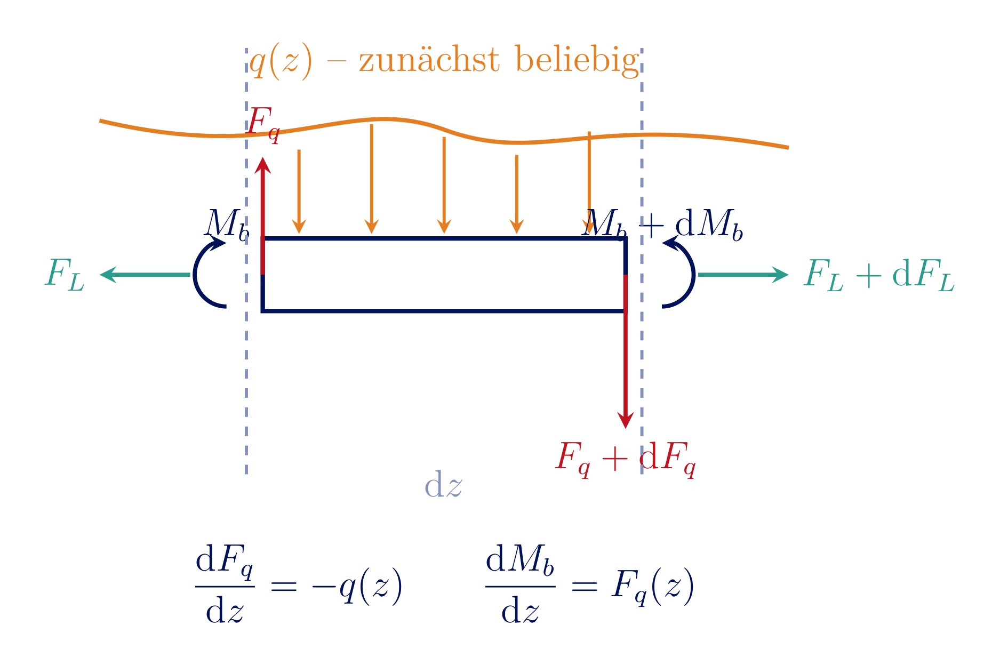
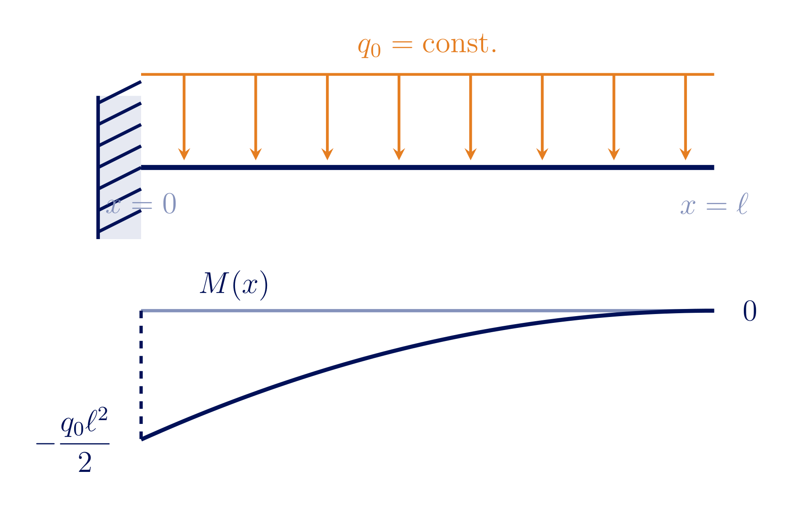
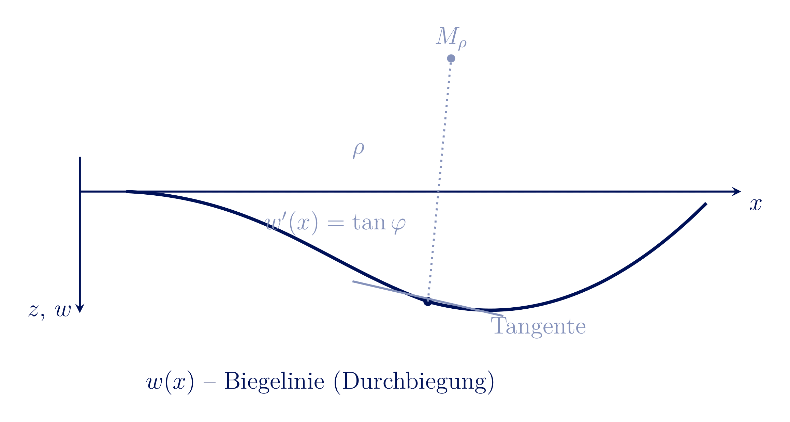
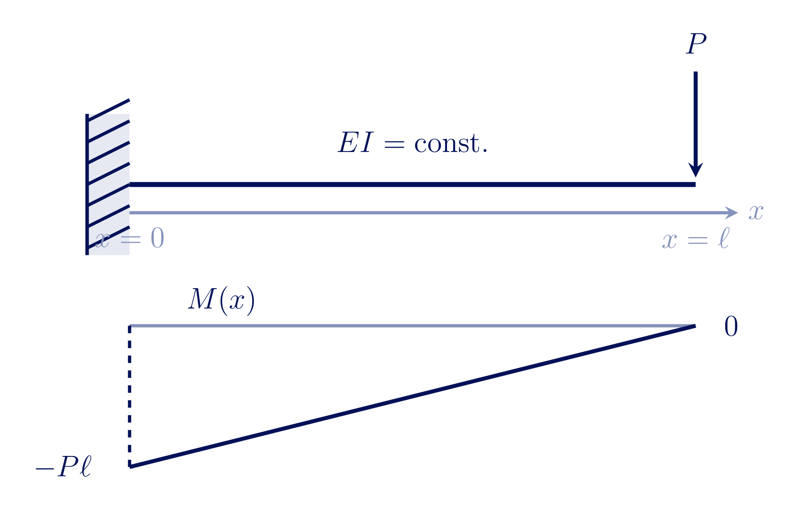
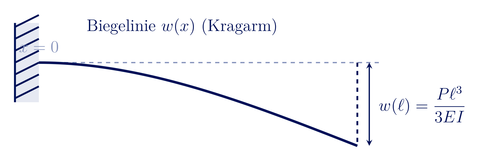
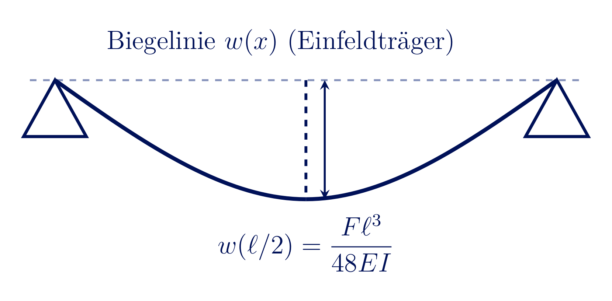

<!-- _class: lead -->
# Die Differentialgleichung der Biegelinie 2. Ordnung
## Herleitung, Lösung und Anwendung
Berufungsvorlesung - Professur Mechanik und experimentelle Mechanik

Prof. Dr.-Ing. Christian Willberg

---

## Überblick

- Warum interessiert uns die Durchbiegung eines Balkens?
- Geometrische Beschreibung: Krümmung und Biegelinie $w(x)$
- Von der exakten Krümmung zur technischen Biegelehre
- Herleitung der Differentialgleichung 2. Ordnung: $EI\,w''(x) = -M(x)$
- Rand- und Übergangsbedingungen
- Zwei vollständig durchgerechnete Beispiele
- Einordnung: Superposition, Grenzen, Ausblick

---

# Motivation

---

## Wiederholung: Was ist Steifigkeit?

- **Steifigkeit** $k$: Widerstand eines Bauteils gegen Verformung - $k = F/w$ (translatorisch) bzw. $M/\varphi$ (rotatorisch)
- Für den Biegebalken: $w \sim \dfrac{F\ell^3}{EI}$ $\Rightarrow$ Steifigkeit $k \sim \dfrac{EI}{\ell^3}$
- Drei **unabhängige** Auslegungskriterien für ein Bauteil:
  - **Festigkeit** - hält der Querschnitt der Spannung stand? ($\sigma \le \sigma_{zul}$)
  - **Ermüdung** - hält er den Lastwechseln auf Dauer stand? (Wöhlerlinie)
  - **Steifigkeit** - verformt er sich nicht zu stark? ($w \le w_{zul}$)
- Jedes der drei Kriterien kann für sich allein auslegungsbestimmend sein

---

## Beispiel 1: Windturbine

- Rotorblätter biegen sich unter Windlast zum Turm hin durch
- **Turmfreigang** (Tower Clearance) begrenzt die zulässige Durchbiegung
- Zu weiche Auslegung $\Rightarrow$ Kollisionsgefahr Blatt/Turm - unabhängig von Festigkeit des Blattes

<!-- _footer: 'Bild: Vinaceus, Wikimedia Commons (CC BY-SA 4.0)' -->

---

## Beispiel 2: Flugzeug U-2

- Höhenaufklärer U-2: extrem leichte, lange Tragflächen für große Flughöhen
- Flügel so biegeweich, dass er am Boden auf Stützrädern ("Pogo-Sticks") ruht
- Bewusste Auslegungsentscheidung - nicht durch Festigkeit, sondern durch Steifigkeit/Gewicht getrieben

<!-- _footer: 'Bild: US Air Force (PD) · u2egypt.brown.edu' -->

---

## Beispiel 3: Blattfeder

- Fahrzeugfederung: großer Federweg bei moderater Kraft
- Hier ist **geringe** Steifigkeit die gewünschte Funktion
- $\Rightarrow$ Steifigkeit ist in allen drei Fällen ein eigenständiges, von Festigkeit & Ermüdung unabhängiges Auslegungskriterium

<!-- _footer: 'Bild: Jim Gill, Wikimedia Commons (public domain)' -->

---

## Warum die Biegelinie? Quantitativ

- Durchbiegungen sind durch Normen begrenzt (z. B. $w_{max} \le \ell/300$ im Hochbau)
- Weitere Beispiele: Kranbahnträger, Werkzeugmaschinenwellen, Leiterplatten
- Frage: Wie groß ist $w(x)$ an jeder Stelle des Balkens - nicht nur der Maximalwert?

<!-- _footer: 'Diese Vorlesung: lineare Elastizität, kleine Verformungen, ebene Biegung' -->

---

<!-- _class: cols-2 -->
## Was wir schon kennen

Aus der Festigkeitslehre:

- Normalspannung bei Biegung: $\sigma(z,y) = \dfrac{M_b(z)}{I}\,y$
- Schnittgrößen $F_q(z)$ (Querkraft), $M_b(z)$ (Biegemoment)
- Gleichgewicht am Element: $\dfrac{dF_q}{dz} = -q(z)$, $\dfrac{dM_b}{dz} = F_q(z)$

**Neu heute:** wie hängt die Form der Biegelinie $w(z)$ mit $M_b(z)$ zusammen?

---

## Kleines Beispiel: Momentenverlauf

- Kragarm mit konstanter Streckenlast $q_0$
- Aus $\dfrac{dV}{dx}=-q_0$ (const.) $\Rightarrow$ $V(x)$ linear
- Aus $\dfrac{dM}{dx}=V(x)$ $\Rightarrow$ $M(x)$ quadratisch (Parabel)
- Maximalmoment an der Einspannung: $M(0) = -\dfrac{q_0\ell^2}{2}$

---

# Geometrische Grundlage: Krümmung

---

## Die Biegelinie $w(x)$

- $x$ - Balkenachse (unverformt)
- $w(x)$ - Durchbiegung in $z$-Richtung
- $w'(x) = \tan\varphi$ - Neigung der Tangente
- $\rho$ - Krümmungsradius an der Stelle $x$

---

## Exakte Krümmung

- Aus der Differentialgeometrie: $\rho = \dfrac{ds}{d\varphi}$
- Für die Biegelinie als Funktion $w(x)$:
$$\frac{1}{\rho} = \frac{w''(x)}{\left(1+w'(x)^2\right)^{3/2}}$$
- Exakt, aber nichtlinear in $w'$

---

## Technische Biegelehre: Linearisierung

- Annahme: **kleine Durchbiegungen**, $w'(x) \ll 1$ (typisch $< 5°$ Neigung)
- Dann: $1 + w'(x)^2 \approx 1$

$$\boxed{\frac{1}{\rho} \approx w''(x)}$$

- Diese Linearisierung ist der entscheidende Schritt der gesamten Theorie
- Grenze der Gültigkeit: große Durchbiegungen (z. B. sehr schlanke Stäbe) brauchen die nichtlineare Form

---

# Von der Krümmung zur Differentialgleichung

---

## Elastizitätsgesetz der Biegung

Aus der Balkentheorie (Navier-Bernoulli, ebene Querschnitte bleiben eben):

$$\frac{1}{\rho(x)} = \frac{M(x)}{EI}$$

- $E$ - Elastizitätsmodul, $I$ - Flächenträgheitsmoment des Querschnitts
- $EI$ - **Biegesteifigkeit**
- Große $M$ oder kleine $EI$ $\Rightarrow$ starke Krümmung

---

## Die Differentialgleichung der Biegelinie 2. Ordnung

Kombination von Geometrie und Werkstoffgesetz:

$$\frac{1}{\rho(x)} \approx w''(x) \qquad \text{und} \qquad \frac{1}{\rho(x)} = \frac{M(x)}{EI}$$

$$\boxed{EI\,w''(x) = -M(x)}$$

- Das Vorzeichen folgt aus der gewählten Koordinatenkonvention ($z$ nach unten, $M$ positiv wenn es die Biegelinie "nach oben" krümmt - hier: Minuszeichen bei $z$ nach unten)
- **2. Ordnung**, weil $M(x)$ bereits aus dem Gleichgewicht bekannt ist (statisch bestimmte Systeme)

---

## Einordnung: 2. vs. 4. Ordnung

- Differenziert man die Gleichung zweimal und nutzt $\dfrac{dM}{dx}=V$, $\dfrac{dV}{dx}=-q$:

$$EI\,w''''(x) = q(x)$$

| | 2. Ordnung | 4. Ordnung |
|:---|:---|:---|
| Ansatz | $EI\,w'' = -M(x)$ | $EI\,w'''' = q(x)$ |
| Voraussetzung | $M(x)$ bekannt | nur $q(x)$ nötig |
| Integrationskonstanten | 2 pro Bereich | 4 pro Bereich |
| typischer Einsatz | statisch bestimmt, $M(x)$ einfach | statisch unbestimmt, $q(x)$ gegeben |

**Heute:** wir nutzen die 2. Ordnung - $M(x)$ kennen wir aus dem Gleichgewicht.

---

# Lösungsmethode: Integration

---

## Zweifache Integration

$$EI\,w''(x) = -M(x)$$

1. Erste Integration: $EI\,w'(x) = -\int M(x)\,dx + C_1$ (Neigung)
2. Zweite Integration: $EI\,w(x) = -\int\!\!\int M(x)\,dx\,dx + C_1 x + C_2$ (Durchbiegung)

- Zwei Integrationskonstanten $C_1$, $C_2$ **pro Bereich** mit eigener $M(x)$-Funktion
- Bestimmung über **Randbedingungen** (an den Lagern) und **Übergangsbedingungen** (zwischen Bereichen)

---

## Randbedingungen an Lagern

- **Festlager / Loslager:** $w = 0$ (keine Durchbiegung)
- **Einspannung:** $w = 0$ **und** $w' = 0$ (keine Durchbiegung, keine Neigung)
- **Freies Ende:** $M = 0$ (und $V=0$, falls keine Einzellast)

---

## Übergangsbedingungen zwischen Bereichen

An einer Stelle, an der zwei Bereiche mit unterschiedlicher $M(x)$-Funktion aneinandertreffen (z. B. unter einer Einzellast):

- **Durchbiegung stetig:** $w_I(x_0) = w_{II}(x_0)$
- **Neigung stetig:** $w_I'(x_0) = w_{II}'(x_0)$

Der Balken "knickt" nicht und reißt nicht - die Biegelinie bleibt glatt.

---

# Beispiel 1: Der Kragarm

---

## Kragarm mit Einzellast am freien Ende

- Einspannung bei $x=0$, freies Ende bei $x=\ell$
- Einzellast $P$ am freien Ende
- Gesucht: $w(x)$, insbesondere $w(\ell)$

---

## Schritt 1: Momentenverlauf

Schnitt bei $x$, Betrachtung des rechten Teils (von $x$ bis $\ell$):

$$M(x) = -P\,(\ell - x)$$

- Bei $x=0$ (Einspannung): $M(0) = -P\ell$ (Maximalbetrag)
- Bei $x=\ell$ (freies Ende): $M(\ell) = 0$ ✓

---

## Schritt 2: Differentialgleichung lösen

$$EI\,w''(x) = -M(x) = P(\ell - x)$$

**1. Integration:**
$$EI\,w'(x) = P\left(\ell x - \frac{x^2}{2}\right) + C_1$$

**2. Integration:**
$$EI\,w(x) = P\left(\frac{\ell x^2}{2} - \frac{x^3}{6}\right) + C_1 x + C_2$$

---

## Schritt 3: Randbedingungen

Einspannung bei $x=0$: $w(0)=0$ und $w'(0)=0$

$$w'(0)=0 \;\Rightarrow\; C_1 = 0 \qquad\qquad w(0)=0 \;\Rightarrow\; C_2 = 0$$

**Ergebnis:**

$$w(x) = \frac{P}{EI}\left(\frac{\ell x^2}{2} - \frac{x^3}{6}\right)$$

$$\boxed{w(\ell) = \frac{P\ell^3}{3EI}}$$

Maximale Durchbiegung am freien Ende - der klassische Referenzwert.

---

## Biegelinie des Kragarms

- Waagerechte Tangente an der Einspannung ($w'(0)=0$)
- Monoton wachsende Durchbiegung bis zum freien Ende
- Maximum $w(\ell)=P\ell^3/3EI$ am freien Ende

---

# Beispiel 2: Der Einfeldträger

---

## Einfeldträger mit Einzellast in Feldmitte

- Loslager bei $x=0$, Festlager bei $x=\ell$
- Einzellast $F$ bei $x=\ell/2$
- Zwei Bereiche nötig: I ($0 \le x \le \ell/2$), II ($\ell/2 \le x \le \ell$)

---

## Schritt 1: Auflagerreaktionen und Momente

Symmetrie: $A = B = F/2$

$$M_I(x) = \frac{F}{2}\,x \qquad (0 \le x \le \ell/2)$$
$$M_{II}(x) = \frac{F}{2}\,x - F\left(x-\frac{\ell}{2}\right) = \frac{F}{2}(\ell - x) \qquad (\ell/2 \le x \le \ell)$$

Maximalmoment in Feldmitte: $M(\ell/2) = F\ell/4$

---

## Schritt 2: Integration in Bereich I

$$EI\,w_I''(x) = -\frac{F}{2}x$$

$$EI\,w_I'(x) = -\frac{F}{4}x^2 + C_1$$

$$EI\,w_I(x) = -\frac{F}{12}x^3 + C_1 x + C_2$$

Analog für Bereich II (mit $C_3$, $C_4$) - macht **vier** Unbekannte.

---

## Schritt 3: Rand- und Übergangsbedingungen

- $w_I(0) = 0$ (Loslager)
- $w_{II}(\ell) = 0$ (Festlager)
- $w_I(\ell/2) = w_{II}(\ell/2)$ (Durchbiegung stetig)
- $w_I'(\ell/2) = w_{II}'(\ell/2)$ (Neigung stetig)

Vier Gleichungen für vier Unbekannte $C_1,\dots,C_4$ - eindeutig lösbar.

---

## Ergebnis

Nach Einsetzen und Auflösen (Rechnung analog zu Beispiel 1, hier das Resultat):

$$w(x) = \frac{F x}{48\,EI}\left(3\ell^2 - 4x^2\right) \qquad (0 \le x \le \ell/2)$$

$$\boxed{w_{max} = w(\ell/2) = \frac{F\ell^3}{48\,EI}}$$

Zum Vergleich: der Kragarm ($w_{max}=P\ell^3/3EI$) ist bei gleicher Last/Spannweite **16-mal** weicher als der beidseitig gelagerte Träger.

---

## Biegelinie des Einfeldträgers

- Symmetrisch, Null an beiden Lagern
- Maximum in Feldmitte: $w(\ell/2)=F\ell^3/48EI$
- Deutlich flacher als beim Kragarm - 16-fach höhere Steifigkeit

---

# Einordnung und Ausblick

---

## Das Superpositionsprinzip

- Die Differentialgleichung ist **linear** in $w$ und $M$
- Mehrere Lasten gleichzeitig? Biegelinien einzeln berechnen und **addieren**
- In der Praxis: Tabellenwerke mit vorgelösten Standardfällen (Kragarm, Einfeldträger, Kraft/Streckenlast) statt jedes Mal neu zu integrieren

---

<!-- _class: cols-2 -->
## Grenzen der Theorie

- **Schubverformung** vernachlässigt (Euler-Bernoulli) - bei gedrungenen Balken (Timoshenko-Theorie nötig)
- **Kleine Verformungen** vorausgesetzt - bei großen Durchbiegungen nichtlineare Krümmung nötig
- **Lineare Elastizität** - keine Plastizität, kein Kriechen

Dennoch: die Grundlage für die allermeisten Auslegungsrechnungen im Maschinenbau - und direkter Ausgangspunkt für FEM-Balkenelemente.

---

## Ausblick: Statisch überbestimmte Systeme

- Bisher: statisch **bestimmte** Systeme - $M(x)$ folgt direkt aus dem Gleichgewicht, unabhängig von der Steifigkeit
- Statisch **überbestimmte** (unbestimmte) Systeme: mehr Lagerreaktionen als Gleichgewichtsbedingungen
  - Randbedingungen weiterhin bekannt ($w=0$, $w'=0$, ...) - aber $M(x)$ selbst hängt jetzt von der Steifigkeitsverteilung $EI(x)$ ab
  - Kraftgrößen-/Verformungsmethoden lösen kleine Systeme noch analytisch, werden aber schnell unübersichtlich
- Für komplexe Geometrien, Randbedingungen und Lastfälle: **numerische Methoden** (FEM) - direkte Erweiterung der hier gezeigten Balkentheorie

---

## Zusammenfassung

- Krümmung $\dfrac{1}{\rho}\approx w''(x)$ + Werkstoffgesetz $\dfrac{1}{\rho}=\dfrac{M}{EI}$ $\Rightarrow$ $EI\,w''=-M(x)$
- Lösung durch zweifache Integration, Konstanten aus Rand-/Übergangsbedingungen
- Kragarm: $w_{max}=P\ell^3/3EI$ - Einfeldträger: $w_{max}=F\ell^3/48EI$
- Grundlage für Superposition, Tabellenwerke und FEM-Balkenelemente

---

<!-- _class: lead -->
# Vielen Dank für Ihre Aufmerksamkeit

## Fragen und Diskussion
