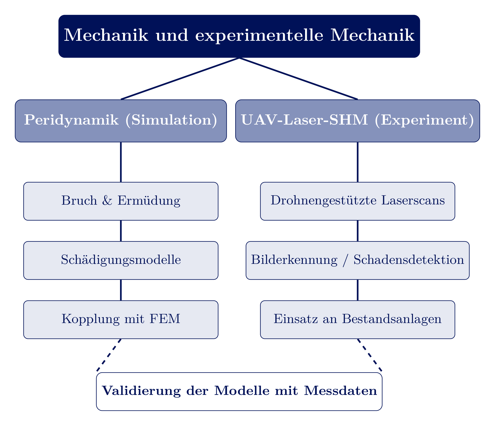
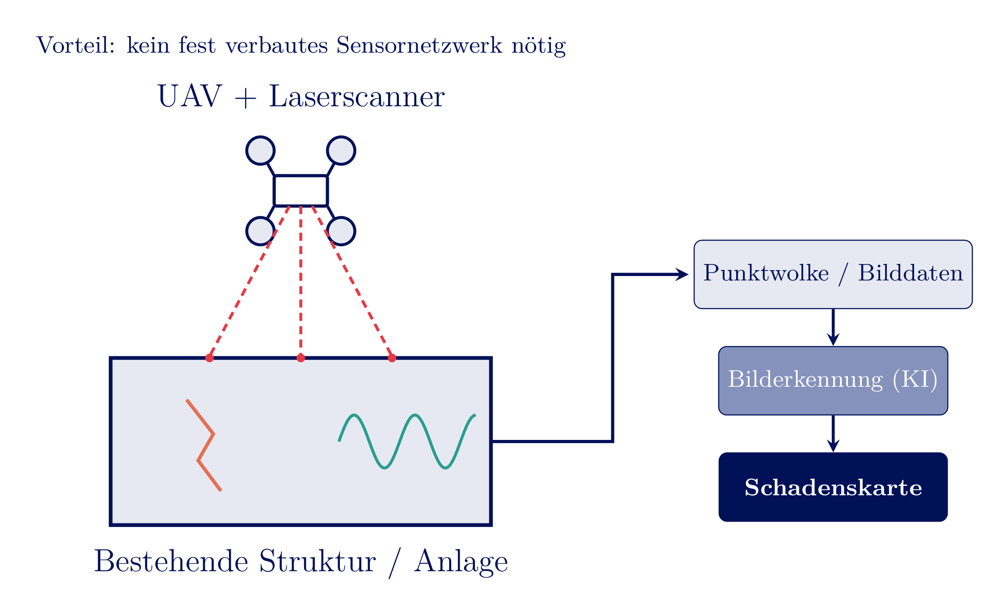
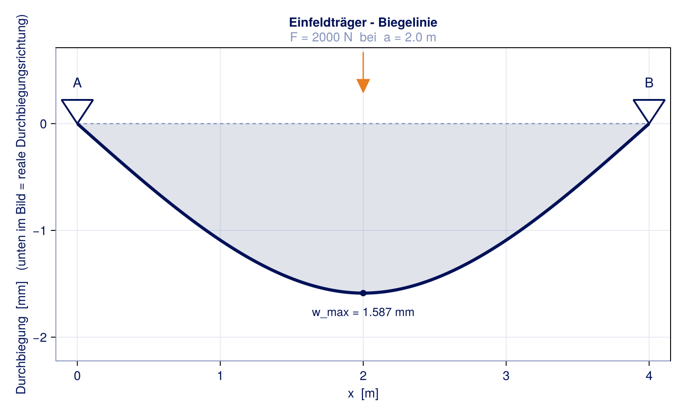

<!-- _class: lead -->
# Forschungs- und Lehrkonzept
## Mechanik und experimentelle Mechanik

Prof. Dr.-Ing.  Christian Willberg
28.10.2026

Jetzt selbst ausprobieren: perihub.nimbus-extern.dlr.de

---

# Forschungskonzept

- **Simulation** (Peridynamik) sagt voraus, wie und wo Schäden entstehen und sich ausbreiten
- **Experiment** messen, wo Schäden tatsächlich sind - auch an bestehenden Anlagen; Verständnis wie sie wirken
- **Daten & Digitalisierung** verbinden beide Seiten strukturiert - Grundlage für Validierung und KI-Modelle

---

## Peridynamik

- Peridynamik: **nichtlokal** über einen Horizont $\delta$ - Risse entstehen, wo es die Physik vorgibt, statt vordefinierter Risspfade
- Simulation mit Open-Source-Code **PeriLab.jl** (DLR/PeriHub), validiert an eigenen Experimenten
- Bereits im industriellen Einsatz (additive Fertigung, Partner SWMS Systemtechnik)

perihub.nimbus-extern.dlr.de

---

## PeriHub: Modellbau & Plattform

<iframe src="https://perihub.nimbus-extern.dlr.de/" width="1150" height="600"></iframe>

- Modelle werden direkt in der Plattform aufgebaut, parametrisiert und simuliert
- Ergebnisse, Modelle und Metadaten liegen zentral und FAIR-strukturiert vor

---

<!-- _class: cols-2 -->
## Peridynamik: ein interdisziplinäres Forschungsfeld

**Mechanik & Numerik**
*Computer Methods in Appl. Mech. and Eng., J. of the Mechanics and Physics of Solids, Engineering Fracture Mechanics*

**Luft- und Raumfahrt**
*CEAS Aeronautical Journal, Chinese Journal of Aeronautics*

**Werkstoffe & Verbunde**
*Composites Part B: Engineering, Composites Science and Technology*

**Geotechnik**
*Acta Geotechnica, Géotechnique*

**Elektrochemie & Korrosion**
*Corrosion Science, Electrochimica Acta*

**Software**
*SoftwareX*

<!-- _footer: 'Auswahl aus eigener Literaturdatenbank (>560 Journalartikel zur Peridynamik)' -->

---

<!-- _class: cols-2 -->
## Säule 2: Structural Health Monitoring

- **Beispiel: geführte Wellen** - Wellenausbreitung in Simulation (EFIT) und FEM, validiert an Messdaten
- Klassisches SHM (feste Sensoren) nur in Neubauten wirtschaftlich nachrüstbar
- Unser Ansatz: **UAV-gestützte Lasermessung** - berührungslos, retrofit-fähig an Bestandsanlagen
- Offene Fragen: Auflösung vs. Schadensgröße, Flugbahnplanung, Datenfusion

<!-- _footer: 'Wellenbild: Lefèvre, Savli, Willberg, Tschöke, ICCBMA 2022' -->

---

## Die Synergie: digitaler Zwilling

- Peridynamik-Prognosen brauchen Validierung - UAV-Laserscans liefern genau diese Referenzdaten an echten Strukturen
- Beide Datenströme werden über **PeriLab/PeriHub** mit einheitlichen Metadaten (FAIR) strukturiert abgelegt - Grundlage für verlässliche KI-/Surrogatmodelle

$$\text{Simulation} \;\longleftrightarrow\; \text{Messung} \;\xrightarrow{\text{Metadaten}}\; \text{digitaler Zwilling}$$

---

## Anwendungsfeld und Förderung

- **Flugwindanlagen** (Airborne Wind Energy, hier: Enerkite): leichte, hochdynamisch belastete Strukturen - Profil beider Säulen
- Aktiv in **IEA Wind Task 48** - WP1-Leiter **"Material and Manufacturing"**
- **Drittmittel:** DFG-Einzelförderung (Peridynamik), Förderlinien für SHM-Entwicklung

<!-- _footer: 'Bild: Enerkite GmbH' -->

---

## Industrietransfer

- Viele DLR-Projekte in enger Zusammenarbeit mit der Industrie
- Aktuell: **Kommerzialisierung von PeriLab** - vom Open-Source-Forschungscode zum Industrieprodukt

---

# Lehrkonzept

---

## Lehrphilosophie: dieselbe Verbindung wie in der Forschung

- Modellbildung **und** Messpraxis gehören zusammen - keine Trennung von Theorie und Experiment
- Visuelle, schrittweise Herleitung statt Formel-Dump: jede Vorlesung mit eigens erstellten Grafiken zur Veranschaulichung
- Materialien offen zugänglich (GitHub Pages) - nachschlagbar über das Semester hinaus

---

## Digitale, interaktive Werkzeuge

- Interaktive Pluto.jl-Notebooks: Studierende verändern Parameter per Schieberegler, Ergebnis aktualisiert sich live
- Beispiel: Einfeldträger-Biegelinie - Kraft und Lastposition frei wählbar, Herleitung im Code nachvollziehbar
- Software-Analysen mit Metadaten verknüpft, strukturierte Daten als Basis für spätere KI-Anbindung

---

## Lehrportfolio

- Technische Mechanik (u.a. Biegelinie, Festigkeitslehre)
- Faserverbundwerkstoffe (Bachelor- und Seminar-Module)
- Bruchmechanik, Ermüdung und Peridynamik
- Durchgängig über mehrere Semester des Maschinenbau-Bachelors

---

## Lehrkonzept an der Professur Mittweida

- Dieselbe Verzahnung Simulation/Experiment, die die Forschungsstrategie trägt, auch in der Lehre verankern
- Abschlussarbeiten an der Schnittstelle Simulation/Experiment - Studierende direkt in laufende Projekte einbinden
- Ziel: Studierende, die beide Seiten der Mechanik - Modell und Messung - sicher beherrschen

---

## Zusammenfassung

- **Forschung:** zwei komplementäre Säulen (Peridynamik-Simulation, UAV-Laser-SHM), verbunden durch strukturierte, FAIR-Daten zum digitalen Zwilling
- **Lehre:** dieselbe Verzahnung von Modellbildung und Messpraxis, vermittelt mit visuellen, interaktiven Werkzeugen
- Beides passt direkt auf die Professur **"Angewandte und Experimentelle Mechanik"**

---

<!-- _class: lead -->
# Vielen Dank für Ihre Aufmerksamkeit

## Fragen und Diskussion
