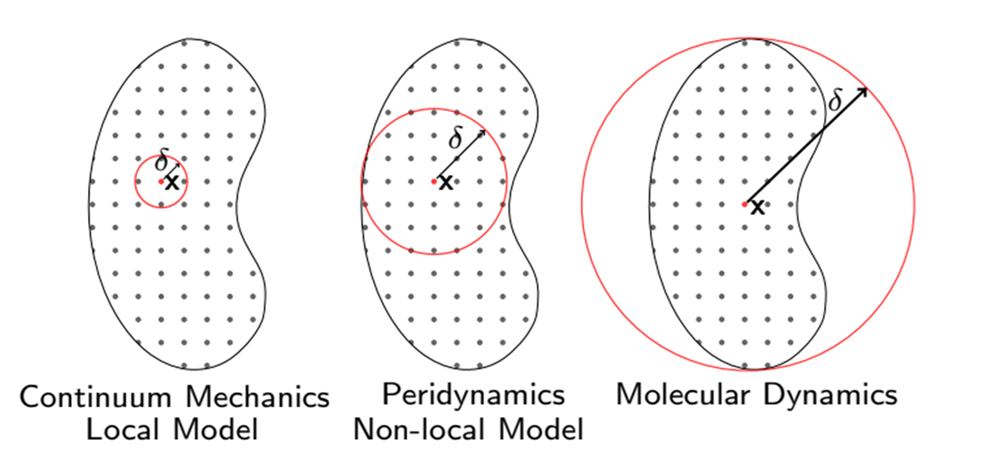
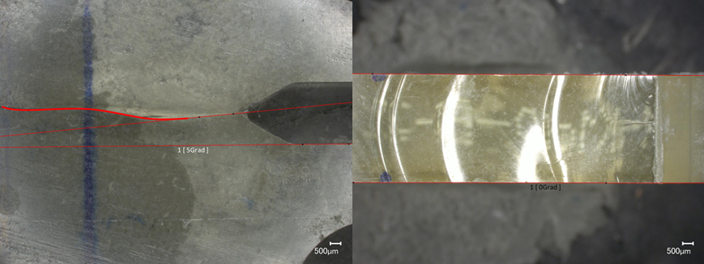
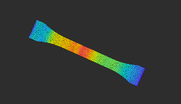
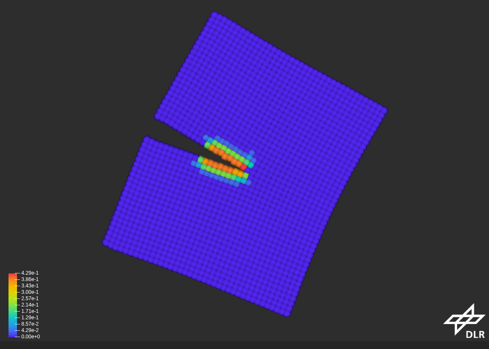
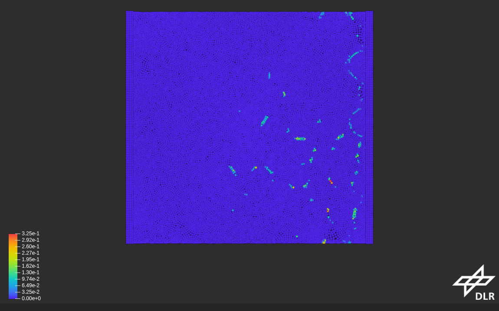
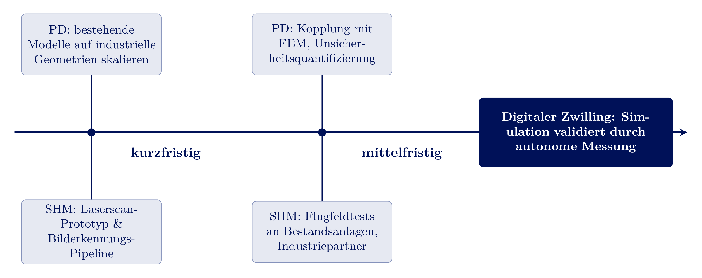

<!-- _class: lead -->
# Forschungsstrategie
## Mechanik und experimentelle Mechanik

Prof. Dr.-Ing. Christian Willberg
28.10.2026

Jetzt selbst ausprobieren: perihub.nimbus-extern.dlr.de

---

# Zwei Säulen

- **Simulation** (Peridynamik) sagt voraus, wie und wo Schäden entstehen und sich ausbreiten
- **Experiment** (SHM) misst, wo Schäden tatsächlich sind - auch an bestehenden Anlagen
- Beide Säulen validieren und schärfen sich gegenseitig

---

# Säule 1: Peridynamik

- Kontinuumsmechanik: **lokal**, braucht vordefinierte Risspfade oder Remeshing
- Peridynamik: **nichtlokal** über einen Horizont $\delta$ - Risse entstehen, wo es die Physik vorgibt
- Schwerpunkt bisher: Bruch- und Ermüdungsverhalten, Schädigungsmodelle, numerische Umsetzung

---

## Validierung an realen Bauteilen

- Simulationen werden gegen eigene Experimente validiert (hier: Rissflächen in PMMA, Mikroskopaufnahmen)
- Open-Source-Code **PeriLab.jl** (DLR / PeriHub) als gemeinsame, offene Software-Basis
- Ergebnisse und Beispielmodelle sind öffentlich einsehbar 

---

<!-- _class: cols-2 -->
## Stand und nächste Schritte

**Bereits etabliert:**
- Schädigungsmodelle für Bruch & Ermüdung
- Numerische Umsetzung und Validierung an Testfällen

**Nächste Schritte:**
- Skalierung auf industrielle Geometrien
- Kopplung mit FEM (Rechenzeit, Hybridmodelle)
- Unsicherheitsquantifizierung

Ziel: Peridynamik von der akademischen Validierung zu einem **einsetzbaren Werkzeug** für reale Bauteile weiterentwickeln.

---

## PeriLab in Aktion: Beispielergebnisse

  <figure style="text-align:center; margin:0;">
    
    <figcaption><b>Dogbone</b> von-Mises-Spannung</figcaption>
  </figure>
  <figure style="text-align:center; margin:0;">
    
    <figcaption><b>DCB</b> Delamination (Damage)</figcaption>
  </figure>
  <figure style="text-align:center; margin:0;">
    
    <figcaption><b>RVE</b> Mikroschädigung</figcaption>
  </figure>

- Farbskala jeweils variablenspezifisch (Spannung, Schädigung)
- Alle Ergebnisse live und interaktiv im Browser einsehbar (nächste Folie)

---

## Software & Demonstrationen (PeriLab)

<!-- _class: cols-2 -->

- Open-Source-Code: [github.com/PeriHub/PeriLab.jl](https://github.com/PeriHub/PeriLab.jl)
- Video-Kanal: [youtube.com/@PeriHub](https://www.youtube.com/@PeriHub/videos)
  - *3D Printed Dogbone - Additive-Manufacturing Stress Analysis*
  - *Fragmenting Cylinder*
- Interaktive Beispielmodelle (live, im Browser):
  [Dogbone](https://perilab-results.nimbus-extern.dlr.de/models/Dogbone), [DCB](https://perilab-results.nimbus-extern.dlr.de/models/DCB), [RVE](https://perilab-results.nimbus-extern.dlr.de/models/RVE), [Additive](https://perilab-results.nimbus-extern.dlr.de/models/Additive)

<iframe src="https://perihub.nimbus-extern.dlr.de/" title="PeriHub (live)" style="width:100%; height:360px; border:1px solid #8592bc; border-radius:6px;"></iframe>

<!-- _footer: 'Auf Wunsch: Live-Demonstration direkt im Browser' -->

---

## Von der Forschung in die Industrie: Additive Fertigung

- PeriLab simuliert native additive Fertigungsprozesse (Schichtaufbau, Temperaturfeld - siehe Demo-Folie)
- Bereits im aktiven industriellen Einsatz: **SWMS Systemtechnik Ingenieurgesellschaft mbH**, Partner auf der PeriLab-Projektseite, u.a. in Forschungsprojekten zur additiven Fertigung
- Zeigt den Übergang von akademischer Validierung zum einsetzbaren Industrie-Werkzeug

---

# Säule 2: Experimentelle Mechanik - Structural Health Monitoring

Bilder und videos zur wellenausbreitung
simulation + system

bild für strukturierte Datenablage -> Digitalisierung
Bild aus antrittsvolesung rein
 KI anlernen. Metadaten wichtig

---

## Das Problem klassischer Structural Health Monitoring (SHM)

- Klassisches SHM: fest verbautes Sensornetzwerk (Dehnmessstreifen, piezoelektrische Sensoren, Glasfasern)
- Nachteile: aufwendige Auslegung, feste Verkabelung, **nur in Neubauten wirtschaftlich** nachrüstbar
- Frage: Wie überwacht man **bestehende** Anlagen, ohne sie umzubauen?

---

## Idee: UAV-gestützte Lasermessung

- Drohne mit Laserscanner tastet die Oberfläche berührungslos ab
- Punktwolken-/Bilddaten werden per Bilderkennung auf Schäden ausgewertet
- Kein fest installiertes Sensornetzwerk nötig
- Einsetzbar an **bestehenden** Anlagen - Inspektion statt Neubau

---

## Vorteile dieses Ansatzes

- **Keine Sensorplanung:** keine vorab festgelegten Messpunkte, keine Verkabelung
- **Retrofit-fähig:** funktioniert an Bestandsanlagen (Brücken, Industrieanlagen, Rotorblätter)
- **Flexibel:** Fluggebiet und Auflösung pro Inspektion anpassbar
- **Skalierbar:** Bilderkennung automatisiert die Auswertung großer Datenmengen

**Offene Forschungsfragen:** Auflösung vs. Schadensgröße, Flugbahnplanung, Datenfusion, Validierung gegen bekannte Referenzschäden

---

# Die Synergie

---

## Simulation trifft Experiment

- Peridynamik-Modelle sagen Schädigungsentwicklung voraus - aber jedes Modell braucht **Validierung**
- Die UAV-Laserscans liefern genau diese Referenzdaten - gemessen an echten, auch historisch gewachsenen Strukturen
- Umgekehrt: erkannte Schäden aus den Scans lassen sich mit Peridynamik-Simulationen erklären und fortschreiben (Restlebensdauer)

$$\text{Simulation (PD)} \;\;\longleftrightarrow\;\; \text{Messung (UAV-Laser-SHM)}$$

**Langfristige Vision:** ein digitaler Zwilling, dessen Schädigungszustand kontinuierlich durch autonome Messung aktualisiert wird.

---

## Anwendungsfeld: Flugwindanlagen (Airborne Wind Energy)

- Flugwindanlagen (Kites/Tragflächen am Seil statt Turm): leichte, hochdynamisch belastete Faserverbund- und Membranstrukturen
- Genau das Profil beider Säulen: Ermüdung & Schädigung (Peridynamik) und Zustandsüberwachung (UAV-Laser-SHM)
- Aktive Mitarbeit: **IEA Wind Task 48** (Airborne Wind Energy), Arbeitspaket **WP1 - Materials and Manufacturing**

---

## Forschungs-Roadmap

Kurzfristig, mittelfristig, langfristig - entlang beider Säulen, mit dem digitalen Zwilling als gemeinsamem Zielbild:

---

---

<!-- _class: cols-2 -->
## Anbindung an die Lehre

- Peridynamik und Bruchmechanik sind bereits in bestehenden Modulen verankert (FractureFatigue, Peridynamics)
- Neue experimentelle Inhalte (SHM, Messtechnik, Bildverarbeitung) ergänzen das Profil "Mechanik und experimentelle Mechanik" konsequent
- Abschlussarbeiten an der Schnittstelle Simulation/Experiment

Studierende lernen beide Seiten: Modellbildung **und** Messpraxis - keine Trennung von Theorie und Experiment.

---

## Kooperationen und Förderung

- **Industriepartner:** Zugang zu Bestandsanlagen für Flugfeldtests, Praxisrelevanz der Schadensszenarien
- **Drittmittel:** DFG-Einzelförderung (Grundlagenforschung Peridynamik), anwendungsnahe Förderlinien für die SHM-Entwicklung
- **Vernetzung:** bestehende Kontakte aus der Peridynamik-Community, neue Partnerschaften im Bereich UAV/Messtechnik

---

## Zusammenfassung

- Zwei komplementäre Säulen: **Peridynamik** (Simulation) und **UAV-Laser-SHM** (Experiment)
- Beide bauen auf vorhandener Expertise auf und erschließen neue Anwendungsfelder
- Die Verbindung beider Säulen - Validierung, digitaler Zwilling - ist das Alleinstellungsmerkmal dieser Forschungsstrategie
- Passt direkt auf die Professur "Mechanik und experimentelle Mechanik"

---

<!-- _class: lead -->
# Vielen Dank für Ihre Aufmerksamkeit

## Fragen und Diskussion
