## Angewandte und experimentelle Mechanik
<!-- _class: lead -->

Prof. Dr.-Ing. Christian Willberg
28.10.2026

---

## Werdegang

- 2001-2007 Studium Maschinenbau, Otto-von-Guericke-Universität Magdeburg
- 2007-2012 Wissenschaftlicher Mitarbeiter, Otto-von-Guericke-Universität Magdeburg
- 2012 Promotion zum Dr.-Ing.
- 2012-2024 Wissenschaftlicher Mitarbeiter, DLR Braunschweig (Institut für Faserverbundleichtbau und Adaptronik)
- Forschungsaufenthalte im Ausland: 2016 University of Washington, Seattle (USA); 2025 German Jordanian University (GJU)
- seit 2024 Professur, Hochschule Magdeburg-Stendal - zugleich Internationalisierungsbeauftragter des Fachbereichs

---
## Arbeiten am DLR
- Entwicklung und Validierung numerischer Verfahren
- Optimierung von Windenergierotorblättern
- Simulation von additiver Fertigung
- Bewertung von Faserverbunden

**Highlights**
EU Projekt DEMETER
Prüfung eines Windrotorblatts
Grundlagen Peridynamik
...

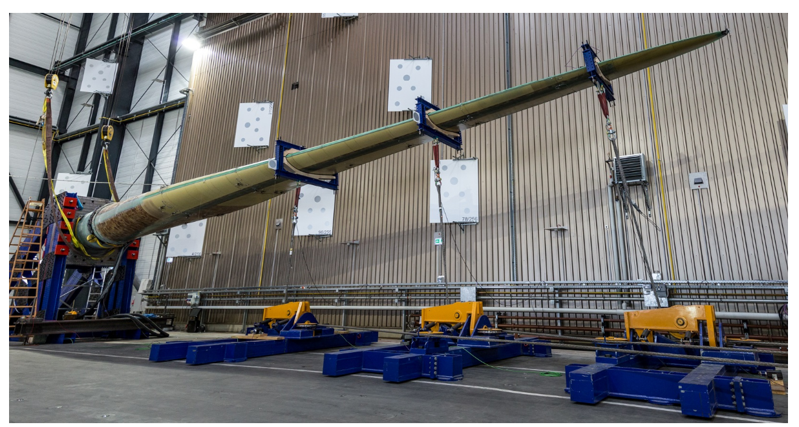

---

## Arbeiten an der H2

- Fokus auf Lehre
- Entwicklung von PD Code PeriLab
- Forschung im Bereich Datenprovenienz (Projekt Insect Care)

## Wissenschaftliches Engagement

- Associate Editor, **SoftwareX** (Elsevier)
- Gutachter für die Österreichische Forschungsförderungsgesellschaft mbH (FFG)
- Mitglied bei der DGZfP und GAMM
- Gutachter in Acta Mechanica, SoftwareX, Wave Motion, ...

---

## Simulation und Experiment

- Am DLR: Simulation **und** experimentelle Validierung - nie nur eine Seite
- Seit 2024 in der Lehre: dieselbe Verbindung weitergegeben
- Die Professur **"Angewandte und Experimentelle Mechanik"** ist die konsequente Fortsetzung dieses Weges

---

## Fragen

---

<!-- header: 'Berufungsvorlesung - Die Biegelinie 2. Ordnung' -->

<!-- _class: lead -->
# Lehrprobe

## Die Differentialgleichung der Biegelinie 2. Ordnung

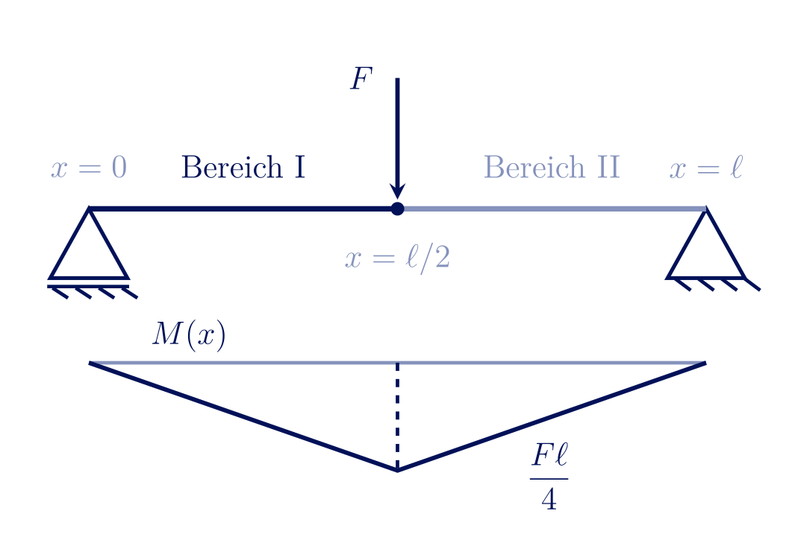

---

## Auslegung eines Bauteils

- bisher Momentenverläufe und daraus abgeleitet Spannungen und Dehnungen
- Fokus auf Materialversagen und Bewertung nach Festigkeit
- **immer** für das statisch bestimmte System

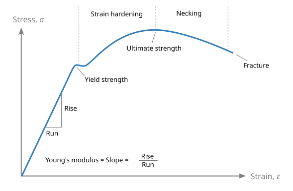

---

# Warum interessiert uns die Durchbiegung eines Balkens?

---

## Beispiel 1: Windturbine

- Rotorblätter biegen sich unter Windlast zum Turm hin durch
- **Turmfreigang** (Tower Clearance) begrenzt die zulässige Durchbiegung
- Zu weiche Auslegung $\Rightarrow$ Kollisionsgefahr Blatt/Turm - unabhängig von Festigkeit des Blattes

<!-- _footer: 'Bild: Vinaceus, Wikimedia Commons (CC BY-SA 4.0)' -->

---

## Beispiel 2: Blattfeder

- Fahrzeugfederung: großer Federweg bei moderater Kraft
- Hier ist **geringe** Steifigkeit die gewünschte Funktion
- $\Rightarrow$ Steifigkeit ist in allen drei Fällen ein eigenständiges, von Festigkeit & Ermüdung unabhängiges Auslegungskriterium

<!-- _footer: 'Bild: Jim Gill, Wikimedia Commons (public domain)' -->

---

## Warum die Biegelinie? Quantitativ

- Durchbiegungen sind beispielsweise durch Normen begrenzt 
- Funktionen werden durch Durchbiegung beeinträchtigt 
- Frage: Wie groß ist $w(x)$ an jeder Stelle des Balkens - nicht nur der Maximalwert?

<!-- _footer: 'Diese Vorlesung: lineare Elastizität, kleine Verformungen, ebene Biegung' -->

---

## Verformung im 1D-Fall: Zugstab

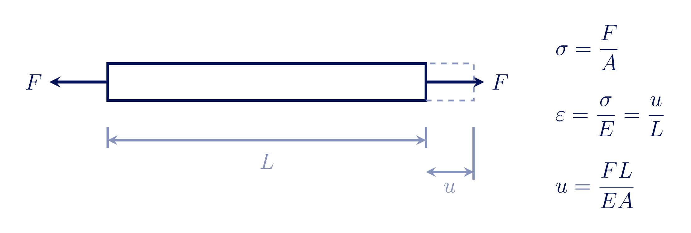

- Kraft $F$, Querschnittsfläche $A$ $\Rightarrow$ Spannung $\sigma = F/A$
- Hookesches Gesetz: $\varepsilon = \sigma/E$
- Verlängerung: $u = \varepsilon L = \dfrac{FL}{EA}$

---

<!-- _class: cols-2 -->
## Was ist der Unterschied beim Balken?

- Beim Balken wirkt am Querschnitt ein **Biegemoment** $M(x)$ statt nur einer Normalkraft
- Schnittgrößen: $F_q(x)$ (Querkraft), $M_b(x)$ (Biegemoment)
- Gleichgewicht am Element: 
$\dfrac{dF_q}{dx} = -q(x) \qquad\dfrac{dM_b}{dx} = F_q(x)$
- Die Biegespannung und Dehnung ist **nicht** konstant über den Querschnitt$\sigma(x,z)$

$$\sigma(x,z) = \frac{M_b(x)}{I}\,z$$

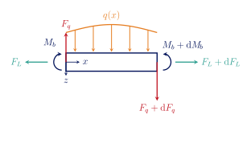

---

## Die Biegelinie $w(x)$

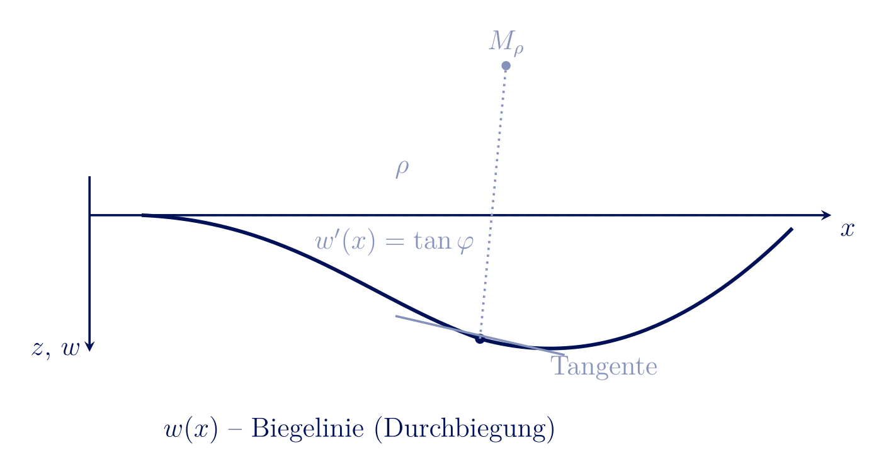

- Beim Balken variiert die Dehnung über $z$ $\Rightarrow$ der Balken **krümmt sich**
- $x$ - Balkenachse (unverformt), $w(x)$ - Durchbiegung in $z$-Richtung
- $w'(x) = \tan\varphi$ - Neigung der Tangente, $\rho$ - Krümmungsradius an der Stelle $x$

---

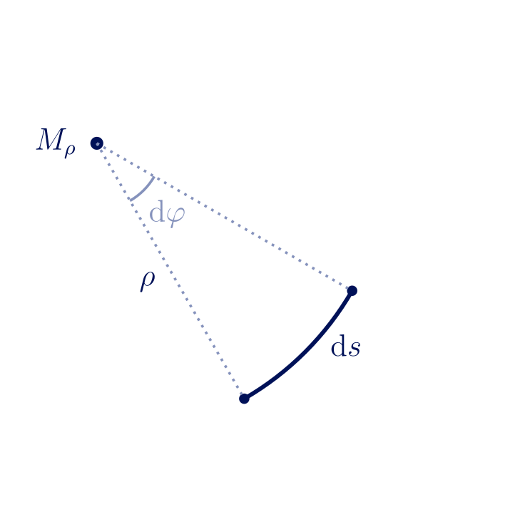

**Krümmung**
$$\rho = \dfrac{ds}{d\varphi}$$

**Biegelinie als Funktion $w(x)$**
$$\frac{1}{\rho} = \frac{w''(x)}{\left(1+w'(x)^2\right)^{3/2}}$$
Annahme: **kleine Durchbiegungen** $w'(x) \ll 1$ (typisch $< 5°$ Neigung)
$\rightarrow 1 + w'(x)^2 \approx 1$

$$\boxed{\frac{1}{\rho} \approx w''(x)}$$

---

## Spannungsverteilung über die Querschnittshöhe

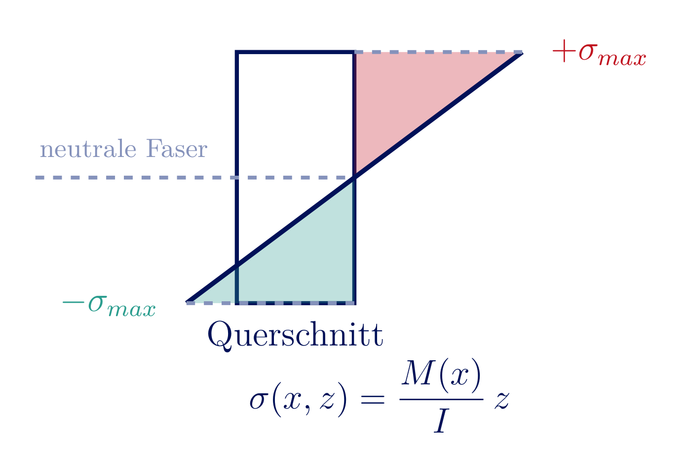

- An jeder Stelle $x$: Spannung linear über $z$, Null an der neutralen Faser
- Zug auf der einen Seite, Druck auf der anderen

---

## Elastizitätsgesetz der Biegung

Drei bekannte Zutaten zusammenführen:

1. **Biegespannung**: $\sigma(x,z) = \dfrac{M_b(x)}{I}\,z$
2. **Hookesches Gesetz:** $\varepsilon = \dfrac{\sigma}{E}$ $\;\Rightarrow\;$ $\varepsilon(x,z) = \dfrac{M_b(x)}{EI}\,z$
3. **Geometrie** (vorige Folie): $\varepsilon(x,z) = \dfrac{z}{\rho(x)}$

Gleichsetzen von (2) und (3):

$$\frac{M_b(x)}{EI}\,z = \frac{z}{\rho(x)} \quad\Rightarrow\quad \boxed{\frac{1}{\rho(x)} = \frac{M_b(x)}{EI}}$$

---

## Die Differentialgleichung der Biegelinie 2. Ordnung

Kombination von Geometrie und Werkstoffgesetz:

$$\frac{1}{\rho(x)} \approx w''(x) \qquad \text{und} \qquad \frac{1}{\rho(x)} = \frac{M_b(x)}{EI}$$

$$\boxed{EI\,w''(x) = -M_b(x)}$$

Das Vorzeichen folgt aus der gewählten Koordinatenkonvention ($z$ nach unten, $M_b$ positiv wenn es die Biegelinie "nach oben" krümmt - hier: Minuszeichen bei $z$ nach unten) $\rightarrow$ $w(x)$ positiv in $z$ für positive $M_b$

---

## Zweifache Integration

$$EI\,w''(x) = -M_b(x)$$

1. Erste Integration: $EI\,w'(x) = -\int M_b(x)\,dx + C_1$ (Neigung)
2. Zweite Integration: $EI\,w(x) = -\int\!\!\int M_b(x)\,dx\,dx + C_1 x + C_2$ (Durchbiegung)

- Zwei Integrationskonstanten $C_1$, $C_2$ **pro Bereich** mit eigener $M_b(x)$-Funktion
- Bestimmung über **Randbedingungen** (an den Lagern) und **Übergangsbedingungen** (zwischen Bereichen)

---

# Beispiel: Der Einfeldträger

---

## Einfeldträger mit Einzellast in Feldmitte

- Loslager bei $x=0$, Festlager bei $x=\ell$
- Einzellast $F$ bei $x=\ell/2$
- Zwei Bereiche nötig: I ($0 \le x \le \ell/2$), II ($\ell/2 \le x \le \ell$)
- Randbedingungen an den Lagern **und** Übergangsbedingungen am Lastangriffspunkt $x=\ell/2$ nötig

---

## Schritt 1: Auflagerreaktionen und Momente

Symmetrie: $A = B = F/2$

$$M_I(x) = \frac{F}{2}\,x \qquad (0 \le x \le \ell/2)$$
$$M_{II}(x) = \frac{F}{2}(\ell - x) \qquad (\ell/2 \le x \le \ell)$$

Maximalmoment in Feldmitte: $M(\ell/2) = F\ell/4$

---

## Lösung: zwei Bereiche, vier Bedingungen

- Integration in **beiden** Bereichen $\Rightarrow$ vier Integrationskonstanten $C_1,\dots,C_4$ (zweifache Integration, s.o.)
- Bestimmt aus $w_I(0)=0$, $w_{II}(\ell)=0$ (Lager) sowie $w_I(\ell/2)=w_{II}(\ell/2)$, $w_I'(\ell/2)=w_{II}'(\ell/2)$ (Stetigkeit am Übergang)

**Ergebnis:**

$$w(x) = \frac{F x}{48\,EI}\left(3\ell^2 - 4x^2\right) \qquad (0 \le x \le \ell/2)$$

$$\boxed{w_{max} = w(\ell/2) = \frac{F\ell^3}{48\,EI}}$$

Beide Bereiche liefern an der Lastposition $x=\ell/2$ denselben Wert und dieselbe Steigung - die Übergangsbedingungen sind erfüllt.

---

## Biegelinie des Einfeldträgers
<iframe src="http://localhost:1234/edit?id=b36a1260-d211-11f1-a8b5-bb277f7ab7c6" width="1150" height="500"></iframe>

---

## Zusammenfassung und Grenzen der Theorie

- Krümmung $\dfrac{1}{\rho}\approx w''(x)$ + Werkstoffgesetz $\dfrac{1}{\rho}=\dfrac{M}{EI}$ $\Rightarrow$ $\boxed{EI\,w''=-M(x)}$
- Lösung durch zweifache Integration, Konstanten aus Rand-/Übergangsbedingungen
- **Schubverformung** vernachlässigt (Euler-Bernoulli) - bei gedrungenen Balken (Timoshenko-Theorie nötig)
- **Kleine Verformungen** vorausgesetzt - bei großen Durchbiegungen nichtlineare Krümmung nötig
- **Lineare Elastizität** - keine Plastizität, kein Kriechen

---

## Fragen

---

<!-- header: 'Berufungsvorlesung - Forschungs- und Lehrkonzept' -->

<!-- _class: lead -->
## Forschungs- und Lehrkonzept

Prof. Dr.-Ing.  Christian Willberg
28.10.2026

---

# Forschungskonzept

- **Simulation** (Peridynamik) sagt voraus, wie und wo Schäden entstehen und sich ausbreiten
- **Experiment** messen, wo Schäden tatsächlich sind - auch an bestehenden Anlagen; Verständnis wie sie wirken
- **Daten & Digitalisierung** verbinden beide Seiten strukturiert - Grundlage für Validierung und KI-Modelle

---

## Peridynamik

- Peridynamik: **nichtlokal** über einen Horizont $\delta$ - Risse entstehen, wo es die Physik vorgibt, statt vordefinierter Risspfade
- Simulation mit Open-Source-Code **PeriLab.jl** (DLR/PeriHub), validiert an eigenen Experimenten
- Bereits im industriellen Einsatz (additive Fertigung, Partner SWMS Systemtechnik)

---

## PeriHub: Modellbau & Plattform

<iframe src="https://perihub.nimbus-extern.dlr.de/" width="800" height="500"></iframe>

Jetzt selbst ausprobieren: perihub.nimbus-extern.dlr.de

---

<!-- _class: cols-2 -->
## Peridynamik: ein interdisziplinäres Forschungsfeld

**Mechanik & Numerik**
*Computer Methods in Appl. Mech. and Eng., J. of the Mechanics and Physics of Solids, Engineering Fracture Mechanics*

**Luft- und Raumfahrt**
*CEAS Aeronautical Journal, Chinese Journal of Aeronautics*

**Werkstoffe & Verbunde**
*Composites Part B: Engineering, Composites Science and Technology*

**Geotechnik**
*Acta Geotechnica, Géotechnique*

**Elektrochemie & Korrosion**
*Corrosion Science, Electrochimica Acta*

**Software**
*SoftwareX*

<!-- _footer: 'Auswahl aus eigener Literaturdatenbank (>560 Journalartikel zur Peridynamik)' -->

---

<!-- _class: cols-2 -->
## Säule 2: Structural Health Monitoring

- **Beispiel: geführte Wellen** - Wellenausbreitung in Simulation (EFIT) und FEM, validiert an Messdaten
- Klassisches SHM (feste Sensoren) nur in Neubauten wirtschaftlich nachrüstbar
- Unser Ansatz: **UAV-gestützte Lasermessung** - berührungslos, retrofit-fähig an Bestandsanlagen
- Offene Fragen: Auflösung vs. Schadensgröße, Flugbahnplanung, Datenfusion

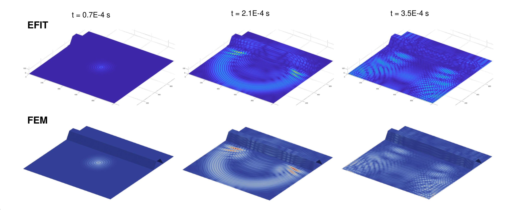

<!-- _footer: 'Wellenbild: Lefèvre, Savli, Willberg, Tschöke, ICCBMA 2022' -->

---

## Die Synergie: digitaler Zwilling

- Peridynamik-Prognosen brauchen Validierung - UAV-Laserscans liefern genau diese Referenzdaten an echten Strukturen
- Beide Datenströme werden über **PeriLab/PeriHub** mit einheitlichen Metadaten (FAIR) strukturiert abgelegt - Grundlage für verlässliche KI-/Surrogatmodelle

$$\text{Simulation} \;\longleftrightarrow\; \text{Messung} \;\xrightarrow{\text{Metadaten}}\; \text{digitaler Zwilling}$$

---

## Anwendungsfeld und Förderung

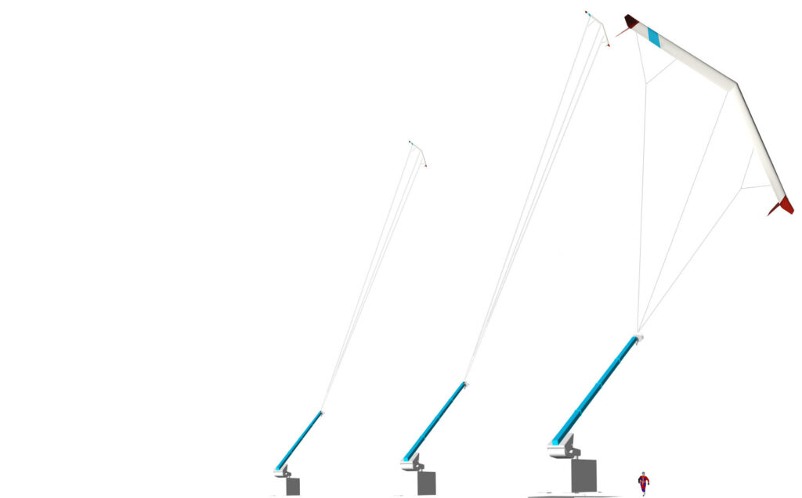

- **Flugwindanlagen** (Airborne Wind Energy, hier: Enerkite): leichte, hochdynamisch belastete Strukturen - Profil beider Säulen
- Aktiv in **IEA Wind Task 48** - WP1-Leiter **"Material and Manufacturing"**
- **Drittmittel:** DFG-Einzelförderung (Peridynamik), Förderlinien für SHM-Entwicklung

<!-- _footer: 'Bild: Enerkite GmbH' -->

---

## Industrietransfer

- Viele DLR-Projekte in enger Zusammenarbeit mit der Industrie
- Aktuell: **Kommerzialisierung von PeriLab** - vom Open-Source-Forschungscode zum Industrieprodukt

---

# Lehrkonzept

---

## Lehrphilosophie: dieselbe Verbindung wie in der Forschung

- Modellbildung **und** Messpraxis gehören zusammen - keine Trennung von Theorie und Experiment
- Visuelle, schrittweise Herleitung statt Formel-Dump: jede Vorlesung mit eigens erstellten Grafiken zur Veranschaulichung
- Materialien offen zugänglich (GitHub Pages) - nachschlagbar über das Semester hinaus

---

## Digitale, interaktive Werkzeuge

- Interaktive Pluto.jl-Notebooks: Studierende verändern Parameter per Schieberegler, Ergebnis aktualisiert sich live
- Beispiel: Einfeldträger-Biegelinie - Kraft und Lastposition frei wählbar, Herleitung im Code nachvollziehbar
- Software-Analysen mit Metadaten verknüpft, strukturierte Daten als Basis für spätere KI-Anbindung

---

## Lehrportfolio

- Technische Mechanik (u.a. Biegelinie, Festigkeitslehre)
- Faserverbundwerkstoffe (Bachelor- und Seminar-Module)
- Bruchmechanik, Ermüdung und Peridynamik
- Durchgängig über mehrere Semester des Maschinenbau-Bachelors

---

## Lehrkonzept an der Professur Mittweida

- Dieselbe Verzahnung Simulation/Experiment, die die Forschungsstrategie trägt, auch in der Lehre verankern
- Abschlussarbeiten an der Schnittstelle Simulation/Experiment - Studierende direkt in laufende Projekte einbinden
- Ziel: Studierende, die beide Seiten der Mechanik - Modell und Messung - sicher beherrschen

---

## Zusammenfassung

- **Forschung:** zwei komplementäre Säulen (Peridynamik-Simulation, UAV-Laser-SHM), verbunden durch strukturierte, FAIR-Daten zum digitalen Zwilling
- **Lehre:** dieselbe Verzahnung von Modellbildung und Messpraxis, vermittelt mit visuellen, interaktiven Werkzeugen

---

<!-- _class: lead -->
# Vielen Dank für Ihre Aufmerksamkeit

## Fragen und Diskussion

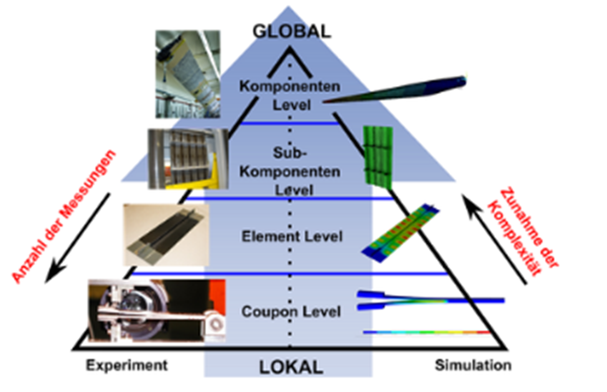
