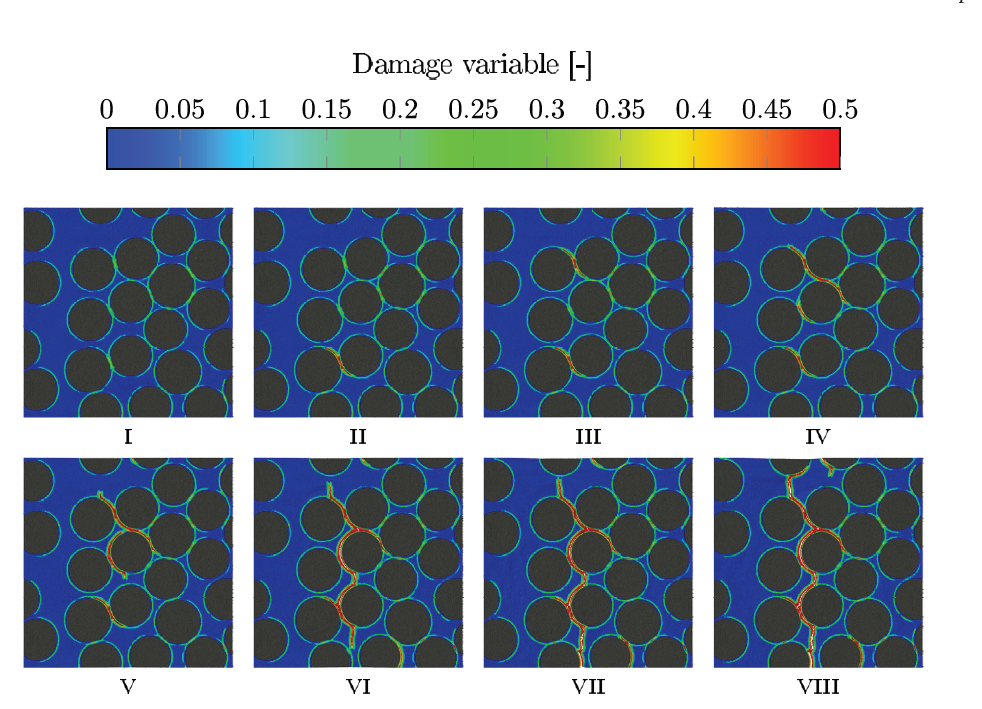
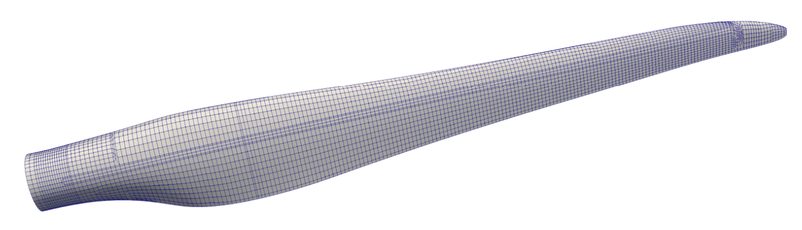
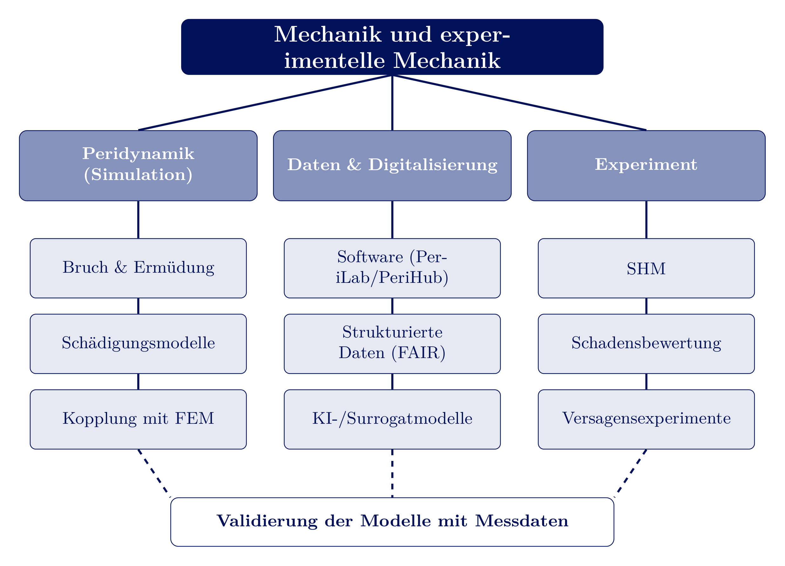

<!-- _class: lead -->
# Persönliche Vorstellung

Prof. Dr.-Ing. Christian Willberg
28.10.2026

---

## Werdegang

- 2001-2007 Studium Maschinenbau, Otto-von-Guericke-Universität Magdeburg
- 2007-2012 Wissenschaftlicher Mitarbeiter, Otto-von-Guericke-Universität Magdeburg
- 2012 Promotion zum Dr.-Ing.
- 2012-2024 Wissenschaftlicher Mitarbeiter, DLR Braunschweig (Institut für Faserverbundleichtbau und Adaptronik)
- Forschungsaufenthalte im Ausland: 2016 University of Washington, Seattle (USA); 2025 German Jordanian University (GJU)
- seit 2024 Professur, Hochschule Magdeburg-Stendal - zugleich Internationalisierungsbeauftragter des Fachbereichs

---
## Arbeiten am DLR
- Entwicklung und Validierung numerischer Verfahren
- Optimierung von Windenergierotorblättern
- Simulation von additiver Fertigung
- Bewertung von Faserverbunden

**Highlights**
EU Projekt DEMETER
Prüfung eines Windrotorblatts
Grundlagen Peridynamik
...

---

## Arbeiten an der H2

- Fokus auf Lehre
- Entwicklung von PD Code PeriLab
- Forschung im Bereich Datenprovenienz (Projekt Insect Care)

## Wissenschaftliches Engagement

- Associate Editor, **SoftwareX** (Elsevier)
- Gutachter für die Österreichische Forschungsförderungsgesellschaft mbH (FFG)
- Mitglied bei der DGZfP und GAMM
- Gutachter in Acta Mechanica, SoftwareX, Wave Motion, ...

---

## Simulation und Experiment

- Am DLR: Simulation **und** experimentelle Validierung - nie nur eine Seite
- Seit 2024 in der Lehre: dieselbe Verbindung weitergegeben
- Die Professur **"Angewandte und Experimentelle Mechanik"** ist die konsequente Fortsetzung dieses Weges
