<!-- _class: lead -->
# Equilibrium and Support Reactions
## Engineering Mechanics - Seminar 3
Prof. Dr.-Ing. Christian Willberg
Hochschule Magdeburg-Stendal

---

## Overview

- The standard support types (*Lagerarten*) and how many reaction components each provides
- Free-body diagrams (*Freischneiden*): replacing supports with their reactions
- Checking static determinacy
- Five worked examples: one concurrent system (two struts), four general systems (pin+roller, two cantilevers with a fixed support, pin+link support)

---

## Recap: Seminars 1-2

- **Seminar 1** - concurrent force system: $\sum F_x=0$, $\sum F_y=0$ (2 equations, forces through one point)
- **Seminar 2** - general force system: $\sum F_x=0$, $\sum F_y=0$, $\sum M=0$ (3 equations)
- **This seminar** - where do the *known* and *unknown* forces in those equations actually come from? Supports.

---

# Theory

---

## Support types (Lagerarten)

Every support restrains some combination of horizontal motion, vertical motion, and rotation. Each restrained motion corresponds to **one unknown reaction**.

| Support | Restrains | Unknowns |
|:---|:---|:---|
| Loslager (roller) | motion $\perp$ to surface | 1 |
| Festlager (pin) | motion in any direction | 2 |
| Einspannung (fixed) | all motion + rotation | 3 |
| Führung (sliding guide) | rotation + motion $\perp$ to slide direction | 2 |
| Pendelstütze (link) | motion along the strut | 1 |

---

## Loslager - roller support

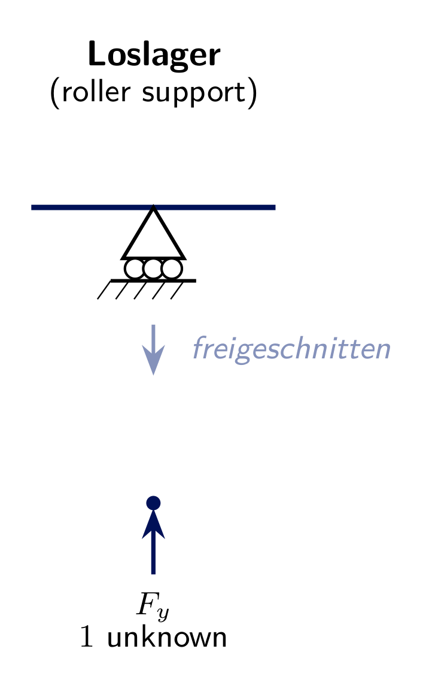

- Free to slide along the surface and to rotate
- Reaction: **one** force, perpendicular to the rolling surface
- Symbol: triangle on rollers, over a hatched surface

---

## Festlager - pin support

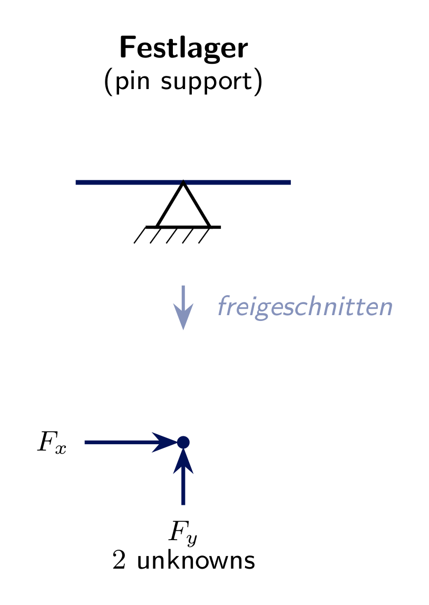

- Free to rotate, but cannot translate in *any* direction
- Reaction: **two** force components $A_x$, $A_y$ (direction generally unknown until solved)
- Symbol: triangle directly on a hatched surface (no rollers)

---

## Einspannung - fixed support

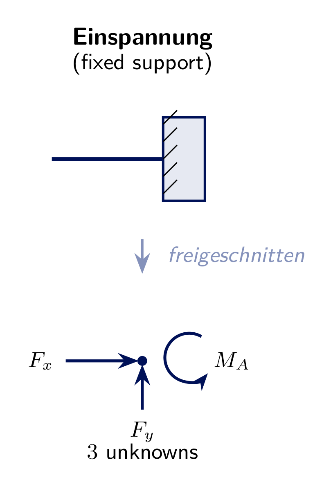

- Cannot translate **or** rotate at all
- Reaction: **two** force components **plus** a reaction moment $M_A$
- Symbol: the member is embedded directly into a hatched block/wall

---

## Führung - sliding guide (variant 1)

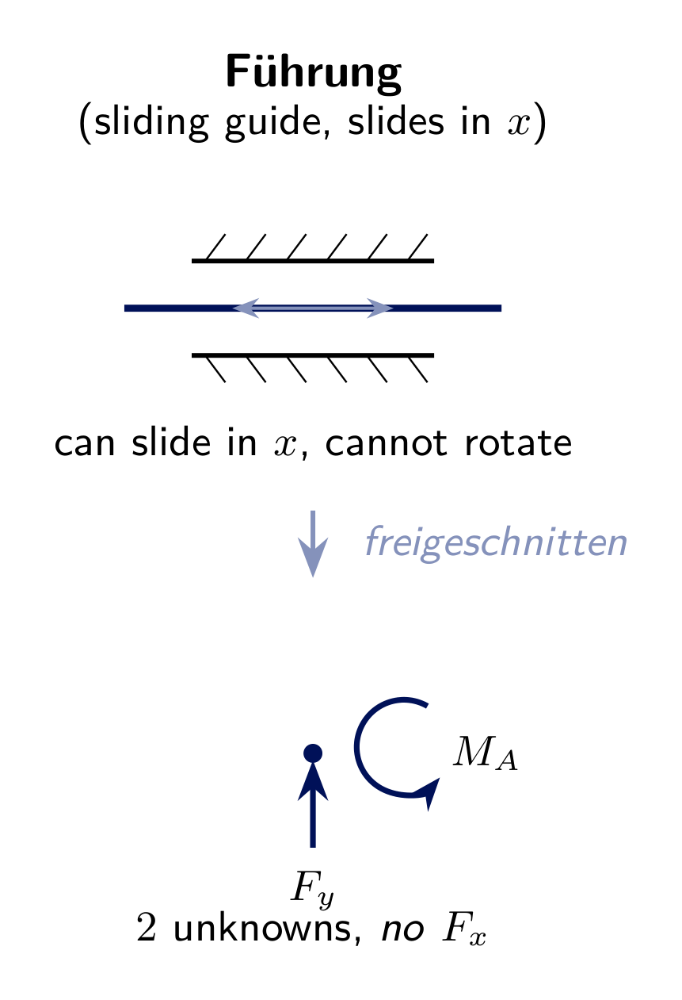

- Cannot rotate, and cannot move **perpendicular** to the slide direction
- **Free** to slide along the guide direction (here: $x$)
- Reaction: $F_y$ **and** $M_A$ - **not** $F_x$

---

## Führung - sliding guide (variant 2)

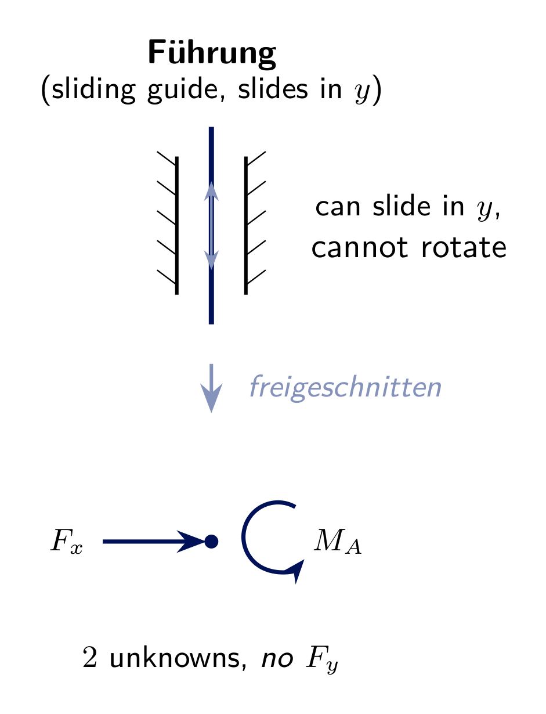

- Same idea, rotated $90^\circ$: free to slide in $y$
- Reaction: $F_x$ **and** $M_A$ - **not** $F_y$
- Same *count* of unknowns as a Festlager (2), but a **different combination** of reaction components

---

## Pendelstütze - link support

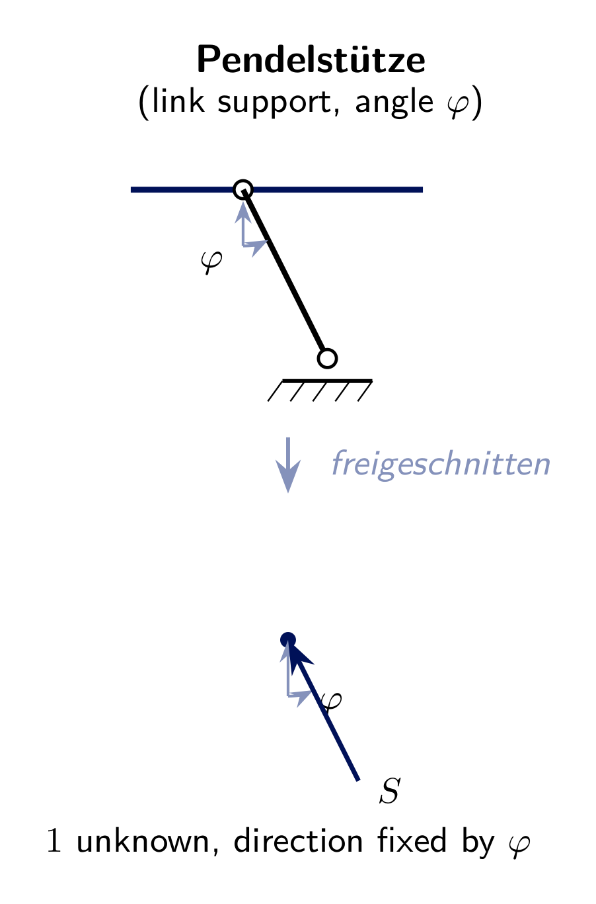

- A two-force member (pinned at both ends) - by definition, its internal force acts **along its own axis**, at whatever angle $\varphi$ the strut is mounted
- Reaction: **one** force $S$, direction fixed by $\varphi$ - only its magnitude (and tension/compression sense) is unknown
- Common in trusses and as a support for another body

---

## The free-body method

1. **Isolate** the body: draw it completely separated from its supports
2. **Replace** every support by its unknown reaction(s), following the table above
3. **Add** all applied (known) loads and couples
4. **Apply** the equilibrium equations: $\sum F_x=0$, $\sum F_y=0$, $\sum M=0$
5. **Solve** for the unknown reactions

The body drawn this way is called a **free-body diagram** - it must show *every* force acting on it, and *nothing else*.

---

## Static determinacy

For a single rigid body in 2D there are exactly **3** independent equilibrium equations.

$$\text{unknown reactions} = 3 \quad\Rightarrow\quad \textbf{statically determinate}$$

- Festlager (2) + Loslager (1) = 3 ✓
- Einspannung alone (3) ✓
- 3 × Pendelstütze (1 each, non-parallel, non-concurrent) = 3 ✓

Every problem in this seminar is set up this way - solvable with $\sum F_x=0$, $\sum F_y=0$, $\sum M=0$ alone.

---

# Exercise 3.1
## Two struts (concurrent system)

A joint $C$ carries a weight $W=800\ \text{N}$ and is held by two pendulum struts: strut $AC$ at $35^\circ$ and strut $BC$ at $60^\circ$ to the horizontal.

**Find** the strut forces $S_{AC}$ and $S_{BC}$.

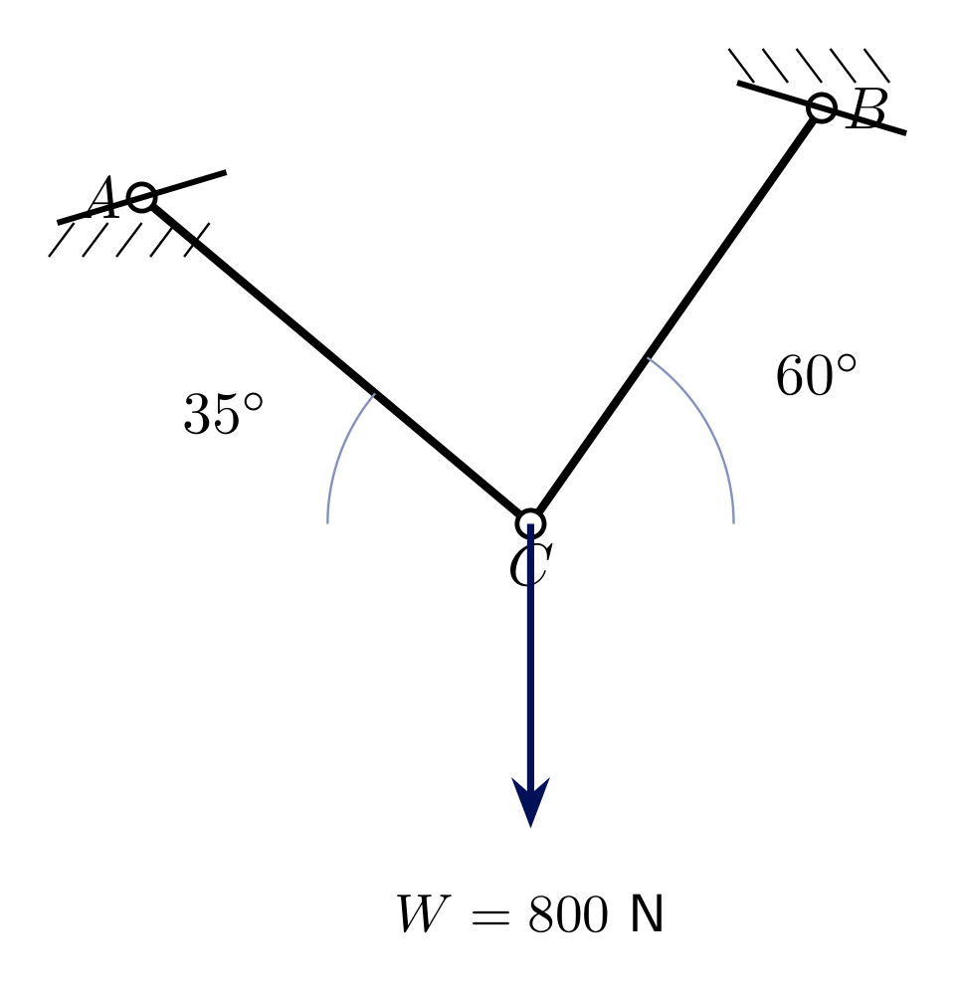

---

## Solution 3.1

Both struts meet at $C$ together with $W$ - this **is** a concurrent force system (Seminar 1 method applies directly):

$$\sum F_x = -S_{AC}\cos35^\circ + S_{BC}\cos60^\circ = 0 \ \Rightarrow\ S_{AC}=0.6104\,S_{BC}$$
$$\sum F_y = S_{AC}\sin35^\circ + S_{BC}\sin60^\circ - W = 0$$

$$S_{BC}(0.6104\sin35^\circ+\sin60^\circ) = 800 \ \Rightarrow\ S_{BC}\cdot1.2162=800$$
$$\boxed{S_{BC}\approx 657.8\ \text{N}} \qquad \boxed{S_{AC}\approx 401.5\ \text{N}}$$

Both come out **positive** - both struts are in tension (pulling on $C$), consistent with the assumed directions.

---

# Exercise 3.2
## Simple beam, point load

Beam $AB$ ($6\ \text{m}$): **pin support** at $A$, **roller support** at $B$. A downward force $F=900\ \text{N}$ acts $4\ \text{m}$ from $A$.

**Find** the reactions $A_x$, $A_y$, $B_y$. Check: $2+1=3$ unknowns, statically determinate.

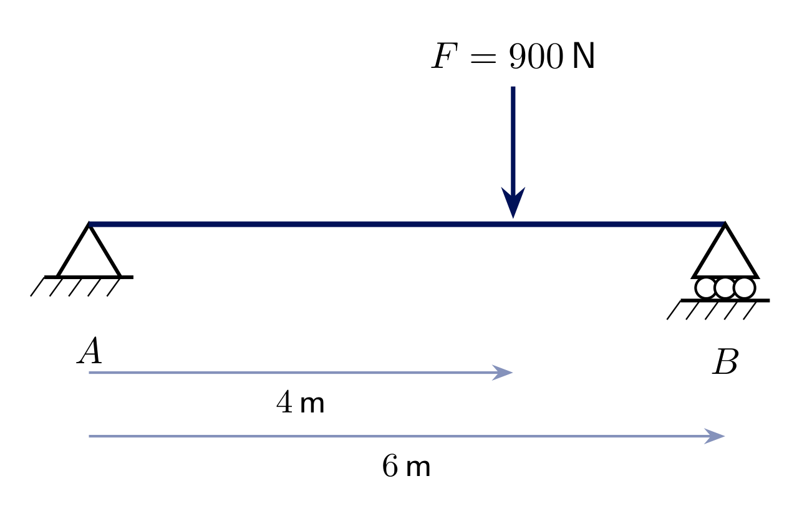

---

## Solution 3.2

**Free-body diagram:** $A_x$, $A_y$ at $A$; $B_y$ at $B$; $F$ downward at $4\ \text{m}$.

Take moments about $A$ (eliminates $A_x$, $A_y$):

$$\sum M_A = B_y\cdot6 - F\cdot4 = 0 \ \Rightarrow\ \boxed{B_y = 600\ \text{N}}$$

$$\sum F_y = A_y + B_y - F = 0 \ \Rightarrow\ \boxed{A_y = 300\ \text{N}}$$

$$\sum F_x = A_x = 0 \ \Rightarrow\ \boxed{A_x = 0}$$

---

# Exercise 3.3
## Cantilever, point load

A cantilever beam is fixed (**fixed support**) at $A$ and free at $B$, length $L=3\ \text{m}$. A downward force $F=600\ \text{N}$ acts at the free end $B$.

**Find** the reactions $A_x$, $A_y$, $M_A$. Check: the fixed support alone provides $3$ unknowns - statically determinate.

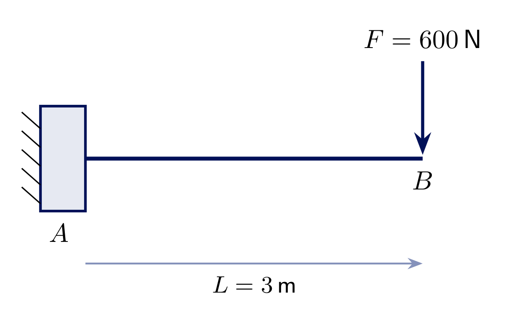

---

## Solution 3.3

A single fixed support already provides all **3** reactions - no second support is needed.

$$\sum F_x = A_x = 0 \ \Rightarrow\ \boxed{A_x = 0}$$
$$\sum F_y = A_y - F = 0 \ \Rightarrow\ \boxed{A_y = 600\ \text{N}}$$
$$\sum M_A = M_A - F\cdot L = 0 \ \Rightarrow\ \boxed{M_A = 600\cdot3 = 1800\ \text{N}\!\cdot\!\text{m}}$$

The fixed support must supply a reaction **moment** as well as a force - that is exactly what distinguishes it from a pin support.

---

# Exercise 3.4
## Cantilever, inclined load

Same cantilever, fixed support at $A$, length $L=2.5\ \text{m}$ - but now the load $F=500\ \text{N}$ at $B$ acts at $40^\circ$ below the horizontal (down and to the right).

**Find** $A_x$, $A_y$, $M_A$.

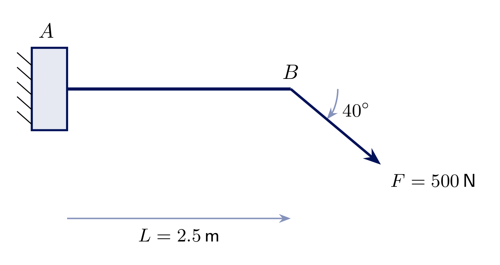

---

## Solution 3.4

Resolve the load first: $F_x = F\cos40^\circ \approx 383.0\ \text{N}$, $F_y = -F\sin40^\circ \approx -321.4\ \text{N}$.

$$\sum F_x = A_x + F_x = 0 \ \Rightarrow\ \boxed{A_x \approx -383.0\ \text{N}}$$
$$\sum F_y = A_y + F_y = 0 \ \Rightarrow\ \boxed{A_y \approx 321.4\ \text{N}}$$
$$\sum M_A = M_A + (L\cdot F_y) = 0 \ \Rightarrow\ M_A = -2.5\cdot(-321.4) \approx \boxed{803.5\ \text{N}\!\cdot\!\text{m}}$$

Only the load's **vertical** component contributes to the moment about $A$ (the horizontal component's line of action passes through the same height as $A$).

---

# Exercise 3.5
## Pin support and link support

Beam $AB$ ($4\ \text{m}$): **pin support** at $A$, **link support** (Pendelstütze) at $B$ mounted at $\varphi=50^\circ$ to the horizontal. A downward force $F=700\ \text{N}$ acts $2.5\ \text{m}$ from $A$.

**Find** $A_x$, $A_y$, and the strut force $S$.

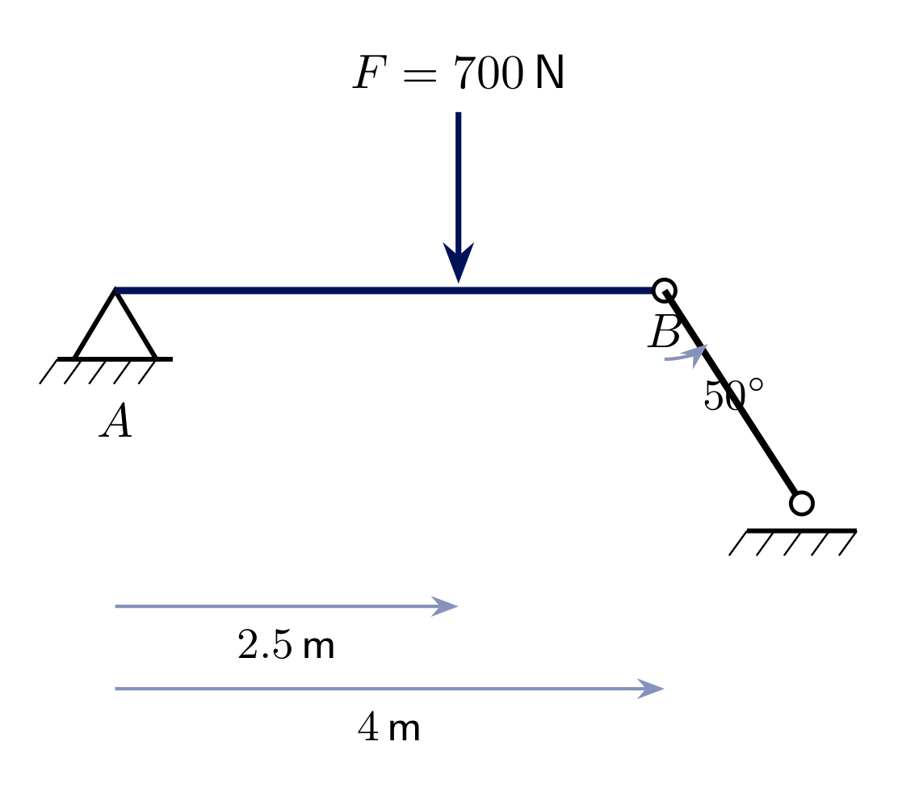

---

## Solution 3.5

The strut force $S$ acts along its own axis, so it has **both** components: $S_x=S\cos\varphi$, $S_y=S\sin\varphi$. As with the pin, only $S_y$ has a moment arm about $A$ (both are at the same height):

$$\sum M_A = S\sin50^\circ\cdot4 - F\cdot2.5 = 0 \ \Rightarrow\ S\sin50^\circ = \frac{700\cdot2.5}{4}=437.5$$
$$\boxed{S \approx \frac{437.5}{\sin50^\circ} \approx 571.1\ \text{N}}, \qquad S_x = S\cos50^\circ \approx 367.1\ \text{N}$$

$$\sum F_x = A_x + S_x = 0 \ \Rightarrow\ \boxed{A_x \approx -367.1\ \text{N}}$$
$$\sum F_y = A_y + S\sin50^\circ - F = 0 \ \Rightarrow\ \boxed{A_y = 700-437.5 = 262.5\ \text{N}}$$

The strut is a **two-force member** - once $S$ is known, the force *inside* the strut itself is simply $S$ (tension, since it pulls up on $B$ here).

---

<!-- _class: lead -->
# Questions?

Prof. Dr.-Ing. Christian Willberg
christian.willberg@h2.de
Office: Building 10, Room 2.09
