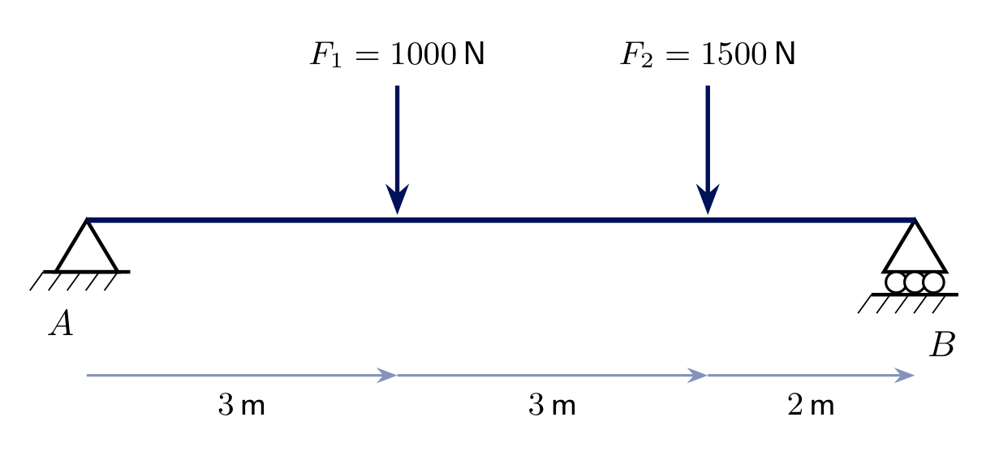
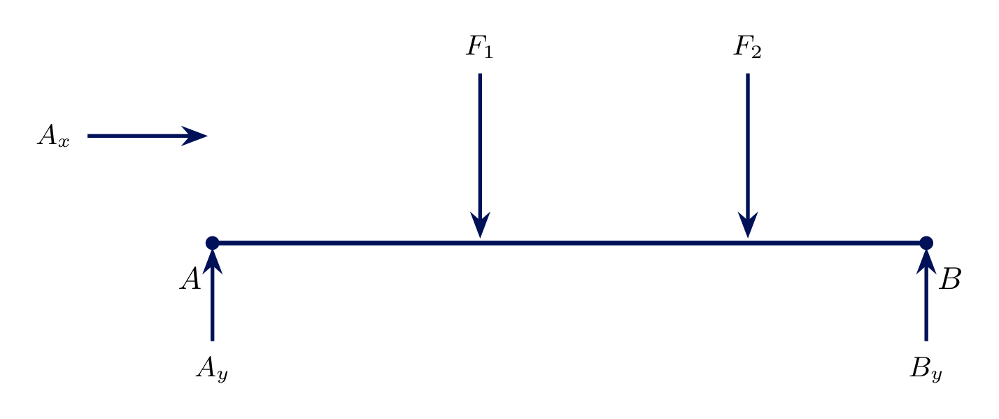
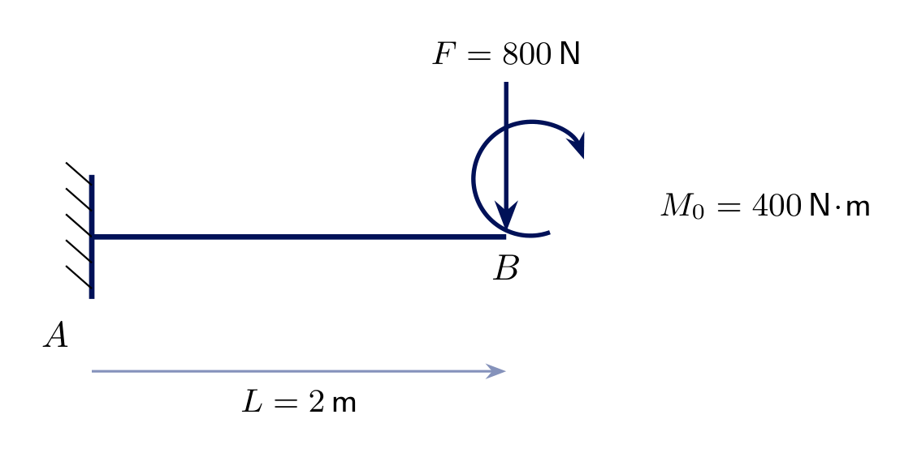
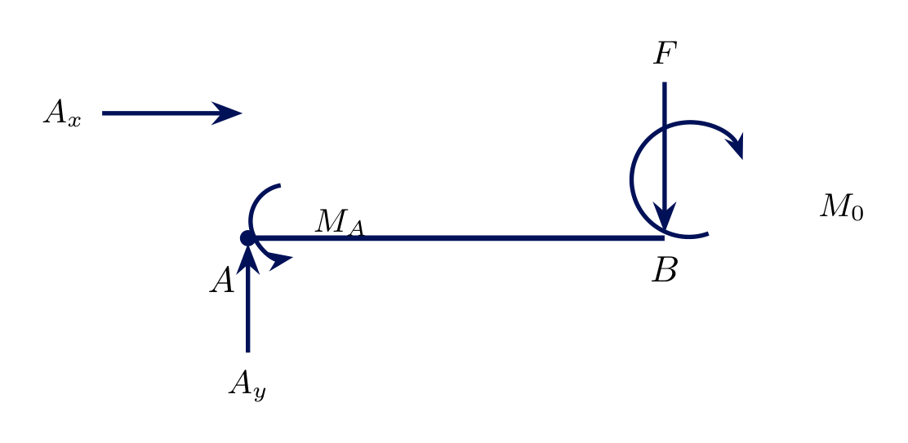
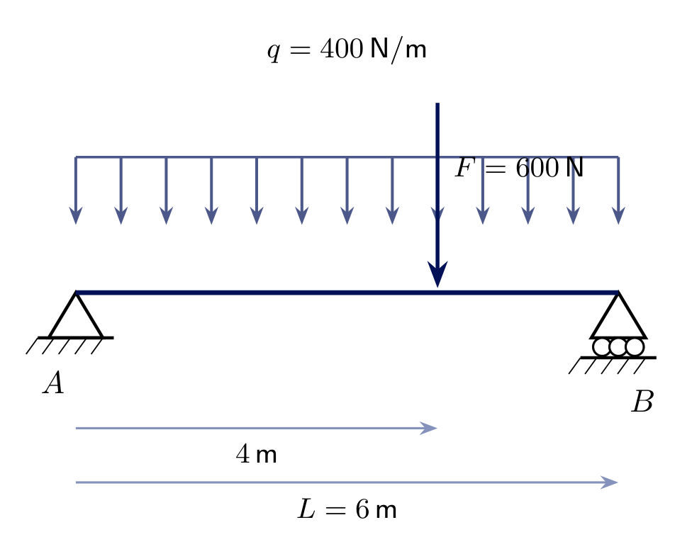
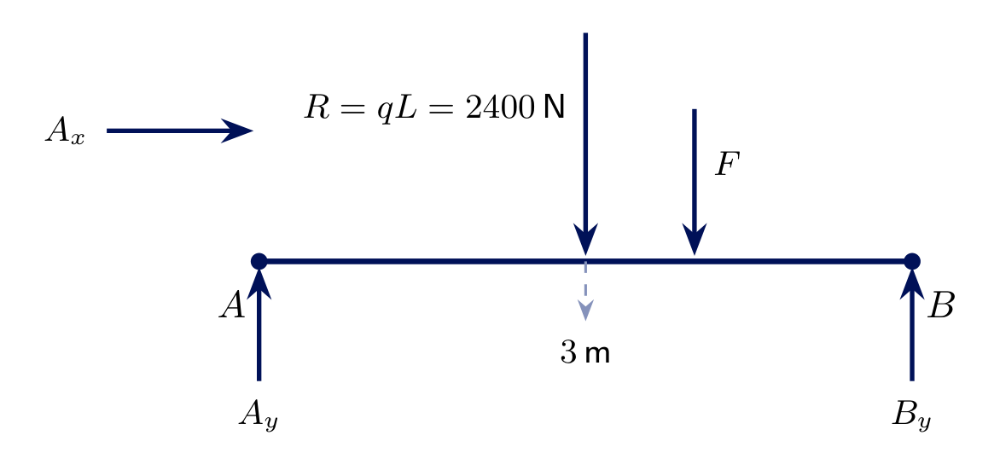
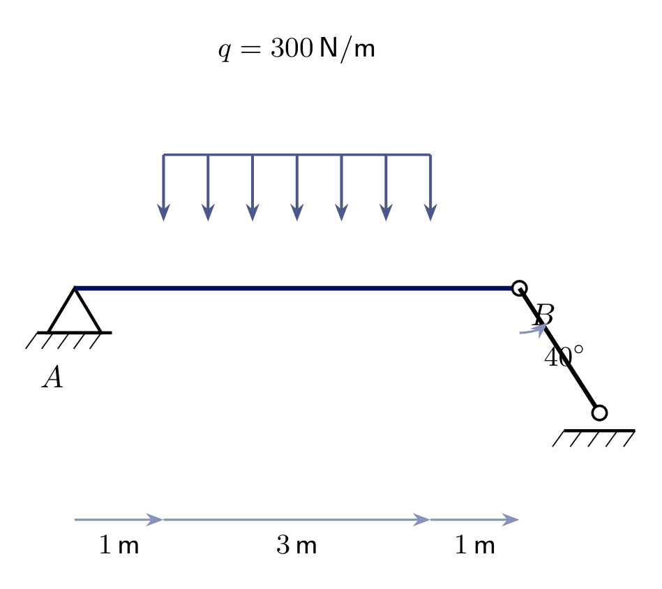
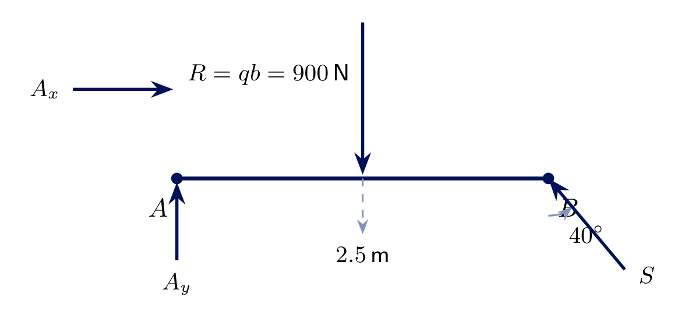

<!-- _class: lead -->
# Equilibrium - Worked Examples
## Engineering Mechanics - Seminar 4
Prof. Dr.-Ing. Christian Willberg
Hochschule Magdeburg-Stendal

---

## Overview

- No new theory today - we **practice** the free-body method from Seminar 3 on four more problems
- Every solution is built the same way: isolate the body, draw the **Schnittbild** (free-body diagram) with all reactions, then apply $\sum F_x=0$, $\sum F_y=0$, $\sum M=0$
- One new *tool*, not a new *concept*: replacing a **distributed load** by its equivalent resultant before applying equilibrium

---

## Recap: Seminar 3

- Every support restrains some motion - each restrained motion is **one unknown reaction** (Loslager 1, Festlager 2, Einspannung 3, Führung 2, Pendelstütze 1)
- **Free-body diagram:** isolate the body, replace every support by its reaction(s), add all known loads, then solve
- All problems here are statically determinate: exactly 3 unknowns, solved with $\sum F_x=0$, $\sum F_y=0$, $\sum M=0$

---

# Exercise 4.1
## Beam with two point loads

Beam $AB$ ($8\ \text{m}$): **pin support** at $A$, **roller support** at $B$. Two downward point loads: $F_1=1000\ \text{N}$ at $3\ \text{m}$ from $A$, $F_2=1500\ \text{N}$ at $6\ \text{m}$ from $A$.

**Find** $A_x$, $A_y$, $B_y$.

---

## Solution 4.1 - Schnittbild

Free-body diagram: $A_x$, $A_y$ at $A$; $B_y$ at $B$; $F_1$, $F_2$ downward at $3\ \text{m}$ and $6\ \text{m}$.

$$\sum M_A = B_y\cdot8 - F_1\cdot3 - F_2\cdot6 = 0 \ \Rightarrow\ B_y = \frac{3000+9000}{8} = \boxed{1500\ \text{N}}$$
$$\sum F_y = A_y+B_y-F_1-F_2=0 \ \Rightarrow\ \boxed{A_y = 1000\ \text{N}}$$
$$\sum F_x = A_x = 0 \ \Rightarrow\ \boxed{A_x=0}$$

---

# Exercise 4.2
## Cantilever with force and applied couple

Cantilever $AB$ ($L=2\ \text{m}$), **fixed support** at $A$. At the free end $B$: a downward force $F=800\ \text{N}$ **and** an applied couple $M_0=400\ \text{N}\!\cdot\!\text{m}$ (counterclockwise).

**Find** $A_x$, $A_y$, $M_A$.

---

## Solution 4.2 - Schnittbild

An **applied couple** enters the moment equation directly - with no lever arm, since it already is a pure moment.

$$\sum F_x = A_x = 0 \ \Rightarrow\ \boxed{A_x=0}$$
$$\sum F_y = A_y - F = 0 \ \Rightarrow\ \boxed{A_y = 800\ \text{N}}$$
$$\sum M_A = M_A + M_0 - F\cdot L = 0 \ \Rightarrow\ M_A = 800\cdot2-400=\boxed{1200\ \text{N}\!\cdot\!\text{m}}$$

---

## Tool: distributed load → equivalent resultant

A distributed load $q$ (force per unit length) acting over a length $\ell$ is, for **equilibrium purposes only**, equivalent to a single resultant force

$$R = q\cdot\ell \quad\text{acting through the centroid of the loaded area}$$

For a **uniform** (rectangular) load this centroid is simply the **midpoint** of the loaded length. The original distributed load is only replaced *after* the free body has been isolated - never on the original structural drawing.

---

# Exercise 4.3
## Beam with full uniform load and point load

Beam $AB$ ($L=6\ \text{m}$): **pin** at $A$, **roller** at $B$. A uniform load $q=400\ \text{N/m}$ acts over the full span, plus a point load $F=600\ \text{N}$ at $4\ \text{m}$ from $A$.

**Find** $A_x$, $A_y$, $B_y$.

---

## Solution 4.3 - Schnittbild

Replace $q$ by its resultant $R=q\cdot L = 400\cdot6=2400\ \text{N}$, acting at the midpoint, $3\ \text{m}$ from $A$. $F$ is already a point load and stays as is.

$$\sum M_A = B_y\cdot6 - R\cdot3 - F\cdot4=0 \ \Rightarrow\ B_y=\frac{7200+2400}{6}=\boxed{1600\ \text{N}}$$
$$\sum F_y = A_y+B_y-R-F=0 \ \Rightarrow\ \boxed{A_y=1400\ \text{N}} \qquad \boxed{A_x=0}$$

---

# Exercise 4.4
## Beam with partial uniform load and link support

Beam $AB$ ($L=5\ \text{m}$): **pin** at $A$, **link support** (Pendelstütze) at $B$, mounted at $\varphi=40^\circ$. A uniform load $q=300\ \text{N/m}$ acts only over the middle $3\ \text{m}$ (from $1\ \text{m}$ to $4\ \text{m}$ from $A$).

**Find** $A_x$, $A_y$, and the strut force $S$.

---

## Solution 4.4 - Schnittbild

The resultant of the **loaded segment only** is $R=q\cdot b = 300\cdot3=900\ \text{N}$, acting at its midpoint: $1+\tfrac{3}{2}=2.5\ \text{m}$ from $A$ - **not** at the midpoint of the whole beam.

$$\sum M_A = S\sin40^\circ\cdot5 - R\cdot2.5=0 \ \Rightarrow\ S=\frac{900\cdot2.5}{5\sin40^\circ}\approx\boxed{700.0\ \text{N}}$$
$$\sum F_y = A_y+S\sin40^\circ-R=0 \ \Rightarrow\ \boxed{A_y = 900-450=450\ \text{N}}$$
$$\sum F_x = A_x+S\cos40^\circ=0 \ \Rightarrow\ \boxed{A_x\approx-536.2\ \text{N}}$$

---

<!-- _class: lead -->
# Questions?

Prof. Dr.-Ing. Christian Willberg
christian.willberg@h2.de
Office: Building 10, Room 2.09
