<!-- _class: lead -->
# Equilibrium - Worked Examples
## Engineering Mechanics - Seminar 4
Prof. Dr.-Ing. Christian Willberg
Hochschule Magdeburg-Stendal

---

## Overview

- First the **theory**: distributed loads - general case, uniform, and triangular
- Then the **practice**: the free-body method from Seminar 3, applied to five problems
- Every solution is built the same way: isolate the body, draw the **free-body diagram** with all reactions, then apply $\sum F_x=0$, $\sum F_y=0$, $\sum M=0$

---

## Recap: Seminar 3

- Every support restrains some motion - each restrained motion is **one unknown reaction** (Loslager 1, Festlager 2, Einspannung 3, Führung 2, Pendelstütze 1)
- **Free-body diagram:** isolate the body, replace every support by its reaction(s), add all known loads, then solve
- All problems here are statically determinate: exactly 3 unknowns, solved with $\sum F_x=0$, $\sum F_y=0$, $\sum M=0$

---

## Theory: Distributed loads - the general case

- So far every load was a single **point force** acting at one location
- A **distributed load** $q(x)$ acts continuously along a length - its intensity is force **per unit length**, $[\text{N/m}]$, and may vary arbitrarily
- It is drawn as arrows **sitting on the loaded member** - the load acts *on* the beam, never floating above it

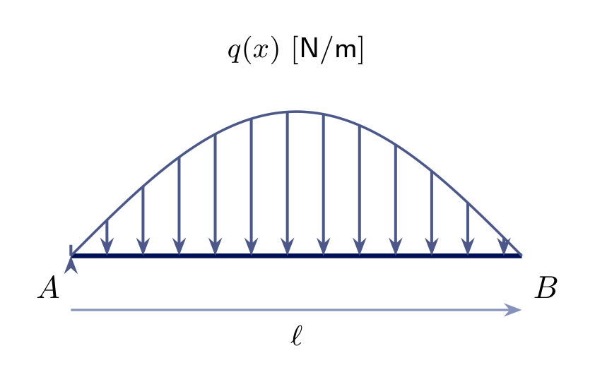

---

## Theory: Uniform distributed load

The simplest and most common case: $q(x)=q_0=\text{const.}$

$$R = q_0\cdot\ell \quad\text{acting at the \textbf{midpoint}}\ \ell/2$$

Because the load is constant, its resultant is simply "intensity times length," acting through the centroid of a rectangle - the midpoint.

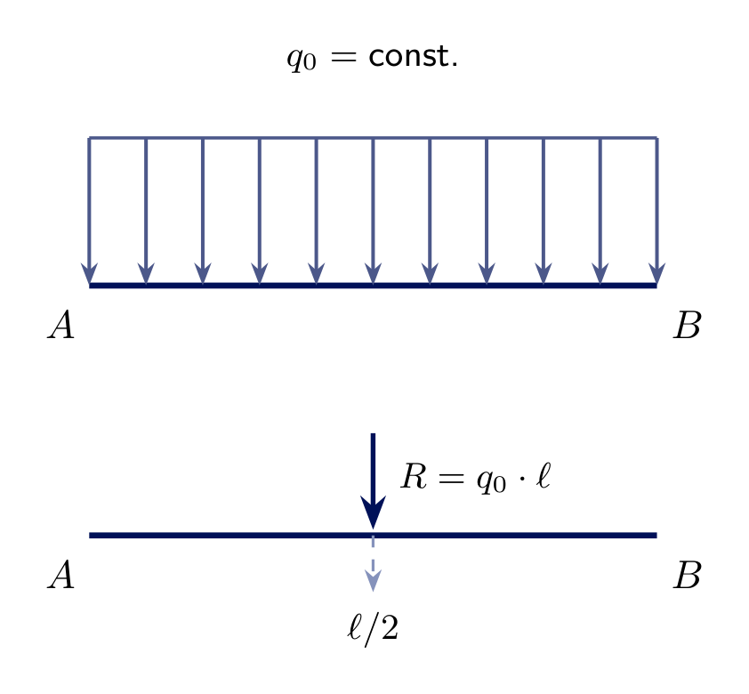

---

## Theory: Triangular distributed load

A **linearly varying** load, zero at one end and $q_0$ at the other. Its resultant equals the **area of the triangle**:

$$R = \tfrac{1}{2}q_0\cdot\ell \quad\text{acting at}\ \tfrac{2}{3}\ell\ \text{from the zero end}$$

The resultant sits closer to the **tall** end, since more of the load is concentrated there.

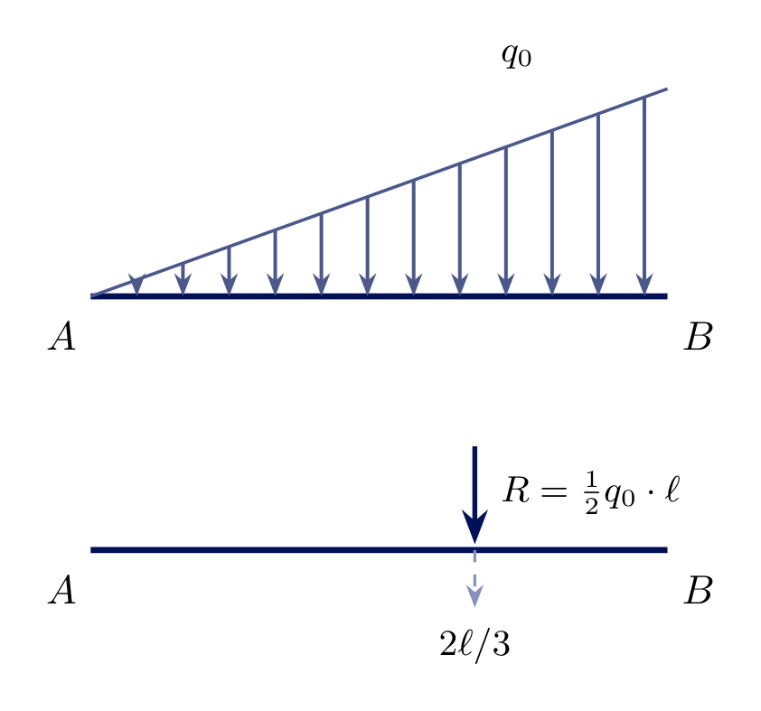

---

## Theory: Partial loads - a caveat

- The original distributed load is only replaced **after** the free body has been isolated - never on the original drawing
- If $q$ acts only over **part** of the member, use only the **loaded length** $b$: $R=q\cdot b$ (uniform) or $R=\tfrac12 q_0 b$ (triangular)
- $R$ acts at the centroid of the **loaded segment**, *not* the midpoint of the whole member (see Exercise 4.4)

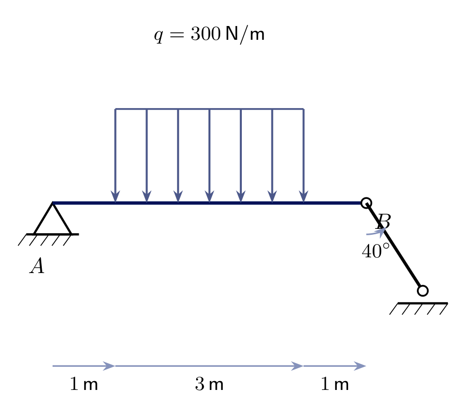

---

# Exercise 4.1
## Beam with two point loads

Beam $AB$ ($8\ \text{m}$): **pin support** at $A$, **roller support** at $B$. Two downward point loads: $F_1=1000\ \text{N}$ at $3\ \text{m}$ from $A$, $F_2=1500\ \text{N}$ at $6\ \text{m}$ from $A$.

**Find** $A_x$, $A_y$, $B_y$.

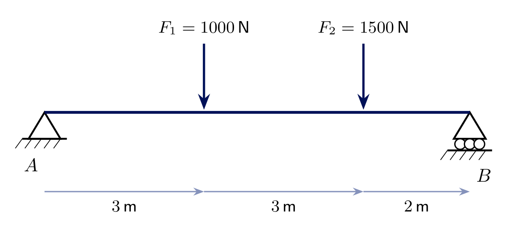

---

## Solution 4.1 - Free Body Diagram

Free-body diagram: $A_x$, $A_y$ at $A$; $B_y$ at $B$; $F_1$, $F_2$ downward at $3\ \text{m}$ and $6\ \text{m}$.

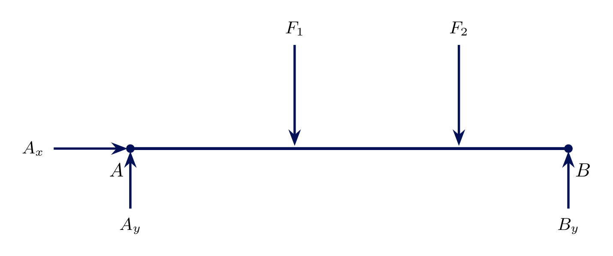

$$\sum M_A = B_y\cdot8 - F_1\cdot3 - F_2\cdot6 = 0 \ \Rightarrow\ B_y = \frac{3000+9000}{8} = \boxed{1500\ \text{N}}$$
$$\sum F_y = A_y+B_y-F_1-F_2=0 \ \Rightarrow\ \boxed{A_y = 1000\ \text{N}}$$
$$\sum F_x = A_x = 0 \ \Rightarrow\ \boxed{A_x=0}$$

---

# Exercise 4.2
## Beam with full uniform load and point load

Beam $AB$ ($L=6\ \text{m}$): **pin** at $A$, **roller** at $B$. A uniform load $q=400\ \text{N/m}$ acts over the full span, plus a point load $F=600\ \text{N}$ at $4\ \text{m}$ from $A$.

**Find** $A_x$, $A_y$, $B_y$.

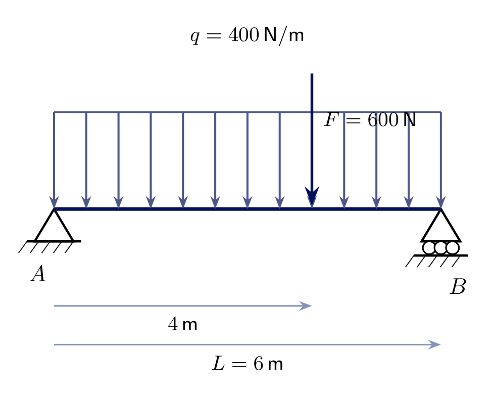

---

## Solution 4.2 - Free Body Diagram

Replace $q$ by its resultant $R=q\cdot L = 400\cdot6=2400\ \text{N}$, acting at the midpoint, $3\ \text{m}$ from $A$. $F$ is already a point load and stays as is.

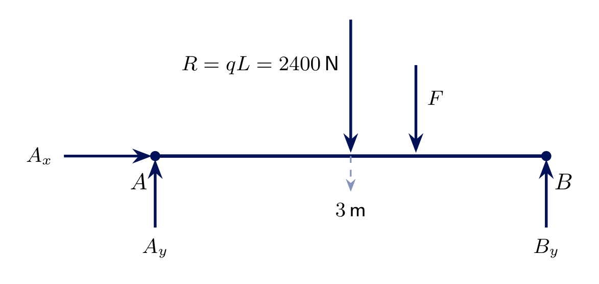

$$\sum M_A = B_y\cdot6 - R\cdot3 - F\cdot4=0 \ \Rightarrow\ B_y=\frac{7200+2400}{6}=\boxed{1600\ \text{N}}$$
$$\sum F_y = A_y+B_y-R-F=0 \ \Rightarrow\ \boxed{A_y=1400\ \text{N}} \qquad \boxed{A_x=0}$$

---

# Exercise 4.3
## Cantilever with force and applied couple

Cantilever $AB$ ($L=2\ \text{m}$), **fixed support** at $A$. At the free end $B$: a downward force $F=800\ \text{N}$ **and** an applied couple $M_0=400\ \text{N}\!\cdot\!\text{m}$ (counterclockwise).

**Find** $A_x$, $A_y$, $M_A$.

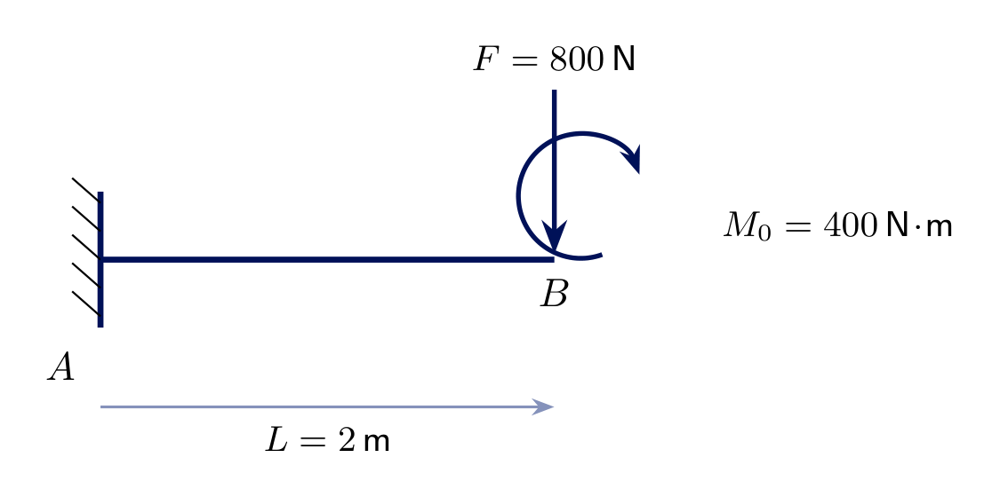

---

## Solution 4.3 - Free Body Diagram

An **applied couple** enters the moment equation directly - with no lever arm, since it already is a pure moment.

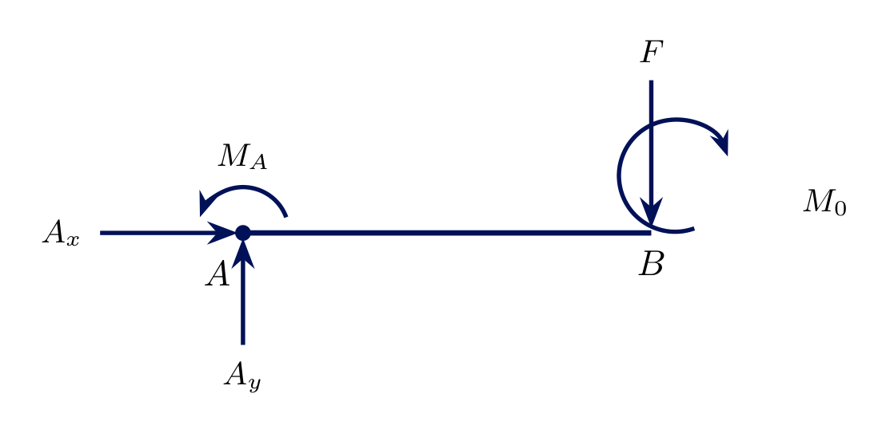

$$\sum F_x = A_x = 0 \ \Rightarrow\ \boxed{A_x=0}$$
$$\sum F_y = A_y - F = 0 \ \Rightarrow\ \boxed{A_y = 800\ \text{N}}$$
$$\sum M_A = M_A + M_0 - F\cdot L = 0 \ \Rightarrow\ M_A = 800\cdot2-400=\boxed{1200\ \text{N}\!\cdot\!\text{m}}$$

---

# Exercise 4.4
## Beam with partial uniform load and link support

Beam $AB$ ($L=5\ \text{m}$): **pin** at $A$, **link support** (Pendelstütze) at $B$, mounted at $\varphi=40^\circ$. A uniform load $q=300\ \text{N/m}$ acts only over the middle $3\ \text{m}$ (from $1\ \text{m}$ to $4\ \text{m}$ from $A$).

**Find** $A_x$, $A_y$, and the strut force $S$.

---

## Solution 4.4 - Free Body Diagram

The resultant of the **loaded segment only** is $R=q\cdot b = 300\cdot3=900\ \text{N}$, acting at its midpoint: $1+\tfrac{3}{2}=2.5\ \text{m}$ from $A$ - **not** every time at the midpoint of the whole beam.

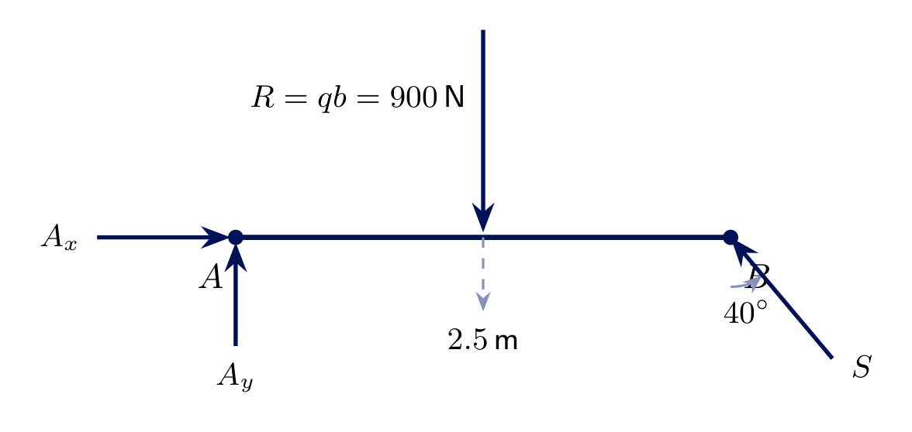

$$\sum M_A : S\cos40^\circ\cdot5 - R\cdot2.5=0 \ \Rightarrow\ S=\frac{900\cdot2.5}{5\cos40^\circ}\approx\boxed{587.4\ \text{N}}$$
$$\sum F_y : A_y+S\cos40^\circ-R=0 \ \Rightarrow\ \boxed{A_y = 900-450=450\ \text{N}}$$
$$\sum F_x : A_x+S\sin40^\circ=0 \ \Rightarrow\ \boxed{A_x\approx-377.5\ \text{N}}$$

---

# Exercise 4.5
## Beam with triangular load

Beam $AB$ ($L=6\ \text{m}$): **pin** at $A$, **roller** at $B$. A triangular load acts over the full span: zero at $A$, rising to $q_0=600\ \text{N/m}$ at $B$.

**Find** $A_x$, $A_y$, $B_y$.

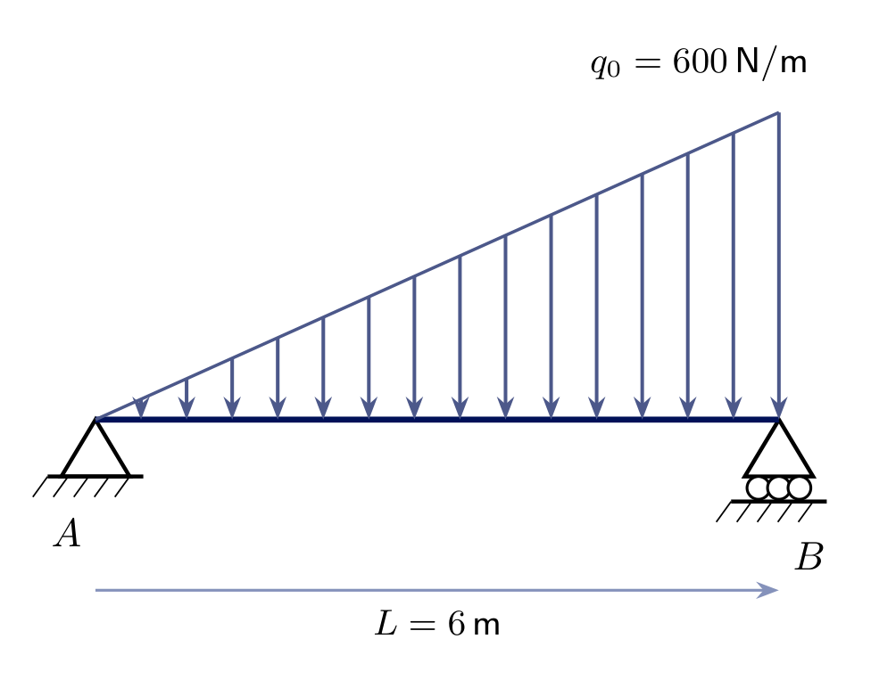

---

## Solution 4.5 - Free Body Diagram

Replace the triangular load by its resultant $R=\tfrac12 q_0 L = \tfrac12\cdot600\cdot6=1800\ \text{N}$, acting at $\tfrac{2}{3}L=4\ \text{m}$ from $A$ (closer to the tall end at $B$).

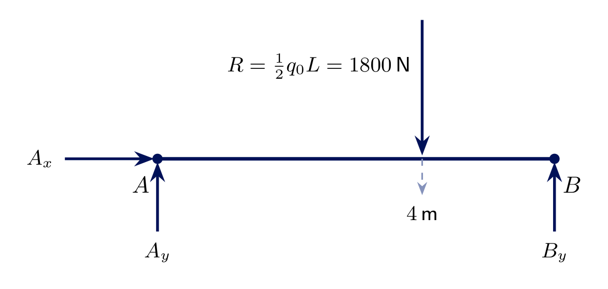

$$\sum M_A = B_y\cdot6 - R\cdot4=0 \ \Rightarrow\ B_y=\frac{1800\cdot4}{6}=\boxed{1200\ \text{N}}$$
$$\sum F_y = A_y+B_y-R=0 \ \Rightarrow\ \boxed{A_y=600\ \text{N}} \qquad \boxed{A_x=0}$$

---

<!-- _class: lead -->
# Questions?

Prof. Dr.-Ing. Christian Willberg
christian.willberg@h2.de
Office: Building 10, Room 2.09
