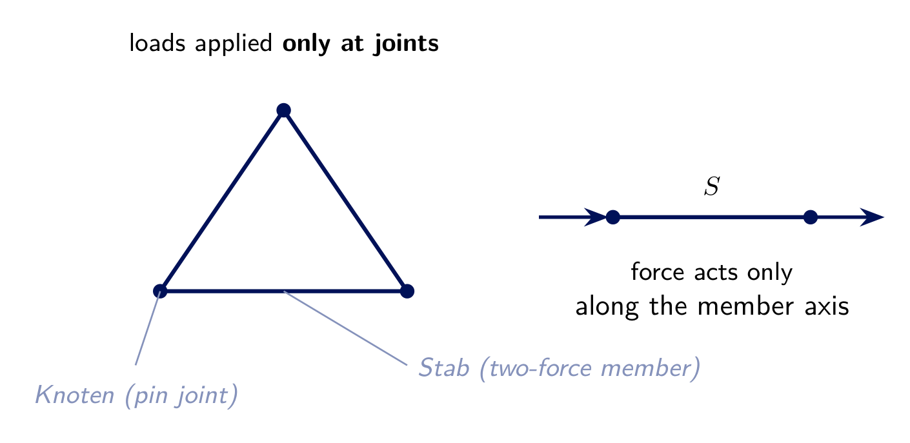
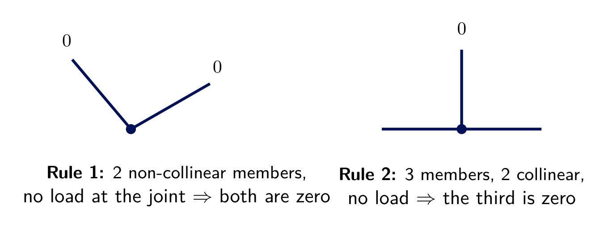
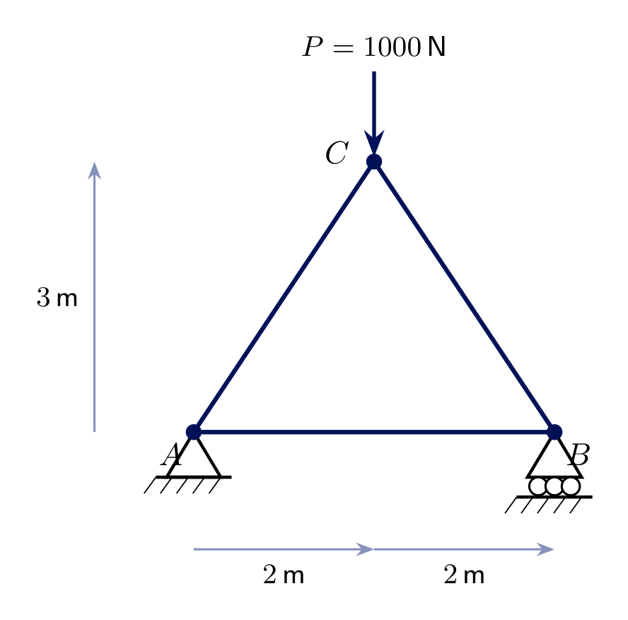
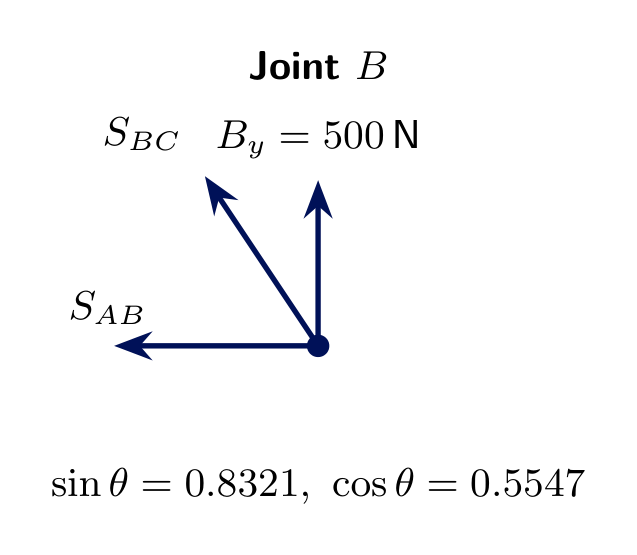
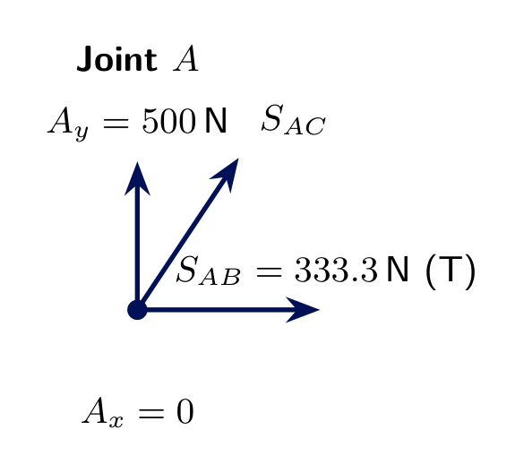
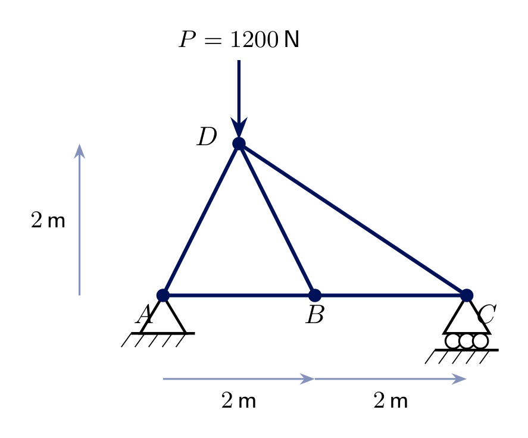
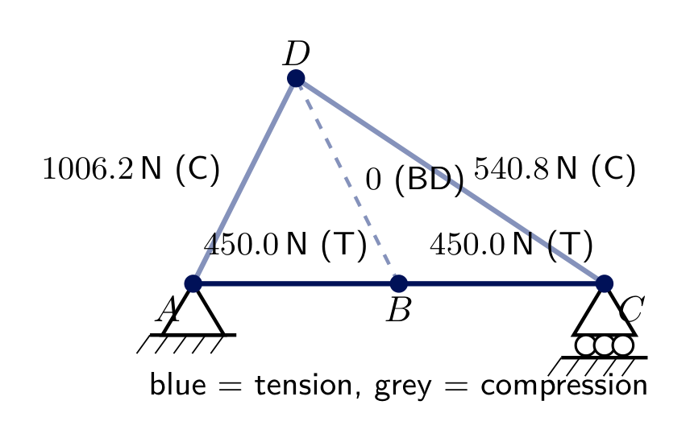
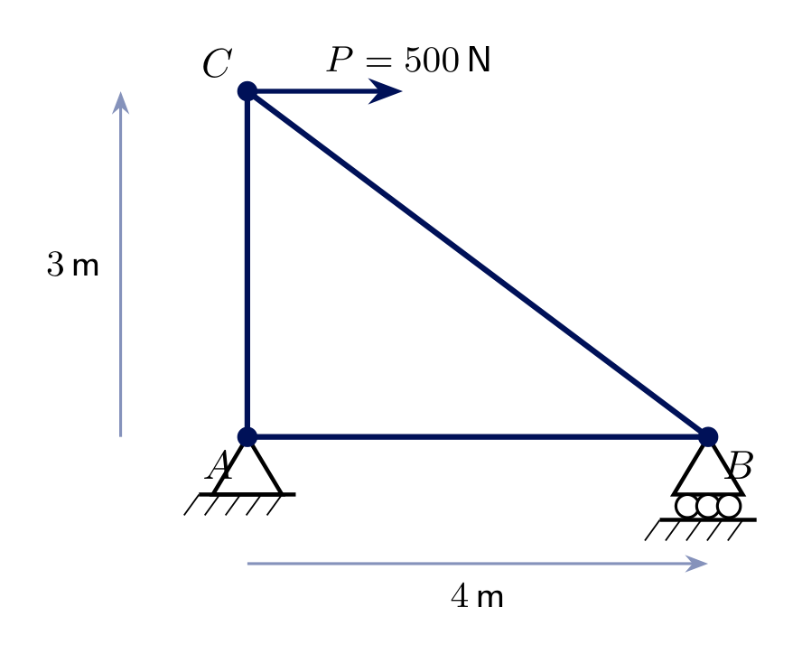
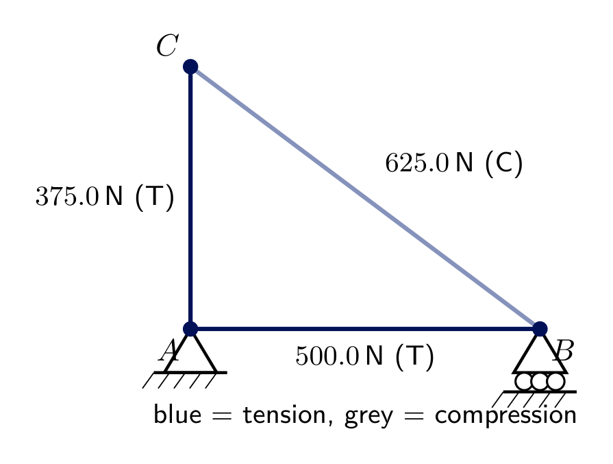

<!-- _class: lead -->
# Trusses I - Method of Joints
## Engineering Mechanics - Seminar 5
Prof. Dr.-Ing. Christian Willberg
Hochschule Magdeburg-Stendal

---

## Overview

- What is a truss (*Stabtragwerk*) and why every member is a **two-force member**
- Static determinacy of trusses: $m+r=2j$
- The **method of joints** (*Knotenpunktverfahren*) - the concurrent-force method from Seminar 1, applied joint by joint
- Two shortcut rules for spotting **zero-force members**
- Three worked examples

---

# Theory

---

## What is a truss?

- Straight members connected at **pin joints** (*Knoten*)
- **Idealization:** loads/reactions act **only at joints**; pins frictionless, member weight neglected
- Consequence: every member is a **two-force member** - force acts **only along its axis**, like the Pendelstütze (Seminar 3)

---

## Static determinacy of a truss

For a 2D truss with $m$ members, $r$ support reactions, and $j$ joints:

$$m + r = 2j \quad\Rightarrow\quad \textbf{statically determinate}$$

Each joint gives 2 equilibrium equations ($\sum F_x=0$, $\sum F_y=0$) - a concurrent force system, same method as Seminar 1. Total equations $=2j$; total unknowns $=m$ member forces $+\,r$ reactions.

All trusses in this seminar satisfy $m+r=2j$.

---

## Method of joints (Knotenpunktverfahren)

1. Find the **support reactions** first (whole truss, Seminar 3 method)
2. Pick a joint with **at most 2 unknown** member forces
3. Draw that joint's free-body diagram: reactions/loads **and** member forces, assumed in **tension** (pulling away from the joint)
4. Apply $\sum F_x=0$, $\sum F_y=0$ - a concurrent system, solve for the 2 unknowns
5. Move to the next joint that now has $\le2$ unknowns; repeat until all members are solved

A **positive** result confirms tension; a **negative** result means the member is actually in **compression**.

---

## Zero-force members - two shortcuts

Spotting these *before* solving saves work - but when in doubt, the joint equations always confirm them automatically (Exercise 5.2).

---

# Exercise 5.1
## Simple triangular truss

Truss $ABC$: **pin** at $A$, **roller** at $B$, apex $C$ above the midpoint. Base $4\ \text{m}$, height $3\ \text{m}$. A vertical load $P=1000\ \text{N}$ acts at $C$.

**Find** the support reactions and all member forces $S_{AB}$, $S_{AC}$, $S_{BC}$.

---

## Solution 5.1 - reactions

By symmetry, or formally:

$$\sum M_A = B_y\cdot4 - P\cdot2=0 \ \Rightarrow\ \boxed{B_y=500\ \text{N}}$$
$$\sum F_y = A_y+B_y-P=0 \ \Rightarrow\ \boxed{A_y=500\ \text{N}} \qquad \boxed{A_x=0}$$

Member $BC$ makes angle $\theta$ with the horizontal: $\tan\theta = 3/2 \Rightarrow \sin\theta=0.8321,\ \cos\theta=0.5547$ (member $AC$, by symmetry, has the same angle on the other side).

---

## Solution 5.1 - joint B

Joint $B$ has only 2 unknowns ($S_{AB}$, $S_{BC}$) - start here.

$$\sum F_y = B_y + S_{BC}\sin\theta = 0 \ \Rightarrow\ S_{BC}=\frac{-500}{0.8321}\approx\boxed{-601.0\ \text{N} \;(\text{C})}$$
$$\sum F_x = -S_{AB} - S_{BC}\cos\theta = 0 \ \Rightarrow\ S_{AB}=-S_{BC}\cos\theta\approx\boxed{333.3\ \text{N} \;(\text{T})}$$

---

## Solution 5.1 - joint A

With $S_{AB}$ now known, joint $A$ has only 1 new unknown, $S_{AC}$.

$$\sum F_y = A_y + S_{AC}\sin\theta = 0 \ \Rightarrow\ S_{AC}\approx\boxed{-601.0\ \text{N} \;(\text{C})}$$

Matches $S_{BC}$ by symmetry - the bottom chord $AB$ is in **tension**, both inclined legs are in **compression**, as expected for an A-frame carrying a downward apex load.

---

# Exercise 5.2
## Two-triangle truss, off-centre load

Truss $A$–$B$–$C$–$D$: **pin** at $A$, **roller** at $C$, bottom chord $AB=BC=2\ \text{m}$, apex $D$ at height $2\ \text{m}$ above $A$ (not above the centre). A vertical load $P=1200\ \text{N}$ acts at $D$.

**Find** all 5 member forces.

---

## Solution 5.2 - reactions and joint A

$$\sum M_A = C_y\cdot4 - P\cdot1=0 \ \Rightarrow\ \boxed{C_y=300\ \text{N}}, \qquad \boxed{A_y=900\ \text{N}}, \qquad \boxed{A_x=0}$$

At joint $A$ ($AD$ at $\tan^{-1}(2/1)=63.4^\circ$, $\sin=0.8944,\ \cos=0.4472$):

$$\sum F_y = A_y + S_{AD}\sin63.4^\circ = 0 \ \Rightarrow\ S_{AD}\approx\boxed{-1006.2\ \text{N}\;(\text{C})}$$
$$\sum F_x = S_{AB} + S_{AD}\cos63.4^\circ = 0 \ \Rightarrow\ S_{AB}\approx\boxed{450.0\ \text{N}\;(\text{T})}$$

---

## Solution 5.2 - joint C and joint D

At joint $C$ ($CD$ at $\tan^{-1}(2/3)=33.7^\circ$, $\sin=0.5547,\ \cos=0.8321$), same procedure:

$$S_{CD}\approx-540.8\ \text{N}\;(\text{C}), \qquad S_{CB}\approx450.0\ \text{N}\;(\text{T})$$

Joint $D$ now has only **one** unknown left, $S_{BD}$. Substituting the known $S_{AD}$, $S_{CD}$ into $\sum F_x=0$ at $D$ gives $S_{BD}\approx0$ - confirmed, not merely assumed: $BD$ is a **zero-force member**.

---

# Exercise 5.3
## Triangular truss with a horizontal joint load

Truss $ABC$: **pin** at $A$, **roller** at $B$, $AB=4\ \text{m}$ (horizontal), $AC=3\ \text{m}$ (vertical, directly above $A$). A **horizontal** load $P=500\ \text{N}$ acts at $C$.

**Find** the reactions and all member forces.

---

## Solution 5.3

$$\sum M_A = B_y\cdot4 - P\cdot3=0 \ \Rightarrow\ \boxed{B_y=375\ \text{N}}$$
$$\sum F_y = A_y+B_y=0 \ \Rightarrow\ \boxed{A_y=-375\ \text{N}} \qquad \sum F_x = A_x+P=0 \ \Rightarrow\ \boxed{A_x=-500\ \text{N}}$$

Joint $B$ (3-4-5 triangle, $\sin=0.6,\cos=0.8$): $\sum F_y: B_y+S_{BC}\cdot0.6=0 \Rightarrow S_{BC}\approx\boxed{-625.0\ \text{N (C)}}$; then $S_{AB}\approx\boxed{500.0\ \text{N (T)}}$. Joint $A$ confirms $S_{AC}\approx\boxed{375.0\ \text{N (T)}}$.

---

<!-- _class: lead -->
# Questions?

Prof. Dr.-Ing. Christian Willberg
christian.willberg@h2.de
Office: Building 10, Room 2.09
