<!-- _class: lead -->
# Trusses II - Method of Sections
## Engineering Mechanics - Seminar 6
Prof. Dr.-Ing. Christian Willberg
Hochschule Magdeburg-Stendal

---

## Overview

- Limitation of the method of joints: to reach a member deep inside a truss you must solve every joint before it
- The **method of sections** (*Ritterschnittverfahren*): cut straight through the truss and find a specific member force directly
- The key trick: choosing the **moment centre** where two of the three cut forces intersect
- Worked examples on the same 5-joint truss, different cuts and load cases
- Comparison: Exercise 6.1 solved with the method of joints - same result
- Two exam-type exercises: wall-mounted cantilever truss and bridge truss

---

# Theory

---

## Why a second method?

- Method of joints (Seminar 5): start at one end, solve joint by joint - to find a member in the *middle* of a large truss you must first solve every joint before it
- **Method of sections:** cut the truss into two parts with an imaginary section, then treat **one whole part** as a single rigid body
- Still just $\sum F_x=0$, $\sum F_y=0$, $\sum M=0$ - but now a **general** force system (Seminar 2), not a concurrent one

---

## Ritterschnitt - procedure

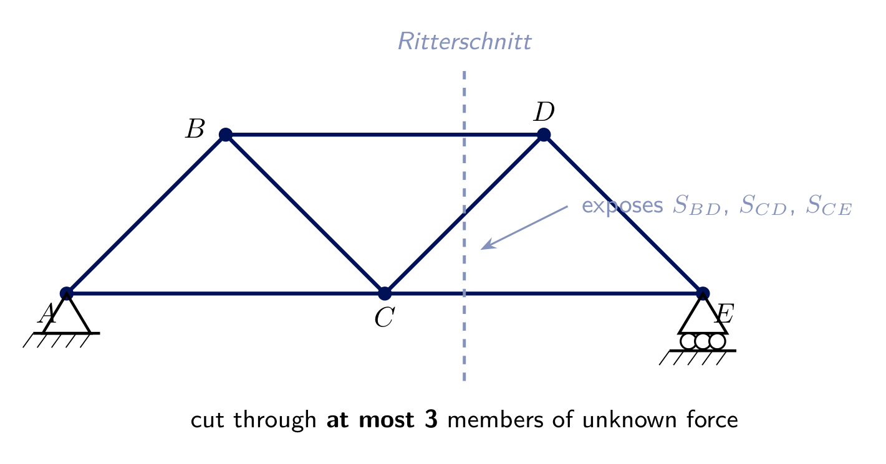

1. Find the **support reactions** first (whole truss)
2. Choose a cut through **at most 3** members of unknown force
3. Keep **either** side as a free body - reactions/loads on that side **and** the 3 cut forces, assumed in tension
4. Apply $\sum F_x=0$, $\sum F_y=0$, $\sum M=0$ to that one free body

---

## The moment-centre trick

If two of the three cut forces **intersect** at a point, taking $\sum M$ about **that point** eliminates both at once - the third force comes out of a **single equation**.

- If two cut members are **parallel** (never intersect), $\sum F$ **perpendicular** to them isolates the third force directly instead
- This is what makes the method of sections fast: one well-chosen equation can give you the **one** member force you actually need, with no other joint ever solved

---

# Exercise 6.1
## Warren truss, load at the bottom-chord joint

Truss $A$-$B$-$C$-$D$-$E$ (5 joints, span $8\ \text{m}$, height $2\ \text{m}$, all diagonals at $45^\circ$): **pin** at $A$, **roller** at $E$. A load $P=2000\ \text{N}$ acts at $C$.

**Find** $S_{BD}$, $S_{CD}$, $S_{CE}$ using **one** Ritterschnitt - without solving joints $A$ or $B$.

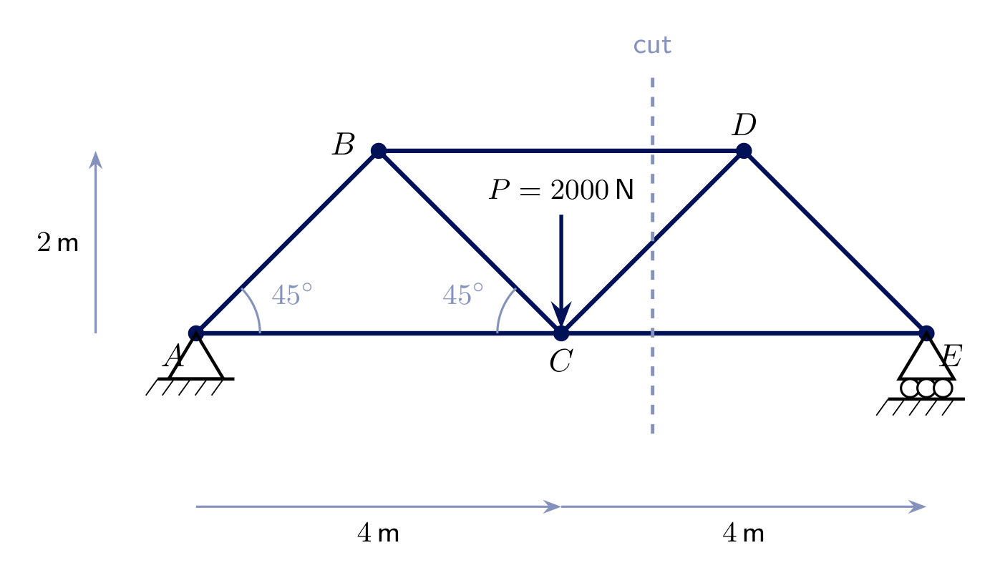

---

## Solution 6.1 - reactions and the cut

By symmetry (or $\sum M_A=0$): $\boxed{A_y=E_y=1000\ \text{N}}$, $A_x=0$.

Cut at $x=5\ \text{m}$ crosses exactly 3 members: top chord $BD$, diagonal $CD$, bottom chord $CE$. Keep the **right** portion ($D$, $E$) as the free body.

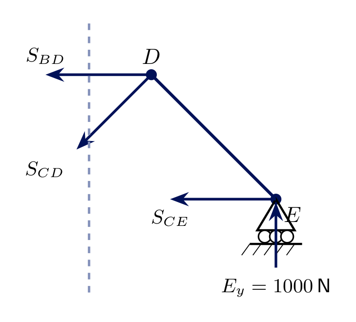

---

## Solution 6.1 - three equations, three members

**Moment about $D$** (eliminates $S_{BD}$, $S_{CD}$ - both pass through $D$):
$$\sum M_D = E_y\cdot2 - S_{CE}\cdot2 = 0 \ \Rightarrow\ \boxed{S_{CE}=1000\ \text{N (T)}}$$

**Moment about $C$** (eliminates $S_{CD}$, $S_{CE}$ - both pass through $C$):
$$\sum M_C = E_y\cdot4 + S_{BD}\cdot2 = 0 \ \Rightarrow\ \boxed{S_{BD}=-2000\ \text{N (C)}}$$

**$\sum F_y=0$** (only $S_{CD}$ has a vertical component): $E_y - S_{CD}\sin45^\circ=0 \ \Rightarrow\ \boxed{S_{CD}\approx1414.2\ \text{N (T)}}$

---

# Comparison
## Exercise 6.1 again - with the method of joints

Same truss, same load $P=2000\ \text{N}$ at $C$, same reactions $A_y=E_y=1000\ \text{N}$.

**Find** $S_{BD}$, $S_{CD}$, $S_{CE}$ again - this time joint by joint (*Knotenpunktverfahren*, Seminar 5) - and compare with the Ritterschnitt result.

---

## Method of joints - joint E

Joint $E$ has only 2 unknowns ($S_{CE}$, $S_{DE}$) - start here. All member forces assumed in tension.

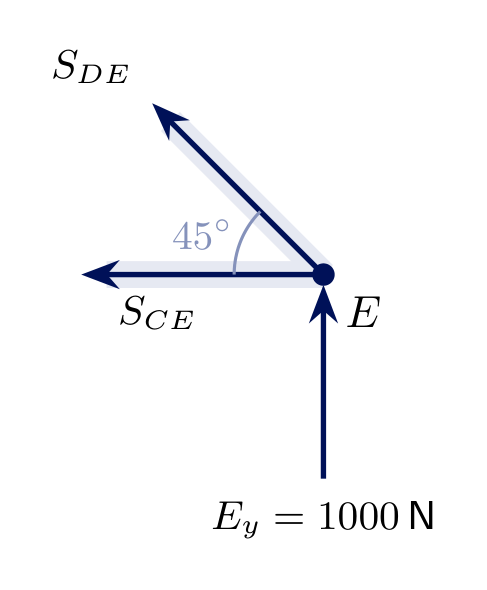

$$\sum F_y = E_y + S_{DE}\sin45^\circ = 0$$
$$\Rightarrow\ S_{DE}=\frac{-1000}{0.7071}\approx\boxed{-1414.2\ \text{N (C)}}$$

$$\sum F_x = -S_{CE} - S_{DE}\cos45^\circ = 0$$
$$\Rightarrow\ \boxed{S_{CE}=1000\ \text{N (T)}}$$

---

## Method of joints - joint D

With $S_{DE}$ known, joint $D$ has 2 unknowns left ($S_{BD}$, $S_{CD}$).

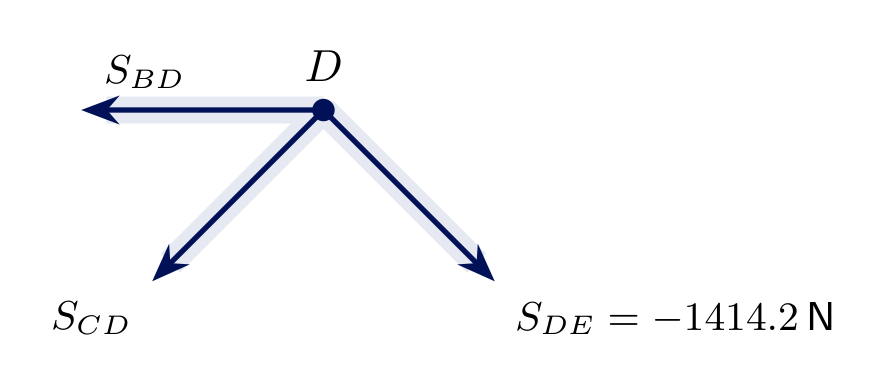

$$\sum F_y = -S_{CD}\sin45^\circ - S_{DE}\sin45^\circ = 0$$
$$\Rightarrow\ \boxed{S_{CD}=-S_{DE}=1414.2\ \text{N (T)}}$$

$$\sum F_x = -S_{BD} - S_{CD}\cos45^\circ + S_{DE}\cos45^\circ = 0$$
$$\Rightarrow\ S_{BD} = -1000 - 1000 = \boxed{-2000\ \text{N (C)}}$$

---

## Ritterschnitt vs. method of joints - same result

| Member | Ritterschnitt (one cut, right part) | Method of joints (joints $E$, $D$) |
|---|---|---|
| $S_{BD}$ | $-2000\ \text{N}$ (C) | $-2000\ \text{N}$ (C) |
| $S_{CD}$ | $+1414.2\ \text{N}$ (T) | $+1414.2\ \text{N}$ (T) |
| $S_{CE}$ | $+1000\ \text{N}$ (T) | $+1000\ \text{N}$ (T) |

**Why identical?** The free body of the cut (right part) consists of exactly the joints $D$ and $E$. Adding their joint equations, the internal member force $S_{DE}$ appears twice with opposite sign and **cancels** - what remains are the equilibrium equations of the cut part.

Same mechanics, different bookkeeping: the method of joints also delivers $S_{DE}$, the Ritterschnitt skips it. The deeper the member sits in a large truss, the more joints the method of joints needs - the Ritterschnitt still needs **one** cut.

---

# Exercise 6.2
## Same truss, asymmetric load at a top-chord joint

Same truss, but now $P=1600\ \text{N}$ acts at $B$ only (not at $C$).

**Find** $S_{AC}$, $S_{BD}$, $S_{BC}$ with a cut at $x=3\ \text{m}$ - keep the **left** portion ($A$, $B$) this time.

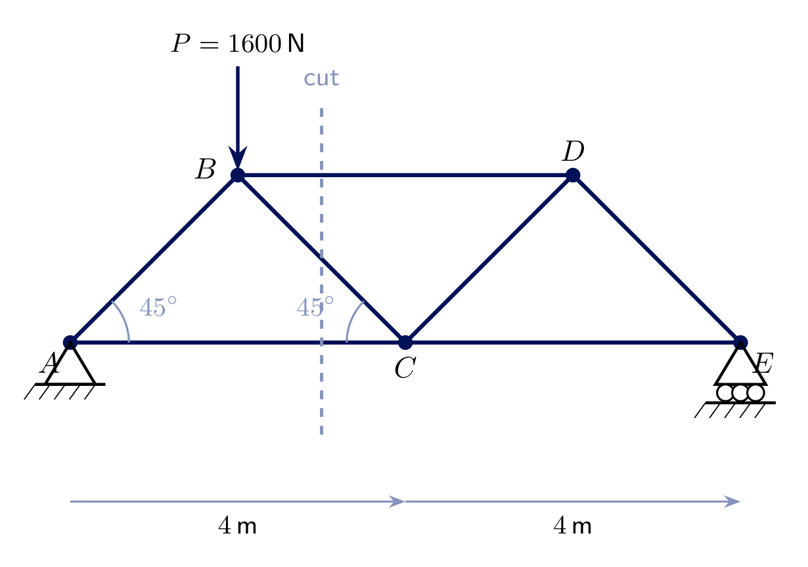

---

## Solution 6.2 - reactions and the cut

$$\sum M_A = E_y\cdot8-P\cdot2=0 \ \Rightarrow\ E_y=400\ \text{N}, \qquad \boxed{A_y=1200\ \text{N}}$$

Cut at $x=3\ \text{m}$ crosses $AC$ (bottom), $BC$ (diagonal), $BD$ (top) - all reachable from joints $A$, $B$.

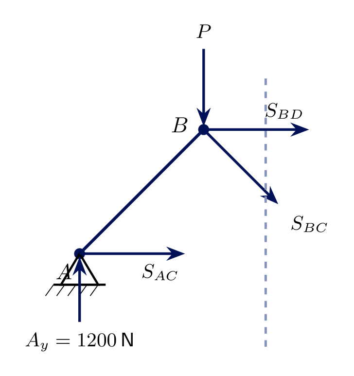

---

## Solution 6.2 - three equations, three members

**Moment about $B$** (eliminates $S_{BC}$, $S_{BD}$ - both pass through $B$; $P$ also passes through $B$):
$$\sum M_B = -A_y\cdot2 + S_{AC}\cdot2 = 0 \ \Rightarrow\ \boxed{S_{AC}=1200\ \text{N (T)}}$$

**Moment about $C$** (eliminates $S_{AC}$, $S_{BC}$ - both pass through $C$):
$$\sum M_C = -A_y\cdot4 + P\cdot2 - S_{BD}\cdot2 = 0 \ \Rightarrow\ \boxed{S_{BD}=-800\ \text{N (C)}}$$

**$\sum F_y=0$:** $A_y - P - S_{BC}\sin45^\circ = 0 \ \Rightarrow\ \boxed{S_{BC}\approx-565.7\ \text{N (C)}}$

---

# Exercise 6.3
## Same cut as 6.1 - finding only $S_{CD}$

Same truss as Exercise 6.1, same cut at $x=5\ \text{m}$, but now $P=3000\ \text{N}$ at $C$ (symmetric, scaled up). This time we only need the diagonal force $S_{CD}$.

**Find** $S_{CD}$ in a **single** equation.

---

## Solution 6.3 - sum forces, not moments

By symmetry: $A_y=E_y=1500\ \text{N}$. Keep the right portion ($D$, $E$), same free body as Exercise 6.1.

$S_{BD}$ (top chord) and $S_{CE}$ (bottom chord) are both **horizontal** - neither has a vertical component, so $\sum F_y=0$ isolates $S_{CD}$ **directly**, no moment equation needed:

$$\sum F_y = E_y - S_{CD}\sin45^\circ = 0 \ \Rightarrow\ S_{CD}=\frac{1500}{\sin45^\circ}\approx\boxed{2121.3\ \text{N (T)}}$$

**Lesson:** when two of the three cut members are parallel, summing forces perpendicular to them is even faster than hunting for a moment centre.

---

# Exercise 6.4
## Wall-mounted cantilever truss (exam type)

Truss $A$-$B$-$C$-$D$-$E$ fixed to a wall by **two pins** at $A(0,0)$ and $B(0,2)$; panels $2\ \text{m}$, height $2\ \text{m}$ (diagonals at $45^\circ$). Loads $Q=10\ \text{kN}$ at $D$, $P=20\ \text{kN}$ at the tip $E$.

**Find**
a) all 6 member forces with the **method of joints**
b) $S_{BC}$, $S_{AD}$, $S_{AC}$ again with **one Ritterschnitt** as a check
c) the support reactions at $A$ and $B$

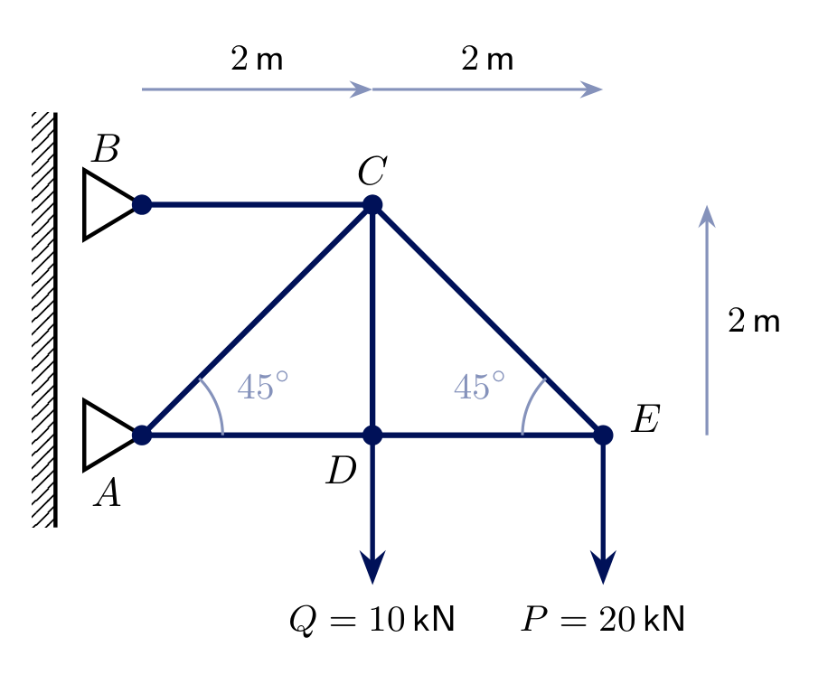

---

## Solution 6.4 a) - joints E and D

**Tip:** with two pins at the wall the reactions (4 unknowns) cannot be found first - start at the **free end** instead.

**Joint E** (unknowns $S_{DE}$, $S_{CE}$):
$$\sum F_y = S_{CE}\sin45^\circ - P = 0 \ \Rightarrow\ \boxed{S_{CE}=28.28\ \text{kN (T)}}$$
$$\sum F_x = -S_{DE} - S_{CE}\cos45^\circ = 0 \ \Rightarrow\ \boxed{S_{DE}=-20\ \text{kN (C)}}$$

**Joint D** (unknowns $S_{AD}$, $S_{CD}$):
$$\sum F_y = S_{CD} - Q = 0 \ \Rightarrow\ \boxed{S_{CD}=10\ \text{kN (T)}}$$
$$\sum F_x = -S_{AD} + S_{DE} = 0 \ \Rightarrow\ \boxed{S_{AD}=-20\ \text{kN (C)}}$$

---

## Solution 6.4 a) - joint C

**Joint C** (unknowns $S_{BC}$, $S_{AC}$; $S_{AC}$ points from $C$ towards $A$, i.e. down-left):

$$\sum F_y = -S_{CD} - S_{CE}\sin45^\circ - S_{AC}\sin45^\circ = 0$$
$$\Rightarrow\ -10 - 20 - 0.7071\,S_{AC} = 0 \ \Rightarrow\ \boxed{S_{AC}=-42.43\ \text{kN (C)}}$$

$$\sum F_x = -S_{BC} + S_{CE}\cos45^\circ - S_{AC}\cos45^\circ = 0$$
$$\Rightarrow\ S_{BC} = 20 + 30 = \boxed{50\ \text{kN (T)}}$$

Upper chord in **tension**, lower chord in **compression** - like a cantilever beam bending downwards.

---

## Solution 6.4 b) - check with one Ritterschnitt

Cut between wall and $C$/$D$, keep the **right** part ($C$, $D$, $E$) - no reactions needed.

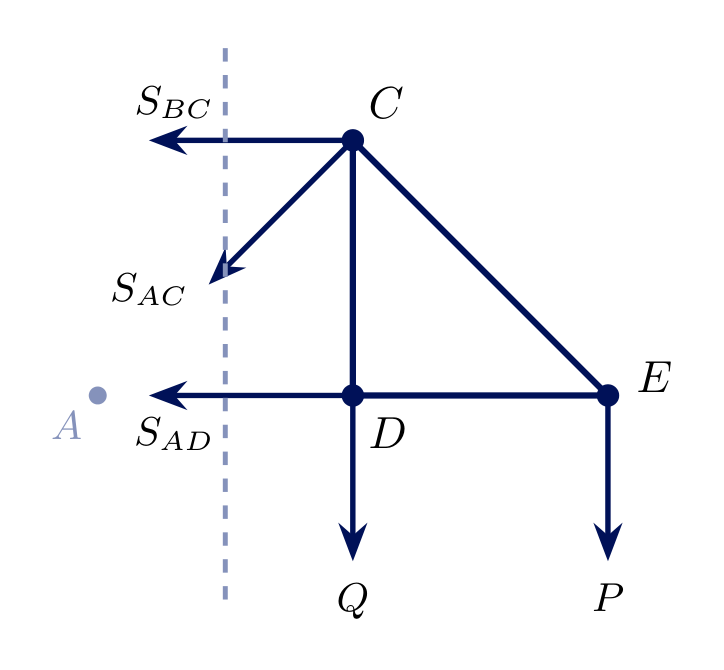

$\sum M_A$ ($S_{AC}$, $S_{AD}$ pass through $A$):
$$S_{BC}\cdot2 - Q\cdot2 - P\cdot4 = 0 \Rightarrow \boxed{S_{BC}=50\ \text{kN}}$$

$\sum M_C$ ($S_{BC}$, $S_{AC}$ pass through $C$):
$$-S_{AD}\cdot2 - P\cdot2 = 0 \Rightarrow \boxed{S_{AD}=-20\ \text{kN}}$$

$\sum F_y$: $-S_{AC}\sin45^\circ - Q - P = 0 \Rightarrow \boxed{S_{AC}=-42.43\ \text{kN}}$

Same values as with the method of joints.

---

## Solution 6.4 c) - support reactions

Reactions follow from the joints at the wall:

**Joint B** (only member $BC$, horizontal):
$$B_x = -S_{BC} = -50\ \text{kN} \ (\text{wall pulls}), \qquad B_y = 0$$

**Joint A** (members $AD$, $AC$):
$$A_x = -S_{AD} - S_{AC}\cos45^\circ = 20 + 30 = 50\ \text{kN} \ (\text{wall pushes})$$
$$A_y = -S_{AC}\sin45^\circ = 30\ \text{kN}$$

**Check (whole truss):** $\sum F_x = 50 - 50 = 0$, $\sum F_y = 30 - 10 - 20 = 0$ ✓

---

# Exercise 6.5
## Bridge truss with three loads (exam type)

Pratt truss, 4 panels of $3\ \text{m}$, height $4\ \text{m}$ (diagonals at $\alpha = 53.1^\circ$ to the horizontal: $\sin\alpha=0.8$, $\cos\alpha=0.6$). **Pin** at $A$, **roller** at $E$. Loads $30\ \text{kN}$ at $B$, $20\ \text{kN}$ at $C$, $10\ \text{kN}$ at $D$.

**Find**
a) the support reactions
b) all **zero-force members** by inspection
c) $S_{FG}$, $S_{FC}$, $S_{BC}$ with **one Ritterschnitt**
d) $S_{BC}$ again with the method of joints ($A$, then $B$)

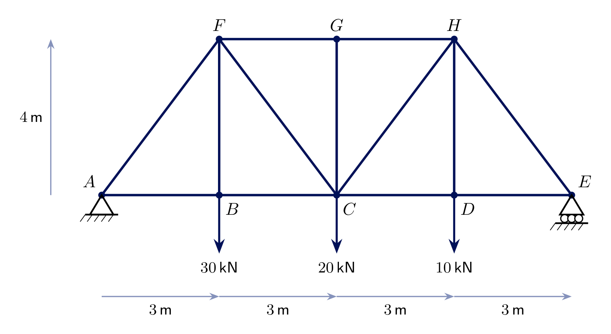

---

## Solution 6.5 a), b) - reactions and zero-force members

**a)** $\sum M_A = E_y\cdot12 - 30\cdot3 - 20\cdot6 - 10\cdot9 = 0$
$$\Rightarrow\ \boxed{E_y=25\ \text{kN}}, \qquad \boxed{A_y=60-25=35\ \text{kN}}, \qquad A_x=0$$

**b)** Joint $G$: unloaded, $FG$ and $GH$ collinear, $CG$ the only other member
$$\Rightarrow\ \boxed{S_{CG}=0} \quad \text{(rule 2, Seminar 5)}$$

Careful: $BF$ and $DH$ look similar, but joints $B$ and $D$ **are loaded** - they are **not** zero-force members ($S_{BF}=30\ \text{kN}$, $S_{DH}=10\ \text{kN}$).

---

## Solution 6.5 c) - Ritterschnitt in panel B-C

Cut through $FG$, $FC$, $BC$; keep the **left** part ($A$, $B$, $F$).

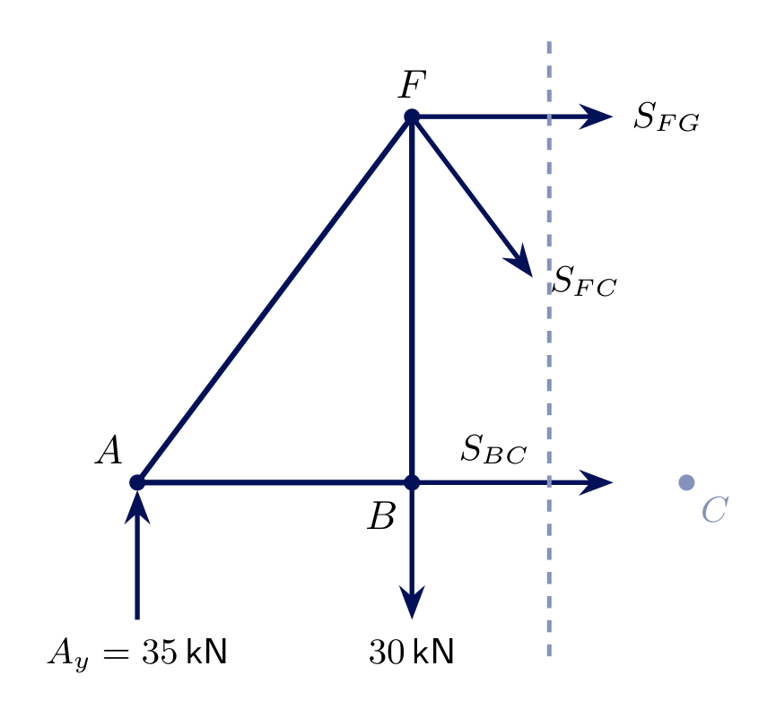

$\sum M_F$ ($S_{FG}$, $S_{FC}$ pass through $F$):
$$-A_y\cdot3 + S_{BC}\cdot4 = 0 \Rightarrow \boxed{S_{BC}=26.25\ \text{kN (T)}}$$

$\sum M_C$ ($S_{BC}$, $S_{FC}$ pass through $C$):
$$-A_y\cdot6 + 30\cdot3 - S_{FG}\cdot4 = 0 \Rightarrow \boxed{S_{FG}=-30\ \text{kN (C)}}$$

$\sum F_y$:
$$A_y - 30 - 0.8\,S_{FC} = 0 \Rightarrow \boxed{S_{FC}=6.25\ \text{kN (T)}}$$

Check $\sum F_x$: $26.25 - 30 + 0.6\cdot6.25 = 0$ ✓

---

## Solution 6.5 d) - same member, method of joints

**Joint A** (members $AB$, $AF$):
$$\sum F_y = A_y + 0.8\,S_{AF} = 0 \ \Rightarrow\ S_{AF}=-43.75\ \text{kN (C)}$$
$$\sum F_x = S_{AB} + 0.6\,S_{AF} = 0 \ \Rightarrow\ S_{AB}=26.25\ \text{kN (T)}$$

**Joint B** ($AB$, $BC$ collinear, $BF$ vertical):
$$\sum F_x:\ \boxed{S_{BC}=S_{AB}=26.25\ \text{kN (T)}} \qquad \sum F_y:\ S_{BF}=30\ \text{kN (T)}$$

Same result as the Ritterschnitt - here 2 joints vs. 1 cut. For $S_{FG}$, the method of joints would additionally need joint $F$.

---

<!-- _class: lead -->
# Questions?

Prof. Dr.-Ing. Christian Willberg
christian.willberg@h2.de
Office: Building 10, Room 2.09
