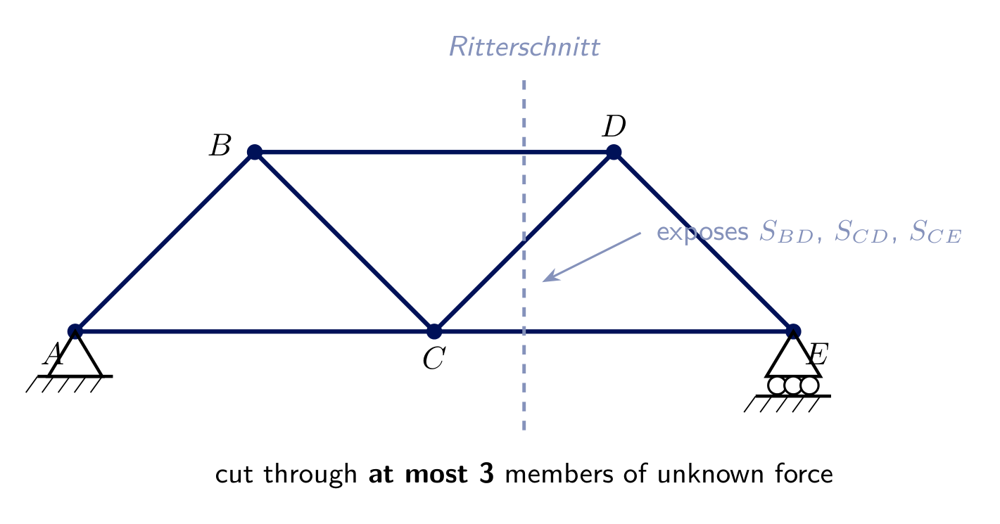
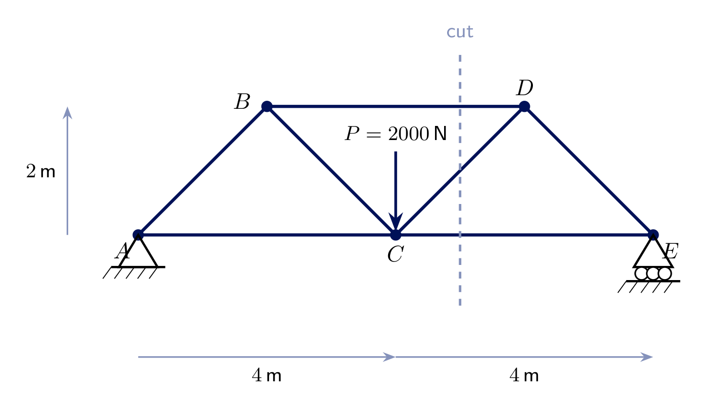
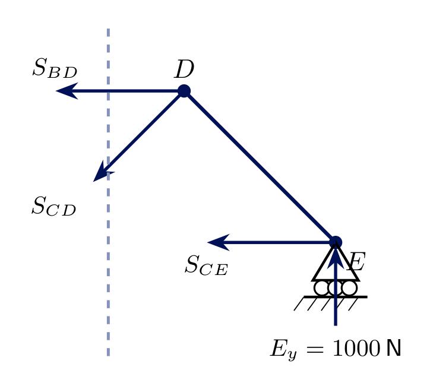
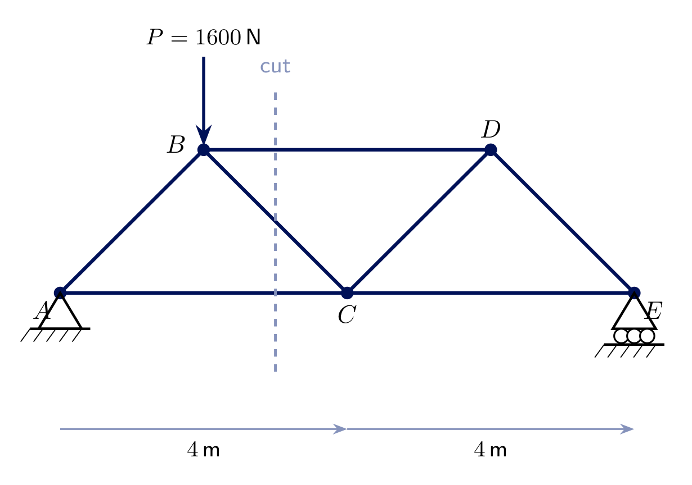
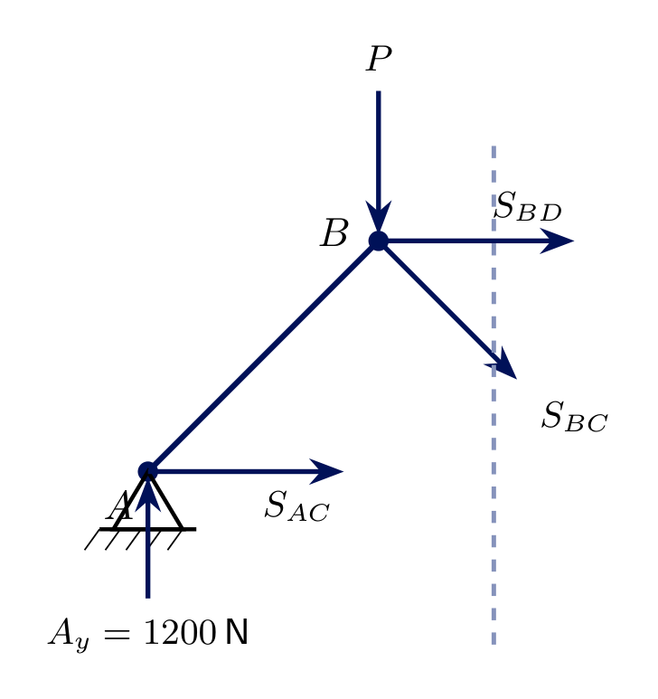

<!-- _class: lead -->
# Trusses II - Method of Sections
## Engineering Mechanics - Seminar 6
Prof. Dr.-Ing. Christian Willberg
Hochschule Magdeburg-Stendal

---

## Overview

- Limitation of the method of joints: to reach a member deep inside a truss you must solve every joint before it
- The **method of sections** (*Ritterschnittverfahren*): cut straight through the truss and find a specific member force directly
- The key trick: choosing the **moment centre** where two of the three cut forces intersect
- Two worked examples, both on the same 5-joint truss, two different cuts and load cases

---

# Theory

---

## Why a second method?

- Method of joints (Seminar 5): start at one end, solve joint by joint - to find a member in the *middle* of a large truss you must first solve every joint before it
- **Method of sections:** cut the truss into two parts with an imaginary section, then treat **one whole part** as a single rigid body
- Still just $\sum F_x=0$, $\sum F_y=0$, $\sum M=0$ - but now a **general** force system (Seminar 2), not a concurrent one

---

## Ritterschnitt - procedure

1. Find the **support reactions** first (whole truss)
2. Choose a cut through **at most 3** members of unknown force
3. Keep **either** side as a free body - reactions/loads on that side **and** the 3 cut forces, assumed in tension
4. Apply $\sum F_x=0$, $\sum F_y=0$, $\sum M=0$ to that one free body

---

## The moment-centre trick

If two of the three cut forces **intersect** at a point, taking $\sum M$ about **that point** eliminates both at once - the third force comes out of a **single equation**.

- If two cut members are **parallel** (never intersect), $\sum F$ **perpendicular** to them isolates the third force directly instead
- This is what makes the method of sections fast: one well-chosen equation can give you the **one** member force you actually need, with no other joint ever solved

---

# Exercise 6.1
## Warren truss, load at the bottom-chord joint

Truss $A$-$B$-$C$-$D$-$E$ (5 joints, span $8\ \text{m}$, height $2\ \text{m}$, all diagonals at $45^\circ$): **pin** at $A$, **roller** at $E$. A load $P=2000\ \text{N}$ acts at $C$.

**Find** $S_{BD}$, $S_{CD}$, $S_{CE}$ using **one** Ritterschnitt - without solving joints $A$ or $B$.

---

## Solution 6.1 - reactions and the cut

By symmetry (or $\sum M_A=0$): $\boxed{A_y=E_y=1000\ \text{N}}$, $A_x=0$.

Cut at $x=5\ \text{m}$ crosses exactly 3 members: top chord $BD$, diagonal $CD$, bottom chord $CE$. Keep the **right** portion ($D$, $E$) as the free body.

---

## Solution 6.1 - three equations, three members

**Moment about $D$** (eliminates $S_{BD}$, $S_{CD}$ - both pass through $D$):
$$\sum M_D = E_y\cdot2 - S_{CE}\cdot2 = 0 \ \Rightarrow\ \boxed{S_{CE}=1000\ \text{N (T)}}$$

**Moment about $C$** (eliminates $S_{CD}$, $S_{CE}$ - both pass through $C$):
$$\sum M_C = E_y\cdot4 + S_{BD}\cdot2 = 0 \ \Rightarrow\ \boxed{S_{BD}=-2000\ \text{N (C)}}$$

**$\sum F_y=0$** (only $S_{CD}$ has a vertical component): $E_y - S_{CD}\sin45^\circ=0 \ \Rightarrow\ \boxed{S_{CD}\approx1414.2\ \text{N (T)}}$

---

# Exercise 6.2
## Same truss, asymmetric load at a top-chord joint

Same truss, but now $P=1600\ \text{N}$ acts at $B$ only (not at $C$).

**Find** $S_{AC}$, $S_{BD}$, $S_{BC}$ with a cut at $x=3\ \text{m}$ - keep the **left** portion ($A$, $B$) this time.

---

## Solution 6.2 - reactions and the cut

$$\sum M_A = E_y\cdot8-P\cdot2=0 \ \Rightarrow\ E_y=400\ \text{N}, \qquad \boxed{A_y=1200\ \text{N}}$$

Cut at $x=3\ \text{m}$ crosses $AC$ (bottom), $BC$ (diagonal), $BD$ (top) - all reachable from joints $A$, $B$.

---

## Solution 6.2 - three equations, three members

**Moment about $B$** (eliminates $S_{BC}$, $S_{BD}$ - both pass through $B$; $P$ also passes through $B$):
$$\sum M_B = -A_y\cdot2 + S_{AC}\cdot2 = 0 \ \Rightarrow\ \boxed{S_{AC}=1200\ \text{N (T)}}$$

**Moment about $C$** (eliminates $S_{AC}$, $S_{BC}$ - both pass through $C$):
$$\sum M_C = -A_y\cdot4 + P\cdot2 - S_{BD}\cdot2 = 0 \ \Rightarrow\ \boxed{S_{BD}=-800\ \text{N (C)}}$$

**$\sum F_y=0$:** $A_y - P - S_{BC}\sin45^\circ = 0 \ \Rightarrow\ \boxed{S_{BC}\approx-565.7\ \text{N (C)}}$

---

# Exercise 6.3
## Same cut as 6.1 - finding only $S_{CD}$

Same truss as Exercise 6.1, same cut at $x=5\ \text{m}$, but now $P=3000\ \text{N}$ at $C$ (symmetric, scaled up). This time we only need the diagonal force $S_{CD}$.

**Find** $S_{CD}$ in a **single** equation.

---

## Solution 6.3 - sum forces, not moments

By symmetry: $A_y=E_y=1500\ \text{N}$. Keep the right portion ($D$, $E$), same free body as Exercise 6.1.

$S_{BD}$ (top chord) and $S_{CE}$ (bottom chord) are both **horizontal** - neither has a vertical component, so $\sum F_y=0$ isolates $S_{CD}$ **directly**, no moment equation needed:

$$\sum F_y = E_y - S_{CD}\sin45^\circ = 0 \ \Rightarrow\ S_{CD}=\frac{1500}{\sin45^\circ}\approx\boxed{2121.3\ \text{N (T)}}$$

**Lesson:** when two of the three cut members are parallel, summing forces perpendicular to them is even faster than hunting for a moment centre.

---

<!-- _class: lead -->
# Questions?

Prof. Dr.-Ing. Christian Willberg
christian.willberg@h2.de
Office: Building 10, Room 2.09
