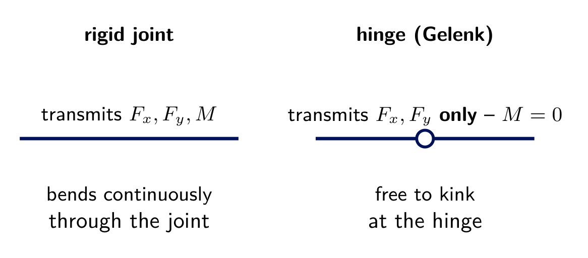
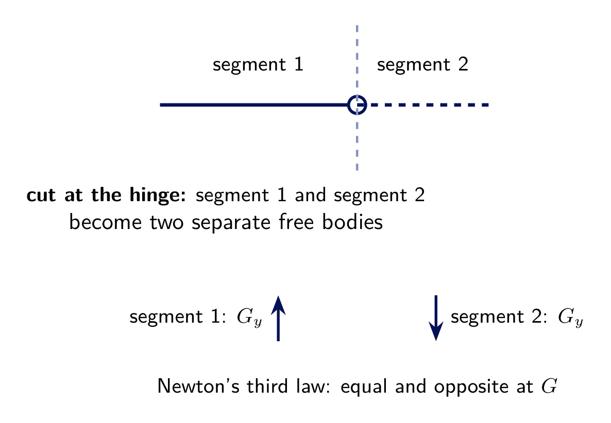
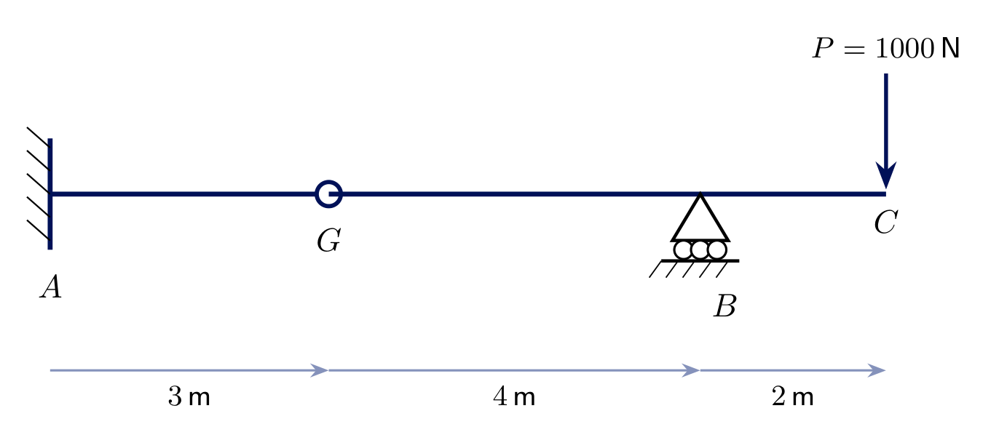
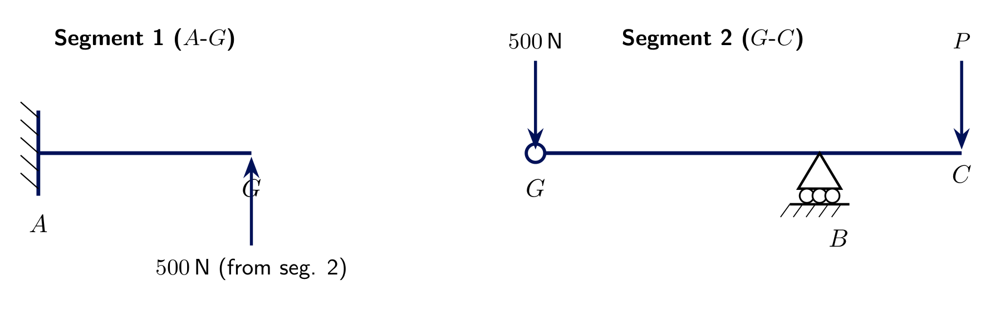
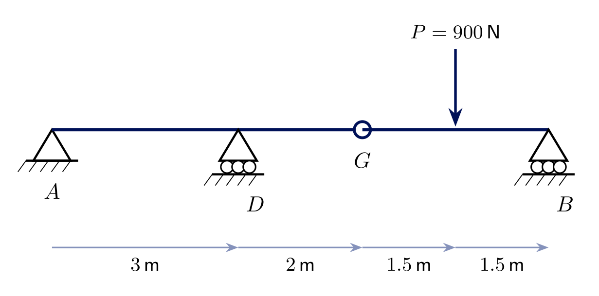
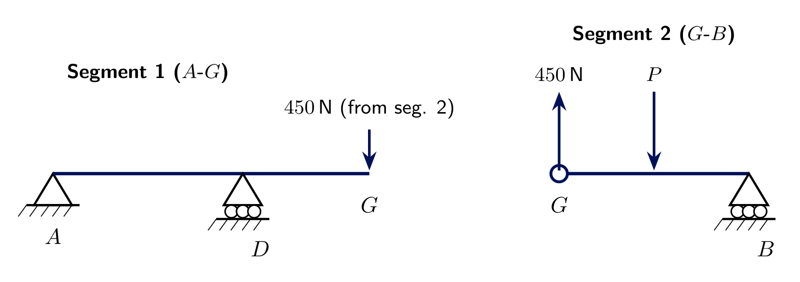
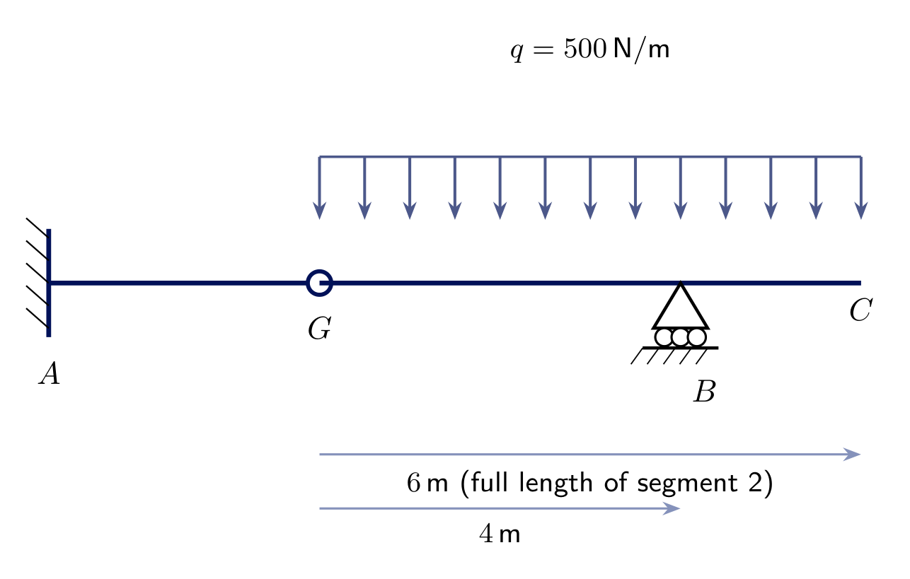
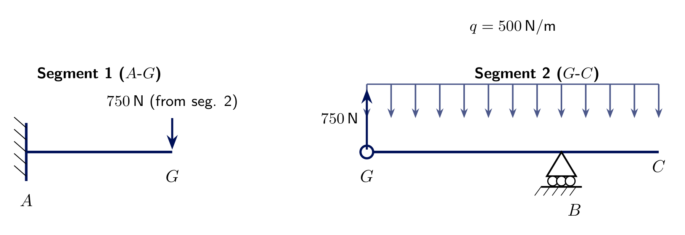

<!-- _class: lead -->
# Hinges in Beams
## Engineering Mechanics - Seminar 7
Prof. Dr.-Ing. Christian Willberg
Hochschule Magdeburg-Stendal

---

## Overview

- What a hinge (*Gelenk*) is and how it differs from a rigid joint **and** from a support
- Why a hinge makes an otherwise indeterminate multi-span beam (*Gelenkbalken*) solvable
- The procedure: cut the structure apart at the hinge, solve the self-sufficient segment first
- Three worked examples, all single-hinge, with increasingly different load cases

---

# Theory

---

## What is a hinge (Gelenk)?

- A **support** connects a structure to the ground; a **hinge** connects two parts of the *same* structure to each other
- A rigid connection transmits $F_x$, $F_y$, **and** $M$
- A hinge transmits $F_x$, $F_y$ **only** - by definition, $M=0$ at a hinge
- A *Gelenkbalken* is a multi-span beam with one or more internal hinges

---

## Cutting the structure at the hinge

- Cutting at the hinge turns one structure into **two separate free bodies**
- The hinge forces $G_x$, $G_y$ are **internal** - equal and opposite on the two cut faces (Newton's third law) - and vanish when the whole system is considered together
- No hinge moment ever appears, on either side

---

## Solution procedure

1. Identify the segments and the hinge(s) between them
2. Find the segment that is **statically determinate on its own** (its own supports + the hinge give exactly 3 independent reaction components) - solve it first with $\sum F_x=0,\sum F_y=0,\sum M=0$
3. By Newton's third law, the **other** segment feels the *same* hinge force, **reversed**
4. Solve the remaining segment the same way

A segment resting on the hinge alone (no support of its own) is **not** stable - every segment needs enough of its *own* supports besides the hinge.

---

# Exercise 7.1
## Fixed support, hinge, roller, overhang load

Segment 1: **fixed** at $A$, to hinge $G$ ($3\ \text{m}$). Segment 2: $G$ to **roller** $B$ ($4\ \text{m}$) to free end $C$ ($2\ \text{m}$ further), with $P=1000\ \text{N}$ at $C$.

**Find** all reactions at $A$ and $B$.

---

## Solution 7.1 - segment 2 first

Segment 2 (hinge $G$ + roller $B$) is determinate on its own - solve it first:

$$\sum M_G = B_y\cdot4 - P\cdot6=0 \ \Rightarrow\ \boxed{B_y=1500\ \text{N}}$$
$$\sum F_y = G_y+B_y-P=0 \ \Rightarrow\ G_y=1000-1500=\boxed{-500\ \text{N}}$$

$G_y$ negative: segment 1 actually pulls **down** on segment 2 at $G$ (the overhang moment at $C$ overpowers the roller alone).

---

## Solution 7.1 - segment 1

By Newton's third law, segment 2 pulls **up** on segment 1 at $G$ with $500\ \text{N}$:

$$\sum F_x = A_x = 0 \ \Rightarrow\ \boxed{A_x=0}$$
$$\sum F_y = A_y+500=0 \ \Rightarrow\ \boxed{A_y=-500\ \text{N}}$$
$$\sum M_A = M_A+500\cdot3=0 \ \Rightarrow\ \boxed{M_A=-1500\ \text{N}\!\cdot\!\text{m}}$$

Check (whole system): $A_y+B_y-P=-500+1500-1000=0$ ✓

---

# Exercise 7.2
## Pin, roller, hinge, roller - load between hinge and far support

Segment 1: **pin** $A$, **roller** $D$ ($3\ \text{m}$ apart), to hinge $G$ ($2\ \text{m}$ further). Segment 2: $G$ to **roller** $B$ ($3\ \text{m}$), $P=900\ \text{N}$ at midspan.

**Find** all reactions at $A$, $D$, $B$.

---

## Solution 7.2 - segment 2 first, then segment 1

Segment 2 (hinge + roller, determinate alone):
$$\sum M_G = B_y\cdot3 - P\cdot1.5=0 \ \Rightarrow\ \boxed{B_y=450\ \text{N}}, \qquad G_y=900-450=\boxed{450\ \text{N}}$$

Segment 1 receives $450\ \text{N}$ **downward** at $G$ (opposite of $G_y$ above):

$$\sum M_A = D_y\cdot3 - 450\cdot5=0 \ \Rightarrow\ \boxed{D_y=750\ \text{N}}, \qquad \sum F_y: \boxed{A_y=450-750=-300\ \text{N}}$$

---

# Exercise 7.3
## Fixed support, hinge, then a distributed load over the whole second segment

Segment 1: **fixed** at $A$, to hinge $G$ ($3\ \text{m}$). Segment 2: $G$ to **roller** $B$ ($4\ \text{m}$) to free end $C$ ($2\ \text{m}$ further) - but now $q=500\ \text{N/m}$ acts over the **entire** $6\ \text{m}$ of segment 2.

**Find** all reactions at $A$ and $B$.

---

## Solution 7.3

Resultant $R=q\cdot6=3000\ \text{N}$ at the centroid, $3\ \text{m}$ from $G$ (Seminar 4 technique). Segment 2:

$$\sum M_G = B_y\cdot4-R\cdot3=0 \ \Rightarrow\ \boxed{B_y=2250\ \text{N}}, \qquad G_y=3000-2250=\boxed{750\ \text{N}}$$

Segment 1 receives $750\ \text{N}$ **downward** at $G$:

$$\boxed{A_x=0}, \qquad \boxed{A_y=750\ \text{N}}, \qquad \boxed{M_A=2250\ \text{N}\!\cdot\!\text{m}}$$

---

<!-- _class: lead -->
# Questions?

Prof. Dr.-Ing. Christian Willberg
christian.willberg@h2.de
Office: Building 10, Room 2.09
