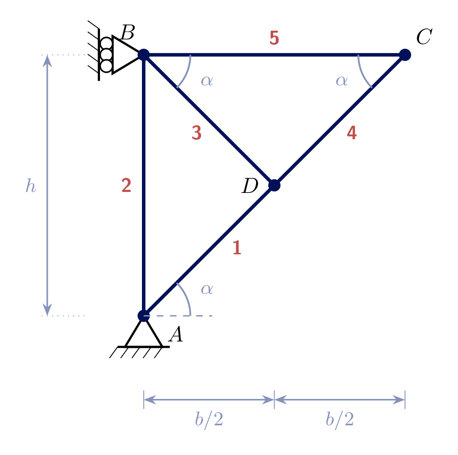
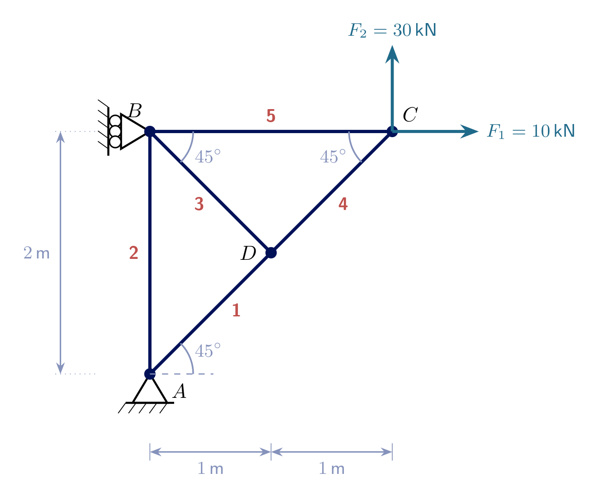
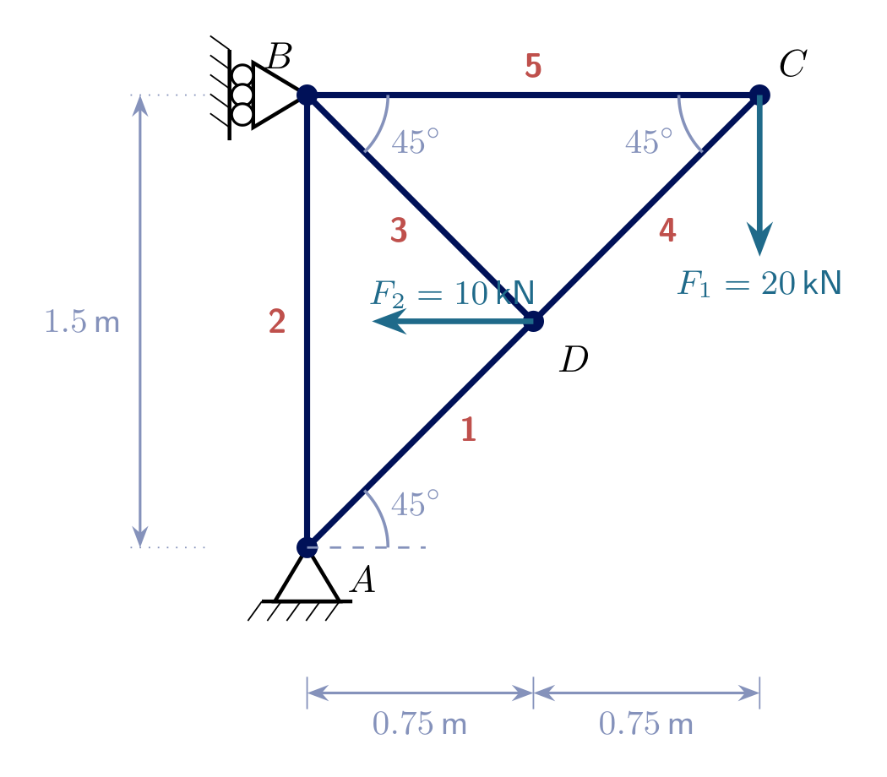
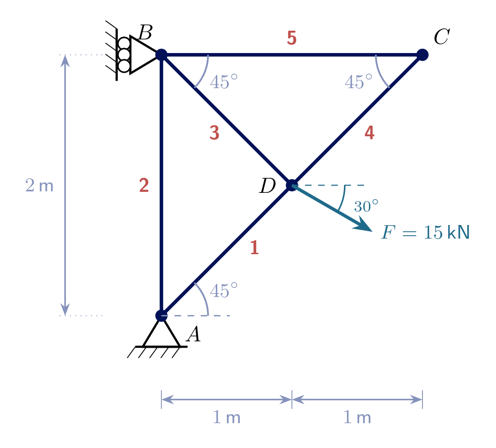
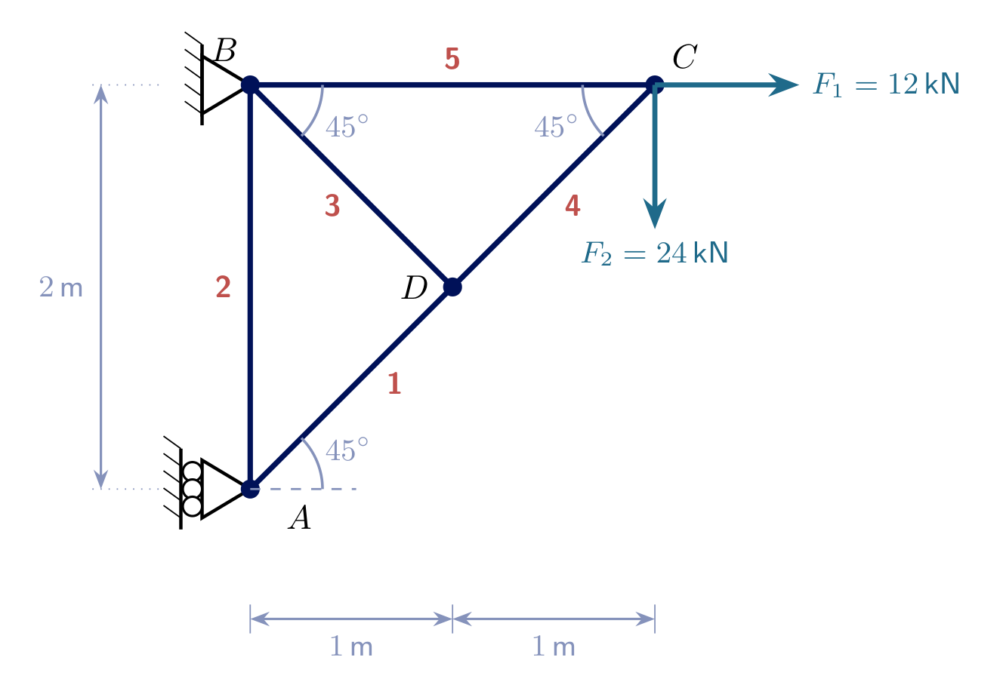
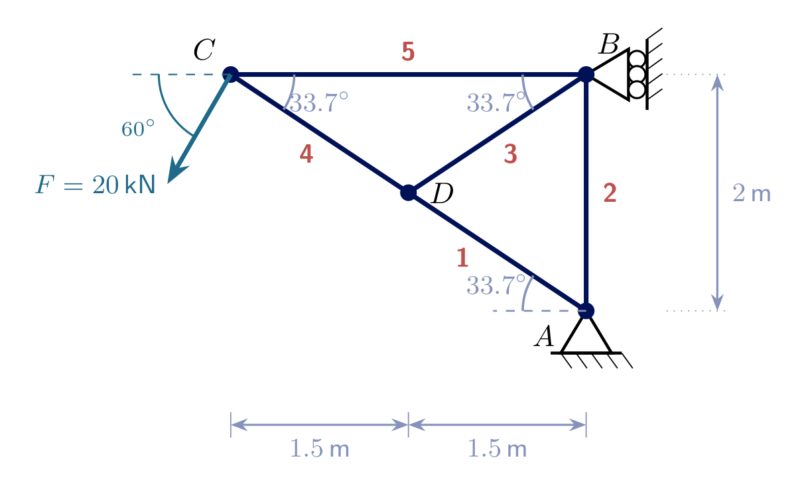

<!-- _class: lead -->
# Trusses III - Calculation Practice
## Engineering Mechanics - Seminar 7
Prof. Dr.-Ing. Christian Willberg
Hochschule Magdeburg-Stendal

---

## Overview

- **No new theory** - a pure calculation session
- One truss model, **five variations**: different dimensions, loads and supports
- Exam type: this is the kind of truss you will meet in the written exam
- Use the methods from Seminars 5 and 6: method of joints and method of sections
- Only the tasks are given here - the solutions are discussed in the seminar

<!--
Timing (90 min): 5 min introduction, 5 x 15 min exercises (work in pairs, then compare at the board), 10 min wrap-up.
Solutions intentionally not on the slides.
-->

---

## The truss model

- Joints $A$, $B$, $C$, $D$ - $D$ is the **midpoint** of the diagonal $AC$
- Width $b$, height $h$; $AB$ vertical, $BC$ horizontal
- Inclined members make the angle $\alpha$ with the horizontal: $\tan\alpha = h/b$

| Member | Joints | Angle to the horizontal |
|---|---|---|
| 1 | $A$-$D$ | $\alpha$ |
| 2 | $A$-$B$ | $90^\circ$ |
| 3 | $B$-$D$ | $\alpha$ |
| 4 | $D$-$C$ | $\alpha$ |
| 5 | $B$-$C$ | $0^\circ$ |

---

## Working procedure

1. **Check** static determinacy: $m + r = 2j$
2. **Free-body diagram** of the whole truss - replace supports by their reactions
3. **Support reactions** from $\sum F_x = 0$, $\sum F_y = 0$, $\sum M = 0$
4. **Zero-force members** - spot them before you calculate
5. **Member forces** - method of joints (start at a joint with at most 2 unknowns) or method of sections
6. **Check** - one equation you have not used yet must also be satisfied

**Don't forget the sketches!** Every free-body diagram counts in the exam. Assume all member forces as **tension** - a negative result means compression.

---

# Exercise 7.1
## Loads at the free corner (exam type)

**Given**
- $b = h = 2\ \text{m}$, $\alpha = 45^\circ$
- $A$: **pin support**, $B$: **roller support** at the wall (reaction horizontal only)
- At $C$: $F_1 = 10\ \text{kN}$ horizontal (to the right), $F_2 = 30\ \text{kN}$ vertical (upwards)

**Find**
a) the support reactions at $A$ and $B$
b) all member forces $S_1 \dots S_5$ (tension or compression?)
c) the zero-force members

---

# Exercise 7.2
## Two loads, smaller truss

**Given**
- $b = h = 1.5\ \text{m}$, $\alpha = 45^\circ$
- $A$: **pin support**, $B$: **roller support** at the wall (reaction horizontal only)
- At $C$: $F_1 = 20\ \text{kN}$ vertical (downwards)
- At $D$: $F_2 = 10\ \text{kN}$ horizontal (to the left)

**Find**
a) the support reactions at $A$ and $B$
b) all member forces $S_1 \dots S_5$ (tension or compression?)

---

# Exercise 7.3
## Inclined load at the inner joint

**Given**
- $b = h = 2\ \text{m}$, $\alpha = 45^\circ$
- $A$: **pin support**, $B$: **roller support** at the wall (reaction horizontal only)
- At $D$: $F = 15\ \text{kN}$, acting **downwards to the right** at $30^\circ$ below the horizontal

**Find**
a) the components of $F$
b) the support reactions at $A$ and $B$
c) all member forces $S_1 \dots S_5$ (tension or compression?)
d) Which members are zero-force members here - and why is the answer different from Exercise 7.1?

---

# Exercise 7.4
## Supports swapped

**Given**
- $b = h = 2\ \text{m}$, $\alpha = 45^\circ$
- $A$: **roller support** at the wall (reaction horizontal only), $B$: **pin support** at the wall
- At $C$: $F_1 = 12\ \text{kN}$ horizontal (to the right), $F_2 = 24\ \text{kN}$ vertical (downwards)

**Find**
a) the support reactions at $A$ and $B$
b) all member forces $S_1 \dots S_5$ (tension or compression?)
c) Which member now carries the vertical load into the support - compare with Exercise 7.1

---

# Exercise 7.5
## Rectangular truss, inclined load

**Given**
- $b = 3\ \text{m}$, $h = 2\ \text{m}$, $\alpha = 33.7^\circ$ ($\sin\alpha = 0.555$, $\cos\alpha = 0.832$)
- $A$: **pin support**, $B$: **roller support** at the wall (reaction horizontal only)
- At $C$: $F = 20\ \text{kN}$, acting **downwards to the right** at $60^\circ$ below the horizontal

**Find**
a) the components of $F$
b) the support reactions at $A$ and $B$
c) all member forces $S_1 \dots S_5$ (tension or compression?)

---

## Before you hand in

- Is every free-body diagram drawn - whole truss **and** each joint you used?
- Do the support reactions satisfy **all three** equilibrium equations?
- Are signs consistent? Tension $+$, compression $-$
- Did you mark **T** / **C** for every member?
- Does an unused joint confirm your results?

Exam tip: Look for **zero-force members** first - at an unloaded joint with two members, or with three members where two are collinear. They save time and are a free check.

---

<!-- _class: lead -->
# Questions?

Prof. Dr.-Ing. Christian Willberg
christian.willberg@h2.de
Office: Building 10, Room 2.09
