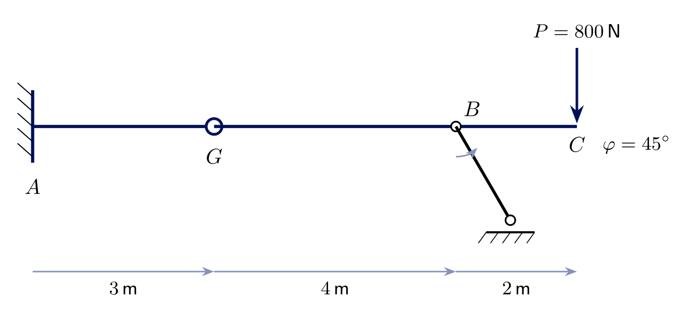
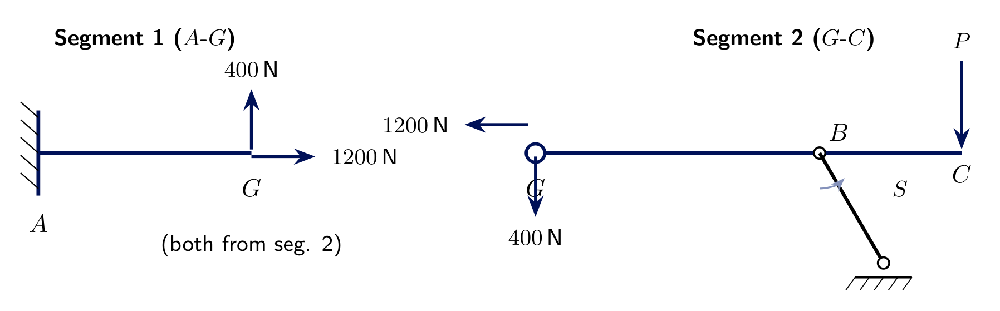
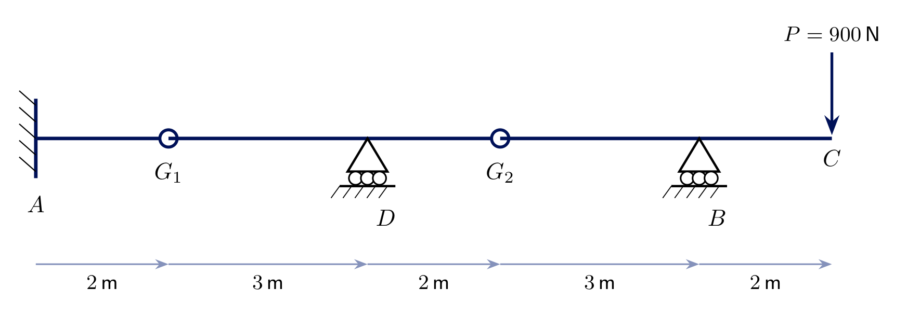
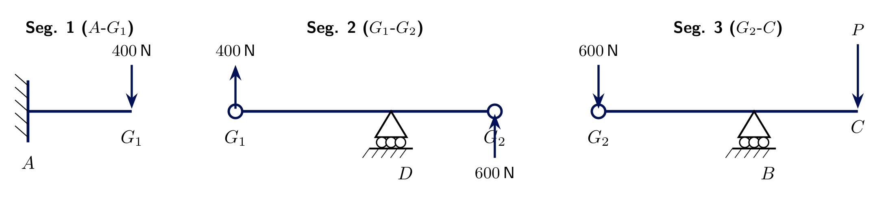
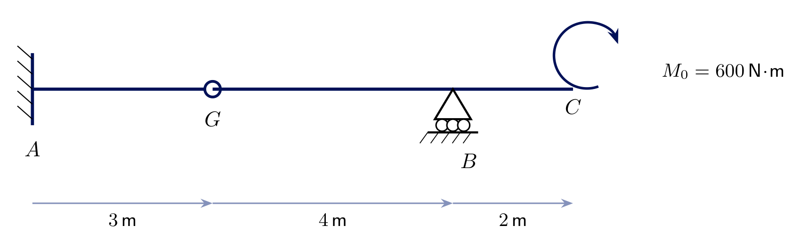
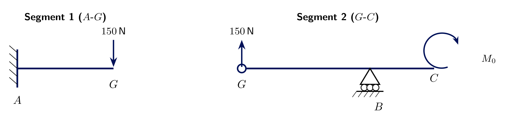

<!-- _class: lead -->
# Hinges - Worked Calculations
## Engineering Mechanics - Seminar 8
Prof. Dr.-Ing. Christian Willberg
Hochschule Magdeburg-Stendal

---

## Overview

- No new theory - the same cut-at-the-hinge method from Seminar 7, applied to three harder cases
- Exercise 8.1: a **Pendelstütze** instead of a roller - the hinge now carries a horizontal force too
- Exercise 8.2: **two hinges**, three segments - which one do you solve first?
- Exercise 8.3: an **applied couple** at the free end instead of a point load

---

## Recap: the procedure

1. Find the segment that is determinate **on its own** (its own supports + the hinge give exactly 3 reaction components)
2. Solve it with $\sum F_x=0,\sum F_y=0,\sum M=0$
3. The neighbouring segment feels the **same hinge force, reversed** (Newton's third law)
4. Repeat outward until every segment is solved

---

# Exercise 8.1
## Hinge next to a Pendelstütze

Segment 1: **fixed** $A$, to hinge $G$ ($3\ \text{m}$). Segment 2: $G$ to **Pendelstütze** $B$ at $\varphi=45^\circ$ ($4\ \text{m}$), to free end $C$ ($2\ \text{m}$ further), $P=800\ \text{N}$ at $C$.

**Find** all reactions at $A$ and the strut force $S$.

---

## Solution 8.1 - segment 2 first

The strut force has **both** components: $B_y=S\sin45^\circ$, $B_x=S\cos45^\circ$.

$$\sum M_G = B_y\cdot4-P\cdot6=0 \ \Rightarrow\ B_y=1200\ \text{N} \ \Rightarrow\ \boxed{S\approx1697.1\ \text{N}}, \quad B_x=1200\ \text{N}$$
$$\sum F_y: G_y=800-1200=\boxed{-400\ \text{N}} \qquad \sum F_x: G_x=\boxed{-1200\ \text{N}}$$

For the **first time**, the hinge carries a horizontal force too - because the Pendelstütze's reaction isn't purely vertical.

---

## Solution 8.1 - segment 1

Segment 1 receives the reversed hinge force: $1200\ \text{N}$ rightward, $400\ \text{N}$ upward.

$$\boxed{A_x=-1200\ \text{N}} \qquad \boxed{A_y=-400\ \text{N}}$$
$$\sum M_A = M_A+400\cdot3=0 \ \Rightarrow\ \boxed{M_A=-1200\ \text{N}\!\cdot\!\text{m}}$$

---

# Exercise 8.2
## Two hinges, three segments

$A$ (fixed) - $G_1$ ($2\ \text{m}$) - $D$ (roller, $3\ \text{m}$) - $G_2$ ($2\ \text{m}$) - $B$ (roller, $3\ \text{m}$) - $C$ (free end, $2\ \text{m}$), $P=900\ \text{N}$ at $C$.

**Which segment do you solve first?** The one determinate on its own - here, segment 3 ($G_2$-$B$-$C$): hinge + roller = 3 unknowns, 3 equations.

---

## Solution 8.2 - outside in

**Seg. 3** ($G_2$-$C$, first): $B_y\cdot3-P\cdot5=0 \Rightarrow B_y=1500\ \text{N}$, $G_{2y}=900-1500=-600\ \text{N}$

**Seg. 2** (receives $+600\ \text{N}$ at $G_2$): $D_y\cdot3+600\cdot5=0 \Rightarrow D_y=-1000\ \text{N}$, $G_{1y}=-600-D_y=400\ \text{N}$

**Seg. 1** (receives $-400\ \text{N}$ at $G_1$): $\boxed{A_y=400\ \text{N}}$, $\boxed{M_A=800\ \text{N}\!\cdot\!\text{m}}$

---

# Exercise 8.3
## Applied couple instead of a point load

Segment 1: **fixed** $A$, to hinge $G$ ($3\ \text{m}$). Segment 2: $G$ to **roller** $B$ ($4\ \text{m}$), to free end $C$ ($2\ \text{m}$ further) - but now an **applied couple** $M_0=600\ \text{N}\!\cdot\!\text{m}$ acts at $C$, no force.

**Find** all reactions at $A$ and $B$.

---

## Solution 8.3

A pure couple still needs $\sum M=0$ - but contributes **no** term to $\sum F_x$ or $\sum F_y$ directly, and (having no lever arm of its own) enters the moment equation unchanged:

$$\sum M_G = B_y\cdot4+M_0=0 \ \Rightarrow\ \boxed{B_y=-150\ \text{N}}, \qquad G_y=0-(-150)=\boxed{150\ \text{N}}$$

Segment 1 receives $150\ \text{N}$ **downward**: $\boxed{A_y=150\ \text{N}}$, $\sum M_A=M_A-150\cdot3=0\Rightarrow\boxed{M_A=450\ \text{N}\!\cdot\!\text{m}}$

---

<!-- _class: lead -->
# Questions?

Prof. Dr.-Ing. Christian Willberg
christian.willberg@h2.de
Office: Building 10, Room 2.09
