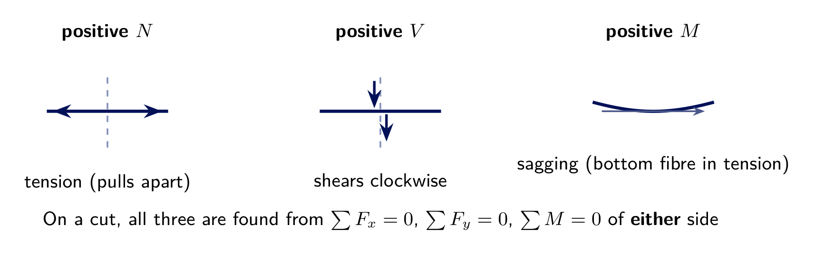
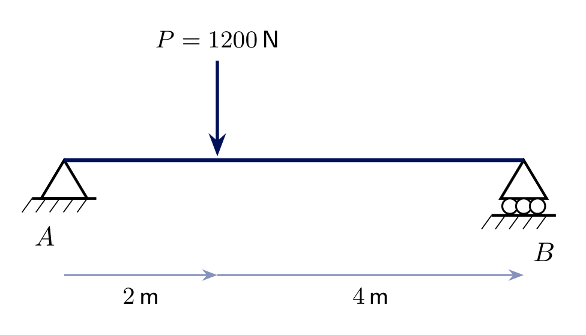
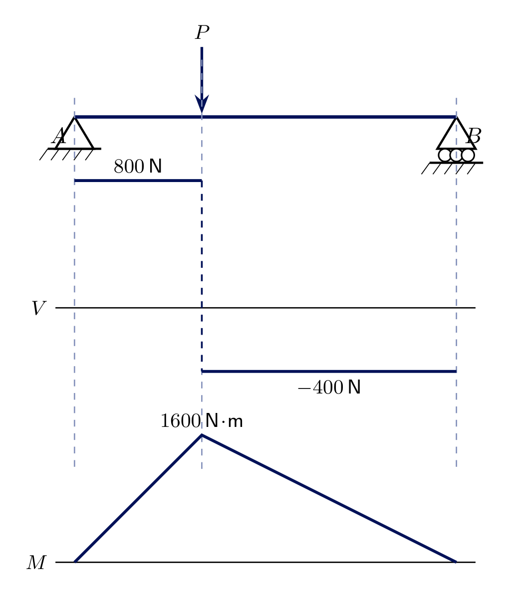
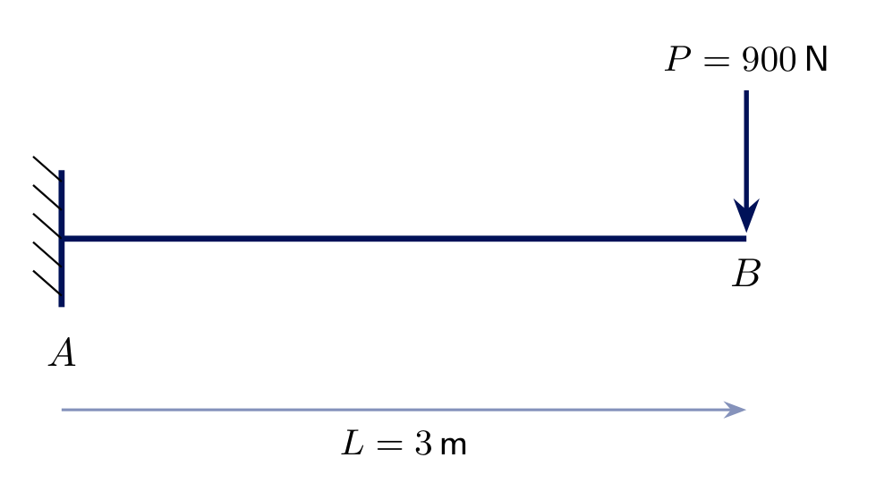
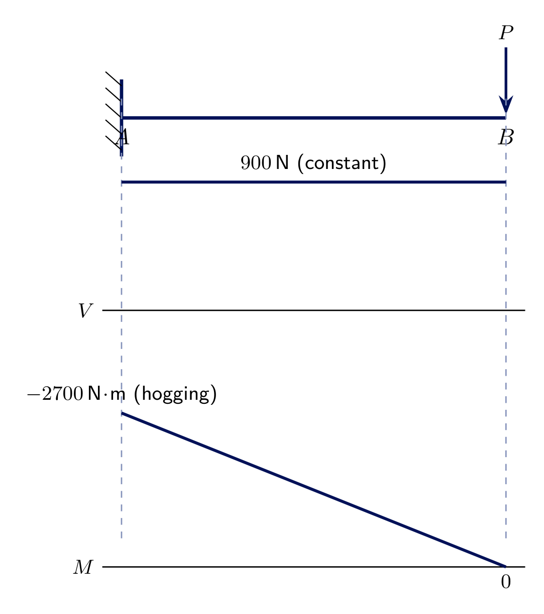
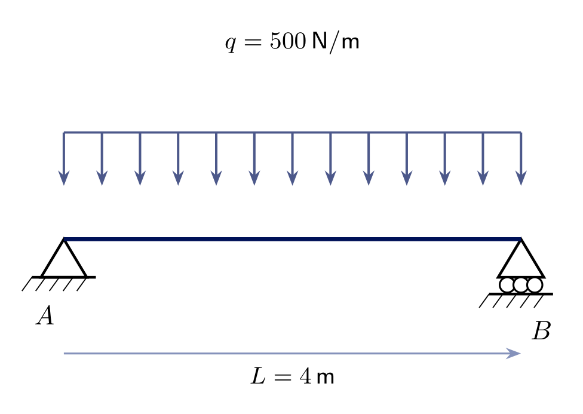
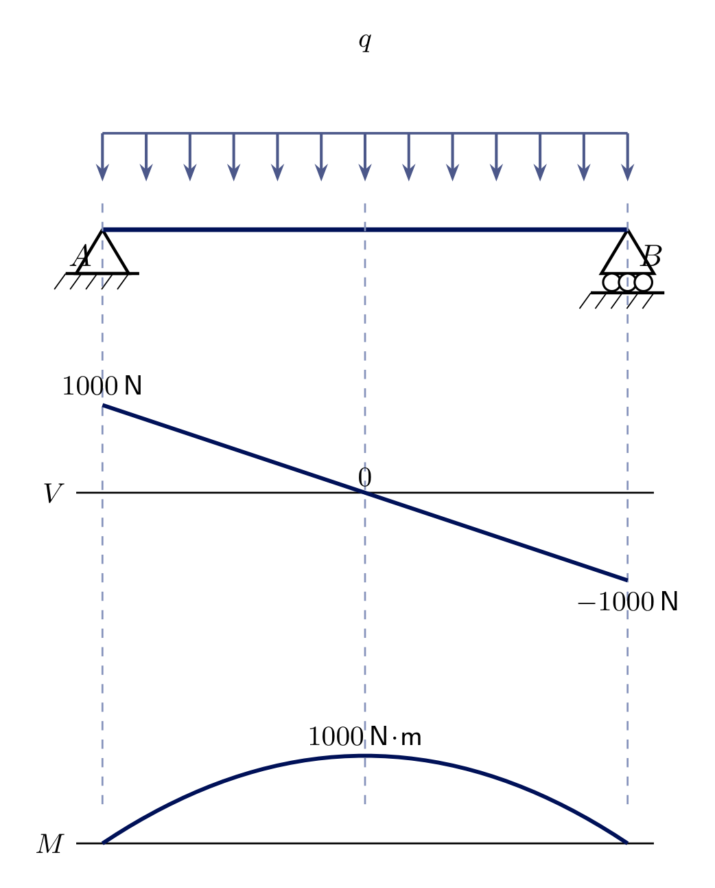

<!-- _class: lead -->
# Internal Forces I
## Engineering Mechanics - Seminar 9
Prof. Dr.-Ing. Christian Willberg
Hochschule Magdeburg-Stendal

---

## Overview

- Three internal reactions at any cut through a beam: normal force $N$, shear force $V$, bending moment $M$
- Sign convention: tension, "clockwise shear", sagging
- How to compute and sketch $V(x)$ and $M(x)$ along a beam
- Three worked examples: a point load, a cantilever, a full uniform load - the three basic diagram shapes

---

# Theory

---

## Internal forces: cutting the beam

Every beam carries loads *through itself* by developing internal forces at every cross-section. Cut the beam anywhere and ask: what must the material transmit across that cut to keep both halves in equilibrium?

- **Normal force $N$** - along the beam axis (tension/compression)
- **Shear force $V$** (*Querkraft*) - perpendicular to the axis
- **Bending moment $M$** (*Biegemoment*) - resists rotation of the cut faces

All three are found the same way as every free-body diagram so far: isolate one side, apply $\sum F_x=0,\sum F_y=0,\sum M=0$.

---

## Sign convention

- Positive $N$: **tension** - the two cut faces pulled apart
- Positive $V$: would **rotate** a thin slice at the cut **clockwise**
- Positive $M$: **sagging** - the beam curves like a smile, bottom fibre in tension

This seminar only needs $V(x)$ and $M(x)$ - no axial load acts in any example, so $N\equiv0$ throughout.

---

## Procedure for $V(x)$ and $M(x)$

1. Find the support reactions (whole beam)
2. Cut at a variable position $x$ within each load region (at most 3 regions per problem here)
3. Take **one** side (whichever has fewer forces) as a free body
4. $V(x)=$ net transverse force on that side; $M(x)=$ net moment of that side's forces about the cut
5. Plot $V(x)$ and $M(x)$ along the full length - $M$ is extremal wherever $V=0$ (or changes sign)

---

# Exercise 9.1
## Simply supported beam, one point load

Beam $AB$ ($L=6\ \text{m}$): pin at $A$, roller at $B$. $P=1200\ \text{N}$ at $2\ \text{m}$ from $A$.

**Find** $V(x)$ and $M(x)$, and sketch both diagrams.

---

## Solution 9.1

Reactions: $A_y=P\cdot\frac{4}{6}=800\ \text{N}$, $B_y=P\cdot\frac{2}{6}=400\ \text{N}$.

$$0\le x<2:\quad V=A_y=800\ \text{N} \ \text{(const.)}, \qquad M(x)=A_y\,x$$
$$2<x\le6:\quad V=A_y-P=-400\ \text{N} \ \text{(const.)}, \qquad M(x)=A_y\,x-P(x-2)$$

$M$ is **linear** on each side, peaking at the load: $M(2)=1600\ \text{N}\!\cdot\!\text{m}$. $V$ **jumps** by $-P$ exactly where the point load acts - a general rule.

---

# Exercise 9.2
## Cantilever, tip load

Cantilever $AB$ ($L=3\ \text{m}$): fixed at $A$, free at $B$, $P=900\ \text{N}$ at the tip.

**Find** $V(x)$ and $M(x)$.

---

## Solution 9.2

For a cantilever, cut from the **free end** - that side never needs the (unknown) reactions. Measuring $\xi$ from the tip ($\xi=0$ at $B$, $\xi=L$ at $A$):

$$V(\xi)=-P=-900\ \text{N} \ \text{(constant over the whole length)}$$
$$M(\xi)=-P\,\xi \ \Rightarrow\ M(0)=0,\quad M(L)=-900\cdot3=-2700\ \text{N}\!\cdot\!\text{m}$$

$M$ is **negative throughout** - hogging (top fibre in tension), the opposite of Exercise 9.1's sagging. $V$ is constant, $M$ is linear - just like a point-load region, but with no second region to switch to.

---

# Exercise 9.3
## Simply supported beam, full uniform load

Beam $AB$ ($L=4\ \text{m}$): pin at $A$, roller at $B$, $q=500\ \text{N/m}$ over the whole span.

**Find** $V(x)$ and $M(x)$.

---

## Solution 9.3

By symmetry, $A_y=B_y=q L/2=1000\ \text{N}$.

$$V(x)=A_y-q\,x=1000-500x \quad \text{(linear, crosses zero at midspan)}$$
$$M(x)=A_y\,x-\frac{q\,x^2}{2}=1000x-250x^2 \quad \text{(parabolic)}$$

Unlike the point-load case, $q$ is distributed: $V$ is now **linear**, not constant, and $M$ is **parabolic**, not piecewise-straight. $M$ is maximal at $x=2\ \text{m}$ (where $V=0$): $M(2)=1000\ \text{N}\!\cdot\!\text{m}$.

---

<!-- _class: lead -->
# Questions?

Prof. Dr.-Ing. Christian Willberg
christian.willberg@h2.de
Office: Building 10, Room 2.09
