

## Vorlesung MTI - Legierungsbildung
Prof. Dr.-Ing.  Christian Willberg 

Kontakt: christian.willberg@h2.de
Teile des Skripts sind von \
Prof. Dr.-Ing. Jürgen Häberle übernommen

---

<!--paginate: true-->

# Inhalte
- Grundbegriffe
- Kristallbildung
- Zustandsdiagramme

 

---

# Begriffe

## Legierung
- von "ligare" - zusammenbinden, verbinden, vereinigen
- Gemisch aus mehreren Atomsorten (_Komponenten_) mit _metallischem Charakter_
- Komponenten
  - meist metallisch (Cu, Ni)
  - nicht metallisch (C, P, S, N, O)
- Variationen
  - welche Komponenten
  - Zahl der Komponenten
  - Konzentration der Komponenten
---

## Warum Legierungen?

<!-- _class: cols-2 -->

**Vorteile gegenüber reinen Metallen:**
- Höhere Festigkeit
- Bessere Korrosionsbeständigkeit
- Verbesserte Verarbeitungseigenschaften
- Anpassbare mechanische Eigenschaften
- Wirtschaftlichkeit

**Beispiele aus dem Alltag:**
- Stahl (Fe + C)
- Bronze (Cu + Sn)
- Messing (Cu + Zn)

---

## Phase

- Bekannt im Bezug auf den Aggregatzustand (fest, flüssig, gasförmig, plasmaförmig)

**Allgemeine Definition**
Unter Phase versteht man einen chemisch und physikalisch gleichartigen homogenen Bestandteil einer Legierung oder von Materie überhaupt.

---

Einphasigkeit

- reines Aluminium
- reines Eisen
- Wasser

Zweiphasigkeit

- Nebel
- übersättigte Lösungen

Mischkristall

Ein Mischkristall ist ein chemisch homogener, gleichartiger Kritall, der aus mehreren Atomsorten aufgebaut ist.

---

## Mischkristalle - Arten

**Substitutionsmischkristall**
- ähnlicher chemischer Charakter
- ähnlicher Durchmesser
- gleiches Kristallgitter

**Einlagerungsmischkristall**
- kleinere Atome
- in Gitterlücken eingelagert (Zwischengitteratome)
- zweite Komponente ist gelöst

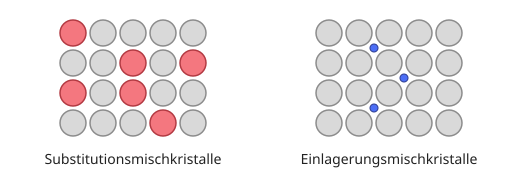

Beide Arten sind einphasig.

---

## Intermetallische Phase

-	meist komplizierter Gitteraufbau, unabhängig von Ausgangsgittern
- geordnete Einlagerungsstrukturen
- keine Verbindung im chemischen Sinne (Gesetz der konstanten und multiplen Proportionen gilt nicht)
- vorherrschender Bindungstyp: Metallbindung, aber Atom- und Ionenbindungsanteile „zugemischt“

Eigenschaft: hart und sehr spröde

---

## Chemische Zusammensetzung oder Konzentration
**Massenanteil, Gewichtsanteil, Massenprozent (Synonym)**
$\frac{m_1}{\sum_i m_{i}}\cdot 100 = m_{1-rel}$ in [%]
Bsp. $m_{Cu-rel}=\frac{m_{Cu}}{m_{Cu}+m_{Fe}}\cdot 100$

Massen $m$ von Komponenten sind unterschiedlich

**Atomanteil**

$\frac{n_1}{\sum_i n_{i}}\cdot 100 = n_{1-rel}$ in [%]
Bsp. $n_{Cu-rel}=\frac{n_{Cu}}{n_{Cu}+n_{Fe}}\cdot 100$

Wenn Massen $m$ von Komponenten ähnlich sind, dann sind $n_{rel}$ und $m_{rel}$ gleich. 

---

## Übung: Massenanteil vs. Atomanteil

Eine Legierung mit 1 kg Gesamtmasse enthält **25 Atom-% Ni** und **75 Atom-% Cu**.

**Fragen:**
1. Wie groß ist die Masse von Ni und Cu beim **Atomanteil**?
2. Wie groß wäre die Masse beim **Massenanteil** von 25 % Ni und 75 % Cu?

**Gegeben:** $A_{Cu} = 63.54$ u; $A_{Ni} = 58.69$ u; $u = 1.66 \times 10^{-27}$ kg

---

🔍 Lösung Teil 1: als Massenanteil gelesen

$$m_{Cu} = 0.75 \cdot 1\text{ kg} = 0.75\text{ kg} \qquad m_{Ni} = 0.25 \cdot 1\text{ kg} = 0.25\text{ kg}$$

🔍 Lösung Teil 2: als Atomanteil gelesen

$$n = \frac{m}{0.25\cdot A_{Ni}+0.75\cdot A_{Cu}}\cdot\frac{1}{u} = \frac{1\text{ kg}}{0.25\cdot58.69+0.75\cdot63.54}\cdot\frac{1}{1.66\times10^{-27}\text{ kg}} = 9.665\times10^{24}\text{ Atome}$$

$$m_{Ni} = 0.25\,n \cdot A_{Ni}\cdot u \approx 0.235\text{ kg} \qquad m_{Cu} = 0.75\,n \cdot A_{Cu}\cdot u \approx 0.765\text{ kg}$$

**Merke:** Da $A_{Cu}\approx A_{Ni}$, liegen beide Ergebnisse nah beieinander - genau wie im vorherigen Merksatz erklärt.

---

## Phasenänderungen

<!-- _class: cols-2 -->

**1. Umwandlungen**
- Instabile Gittermodifikationen wandeln sich in stabile um, unterhalb einer Gleichgewichtstemperatur
- Beispiel: $\gamma$-Fe → $\alpha$-Fe bei Abkühlung unter 911°C

**2. Ausscheidungen**
- Löslichkeit nimmt ab (meist durch Temperaturänderung)
- Phasen scheiden aus dem Mischkristall aus - erfordert Massentransport (Diffusion), Wärme und Zeit

---

## Diffusion - Die Grundlage

<!-- _class: cols-2 -->

**Definition:** Temperatur- und zeitabhängiger Massentransport

**1. Ficksches Gesetz:**
$$dm_A = -D \frac{dc_A}{dx} S \, dt$$
$$D = D_0 \exp\left(-\frac{Q_A}{RT}\right)$$

- $c_A$ = Konzentration der Komponente A
- $x$ = Ortskoordinate, $S$ = Querschnittsfläche, $t$ = Zeit
- $D_0$ = Diffusionskonstante, $Q_A$ = Aktivierungsenergie
- $R$ = Gaskonstante, $T$ = absolute Temperatur

---

## Diffusion - wichtig für

- Härten von Stahl (Einsatzhärten, Nitrieren), Verzinken, Glühen, Schweißen, Löten

**Auch außerhalb der Metallurgie:**
- Gasdiffusion aus Tanks, Diffusion von Gasen durch Membranen, Korrosion

---

# Gefüge der Werkstoffe

**Definition:** Charakterisiert durch Art, Größe, Form, Orientierung und Anordnung der Phasen (Kristallite/Körner, amorphe Bereiche, Verstärkungs- und Füllstoffe)

[🎬 Video zum Kristallwachstum](https://youtu.be/xlxFVIw_Esc?si=Dqws4vs14SN5CU4y&t=7)

---

## Entstehung des Gefüges - Ablauf

**Schmelze** → Abkühlung / Unterkühlung → Keimbildung (homogen + heterogen) → Keimwachstum → Kristallisation → Kristallitbildung (Körner + Korngrenzen) → **Gefüge**

---

## Keimbildung

<!-- _class: cols-2 -->

**Homogene Keimbildung**
- arteigene Keime, Schwankungen in der Schmelze
- höhere Unterkühlung nötig, seltener in der Praxis

**Heterogene Keimbildung**
- artfremde Keime (Verunreinigungen, Kokillenwand)
- geringere Unterkühlung nötig, häufigste Form in der Praxis - kann gezielt genutzt werden (Impfkristalle)

---

 
<iframe width="1150" height="500" src="https://youtu.be/-J2ZOngBfcg?si=Ek3YpDJx4PgGPlFV" title="YouTube video player" frameborder="0" allow="accelerometer; autoplay; clipboard-write; encrypted-media; gyroscope; picture-in-picture; web-share" referrerpolicy="strict-origin-when-cross-origin" allowfullscreen></iframe>

---

## Kristallwachstum

- Keimzahl (KZ) und Kristallisationsgeschwindigkeit (KG) hängen von der Unterkühlung ab

| Bedingung | Ergebnis |
|-----------|----------|
| Viele Keime + langsames Wachstum | Feinkörnig |
| Wenige Keime + schnelles Wachstum | Grobkörnig |

**Merke:** Schnelle Abkühlung → viele Keime → feinkörnig!

---

## Einfluss der Korngröße

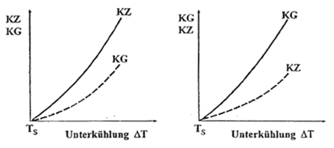

---

## a) Feinkörniges Gefüge
- Viele Keime, schnelle Abkühlung
- Eigenschaften siehe Kapitel 4: höhere Festigkeit, bessere Zähigkeit, gleichmäßigere Eigenschaften

## b) Grobkörniges Gefüge
- Wenige Keime, langsame Abkühlung
- Eigenschaften siehe Kapitel 4: geringere Festigkeit, höhere Duktilität, besseres Kriechverhalten

---

## Begriffe: Korn und Korngrenze

**Korn (Kristallit)**
- Keime haben Wachstum abgeschlossen, Körner stoßen aneinander
- Kristallorientierung zwischen Körnern unterschiedlich
- Form durch Wärmefluss: gleichmäßig → globulitisch (kugelförmig); Vorzugsrichtung → transkristalline Erstarrung (stängelförmig)

**Korngrenze**
- Übergangsflächen zwischen Körnern, gestörte Gitterstruktur - wichtig für mechanische Eigenschaften!

---

## Gießen und Stranggießen - Drei Zonen

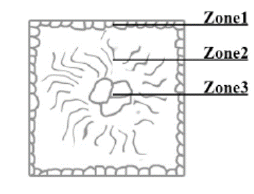

Beim Gießen in eine Metallform (Kokille) bilden sich drei charakteristische Zonen:

1. Feinkörnige Randzone
2. Transkristallisationszone
3. Globulare Kernzone

---

## Zone 1: Feinkörnige Randzone

**Entstehung:** starke Unterkühlung an der Kokillenwand, viele Kristallkeime bilden sich gleichzeitig, schnelles Erstarren

**Ergebnis:** kleine, gleichmäßige Kristallite, globulare Form, feinkörniges Gefüge

---

## Zone 2: Transkristallisationszone

**Entstehung:** gerichtetes Wachstum von Kristalliten entgegen dem Wärmestrom, kristallographische Orientierung parallel zum Temperaturgradienten

**Ergebnis:** Stängelkristalle (sehr grob), ausgeprägte Vorzugsorientierung → Gusstextur, anisotrope Eigenschaften

---

## Zone 3: Globulare Kernzone

**Entstehung:** Verunreinigungen werden von Stängelkristallen vorgeschoben, Anreicherung im Kern (Seigerung), viele artfremde Keime

**Ergebnis:** bei normalen Metallen globulare, feinkörnige Struktur; bei sehr reinen Metallen eher grobkörniges Gefüge

---

## Schweißen - Gefügebildung

**Ähnliche Zonen wie beim Gießen:** Wärmeeinflusszone (WEZ), Schmelzzone mit Erstarrungsgefüge, Übergangszone

**Besonderheiten:** sehr schnelle Abkühlung möglich → feinkörniges Gefüge, aber Gefahr der Aufhärtung

---

## Gefügenachweise - Arbeitsschritte

**Probenpräparation:**
1. Gezielte Probenentnahme (repräsentative Stelle, schonende Trennung)
2. Schleifen
3. Polieren
4. Ätzen

**Ziel:** Mikrostruktur analysieren, Korngröße bestimmen, Phasenverteilung untersuchen, Fehler erkennen

---

## Mikroschliffe

**Lichtmikroskop:** bis ca. 1000× Vergrößerung, einfache Handhabung, ausreichend für viele Anwendungen

**Elektronenrastermikroskop (REM):** bis > 100.000× Vergrößerung, höhere Auflösung, größere Schärfentiefe, Elementanalyse möglich (EDX)

---

## Ätzverfahren

**Ätzen = kontrollierter Korrosionsvorgang**

**1. Korngrenzenätzung:** bevorzugtes Auflösen von Korngrenzen - erscheinen als dunkle Linien, Körner werden sichtbar

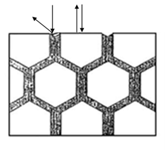

---

## Ätzverfahren

**2. Kornflächenätzung:** Kornschnittflächen unterschiedlich aufgeraut bzw. unterschiedliche Oxidschichtdicken → unterschiedlich starke Lichtreflexion → Kontrastbildung durch verschiedene Grautöne

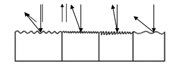

---

## Makroschliffe

**Definition:** Gefügeuntersuchung mit bloßem Auge oder Lupe

1. **Seigerungen** nachweisen und lokalisieren - Ätzungen nach Heyn und Oberhoffer, Baumannabdruck (für Schwefel)
2. **Qualität von Schweißverbindungen** - Adlerätzung
3. **Kraftwirkungslinien** nach plastischer Verformung - Ätzung nach Fry, Faserverlauf sichtbar machen

---

## Korngrenzen im Detail

Unlösbare Bestandteile und Verunreinigungen werden von Kristallfronten vorgeschoben → Anreicherung an Korngrenzen → **Korngrenzensubstanzen**

---

## Einfluss von Korngrenzensubstanzen

<!-- _class: cols-2 -->

**Fall 1: Verformbare Korngrenzensubstanz**
- Materialverhalten wird durch Körner dominiert, gute Duktilität
- Beispiel: reine Metalle mit geringen Verunreinigungen

**Fall 2: Spröde Korngrenzensubstanz**
- Materialverhalten wird durch Korngrenzen dominiert, interkristalline Brüche → Versprödung!
- Beispiel: Phosphor-Seigerung in Stahl

**Wichtig für:** Schweißbarkeit, Warmformgebung, Zähigkeit

---

# Zustandsdiagramme (ZSD)

- auch Phasendiagramm -phase diagram-
- stellt den Zustand von Legierungen und Stoffgemischen in Abhängigkeit von der chemischen Zusammensetzung, Temperatur und ggf. dem Druck dar
- Zustand meint die auftretenden Phasen (alle festen, flüssige, gasförmige)

---
## Achtung!

Zustandsdiagramme sind Gleichgewichtsdiagramme. Sie haben nur Gültigkeit bei einer sehr lang-samen Abkühlung aus dem schmelzflüssigen Zustand bis hin zur Raumtemperatur, bei der sich das Gleichgewicht zwischen den Phasen (an bzw. zwischen den Phasengrenzlinien) einstellen kann. 

---

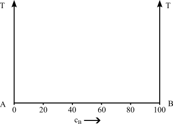
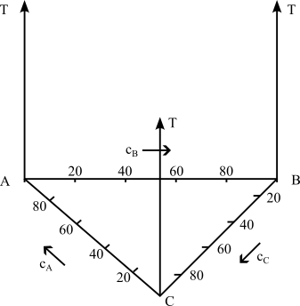

---

## Löslichkeiten

<!-- _class: cols-2 -->

**Unlöslich**

- zu große Unterschiede bei den Atomdurchmessern (>15%)
- Kristallgitter weichen voneinander ab
- Komponenten sind chemisch sehr unterschiedlich
- Elektronen unterscheiden sich stark

**Löslich**
- kaum Unterschiede bei den Atomdurchmessern (<15%)
- Kristallgitter sind identisch
- Komponenten sind chemisch sehr nah beieinander
- Elektronegativität ähnlich

---

---

## Hume-Rothery-Regeln für vollständige Löslichkeit

**Alle 4 Bedingungen müssen erfüllt sein:**

1. **Atomradius:** Differenz < 15%
2. **Kristallstruktur:** Gleiche Gitterstruktur
3. **Elektronegativität:** Ähnliche Werte (sonst intermetallische Verbindung)
4. **Wertigkeit:** Gleiche Wertigkeit bevorzugt

Beispiel: Cu-Ni erfüllt alle Bedingungen ✓

---
## Beispiel aus der eigenen Erfahrung
- Ölfilm auf Wasser ist nicht löslich und es findet eine Trennung aufgrund der unterschiedlichen Dichte statt
- Salz- / Zuckerkristalle in Wasser werden vollständig gelöst und ist nicht mehr sichtbar

---

## Beispiel für Unlöslichkeit

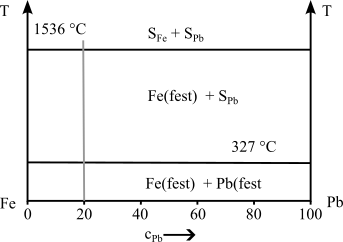

---

## System Eisen-Blei: Eigenschaften

**Warum unlöslich?**
- Atomradius: Fe = 1,26 Å, Pb = 1,75 Å (Differenz 39%)
- Kristallstruktur: Fe = krz, Pb = kfz
- Schmelzpunkte: Fe = 1538°C, Pb = 327°C

**Konsequenz:** keine Mischkristallbildung, praktisch keine gegenseitige Löslichkeit, zwei getrennte flüssige Phasen

---

## Beispiel für vollständige Löslichkeit

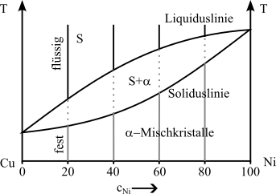

---

## System Kupfer-Nickel: Eigenschaften

**Warum vollständig löslich?**
- Atomradius: Cu = 1,28 Å, Ni = 1,24 Å (Differenz 3%)
- Kristallstruktur: beide kfz; Elektronegativität ähnlich; chemisch ähnlich (Nachbarn im PSE)

**Eigenschaften:** höhere Festigkeit als reines Cu, gute Korrosionsbeständigkeit; Anwendung: Münzen, Schiffsbau

---

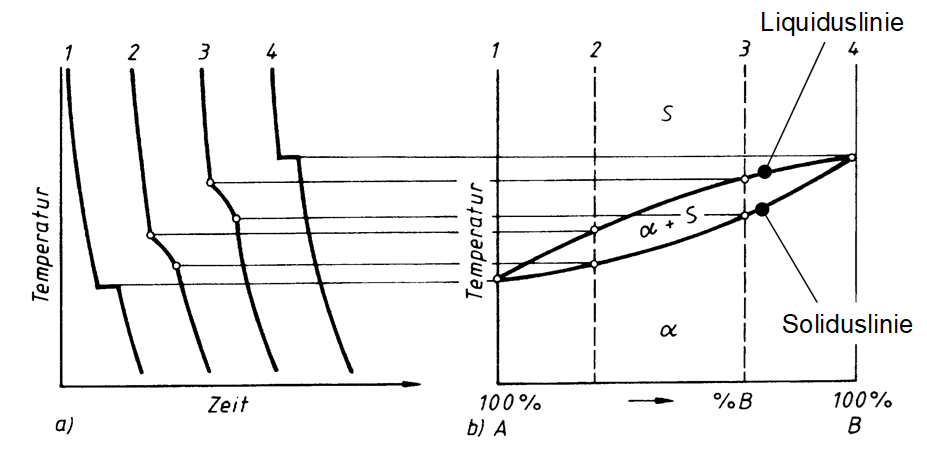

---

## Wichtige Begriffe

**Komponenten:** die reinen Elemente A und B
**Phase:** homogener Bereich mit gleichen physikalischen Eigenschaften
**Mischkristall:** feste Lösung von B in A (oder umgekehrt)
**Schmelze:** flüssige Phase (meist vollständig mischbar)
**Eutektikum:** Punkt niedrigster Schmelztemperatur
**Konzentration:** Anteil einer Komponente (in Gew.-% oder At.-%)

---

## Hebelgesetz

- In Punkt 2 hat die Schmelze einen kleineren Nickelgehalt als der $\alpha$-MK
- D.h. die Konzentration im Mischkristall muss steigen, damit die Zahl der Nickelatome konstant bleibt
- Schmelze und Mischkristall müssen nicht die gleiche chemische Zusammensetzung haben

---

## Hebelgesetz - Herleitung

**Massenbilanz:** Die Gesamtmasse bleibt konstant: $m_{ges} = m_S + m_\alpha$

**Stoffmengenbilanz:** Die Gesamtkonzentration bleibt konstant: $c_L \cdot m_{ges} = c_S \cdot m_S + c_\alpha \cdot m_\alpha$

**Umformung führt zu:**

$\frac{m_S}{m_{\alpha}}=\frac{c_{\alpha}-c_{L}}{c_{L}-c_{S}}$

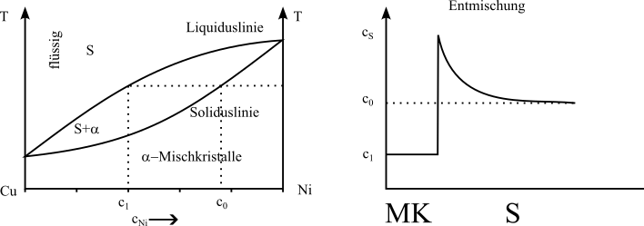

---

## Hebelgesetz - Anwendung

**Regel:** Die Masse einer Phase verhält sich umgekehrt proportional zum Abstand von der Legierungskonzentration

**Merkhilfe:** Lege einen "Hebel" an die Isotherm-Linie - die Hebelmasse liegt bei der Legierungskonzentration $c_L$; die längere Hebelstrecke gehört zur kleineren Masse

**Wichtig:** Immer auf die Gesamtkonzentration achten!

---

## Rechenbeispiel

→ Annahme Konzentrationen in Punkt 2

$c_S=20\%$, $c_{\alpha}=40\%$, $c_L=25\%$

---

## Lösung

$\frac{m_S}{m_{\alpha}}=\frac{c_{\alpha}-c_{L}}{c_{L}-c_{S}}=\frac{40\%-25\%}{25\%-20\%}=\frac{15}{5}=\frac{3}{1}$

- im Punkt 2 liegt 3 mal soviel Schmelze wie Mischkristall vor

**Plausibilitätsprüfung:** $c_L = 25\%$ liegt näher bei $c_S = 20\%$ als bei $c_\alpha = 40\%$ → daher mehr Schmelze ✓

---

## Übungsaufgabe: Hebelgesetz

Eine Cu-Ni-Legierung mit 60 Gew.-% Ni befindet sich bei 1300°C im Zweiphasengebiet.

**Ablesewerte aus dem Diagramm:**
- $c_S = 52\%$ Ni (Liquiduslinie), $c_\alpha = 68\%$ Ni (Soliduslinie), $c_L = 60\%$ Ni (Legierungskonzentration)

**Frage:** Wie groß sind die Massenanteile von Schmelze und α-Mischkristall?

---

## Lösung: Übungsaufgabe Hebelgesetz

$\frac{m_S}{m_{\alpha}}=\frac{c_{\alpha}-c_{L}}{c_{L}-c_{S}}=\frac{68\%-60\%}{60\%-52\%}=\frac{8}{8}=\frac{1}{1}$

**Anteile:**
- Anteil Schmelze: $\frac{m_S}{m_{ges}}=\frac{c_{\alpha}-c_{L}}{c_{\alpha}-c_{S}}=\frac{8}{16}=0,5 = 50\%$
- Anteil α-MK: $\frac{m_{\alpha}}{m_{ges}}=\frac{c_{L}-c_{S}}{c_{\alpha}-c_{S}}=\frac{8}{16}=0,5 = 50\%$

**Interpretation:** Bei dieser Temperatur liegt die Legierung zu gleichen Teilen als Schmelze und fester Mischkristall vor.

---

## Völlige Löslichkeit im flüssigen und teilweise Löslichkeit im festen Zustand

- Metallschmelzen der Elemente A und B lösen sich in beliebigen Mischungsverhältnissen (Konzentrationen)
- die Mischkristalle bilden sich nur noch in bestimmten Maße

**Wichtig:** Dies ist der häufigste Fall in der Praxis!

---

## Wann tritt das auf?

- Atomdurchmesser weichen voneinander ab (aber < 30%)
- Kristallgitter der Komponenten unterscheiden sich
- Komponenten sich chemisch verschieden

Die Komponenten sind sich weder sehr ähnlich, noch sehr verschieden

Es können folgende ZSDs auftauchen:
- Eutektikum (häufigster Fall)
- Peritektikum (seltener)

---

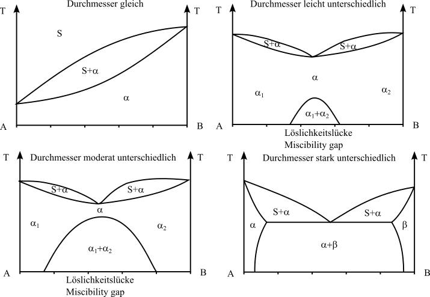

---

## Eutektische Reaktion

- Bei einer Konzentration erstarren aus der Schmelze S bei konstanter Temperatur (Eutektikale) A- und B-Kristalle zu einem feinkristallinen Kristallgemisch (Eutektikum)
- Eutektisches Gefüge besitzt oft eine schicht- oder lamellenartige Struktur
- Legierungen anderer Konzentrationen scheiden vor Erreichen der Eutektikale die überwiegende Komponente aus, sodass sich die Konzentration der verbleibenden Schmelze der eutektischen Zusammensetzung annähert
- Die **Eutektikale** bildet die Soliduslinie des gesamten Systems

---

## Eutektische Reaktion - Formel

**Reaktionsgleichung:** Schmelze → α-Mischkristall + β-Mischkristall

$S_E \rightarrow \alpha_E + \beta_E$

**Merkmale:** konstante Temperatur (Haltepunkt), konstante Zusammensetzung (eutektischer Punkt), gleichzeitige Bildung zweier Phasen, feines lamellenartiges Gefüge

**Vorteil:** niedrigste Schmelztemperatur im System → Gießlegierungen

---

## Abkühlungskurven bei eutektischen Systemen

**Legierung links vom eutektischen Punkt:**
1. Primärkristallisation von α-MK (Knick)
2. Eutektische Reaktion (Haltepunkt)

**Eutektische Legierung:** nur eutektische Reaktion (Haltepunkt)

**Legierung rechts vom eutektischen Punkt:**
1. Primärkristallisation von β-MK (Knick)
2. Eutektische Reaktion (Haltepunkt)

---

## Eutektische Entmischung

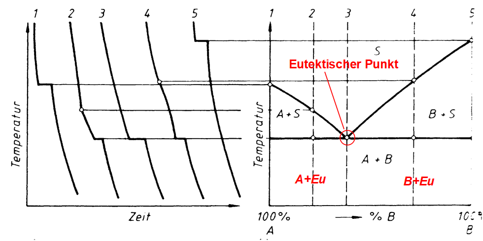

---

## Klassische eutektische Systeme

**Blei-Zinn (Pb-Sn):** Eutektikum bei 61,9% Sn und 183°C - Anwendung: Weichlote

**Silber-Kupfer (Ag-Cu):** Eutektikum bei 71,9% Ag und 779°C - Anwendung: Hartlote

**Aluminium-Silizium (Al-Si):** Eutektikum bei 12,6% Si und 577°C - Anwendung: Gusslegierungen (z.B. Motorblöcke)

---

## Gefüge untereutektischer Legierungen

**Untereutektische Legierung** (< eutektische Konzentration):
1. Primärkristallisation: α-Mischkristalle scheiden sich aus (grobkörnig)
2. Eutektische Erstarrung: verbleibende Schmelze erstarrt eutektisch (feinkörnig)

**Resultat:** große α-Primärkristalle, umgeben von eutektischem Gefüge (α + β lamellar) - "Primär-α in eutektischer Grundmasse"

---

## Gefüge übereutektischer Legierungen

**Übereutektische Legierung** (> eutektische Konzentration):
1. Primärkristallisation: β-Mischkristalle scheiden sich aus (grobkörnig)
2. Eutektische Erstarrung: verbleibende Schmelze erstarrt eutektisch (feinkörnig)

**Resultat:** große β-Primärkristalle, umgeben von eutektischem Gefüge (α + β lamellar) - "Primär-β in eutektischer Grundmasse"

---

## Aushärtung durch Ausscheidung

**Prinzip:**
1. Lösung bei hoher Temperatur (Einphasengebiet)
2. Abschrecken (übersättigte Lösung)
3. Auslagern bei mittlerer Temperatur
4. Feine Ausscheidungen → Festigkeitssteigerung

**Beispiel:** Aluminium-Kupfer-Legierungen (Duraluminium)
**Voraussetzung:** abnehmende Löslichkeit mit sinkender Temperatur!

---

## Systeme mit Peritektikum

- Weit auseinander liegende Schmelz-/Erstarrungstemperaturen der beteiligten Komponenten sind charakteristisch
- Bei Abkühlung aus der Schmelze bildet sich ein Mischkristall $\alpha$
- Er bildet bei konstanter Temperatur (entsprechend der **Peritektikalen**) mit der Schmelze reagierend eine zweite Mischkristallart $\beta$
- Bei der peritektischen Reaktion entstehen aus der Schmelze und bereits ausgeschiedenen $\alpha$-Mischkristallen bei gleichbleibender Temperatur neue $\beta$-Mischkristalle

---

## Peritektische Reaktion - Formel

**Reaktionsgleichung:** Schmelze + α-Mischkristall → β-Mischkristall

$S + \alpha \rightarrow \beta$

**Merkmale:** konstante Temperatur (Haltepunkt), Reaktion zwischen fester und flüssiger Phase, Bildung einer neuen festen Phase, α-Kristalle werden "umhüllt"

**Problem:** Reaktion oft unvollständig bei schneller Abkühlung → Seigerungen

---

---

## Beispiel: Eisen-Kohlenstoff (vereinfacht)

**Peritektische Reaktion bei 1493°C:** δ-Ferrit + Schmelze → γ-Austenit

- wichtig für Stahlherstellung, bei langsamer Abkühlung vollständig
- bei schneller Abkühlung: Seigerungen möglich

**Weitere Beispiele:** Silber-Platin, Kupfer-Zink (oberhalb 36% Zn)

---

## Vergleich: Eutektikum vs. Peritektikum

| Merkmal | Eutektikum | Peritektikum |
|---------|------------|--------------|
| Reaktion | S → α + β | S + α → β |
| Temperatur | Minimum | Maximum lokal |
| Gefüge | Lamellar | α-Reste in β |
| Häufigkeit | Häufig | Selten |
| Gießbarkeit | Sehr gut | Problematisch |

---

---

## Gibbsche Phasenregel

$F = n  - P + 2$ (für Gase und Flüssigkeiten)

Bei konstantem Druck (feste Stoffe): $F = n  - P + 1$

F = Anzahl der Freiheitsgrade; n = Anzahl der Komponenten; P = Anzahl der Phasen

Für Abkühlungs-/Erwärmungskurven metallischer Systeme gilt: F = 0 → ein Haltepunkt; F = 1 → ein Knickpunkt

---

## Gibbsche Phasenregel - Beispiele

**Beispiel 1: Reines Metall beim Schmelzen**
n = 1, P = 2 (fest + flüssig) → F = 1 - 2 + 1 = 0 → Haltepunkt bei konstanter Temperatur

**Beispiel 2: Cu-Ni-Legierung im Zweiphasengebiet**
n = 2 (Cu, Ni), P = 2 (α + Schmelze) → F = 2 - 2 + 1 = 1 → ein Freiheitsgrad (T oder c veränderbar)

**Beispiel 3: Einphasengebiet (nur α)**
n = 2, P = 1 → F = 2 - 1 + 1 = 2 → zwei Freiheitsgrade (T und c frei wählbar)

---

- Die Phasen bzw. Phasengrenzlinien können als ein Zustandsdiagramm dargestellt werden
- Die Anzahl der miteinander im Gleichgewicht stehenden Phasen ist gesetzmäßig verknüpft mit der Zahl der an der Legierungsbildung beteiligten Komponenten und der Zahl der Freiheitsgrade über die Gibbsche Phasenregel
- Ein Freiheitsgrad beinhaltet die mögliche Veränderung von Zustandsvariablen, ohne das Gleichgewicht, d.h. die Anzahl der Phasen, zu ändern
- Die Anzahl der frei wählbaren Zustandsvariablen wird  nach der Phasenregel bestimmt

---

## Verständnisfragen

1. Warum sind Zustandsdiagramme Gleichgewichtsdiagramme?
2. Was bedeutet ein Freiheitsgrad?
3. Warum ist die eutektische Temperatur ein Minimum?
4. Welche Vorteile haben eutektische Legierungen beim Gießen?
5. Was ist der Unterschied zwischen Mischkristall und Kristallgemisch?

---

## Antworten zu Verständnisfragen

1. **Gleichgewicht:** benötigt sehr langsame Abkühlung für Diffusion
2. **Freiheitsgrad:** Anzahl frei wählbarer Zustandsvariablen ohne Änderung der Phasenzahl
3. **Eutektisches Minimum:** gegenseitige Störung der Kristallisation senkt den Schmelzpunkt
4. **Gießvorteile:** niedrigste Schmelztemperatur, gute Formfüllung, dünnflüssig
5. **MK vs. KG:** MK = homogene atomare Lösung, KG = mechanisches Gemenge

---

## Realdiagramme
- die bisherigen Digramme waren Idealdigramme und treten so nicht wirklich auf
- Eisen-Kohlenstoff-Diagramm (EKD) ist das wichtigste Realdiagramm
- Grundmetall ist Eisen -> Stahl oder Eisenguss
- das EKD setzt sich aus den Idealdiagrammen - dem peritektischen, eutektischen und eutektoiden Teildiagramm - zusammen

---

- Man kann je nach Erscheinungsform des Kohlenstoffs zwischen dem stabilen System Fe-C, in dem Kohlenstoff als Graphit, und dem metastabilen System Fe-Fe3C, in dem Kohlenstoff gebunden als Fe3C (intermediäre Phase Zementit) vorliegt, unterscheiden. 
- Stabil bedeutet, dass der Kohlenstoff in Form von Graphit nicht weiter zerlegt werden kann, Fe3C aber bei langzeitigem Glühen in Eisen und Temperkohle zerfällt. 
- Das metastabile System stellt gewissermaßen ein relatives Minimum der Gesamtenergie des Systems dar. Für techni-sche Belange kann es als „hinreichend stabil“ bewertet werden.

---

# Eisen-Kohlenstoffdiagramm (EKD)

- wichtigstes ZSD
- Eisen ist der wichtigste Werkstoff im Maschinenbau. 

Gründe sind
- geringe Kosten
- hohe Festigkeit und elastische Steifigkeit
- Vielzahl von möglichen Legierungen
- Verfügbarkeit
- Gießbarkeit, Schweißbarkeit, etc.

[Erklärvideo für das Eisen Kohlenstoff Diagramm](https://www.youtube.com/watch?v=oJqvnKhnsg0&t=1s)

---

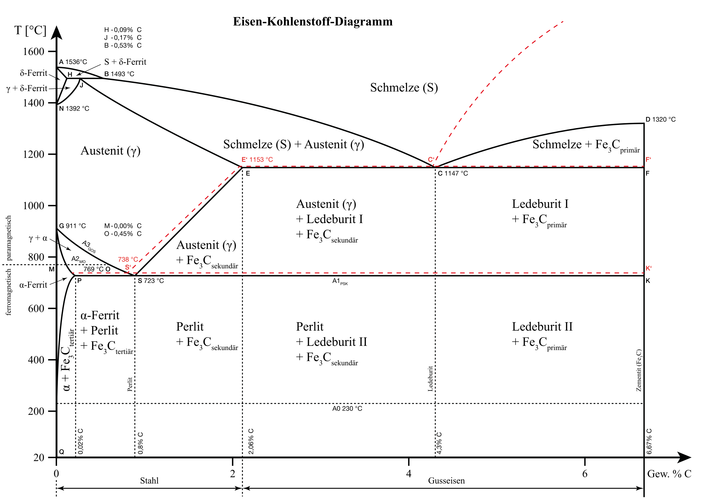

---

# Phasen- und Gefüge im System-Eisen-Kohlenstoff
## Mischkristalle

---

---
## $\alpha$-Mischkristall (krz)
- Gefügebezeichnung Ferrit ($\alpha$-Ferrit)
- rein ferritisches Gefüge besitzt geringe Härte/Festigkeit, aber hohe Duktilität (Zähigkeit)
- Max. C-Löslichkeit: nur 0,02 % 

---
## Exkurs Härte / Festigkeit
Im Detail kommt das später.
Festigkeit 
- Maß der maximalen Beanspruchbarkeit bis Versagen
- Kraft pro Querschnittsfläche

Härte 
- mechanischer Widerstand gegen mechanisches Eindringung eines anderen Körpers 
- Maß für die Verschleißbeständigkeit

---

## $\delta$-Mischkristall (krz)
 - $\delta$-Ferrit ist nur oberhalb von 1392°C stabil  
 - technisch von untergeordneter Bedeutung
 - Max. C-Löslichkeit: 0.12 %

---

## $\gamma$-Mischkristall (kfz)

- Gefügebezeichnung Austenit
- scheidet sich oberhalb der G-S-E-Linie  aus; 
  - durch Legierungszusätze (Ni, Mn) und Abschrecken auch bei Raumtemperatur beständig (austenitische Stähle)
- unmagnetisch, zäh und durch Kaltverfestigung härtbar (Mangan-, Nickel-, Chrom-Nickel-Stähle)
- hohe Warmfestigkeit, gute Korrosions- und Zunderbeständigkeit
- Max. C-Löslichkeit: 2.06 %

---

## Intermediäre Phase
Zementit (Eisencarbid Fe3C); 6.67 Masse-% C-Gehalt

- Primärzementit:	
primäre Kristallisation aus der Schmelze (Linie CD)

- Sekundärzementit: 
Ausscheidung aus dem Austenit (Linie ES)

- Tertiärzementit:	
Ausscheidung aus dem Ferrit (Linie PQ)

---

## Kristallstruktur

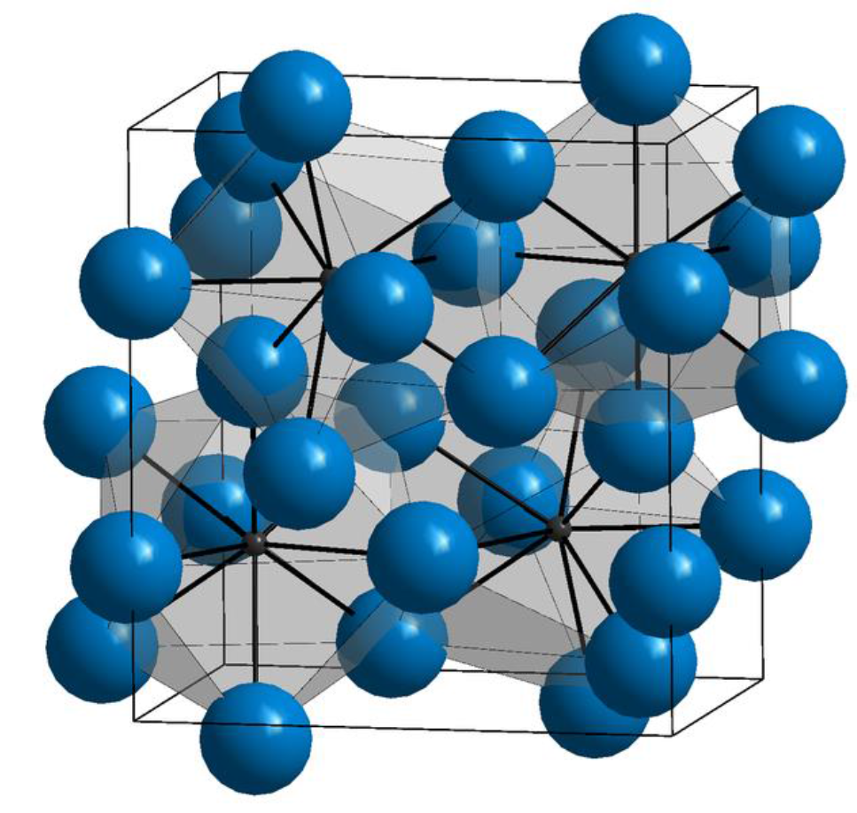

- orthorhombischen Elementarzelle 
  -  zwölf Eisen- und vier Kohlenstoffatome
  - die Kohlenstoffatome sind relativ unregelmäßig (zweifach überkappt trigonal-prismatisch) von acht Eisenatomen umgeben

---

- Zementit ist hart und spröde
- überwiegende Zahl der technischen Eisen-Kohlenstoff-Legierungen erstarrt unter Bildung von Zementit

---

# Phasengemische/Gemische von Mischkristallen

## Perlit (Eutektoid)
- Gefüge aus Zementit und Ferrit (= Phasengemisch)
- entsteht durch den "eutektoiden" Zerfall des Austenits ($\gamma$-Mischkristall) mit 0.8% C bei 723°C
- eutektoider Punkt S: hier liegen 100% Perlit vor
- relativ hohe Härte, relativ hohe Festigkeit, schlechte Umformbarkeit, geringe Zähigkeit

---

- lamellenartiger Aufbau (Schichten von $\alpha$-Mk und Fe3C-Kristallen) .
- häufig spricht man von einer "Perlitstufe", die - gemessen am Lamellenabstand - in Perlit, fein-streifigen  und feinststreifigen Perlit unterteilt wird. 

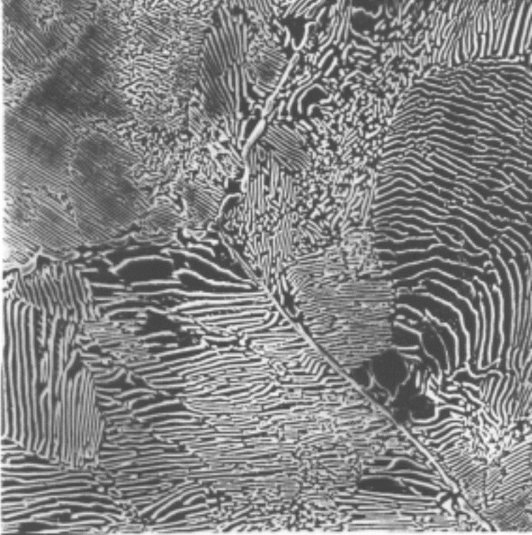

---

## Ledeburit (Eutektikum) 

- Gefüge aus Austenit und Zementit bzw. „zerfallenem“ Austenit und Zementit (= Phasengemisch), Kohlenstoffgehalt 4,3 %, Schmelztemperatur 1147°C 
- Eutektischer Punkt C: hier liegen 100% Ledeburit vor
- Unterscheidung zwischen Ledeburit I (dicht unterhalb 1.147 °C)
  -  um ein Gefüge aus Austenit und Zementit handelt

- Ledeburit II (Raumtemperatur)
  - aus Zementit I mit ankristallisiertem Sekundärzementit (aus dem Austenit bei sinkender Temperatur ausgeschieden) und (bei langsamer Abkühlung) aus Perlit
  -  Der Perlit entsteht durch den eutektoiden Zerfall des Austenits aus dem Ledeburit I bei 723 °C. 

---
- bei schnellerer Abkühlung kann anstelle des Perlit auch Bainit bzw. bei sehr schneller Abkühlung Martensit vorliegen. 
- Ledeburit ist schlecht umformbar, hat sehr geringe Duktilität. 
 - bei Raumtemperatur  feines Gemenge von Fe3C-Kristalliten und Perlitbereichen im Auflichtmikroskop als charakteristische Pantherfellstruktur sichtbar.

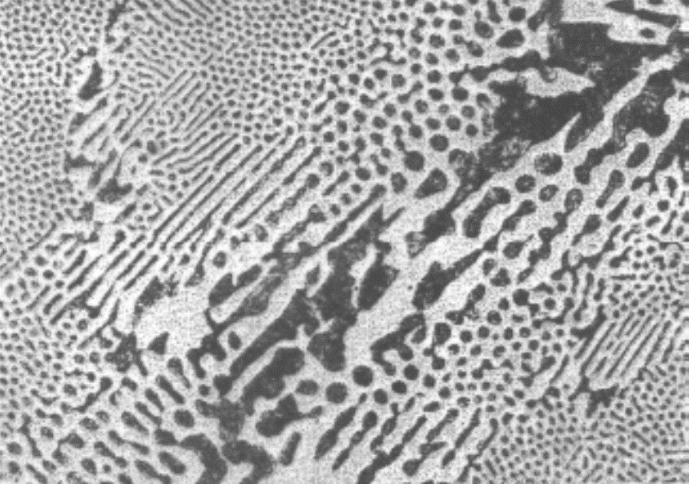

---

Die Eigenschaften der Legierung (z.B. Stahl, Gusseisen) wird durch die Art der beteiligten Phasen (z.B. $\alpha$-Mk, Fe3C), ihren mengenmäßigen Anteil (z. B. abhängig vom C-Gehalt) und die Art ihrer Verteilung im Gefüge bestimmt.

---
# Phasen- und Gefüge im Ungleichgewichtszustand

- Gleichgewichtszustände durch Diffusionsvorgänge dominiert
- bei schnelleren Temperaturänderungen wird die Kohlenstoffdiffusion, die zur Entmischung des Austenits erforderlich ist, behindert 
- Dadurch entstehen auch neuartige Gefügebestandteile, die nicht mehr dem Gleichgewichtszustand entsprechen
- führt zu "zwangsgelöstem" Kohlenstoff
---

## Martensit
- raumzentriertes Gitter tetragonal verzerrt („verspanntes Ferritgitter“)
- meist feinnadeliges, sehr hartes und sprödes Gefüge
- der im krz-Gitter des $\alpha$-Fe zwangsgelöste Kohlenstoff verzerrt das Gitter und weitet es tetragonal auf („diffusionsloses Umklappen“). 

---

## Bainit  

- anders als bei der Bildung von Martensit sind hier Umklappvorgänge im Kristallgitter und Diffusionsvorgänge gekoppelt
-  bildet sich im Temperaturbereich zwischen der Perlit- und der Martensitstufe bei Abkühlungsgeschwindigkeiten (für Martensitbildung zu niedrig; für die Perlitbildung zu hoch)

---
 ## Bainit  

- reiner Bainit lässt sich nur durch isotherme Abkühlung, z.B. beim Warmbadhärten, erzielen. 
- Vorteilhaft, wo bei einer Vergütung durch Abschrecken und Anlassen eine Härterissgefahr besteht. 
- Es hat sehr gute Festigkeits- und Zähigkeitseigenschaften.

---

# Eisen-Kohlenstoff-Legierungsbezeichnungen

| Kohlenstoffgehalt (Masse-%) | Bezeichnung               | Typ                                  |
|-----------------------------|---------------------------|--------------------------------------|
| 0.02 < C < 0.8              | (Kohlenstoff-) Stahl       | untereutektoide Stähle               |
| C = 0.8                     | (Kohlenstoff-) Stahl       | eutektoide Stähle                    |
| 0.8 < C < 2.06              | (Kohlenstoff-) Stahl       | übereutektoide Stähle                |
| 2.06 < C < 4.3              | Gusseisen                 | untereutektische Gusseisen           |
| C = 4.3                     | Gusseisen                 | eutektische Gusseisen                |
| 4.3 < C < 6.67              | Gusseisen                 | übereutektische Gusseisen            |

---

---

- Weiterhin wird unterschieden zwischen dem schwarzen Gusseisen (Grauguss), in dem der überschüssige Kohlenstoff in Form von Graphit, und dem weißen Gusseisen, in dem der Kohlenstoff in Form von Zementit vorkommt 
- Mit zunehmendem C-Gehalt steigen die Festigkeit und Härtbarkeit des Stahles, wogegen seine Dehnung, Schmiedbarkeit, Schweißbarkeit und Bearbeitbarkeit (durch spanabhebende Werkzeuge) verringert werden
- Der Korrosionswiderstand gegenüber Wasser, Säuren und heißen Gasen wird durch den Kohlenstoff praktisch nicht beeinflusst. 
- Für Kohlenstoffgehalte unter 0.25 Masse-% sind Stähle gut schweißbar

---

# Wärmebehandlung

---

## Verfahren

- Glühverfahren
- Härteverfahren

Charakterisierung:
- Art des Erwärmens
- Haltetemperatur
- Haltedauer
- Art des Abkühlens (Ofen-, Luft-, Öl-, Wasserabkühlung)

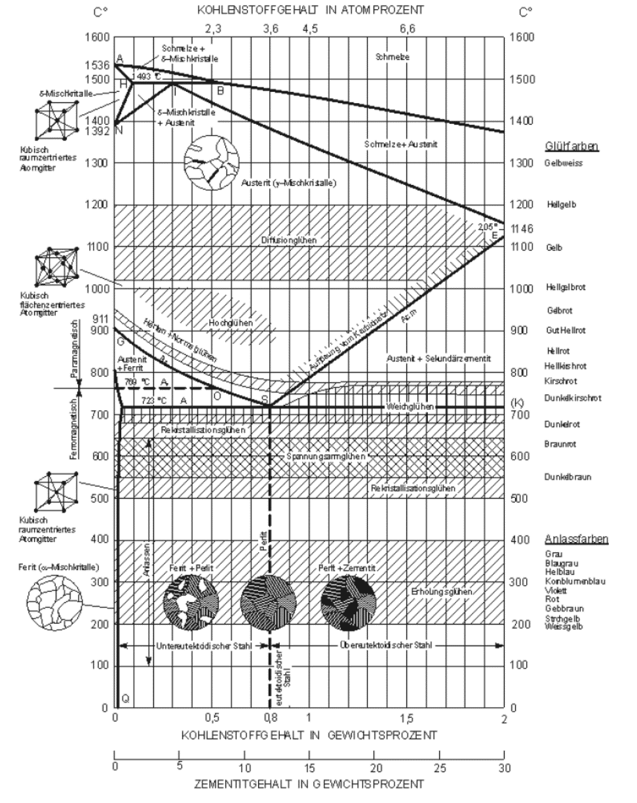

---

Warum?

- Verbesserung der Bearbeitbarkeit (Weichglühen)
- Arbeitsgang der Erzeugung (Härten von Werkzeugen)
- Verbesserung der mechanischen Eigenschaften (Vergüten von Stahl, Aushärten von Al-Legierungen)
- Verminderung des Verschleißes (Randschichthärten von Zahnrädern)
- Beseitigung von Kaltverfestigung (Rekristallisationsglühen)
- Abbau von Guss- oder Schweißspannungen (Spannungsarmglühen)

---

## Glühen
- langsames Kühlen. Versuch nahe dem Gleichgewichtszustand zu kommen

Ziele ausabeiten für
- Spannungsarmglühen
- Rekristallisationsglühen
- Weichglühen
- Normalglühen
- Grobkornglühen
- Diffusionsglühen

---

## Spannungsarmglühen
- Langsames Erwärmen auf 550 - 650 °C (unterhalb $\text{A}_{c1}$)
- Haltedauer 2 - 4 h, langsame Abkühlung (Ofenabkühlung)

Ziel:
Abbau innerer Spannungen (Eigenspannungen) ohne wesentliche Änderung der sonstigen Eigenschaften

---

## Rekristallisationsglühen
- Rekristallisationstemperatur bei Stahl: 500 - 600°C
- halten, langsame Abkühlung
- bei zu langer Haltezeit: Grobkornbildung

Ziel:

Rückgängigmachen von Eigenschaftsänderungen (Verfestigung) durch Kaltumformung; Gefügeumbildung bzw. -neubildung im festen Zustand; Spannungsabbau, Erhöhung der Bruchdehnung

---

## Weichglühen
- Temperaturen um  $\text{A}_{C1}$ (unterhalb, oberhalb oder pendelnd um  $\text{A}_{C1}$)
- langsame Abkühlung.

Ziel:
Herstellung eines - für die Weiterverarbeitung günstigen - weichen Zustands. Dabei werden Zementitteilchen kugelig eingeformt (GKZ-Glühen).

---

## Normalglühen

- Temperatur 30 - 50°C über Umwandlungstempertur im Austenitgebiet. 
- Erwärmung zwischen $\text{A}_{C1}$ und Glühtemperatur rasch, kurze Haltedauer
- rasche Abkühlung durch Zweiphasen-Intervall, dann langsam abkühlen

---

## Normalglühen

Ziel:

Herstellung eines gleichmäßigen und feinkörnigen Gefüges mit Perlitanteilen, Annäherung an den Gleichgewichtszustand durch zweifaches Umkörnen (bei Erwärmung und Abkühlung). Häufig eingesetztes Verfahren

---

## Grobkornglühen

Verfahrensparameter:
- Temperatur deutlich über $\text{A}_{C3}$ (950 - 1100°C)
- Haltezeit 1 bis 2 h
- langsame Ofenabkühlung
- dann raschere Luftabkühlung

Ziel:
Erzielung eines groben Korns. Hierdurch wird die Spanbarkeit verbessert.

---

## Diffusionsglühen

- Temperatur hoch im Austenitbereich
- lange Haltezeit (bis 50 h)
- langsame Abkühlung

Ziel:
Beseitigung örtlicher Konzentrationsunterschiede (Seigerungen) durch Diffusion.

---

# Härten

---

---

## Härteverfahren - Übersicht

- **Härten nach Volumenerwärmung**
  - Durchhärten
  - Einhärten
- **Anlassen**
- **Vergüten** (Härten + Anlassen)
- **Randschichthärten**
  - Flammhärten, Induktionshärten, Laserhärten
- **Thermochemische Verfahren**
  - Aufkohlen / Einsatzhärten
  - Nitrieren / Nitrocarburieren

---

## Härten - Verfahrensschritte

**1. Austenitisieren**:
- Erwärmen auf 30-50°C über Ac₃ (untereutektoid)
- bzw. 30-50°C über Ac₁ (übereutektoid)
- Haltezeit: vollständige Austenitbildung

**2. Abschrecken**:
- schnelle Abkühlung (über kritischer Rate)
- in Wasser, Öl, Gas

**3. Optional: Anlassen**:
- Reduzierung der Sprödigkeit
- Spannungsabbau

---

## Austenitisieren - Details

**Temperaturwahl**:

| Stahltyp | T-Bereich | Typisch |
|----------|-----------|---------|
| untereutektoid | Ac₃ + 30-50°C | 850-900°C |
| übereutektoid | Ac₁ + 30-50°C | 780-820°C |

**Haltezeit**:
- Faustregel: 1 min pro mm Wanddicke
- Minimum: 15 min
- zu kurz: unvollständiges Austenitisieren
- zu lang: Kornvergröberung

---

## Warum unterschiedliche Temperaturen?

<!-- _class: cols-2 -->

**Untereutektoide Stähle (< 0.8% C)**:
- über Ac₃ → vollständig austenitisch
- keine Ferritreste

**Übereutektoide Stähle (> 0.8% C)**:
- nur über Ac₁ → Austenit + Restauszementit
- Restauszementit erhöht Verschleißfestigkeit
- über Acm würde zu Grobkorn führen

---

## Härtbarkeit vs. Aufhärtbarkeit

<!-- _class: cols-2 -->

**Härtbarkeit** (Hardenability):
- Fähigkeit, bei Abkühlung Martensit zu bilden
- abhängig von: C-Gehalt, Legierung, Korngröße
- gemessen als: Einhärtungstiefe

**Aufhärtbarkeit** (Hardness):
- maximal erreichbare Härte
- hauptsächlich vom C-Gehalt abhängig
- Formel (Näherung): HV ≈ 1000 × (% C) + 200

---

**Merke**: Legieren erhöht Härtbarkeit, nicht Aufhärtbarkeit!

---

## Härtbarkeit - Einflussfaktoren

**1. Chemische Zusammensetzung**:
- C-Gehalt: Grundvoraussetzung
- Legierungselemente: verschieben ZTU-Kurven

**2. Austenitkorngröße**:
- feines Korn → geringere Härtbarkeit
- grobes Korn → höhere Härtbarkeit (aber spröder!)

**3. Austenitisierungsbedingungen**:
- Temperatur
- Haltezeit
- Homogenität

---

## Verfahren
- Härten nach Volumenerwärmung
- Anlassen
- Vergüten
- Randschichthärten
- Thermochemische Verfahren
  - Aufkohlen / Einsatzhärten
  - Nitrieren
- Thermomechanische Verfahren
- Aushärten
---

## Härten nach Volumenerwärmung

- Kohlenstoffgehalt von mindestens 0.3% (sonst Vorbehandlung nötig)
- bei kleinen Abmessungen kann eine vollständige Martensitbildung über den gesamten Querschnitt erfolgen (Durchhärtung). Bei großen Abmessungen wird die kritische Abkühlgeschwindigkeit nur bis zu einer bestimmten Tiefe erreicht (Einhärtung). 
- Höchsthärte ist allein vom Kohlenstoffgehalt abhängig

---

## Randschichthärten

- wird angewendet bei niedrig- und unlegierten Stählen mit 0.3 - 0.7% Kohlenstoff (obere Grenze zur Vermeidung von Härterissen)
- insbesondere bei Kurbelwellen, Zapfen, Walzen, Zahnrädern u.a.. Ziel dieses Verfahrens ist eine harte und verschleißbeständige Oberfläche bei zähem Kern. 
- Randschicht des Werkstückes auf Härtetemperatur erhitzt und durch Abschrecken gehärtet. 

---

## Verfahren

Das [Randschichthärten](http://wiki.arnold-horsch.de/index.php/Oberfl%C3%A4chenh%C3%A4rteverfahren) ist mit folgenden Verfahren möglich:

- Flammhärten
- Induktionshärten
- Strahlhärten (Elektronenstrahl- und Laserhärten)
- Tauchhärten 

---

## Referencen

Rainer Schwab: Werkstoffkunde und Werkstoffprüfung für Dummies, 2019; ISBN-10 352771538X
[Grundlagen der Metallkunde](https://wiki.arnold-horsch.de/index.php/Grundlagen_der_Metallkunde)

