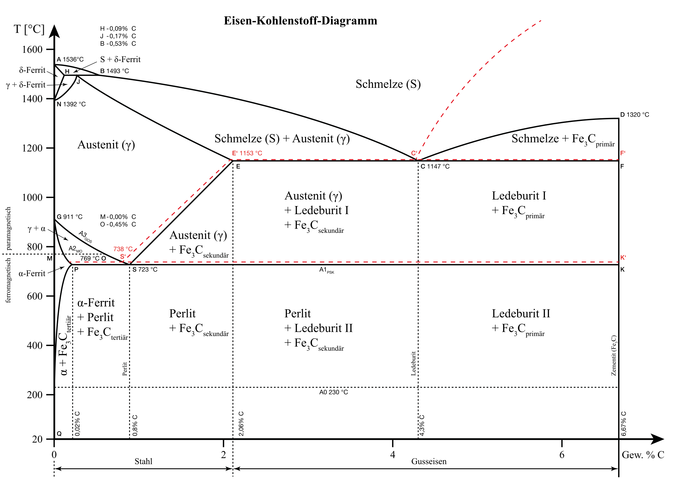

## Vorlesung MTI - Stahl- und Gusseisensorten
Prof. Dr.-Ing.  Christian Willberg 

Kontakt: christian.willberg@h2.de
Teile des Skripts sind von \
Prof. Dr.-Ing. Jürgen Häberle übernommen

Bild: Frankemann, CC BY-SA 4.0, Wikimedia Commons

---

<!--paginate: true-->

# Inhalte
- Stahl im Überblick: Mengen, Verwendung, Klima, Mensch
- Rückblick: Stahl oder Gusseisen?
- Einteilung und Bezeichnung von Stählen
- Legierungselemente - wie sie wirken
- Stahlgruppen und ihre Anwendung
- Gusseisensorten
- Übungen

<!--
Zeitplan (90 min):
12 min  Stahl im Überblick inkl. Stahl-Inventur
 3 min  Rückblick EKD
18 min  Einteilung + Bezeichnung, Übung 1
22 min  Legierungselemente, Übung 2
12 min  Stahlgruppen
20 min  Gusseisen, Übung 3
 5 min  Zusammenfassung
-->

---

# Stahl im Überblick

---

## Stahl - der Konstruktionswerkstoff Nr. 1

<!-- _class: cols-2 -->

**Rohstahlproduktion 2025** (worldsteel)
- Welt: **1 849 Mio. t** - ca. 225 kg pro Mensch und Jahr
- China: 961 Mio. t (≈ 52 %)
- Deutschland: 34 Mio. t (Platz 8 weltweit)

**Zum Vergleich (Größenordnung, weltweit pro Jahr)**

| Werkstoff | Menge |
|---|---|
| Zement | ~4 000 Mio. t |
| **Stahl** | **~1 850 Mio. t** |
| Kunststoffe | ~400 Mio. t |
| Aluminium (primär) | ~70 Mio. t |
| Kupfer (raffiniert) | ~27 Mio. t |

Von allen **Metallen** wird Stahl mit großem Abstand am meisten erzeugt - **rund 25-mal mehr als Aluminium**. Fast alles, was Sie heute benutzt haben, wurde mit Stahl hergestellt, transportiert oder enthält ihn.

---

## Wofür wird Stahl verwendet?

<!-- _class: cols-2 -->

**Stahlverwendung weltweit 2025** (worldsteel)

| Sektor | Anteil |
|---|---|
| Gebäude und Infrastruktur | **52 %** |
| Maschinenbau | 16 % |
| Fahrzeugbau (Automobil) | 12 % |
| Metallwaren | 10 % |
| sonstiger Verkehr (Schiff, Bahn) | 5 % |
| Elektrotechnik | 3 % |
| Haushaltsgeräte | 2 % |

- **Bau:** Bewehrung, Träger, Brücken - Baustähle S235/S355, Betonstahl B500
- **Maschinenbau:** Wellen, Zahnräder, Lager - Vergütungs-, Einsatz-, Wälzlagerstähle
- **Fahrzeug:** Karosserie (Tiefziehbleche, pressgehärteter 22MnB5), Motor, Fahrwerk
- **Energie:** Windtürme, Pipelines, Transformatoren (Elektroblech)

---

## Warum gerade Stahl? Vergleich der Konstruktionswerkstoffe

| Werkstoff | $E$ [GPa] | $\rho$ [g/cm³] | $E/\rho$ | $R_m$ [MPa] | Preis [€/kg] | CO₂ [kg/kg] |
|---|---|---|---|---|---|---|
| **Baustahl S355** | 210 | 7,85 | 27 | 470 - 630 | **~1** | ~2 (Schrott: ~0,7) |
| **hochfester Stahl 22MnB5** | 210 | 7,85 | 27 | ~1 500 | ~1,5 | ~2 |
| Aluminium EN AW-6082 | 70 | 2,7 | 26 | ~300 | ~3 - 4 | ~10 - 16 (Recycling: < 1) |
| Titan Ti6Al4V | 110 | 4,4 | 25 | ~950 | ~20 - 40 | ~35 |
| CFK (UD, faserparallel) | ~135 | 1,6 | ~85 | ~1 500 | ~30 - 100 | ~20 - 30 |
| Holz (Fichte, längs) | ~11 | 0,45 | ~24 | ~80 | ~0,5 | sehr gering (speichert CO₂) |

*Richtwerte, stark abhängig von Halbzeug, Markt und Herstellungsroute*

Die **spezifische Steifigkeit** $E/\rho$ von Stahl, Aluminium und Titan ist fast **gleich**. Stahl gewinnt über **Preis, Festigkeit, Schweißbarkeit und Recycling** - leichter wird es nur mit Faserverbunden oder durch **geschickte Geometrie**.

---

## Stahl und Klima

<!-- _class: cols-2 -->

- Stahlindustrie: ca. **7 - 9 %** der weltweiten CO₂-Emissionen
- weltweiter Mittelwert 2024: **1,92 t CO₂ pro t Rohstahl**

| Route | t CO₂ / t Stahl |
|---|---|
| Hochofen + Konverter (Erz, Koks) | 2,34 |
| Elektroofen mit **Schrott** | 0,69 |
| Direktreduktion mit **Wasserstoff** + Elektroofen | deutlich niedriger (mit Ökostrom) |

Anteil Elektrostahl weltweit 2025: **30 %**

**Warum ist Stahl trotzdem nachhaltig nutzbar?**
- lässt sich **beliebig oft** ohne Qualitätsverlust einschmelzen
- magnetisch → leicht aus dem Müll zu trennen
- hohe Recyclingquote am Lebensende (Bau, Auto, Verpackung)

**In Deutschland:** Umbau auf Wasserstoff-Direktreduktion (z. B. Salzgitter, thyssenkrupp)

Begleit- und Störelemente aus dem **Schrott** (Cu, Sn) lassen sich kaum entfernen - Recycling wird zur **Legierungsfrage** (→ Legierungselemente).

---

## Stahl und Mensch (1/2): Nutzung

**Hautkontakt und Gesundheit**
- Besteck, Schmuck, Uhren: X5CrNi18-10 („18/10")
- **Nickelallergie** - eine der häufigsten Kontaktallergien → EU-Grenzwert für Ni-Freisetzung bei längerem Hautkontakt (REACH)
- Implantate (X2CrNiMo18-15-3 / 316L), chirurgische Instrumente (X46Cr13)

**Sicherheit**
- Crash: pressgehärteter Stahl (~1 500 MPa) in der B-Säule schützt die Insassen
- Sicherheitsschuhe (Stahlkappe), Helme, Leitplanken
- **MRT:** ferromagnetische Teile werden zu Geschossen - austenitische Stähle sind (fast) unmagnetisch

---

## Stahl und Mensch (2/2): Herstellung und Wahrnehmung

**Arbeitsschutz in der Fertigung**
- **Schweißrauch** ist krebserzeugend (IARC Gruppe 1)
- beim Schweißen von Cr-Stählen entsteht **Cr(VI)** → Absaugung, Atemschutz
- Lärm, Hitze und schwere Lasten in Stahlwerk und Schmiede

**Ergonomie und Wahrnehmung**
- Gewicht von Werkzeugen und Geräten
- kalt, schwer, glänzend: Stahl wird als **wertig und robust** wahrgenommen
- Korrosion (Rost) wird als Mangel erlebt - auch wenn sie nur optisch ist

Werkstoffwahl ist nie nur Technik: Sie entscheidet mit über **Gesundheit, Sicherheit und Akzeptanz** der Menschen, die ein Produkt herstellen und benutzen.

---

## Aktivierung: Stahl-Inventur

**3 Minuten, zu zweit:**

1. Wie viele Gegenstände aus Stahl tragen oder benutzen Sie **gerade jetzt**? (Reißverschluss, Brillenscharnier, Kugelschreiberfeder, Stuhlgestell, ...)
2. Wählen Sie **einen** davon: Welcher Stahl könnte es sein (unlegiert, nichtrostend, Federstahl)?
3. Durch welchen Werkstoff könnte man ihn ersetzen - und was würde sich für **Sie als Nutzer** ändern (Gewicht, Gefühl, Haltbarkeit, Preis)?

*Am Ende der Vorlesung kommen wir darauf zurück: Können Sie Ihren Stahl dann genauer benennen?*

---

# Rückblick: Stahl oder Gusseisen?

---

## Die Grenze liegt bei 2,06 % C

<!-- _class: cols-2 -->

| C-Gehalt (Masse-%) | Werkstoff |
|---|---|
| < 0,02 | technisch reines Eisen |
| 0,02 ... 2,06 | **Stahl** |
| 2,06 ... 6,67 | **Gusseisen** |

- **Stahl:** schmiedbar, umformbar, schweißbar (bei wenig C)
- **Gusseisen:** nicht schmiedbar, aber **sehr gut gießbar** - Eutektikum (4,3 % C) schmilzt bei 1147 °C, Stahl erst bei ~1500 °C

---

## Was bestimmt die Eigenschaften eines Stahls?

**1. Kohlenstoffgehalt**
mehr C → höhere Festigkeit und Härte, aber geringere Dehnung, Schweißbarkeit und Umformbarkeit

**2. Legierungselemente**
steuern Härtbarkeit, Korrosionsbeständigkeit, Warmfestigkeit, Zähigkeit

**3. Wärmebehandlung**
stellt das Gefüge ein: Ferrit/Perlit, Martensit, angelassener Martensit (MTI 06)

**Merke:** Der C-Gehalt legt das Grundpotenzial fest - die Legierungselemente entscheiden, **wie** es genutzt werden kann.

---

# Einteilung und Bezeichnung von Stählen

---

## Einteilung nach DIN EN 10020

<!-- _class: cols-2 -->

**Unlegierte Stähle**
- keiner der Grenzwerte (Tabelle) wird erreicht

**Nichtrostende Stähle**
- Cr ≥ **10,5 %** und C ≤ 1,2 %

**Andere legierte Stähle**
- mindestens ein Grenzwert erreicht

**Grenzwerte (Masse-%)**

| Element | Grenzwert |
|---|---|
| Mn | 1,65 |
| Si | 0,60 |
| Cu | 0,40 |
| Cr, Ni, Al, Co, W | 0,30 |
| V | 0,10 |

Die Grenzwerte sind **kein Maß für die Wirkung** - schon 0,003 % Bor verändern die Härtbarkeit deutlich.

---

## Qualitätsstahl und Edelstahl

**Qualitätsstahl**
- erfüllt sortenabhängige Anforderungen (z. B. Zähigkeit, Schweißeignung)
- i. A. **nicht zum Vergüten** vorgesehen
- Beispiele: Baustähle S235, S355

**Edelstahl**
- sehr wenige nichtmetallische Einschlüsse
- P, S ≤ 0,025 %
- enge Toleranzen, homogen → meist **vergütbar**
- Beispiele: C45, 42CrMo4, X5CrNi18-10

**Achtung Alltagssprache:** „Edelstahl" heißt technisch **hohe Reinheit** - nicht „rostfrei". Rostfrei ist ein **nichtrostender** Stahl (Cr ≥ 10,5 %).

---

## Bezeichnung nach Verwendung (DIN EN 10027-1)

<!-- _class: cols-2 -->

**Aufbau:** Kennbuchstabe + Mindeststreckgrenze in MPa + Zusatzsymbole

| Buchstabe | Verwendung |
|---|---|
| **S** | Stahlbau |
| **E** | Maschinenbau |
| **P** | Druckbehälter |
| **B** | Betonstahl |
| **L** | Leitungsrohre |

**Kerbschlagarbeit (Zusatzsymbol)**

| Symbol | Kerbschlagarbeit | Prüftemperatur |
|---|---|---|
| JR | 27 J | +20 °C |
| J0 | 27 J | 0 °C |
| J2 | 27 J | −20 °C |
| K2 | 40 J | −20 °C |

**S355J2** = Stahlbau, $R_e \geq 355$ MPa, 27 J bei −20 °C

---

## Bezeichnung nach chemischer Zusammensetzung

| Gruppe | Aufbau | Beispiel | Bedeutung |
|---|---|---|---|
| unlegiert (Mn < 1 %) | **C** + C-Gehalt·100 | C45 | 0,45 % C |
| niedriglegiert (jedes Element < 5 %) | C-Gehalt·100 + Elemente + Gehalt·Faktor | 42CrMo4 | 0,42 % C, 4/4 = 1 % Cr, wenig Mo |
| hochlegiert (mind. ein Element ≥ 5 %) | **X** + C-Gehalt·100 + Elemente + Gehalte in % | X5CrNi18-10 | 0,05 % C, 18 % Cr, 10 % Ni |
| Schnellarbeitsstahl | **HS** + W-Mo-V-Co in % | HS6-5-2-5 | 6 % W, 5 % Mo, 2 % V, 5 % Co |

**Faktoren für niedriglegierte Stähle:** &nbsp; **4:** Cr, Co, Mn, Ni, Si, W &nbsp;|&nbsp; **10:** Al, Be, Cu, Mo, Nb, Pb, Ta, Ti, V, Zr &nbsp;|&nbsp; **100:** Ce, N, P, S &nbsp;|&nbsp; **1000:** B

---

## Werkstoffnummer (DIN EN 10027-2)

<!-- _class: cols-2 -->

**Aufbau:** 1.XXXX
- **1** = Werkstoffhauptgruppe Stahl
- 2.-3. Stelle = Stahlgruppe
- 4.-5. Stelle = Zählnummer

**Grobe Orientierung:**

| Nummer | Gruppe |
|---|---|
| 1.0xxx | unlegierte Stähle |
| 1.2xxx | Werkzeugstähle |
| 1.3xxx | Schnellarbeits-, Wälzlagerstähle |
| 1.4xxx | nichtrostende Stähle |
| 1.5xxx - 1.8xxx | legierte Bau-/Maschinenbaustähle |

**Beispiele**

| Kurzname | Werkstoffnummer |
|---|---|
| S235JR | 1.0038 |
| C45 | 1.0503 |
| 42CrMo4 | 1.7225 |
| 100Cr6 | 1.3505 |
| X5CrNi18-10 | 1.4301 |

Die Nummer ist kürzer und eindeutig - in Zeichnungen und Bestellungen sehr verbreitet.

---

## Übung 1: Bezeichnungen entschlüsseln

Was steckt in den folgenden Bezeichnungen? Gruppe, C-Gehalt, Legierungselemente, Kennwerte.

1. S235JR
2. C60
3. 16MnCr5
4. 100Cr6
5. X46Cr13
6. HS6-5-2

*Zeit: 5 Minuten, gern zu zweit*

---

## Lösung Übung 1

1. **S235JR** - Baustahl, $R_e \geq 235$ MPa, 27 J bei +20 °C
2. **C60** - unlegierter Stahl, 0,60 % C
3. **16MnCr5** - niedriglegiert: 0,16 % C, 5/4 = **1,25 % Mn**, wenig Cr (Einsatzstahl)
4. **100Cr6** - niedriglegiert: **1,0 % C**, 6/4 = **1,5 % Cr** (Wälzlagerstahl)
5. **X46Cr13** - hochlegiert: 0,46 % C, **13 % Cr** (nichtrostend, härtbar → Messer)
6. **HS6-5-2** - Schnellarbeitsstahl: 6 % W, 5 % Mo, 2 % V

**Typischer Fehler:** Bei niedriglegierten Stählen den Faktor vergessen - 16MnCr5 enthält **nicht** 5 % Mn.

---

# Legierungselemente - wie sie wirken

---

## Warum überhaupt legieren?

<!-- _class: cols-2 -->

**Ein reiner Kohlenstoffstahl kann nicht gleichzeitig:**
- große Querschnitte durchhärten
- korrosionsbeständig sein
- bei hohen Temperaturen fest bleiben
- bei hoher Festigkeit zäh sein

**Legierungselemente lösen diese Zielkonflikte:**
- verzögern Umwandlungen (Perlitbildung)
- bilden harte, stabile **Karbide**/Nitride
- bilden **Schutzschichten** (Passivierung)
- **verfeinern das Korn**
- verzerren das Gitter → **Mischkristallverfestigung**

Ein legierter Stahl ist im Kern immer noch ein **Fe-C-System** - die Zusatzelemente steuern, **wie** sich dieses System verhält.

---

## Wirkmechanismen im Überblick

| Mechanismus | Was passiert? | Typische Elemente |
|---|---|---|
| Mischkristallverfestigung | Fremdatome verzerren das Gitter, Versetzungen werden gebremst | Si, Mn, (C, N) |
| Härtbarkeit ↑ | Perlitbildung wird verzögert → Martensit auch bei langsamer Abkühlung | Cr, Mo, Mn, Ni, B |
| Karbidbildung | harte Teilchen → Verschleißfestigkeit, Warmhärte | Cr, Mo, V, W |
| Kornfeinung | Nitride/Karbide behindern Kornwachstum → fester **und** zäher | Al, Ti, Nb, V |
| Passivierung | dichte Oxidschicht schützt vor Korrosion | Cr (≥ 10,5 %), Al, Si |

---

## α-Bildner und γ-Bildner

<!-- _class: cols-2 -->

**α-Bildner (krz-Stabilisatoren)**
- vergrößern das Ferritgebiet
- **Cr**, Si, Mo, W, V, Ti, Al
- stark genug → **ferritischer** Stahl, keine Umwandlung α ↔ γ → nicht härtbar

**γ-Bildner (kfz-Stabilisatoren)**
- vergrößern das Austenitgebiet
- **Ni**, Mn, C, N, Cu
- stark genug → **austenitischer** Stahl bis Raumtemperatur → nicht härtbar, nicht magnetisch

**Erinnerung (MTI 06):** Härten braucht die Umwandlung γ → Martensit. Wer das γ-Gebiet „wegschiebt" (α-Bildner) oder „festhält" (γ-Bildner), verhindert das Härten.

**Kompromiss:** genug Cr für Korrosionsschutz **und** genug C für ein γ-Gebiet → **martensitischer**, härtbarer Stahl (z. B. X46Cr13)

---

## Die wichtigsten Elemente (1/2)

| Element | Hauptwirkung | Beispiel |
|---|---|---|
| **C** | Basis von Festigkeit und Härtbarkeit; senkt Schweißbarkeit | C45 |
| **Mn** | Härtbarkeit ↑, Festigkeit ↑, bindet Schwefel als MnS | 16MnCr5 |
| **Si** | Desoxidation, Streckgrenze ↑ (Federstähle), Elektrobleche | 56SiCr7 |
| **Cr** | Härtbarkeit ↑, Karbidbildner, ab 10,5 % **nichtrostend** | 42CrMo4, X5CrNi18-10 |
| **Ni** | Zähigkeit ↑ (auch bei Kälte), γ-Bildner → austenitisch | X5CrNi18-10 |

---

## Die wichtigsten Elemente (2/2)

| Element | Hauptwirkung | Beispiel |
|---|---|---|
| **Mo** | Anlassbeständigkeit, Warmfestigkeit, gegen Lochkorrosion | 42CrMo4, X2CrNiMo17-12-2 |
| **V, W** | sehr stabile Karbide → Warmhärte, Verschleiß, Kornfeinung | HS6-5-2 |
| **Co** | Warmhärte (Schnellarbeitsstähle) | HS6-5-2-5 |
| **Ti, Nb, Al** | Kornfeinung; Ti/Nb binden C (gegen interkristalline Korrosion) | X6CrNiTi18-10 |
| **B** | in Spuren (0,001-0,005 %) stark härtbarkeitssteigernd | 22MnB5 (Karosserie) |

**Faustregel:** Cr, Mo, Mn, Ni verzögern die Perlitbildung → Martensit auch im Kern → **große Querschnitte durchhärtbar**.

---

## Begleit- und Störelemente

<!-- _class: cols-2 -->

**Meist unerwünscht**
- **P** (Phosphor): Kaltsprödigkeit
- **S** (Schwefel): bildet FeS → Rotbruch beim Warmumformen
- **N** (Stickstoff): Alterung, Versprödung
- **H** (Wasserstoff): Wasserstoffversprödung, Risse nach dem Schweißen

**Gezielt genutzt**
- **S + Mn** → MnS-Einschlüsse brechen den Span → **Automatenstahl** (z. B. 11SMnPb30) für Drehteile
- **N** in austenitischen Stählen → Festigkeit ↑

Deshalb begrenzt die Norm P und S bei Edelstählen auf ≤ 0,025 %.

---

## Schweißbarkeit: das Kohlenstoffäquivalent

Legierungselemente machen den Stahl härtbar - auch dort, wo man es nicht will: in der **Wärmeeinflusszone** einer Schweißnaht (Martensit → Kaltrisse).

$$CEV = C + \frac{Mn}{6} + \frac{Cr + Mo + V}{5} + \frac{Ni + Cu}{15} \quad \text{(Gehalte in Masse-\%)}$$

| CEV | Schweißeignung |
|---|---|
| ≤ 0,45 | gut, meist ohne Vorwärmen |
| 0,45 ... 0,60 | bedingt, Vorwärmen nötig |
| > 0,60 | schlecht, nur mit besonderen Maßnahmen |

Mehr dazu - Wärmeeinflusszone, Kaltrisse, Vorwärmen - in **MTI 09 Fügen**.

---

## Übung 2: Welcher Stahl lässt sich gut schweißen?

Berechnen Sie das Kohlenstoffäquivalent $CEV$ und bewerten Sie die Schweißeignung.

| Stahl | C | Mn | Cr | Mo | V | Ni | Cu |
|---|---|---|---|---|---|---|---|
| S355J2 | 0,16 | 1,20 | 0,10 | 0,02 | 0,03 | 0,10 | 0,05 |
| 42CrMo4 | 0,42 | 0,75 | 1,05 | 0,22 | 0 | 0 | 0 |

**Zusatzfrage:** Welches Element trägt bei 42CrMo4 am meisten bei?

---

## Lösung Übung 2

**S355J2:**
$$CEV = 0{,}16 + \frac{1{,}20}{6} + \frac{0{,}10+0{,}02+0{,}03}{5} + \frac{0{,}10+0{,}05}{15} = 0{,}16 + 0{,}20 + 0{,}03 + 0{,}01 = 0{,}40$$
→ gut schweißbar

**42CrMo4:**
$$CEV = 0{,}42 + \frac{0{,}75}{6} + \frac{1{,}05+0{,}22}{5} = 0{,}42 + 0{,}125 + 0{,}254 \approx 0{,}80$$
→ schlecht schweißbar (Vorwärmen, Nachbehandlung)

**Zusatzfrage:** Den größten Beitrag liefert der **Kohlenstoff** (0,42), danach Cr + Mo (0,25). Ein Vergütungsstahl ist zum Härten gemacht - nicht zum Schweißen.

---

# Stahlgruppen und ihre Anwendung

---

## Baustähle, Einsatzstähle, Vergütungsstähle

| Gruppe | C [%] | Leitelemente | Behandlung | Beispiel | Anwendung |
|---|---|---|---|---|---|
| **Baustahl** | < 0,25 | Mn | keine (Walzzustand) | S235JR, S355J2 | Träger, Brücken, Gestelle |
| **Einsatzstahl** | 0,1 - 0,2 | Cr, Mn, Ni | **Einsatzhärten**: Rand aufkohlen + härten | 16MnCr5 | Zahnräder, Nockenwellen |
| **Vergütungsstahl** | 0,2 - 0,6 | Cr, Mo, Ni | **Vergüten** = Härten + Anlassen (500-650 °C) | C45, 42CrMo4 | Wellen, Schrauben, Kurbelwellen |

**Einsatzstahl:** harte, verschleißfeste Oberfläche (~60 HRC) + **zäher Kern**

**Vergütungsstahl:** beste Kombination aus Festigkeit **und** Zähigkeit im ganzen Querschnitt

---

## Feder-, Werkzeug- und Wälzlagerstähle

| Gruppe | C [%] | Leitelemente | Ziel | Beispiel |
|---|---|---|---|---|
| **Federstahl** | 0,4 - 1,0 | Si, Cr, V | hohe Streckgrenze, Dauerfestigkeit | 56SiCr7 |
| **Kaltarbeitsstahl** | 0,6 - 1,2 | (Cr) | Härte, Verschleiß bis ~200 °C | C110, X153CrMoV12 |
| **Warmarbeitsstahl** | 0,3 - 0,6 | Cr, Mo, V | Warmhärte, Temperaturwechsel | X38CrMoV5-1 (Druckgießformen) |
| **Schnellarbeitsstahl** | 0,8 - 1,3 | W, Mo, V, Co | Schneidenhärte bis ~600 °C | HS6-5-2 (Bohrer, Fräser) |
| **Wälzlagerstahl** | ~1,0 | Cr | maximale Härte, höchste Reinheit | 100Cr6 |

**Faustregel:** Je höher die Verschleißanforderung, desto **mehr C**, desto **niedriger die Anlasstemperatur** und desto **mehr Karbidbildner** (Cr, Mo, V, W).

---

## Nichtrostende Stähle (Cr ≥ 10,5 %)

| Typ | Gefüge | Legierung | härtbar | magnetisch | Beispiel | Anwendung |
|---|---|---|---|---|---|---|
| **ferritisch** | α (krz) | Cr, wenig C | nein | ja | X6Cr17 (1.4016) | Spülen, Zierleisten, Haushalt |
| **martensitisch** | Martensit | Cr + mehr C | **ja** | ja | X46Cr13 (1.4034) | Messer, Scheren, chirurg. Instrumente |
| **austenitisch** | γ (kfz) | Cr + Ni | nein* | nein | X5CrNi18-10 (1.4301, „V2A") | Lebensmittel, Chemie, Medizin |
| **austenitisch + Mo** | γ (kfz) | Cr + Ni + Mo | nein* | nein | X2CrNiMo17-12-2 (1.4404, „V4A") | Meerwasser, Chloride |

\* Festigkeitssteigerung nur durch Kaltverfestigung

Die Cr-Oxidschicht ist nur wenige Nanometer dick und **heilt selbst** - solange Sauerstoff da ist. Rostfrei ist immer relativ zum **Medium**.

---

# Gusseisen

---

## Warum Gusseisen?

<!-- _class: cols-2 -->

**Zusammensetzung:** 2,5 - 4 % C, 1 - 3 % Si

**Vorteile**
- niedrige Schmelztemperatur (~1150 - 1250 °C)
- dünnflüssige Schmelze → **komplexe Formen** gießbar
- gut **zerspanbar** (Graphit wirkt als Schmierstoff und Spanbrecher)
- hohe **Schwingungsdämpfung**
- günstig

**Nachteile:** nicht schmiedbar, kaum schweißbar, je nach Sorte spröde

Zugproben aus Gusseisen: glatter, verformungsloser Bruch. Bild: Sigmund, CC BY-SA 3.0, Wikimedia Commons

---

## Weißes und graues Gusseisen

<!-- _class: cols-2 -->

Kohlenstoff kann in zwei Formen erstarren (MTI 06: metastabil vs. stabil):

| | **weiß** | **grau** |
|---|---|---|
| C liegt vor als | Zementit Fe₃C | **Graphit** |
| System | metastabil | stabil |
| Bruchfläche | hell | grau |
| Eigenschaften | sehr hart, spröde, nicht spanbar | spanbar, dämpfend |
| Gefördert durch | schnelle Abkühlung, wenig Si | langsame Abkühlung, **viel Si** |

**Wanddicke zählt:** Dünne Wände kühlen schnell ab → können weiß erstarren (harter, spröder Rand). Dicke Wände kühlen langsam ab → grau.

**Hartguss:** gezielt weiß erstarrte Oberfläche für Walzen, Mühlen, Nockenwellen

---

## Die Form des Graphits entscheidet

<!-- _class: cols-2 -->

**Lamellengraphit (GJL)**
- Graphitblätter wirken wie **innere Kerben**
- spröde, geringe Zugfestigkeit

**Vermiculargraphit (GJV)**
- wurmartig, Zwischenstufe

**Kugelgraphit (GJS)**
- Graphitkugeln: **kaum Kerbwirkung**
- duktil, „stahlähnlich"
- entsteht durch Zugabe von **Magnesium** (~0,04 %) zur Schmelze

Tiefgeätzte Graphitformen im REM, links nach rechts: lamellar, vermicular, kugelig. Bild: Ivak, gemeinfrei, Wikimedia Commons

---

## Gusseisen mit Lamellengraphit (GJL, „Grauguss")

<!-- _class: cols-2 -->

- $R_m$ = 100 ... 350 MPa, Bruchdehnung < 1 %
- **Druckfestigkeit** ca. 3-4 × Zugfestigkeit
- E-Modul nur ~80 ... 140 GPa (Lamellen!)
- **beste Dämpfung** aller Eisenwerkstoffe
- gute Wärmeleitfähigkeit

**Anwendung:** Maschinenbetten, Motorblöcke, Bremsscheiben, Getriebegehäuse

**Bezeichnung:** EN-GJL-250 → $R_m \geq 250$ MPa

Gusseisen mit Lamellengraphit. Bild: Hb tuw, CC BY-SA 4.0, Wikimedia Commons

---

## Gusseisen mit Kugelgraphit (GJS, „Sphäroguss")

<!-- _class: cols-2 -->

- $R_m$ = 350 ... 900 MPa
- Bruchdehnung bis ~22 %
- E-Modul ~170 GPa
- gießbar wie Gusseisen, belastbar fast wie Stahl

**Anwendung:** Kurbelwellen, Radnaben, Achsschenkel, Druckrohre, Windkraft-Naben

**Bezeichnung:** EN-GJS-400-15 → $R_m \geq 400$ MPa, $A \geq 15$ %

**ADI** (austenitisch-ferritisch durch Zwischenstufenvergüten): bis 1400 MPa

EN-GJS-400-15, Graphitkugeln mit Ferrithof. Bild: Schmitz-Metallographie, CC BY-SA 4.0, Wikimedia Commons

---

## Weitere Eisengusswerkstoffe

| Werkstoff | Kurzzeichen | Besonderheit | Anwendung |
|---|---|---|---|
| Gusseisen mit Vermiculargraphit | EN-GJV-400 | zwischen GJL und GJS, gute Wärmeleitung + Festigkeit | Diesel-Zylinderköpfe, Motorblöcke |
| Temperguss, weiß/schwarz | EN-GJMW-350-4, EN-GJMB-450-6 | weiß gegossen, durch Glühen zäh gemacht | Fittings, kleine Fahrzeugteile |
| Hartguss | - | weiß erstarrter, verschleißfester Rand | Walzen, Mahlkörper |
| **Stahlguss** | GE240, G17CrMo5-5 | **Stahl** (< 2 % C), in Form gegossen; schweißbar | Turbinengehäuse, Ventile |

**Aufbau der Bezeichnung (DIN EN 1560):** EN - **G**uss - **J** (Eisen) - Graphitform (**L**, **S**, **V**, **M**) - Kennwerte

---

## Stahl und Gusseisen im Vergleich

| Eigenschaft | Baustahl S355 | EN-GJL-250 | EN-GJS-400-15 | Stahlguss GE300 |
|---|---|---|---|---|
| $R_m$ [MPa] | 470 - 630 | ≥ 250 | ≥ 400 | ≥ 600 |
| Bruchdehnung [%] | ~20 | < 1 | ≥ 15 | ~15 |
| E-Modul [GPa] | 210 | ~100 - 120 | ~170 | 210 |
| Dämpfung | gering | **sehr hoch** | mittel | gering |
| Gießbarkeit | - | **sehr gut** | sehr gut | mäßig |
| Schweißbarkeit | gut | schlecht | bedingt | gut |
| Kosten | gering | **sehr gering** | gering | höher |

**Merke:** Gusseisen ist kein „schlechter Stahl", sondern ein eigener Werkstoff - die **Graphitform** bestimmt, ob er spröde (GJL) oder duktil (GJS) ist.

---

## Übung 3: Werkstoffauswahl

Ordnen Sie jedem Bauteil einen passenden Werkstoff zu und begründen Sie kurz.

| Bauteil | Werkstoffe (bunt gemischt) |
|---|---|
| a) Maschinenbett einer Drehmaschine | S235JR |
| b) Zahnrad im Pkw-Getriebe | 16MnCr5 |
| c) Kurbelwelle eines Lkw-Motors | X5CrNi18-10 |
| d) Kochtopf | EN-GJL-250 |
| e) Wälzlagerkugel | 100Cr6 |
| f) Hallenträger | EN-GJS-700-2 oder 42CrMo4 |

*Zeit: 10 Minuten in Gruppen*

---

## Lösung Übung 3

| Bauteil | Werkstoff | Begründung |
|---|---|---|
| a) Maschinenbett | **EN-GJL-250** | komplexe Form, hohe Dämpfung, druckbelastet, günstig |
| b) Zahnrad | **16MnCr5** | Einsatzhärten: harte Zahnflanke, zäher Zahnfuß |
| c) Kurbelwelle | **EN-GJS-700-2** oder **42CrMo4** | gegossen (günstig, komplexe Form) oder geschmiedet + vergütet (höchste Last) |
| d) Kochtopf | **X5CrNi18-10** | nichtrostend, lebensmittelecht, gut umformbar |
| e) Wälzlagerkugel | **100Cr6** | maximale Härte, Reinheit, Rollkontakt |
| f) Hallenträger | **S235JR** | schweißbar, günstig, ausreichend fest |

**Diskussion:** Bei c) sind beide Lösungen üblich - die Entscheidung ist eine Frage von Belastung, Stückzahl und Kosten.

---

## Zusammenfassung

- **C-Gehalt:** < 2,06 % Stahl, > 2,06 % Gusseisen
- **Bezeichnung:** nach Verwendung (S355J2) oder nach Zusammensetzung (C45, 42CrMo4, X5CrNi18-10) - Faktoren 4/10/100/1000 nicht vergessen
- **Legierungselemente:** Härtbarkeit (Cr, Mo, Mn, Ni, B), Karbide (Cr, Mo, V, W), Korrosion (Cr ≥ 10,5 %), Zähigkeit (Ni), Kornfeinung (Al, Ti, Nb, V)
- **α-/γ-Bildner** entscheiden, ob ein Stahl ferritisch, austenitisch oder martensitisch ist
- **Gusseisen:** Si fördert Graphit; die Graphitform (Lamellen, Vermicular, Kugeln) bestimmt die Zähigkeit
- **Stahl im Großen:** ~1,85 Mrd. t/Jahr, gut die Hälfte für Bau; CO₂ ist die große Herausforderung, Schrott und Wasserstoff sind die Antworten

**Zurück zur Stahl-Inventur:** Können Sie Ihren Gegenstand jetzt genauer benennen - Stahlgruppe, Legierungselemente, vielleicht sogar einen Kurznamen?

---

## Referenzen

- DIN EN 10020: Begriffsbestimmungen für die Einteilung der Stähle
- DIN EN 10027-1/-2: Bezeichnungssysteme für Stähle (Kurznamen, Werkstoffnummern)
- DIN EN 1560: Gießereiwesen - Bezeichnungssystem für Gusseisen
- Bargel, H.-J.; Schulze, G.: Werkstoffkunde. Springer Vieweg
- Seidel, W.; Hahn, F.: Werkstofftechnik. Hanser
- Vorlesung Werkstofftechnik II: Stahl, Legierungselemente, Stahlnormen
- worldsteel: [World Steel in Figures 2026](https://worldsteel.org/wp-content/uploads/World-Steel-in-Figures-2026.pdf) - Produktion, Verwendung nach Sektoren, CO₂-Intensität
- worldsteel: [Sustainability Indicators](https://worldsteel.org/wider-sustainability/sustainability-indicators-2024-report/)
