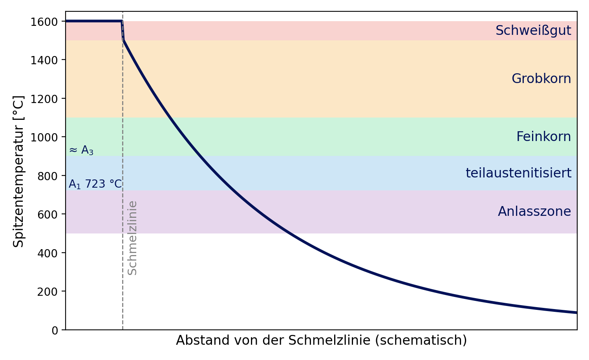
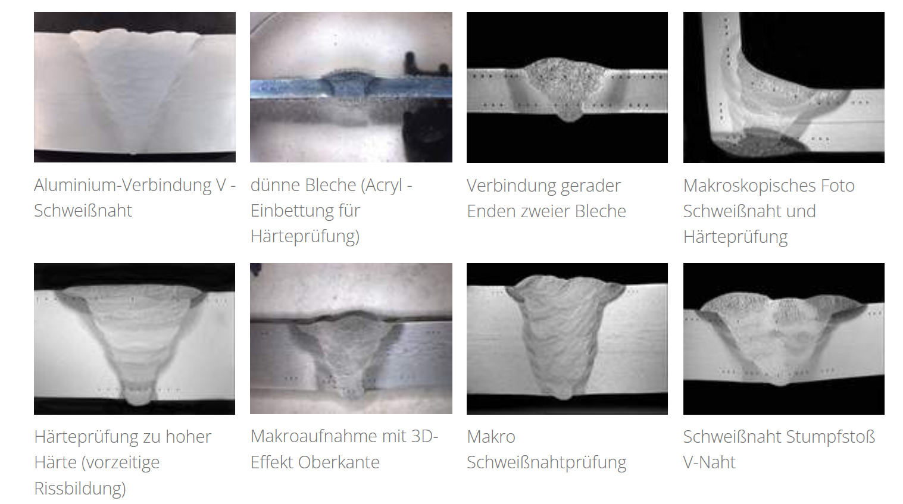

## Vorlesung MTI - Fügen
Prof. Dr.-Ing.  Christian Willberg 

Kontakt: christian.willberg@h2.de
Teile des Skripts sind von \
Prof. Dr.-Ing. Jürgen Häberle übernommen

---

<!--paginate: true-->

# Inhalte
- Einordnung und Verbindungsarten
- Kraft- und Formschluss
- Schweißen: Verfahren
- **Schweißeignung:** Wärmeeinflusszone, Risse, Werkstoffe
- Schweißsicherheit und Schweißmöglichkeit
- Löten und Kleben
- Fügen durch Umformen, Nieten
- Rechenübungen

<!--
Zeitplan (90 min):
 10 min  Einordnung, Verbindungsarten, Kraftschluss, Übung 1
 15 min  Schweißverfahren (Videos auswählen), Übung 2
 30 min  Schweißeignung: WEZ, Risse, Werkstoffe, Übung 3
 10 min  Schweißsicherheit, Schweißmöglichkeit
 15 min  Löten, Kleben, Übung 4
  5 min  Umformfügen, Nieten
  5 min  Zusammenfassung
-->

---

# Einordnung

---

## Definition
Fügen ist das Zusammenbringen von verschiedenen Werkstücken (Bauelementen) geometrisch bestimmter fester Form oder von ebensolchen Werkstücken mit formlosem Stoff oder Verbindungselementen. Dabei wird der Zusammenhalt zwischen den Elementen jeweils örtlich geschaffen oder vermehrt.

- gefügt werden können alle Arten von Werkstoffkombinationen
- nicht alle Fügeverfahren sind für alle Werkstoffe geeignet

Fügen ist die Hauptgruppe 4 nach DIN 8580 - das Gegenstück zum **Trennen** (MTI 08), das den Zusammenhalt aufhebt.

---

## Verfahrensgruppen (DIN 8593)

- 4.1 Zusammensetzen
- 4.2 Füllen
- 4.3 An- und Einpressen
- 4.4 Fügen durch Urformen
- 4.5 Fügen durch Umformen

- 4.6 Fügen durch **Schweißen**
  - Pressschweißen, Schmelzschweißen
- 4.7 Fügen durch **Löten**
  - Weich-, Hart-, Hochtemperaturlöten
- 4.8 **Kleben**
  - physikalisch oder chemisch abbindend
- 4.9 Textiles Fügen

---

## Verbindungsarten

| Art | Wirkprinzip | Beispiele | lösbar? |
|---|---|---|---|
| **Kraftschluss** | Reibung durch Normalkraft | Schrauben, Schrumpfen, Klemmen, Keilen | ja |
| **Formschluss** | Formen greifen ineinander | Passfeder, Bolzen, Nieten, Falzen | teilweise |
| **Stoffschluss** | Atome/Moleküle verbinden sich | Schweißen, Löten, Kleben | nein |

Viele Verbindungen kombinieren Prinzipien: Eine Schraube hält die Bleche **kraftschlüssig** zusammen, das Gewinde selbst ist **formschlüssig**.

---

# Kraft- und Formschluss

---

## Kraftschluss

<!-- _class: cols-2 -->

Die Normalkraft $F_N$ erzeugt Reibung - übertragbar ist höchstens:

$$F_{R} = \mu \cdot F_N$$

**Schrumpfen / Pressverband:** Nabe erwärmen oder Welle kühlen, nach dem Temperaturausgleich entsteht Fugendruck

**Schraubenverbindung:** Vorspannkraft $F_V$ presst die Bauteile zusammen

---

## Schraubenverbindungen

---

| Durchsteckschraube | Einziehschraube, Sechskantschraube, Zylinderschraube | Stiftschraube |
|---|---|---|
| Die Verbindung wird erzeugt durch Verspannen mit einer Mutter. | Hier wird das Verspannen realisiert durch den Einzug in ein Gewinde, welches in einem zu verbindenden Objekt enthalten ist. | Bei einer Stiftschraube wird der Schraubenkopf durch eine Mutter ersetzt. |
| In den Bohrungen ist kein Gewinde enthalten (Durchgangsbohrungen). | Der Schraubenkopf kann zusätzlich versenkt werden oder aufliegen (siehe Durchsteckschraube). | |

[Quelle](https://www.ingenieurkurse.de/technische-darstellungen-maschienenbau/normgerechtes-bemassen-in-einer-technischen-zeichnung/hinweise-zu-speziellen-schrauben-und-gewindebedingungen.html)

**Festigkeitsklasse** auf dem Schraubenkopf, z. B. **8.8**: $R_m = 8 \cdot 100 = 800$ MPa, $R_e = 0{,}8 \cdot 800 = 640$ MPa

---

## Übung 1: Wie viel Querkraft hält der Flansch?

Ein Flansch wird mit **4 Schrauben** zusammengehalten. Jede Schraube ist mit $F_V = 20$ kN vorgespannt. Die Reibungszahl in der Trennfuge beträgt $\mu = 0{,}15$.

a) Welche Querkraft kann der Flansch **reibschlüssig** übertragen?
b) Was passiert, wenn die Querkraft größer wird?
c) Warum ist eine Schraube der Festigkeitsklasse 8.8 hier besser als 4.6?

---

## Lösung Übung 1

a) $F_Q = \mu \cdot n \cdot F_V = 0{,}15 \cdot 4 \cdot 20 \text{ kN} = 12$ kN

b) Die Bauteile **rutschen**: Die Schrauben werden dann auf Biegung und Abscherung belastet, und die Verbindung lockert sich unter Schwingbelastung. Kraftschluss funktioniert nur, solange $F_Q < \mu F_N$.

c) 8.8 ($R_e = 640$ MPa) erträgt eine viel höhere **Vorspannkraft** als 4.6 ($R_e = 240$ MPa) → mehr Reibkraft bei gleicher Schraubengröße.

Wichtig: Nur **vier Schrauben** und $\mu = 0{,}15$ - die übertragbare Querkraft ist nur 15 % der gesamten Vorspannkraft.

---

## Formschluss

- Verzahnungen
- Nuten und Federn (Passfeder)
- Bolzen, Stifte
- Dübel in der Holzbearbeitung: Dübel, die in entsprechend gebohrte Löcher eingefügt werden, um zwei Holzstücke miteinander zu verbinden

Kraft wird über **Flächenpressung** übertragen - unabhängig von der Reibung

---

# Schweißen

---

## Schweißen - Grundprinzip

**Schmelzschweißverfahren**
- Wärme
- Stoffschluss durch Schmelzfluss der Fügeteile und des Zusatzwerkstoffs

**Pressschweißverfahren**
- Druck oder Wärme und Druck
- Plastifizierung und örtliches Verformen der Fügeteile

Eine Schweißnaht ist im Kleinen ein **Gussgefüge** (Erstarrung, MTI 06) neben einem **wärmebehandelten** Grundwerkstoff (MTI 07) - deshalb ist Schweißen auch eine **Werkstofffrage**.

---

## Lichtbogenschweißen

- Lichtbogen brennt zwischen einer abschmelzenden Metallelektrode und dem Werkstück
- die Elektrode ist gleichzeitig der Schweißzusatz
- Lichtbogenhandschweißen (E-Hand): Umhüllung erzeugt Schutzgas und Schlacke - robust, baustellentauglich

<iframe width="350" height="330" src="https://www.youtube.com/embed/DccNuexANYU?start=33" title="YouTube video player" frameborder="0" allow="accelerometer; autoplay; clipboard-write; encrypted-media; gyroscope; picture-in-picture; web-share" referrerpolicy="strict-origin-when-cross-origin" allowfullscreen></iframe>

---

 
<iframe width="1150" height="500" src="https://www.youtube.com/embed/tQocMx5o6dE?start=160" title="YouTube video player" frameborder="0" allow="accelerometer; autoplay; clipboard-write; encrypted-media; gyroscope; picture-in-picture; web-share" referrerpolicy="strict-origin-when-cross-origin" allowfullscreen></iframe>

Schutzgasschweißen

---

## Schutzgasschweißen

**MSG - Metall-Schutzgasschweißen**
- **MIG** (inertes Gas: Ar, He) für Aluminium, Kupfer, Nickel
- **MAG** (aktives Gas: Ar + CO₂/O₂) für unlegierte, niedrig- und hochlegierte Stähle
- Drahtelektrode wird abgeschmolzen - hohe Abschmelzleistung, gut automatisierbar

**WIG - Wolfram-Inertgas-Schweißen**
- Lichtbogen brennt zwischen nicht abschmelzender Wolfram-Elektrode und dem Werkstück
- Zusatzstab sorgt für Schweißzusatz
- sehr saubere Nähte, langsam - für dünne Bleche, Edelstahl, Aluminium, Wurzellagen

---

 
<iframe width="1150" height="500" src="https://www.youtube.com/embed/N7R_7pM3L98?start=14" title="YouTube video player" frameborder="0" allow="accelerometer; autoplay; clipboard-write; encrypted-media; gyroscope; picture-in-picture; web-share" referrerpolicy="strict-origin-when-cross-origin" allowfullscreen></iframe>

Unterpulverschweißen (UP): Lichtbogen brennt unter Pulver - hohe Leistung für dicke Bleche (Schiffbau, Rohre, Windtürme)

---

## Gasschmelzschweißen / Autogenschweißen
- Acetylen-Sauerstoff-Flamme (ca. 3 200 °C)
- wird nur noch selten genutzt
- hohe Betriebskosten und geringe Produktivität
- im Handwerk oder auf Baustellen aufgrund der geringen Anschaffungskosten im Einsatz

---

 
<iframe width="1150" height="500" src="https://www.youtube.com/embed/6SiwQfuhxa8?start=584" title="YouTube video player" frameborder="0" allow="accelerometer; autoplay; clipboard-write; encrypted-media; gyroscope; picture-in-picture; web-share" referrerpolicy="strict-origin-when-cross-origin" allowfullscreen></iframe>

Gasschmelzschweißen

---

## Strahlschweißen: Laser und Elektronenstrahl

- sehr hohe Energiedichte → **tiefe, schmale Naht** (Tiefschweißeffekt)
- **kleine Wärmeeinflusszone**, wenig Verzug
- hohe Geschwindigkeit, gut automatisierbar - Karosseriebau, Getriebeteile
- Elektronenstrahl: im **Vakuum** - auch für reaktive Werkstoffe (Titan)
- Nachteil: teure Anlagen, enge Spaltmaße nötig

---

## Widerstandspressschweißen

- nutzt den elektrischen Widerstand zum Heizen

$Q= \int_0^{t_s} I^2 R \, dt = W_{elektrisch}$

- oft bei Dünnblechen im Einsatz (Punktschweißen im Karosseriebau: mehrere Tausend Punkte pro Fahrzeug)

---

## Besonderheiten des Verfahrens

|Vorteile|  Nachteile |
|---|---|
|keine Nahtvorbereitung|  große Kerbwirkung in einem Punkt |
|kurze Schweißzeiten|  geringe Dauerfestigkeit |
|gute Automatisierbarkeit| Kraftumlenkung infolge der Überlappungsverbindung  |
|kleine Wärmeeinflusszonen| schlechte Prüfbarkeit  |

---

## Reibschweißen

- notwendige Wärme wird durch Reibung erzeugt - **kein Aufschmelzen**
- sehr gute Festigkeitseigenschaften, feinkristallines Gefüge
- Ermüdungsverhalten ist gut
- auch für **Mischverbindungen** (Al-Stahl, Cu-Al)
- die konstruktive Gestaltung spielt bei Reibschweißbauteilen eine große Rolle

 
<iframe width="350" height="250" src="https://www.youtube.com/embed/oO2xxweFl6A?start=17" title="YouTube video player" frameborder="0" allow="accelerometer; autoplay; clipboard-write; encrypted-media; gyroscope; picture-in-picture; web-share" referrerpolicy="strict-origin-when-cross-origin" allowfullscreen></iframe>

---

 
<iframe width="1150" height="500" src="https://www.youtube.com/embed/Z4szktVnMLA?start=13" title="YouTube video player" frameborder="0" allow="accelerometer; autoplay; clipboard-write; encrypted-media; gyroscope; picture-in-picture; web-share" referrerpolicy="strict-origin-when-cross-origin" allowfullscreen></iframe>

oszillierende Bewegung (Ultraschallschweißen)

---

## Wärmeeinbringung

Wie viel Wärme in das Bauteil gelangt, steuert das Gefüge in der Naht und daneben:

$$E = \frac{U \cdot I}{v} \quad \text{(Streckenenergie)} \qquad Q = k \cdot E \quad \text{(Wärmeeinbringung)}$$

| Verfahren | thermischer Wirkungsgrad $k$ |
|---|---|
| Unterpulver (UP) | 1,0 |
| MAG/MIG, E-Hand | 0,8 |
| WIG | 0,6 |

- **viel** Wärme → langsame Abkühlung → grobes Korn, breite WEZ, Verzug
- **wenig** Wärme → schnelle Abkühlung → Gefahr von **Martensit** (Aufhärtung)

---

## Übung 2: Wärmeeinbringung und Punktschweißen

a) Eine Kehlnaht wird MAG-geschweißt mit $U = 25$ V, $I = 250$ A und einer Schweißgeschwindigkeit von $v = 40$ cm/min. Berechnen Sie Streckenenergie $E$ und Wärmeeinbringung $Q$ in kJ/cm.

b) Wie ändert sich $Q$, wenn der Schweißer doppelt so schnell schweißt? Was bedeutet das für die Abkühlung?

c) Ein Schweißpunkt wird mit $I = 10$ kA, Übergangswiderstand $R = 100$ µΩ und $t = 0{,}2$ s erzeugt. Welche Wärmemenge entsteht?

---

## Lösung Übung 2

a) $v = 40$ cm/min $= 0{,}667$ cm/s

$$E = \frac{25 \cdot 250}{0{,}667} \approx 9\,400 \text{ J/cm} = 9{,}4 \text{ kJ/cm} \qquad Q = 0{,}8 \cdot 9{,}4 \approx 7{,}5 \text{ kJ/cm}$$

b) doppelte Geschwindigkeit → **halbe** Wärmeeinbringung (3,75 kJ/cm) → **schnellere Abkühlung** → bei härtbaren Stählen Gefahr von Martensit in der WEZ

c) $Q = I^2 \cdot R \cdot t = (10^4)^2 \cdot 10^{-4} \cdot 0{,}2 = 2\,000$ J - in nur 0,2 s, konzentriert auf wenige mm³

---

# Schweißeignung

---

## Schweißbarkeit eines Bauteils
- Schweißeignung (Werkstoff <-> Verfahren)
- Schweißsicherheit (Werkstoff <-> Konstruktion)
- Schweißmöglichkeit (Konstruktion <-> Verfahren)

**Schweißeignung** ist die Werkstoffseite: Lässt sich der Werkstoff so schweißen, dass Naht und Wärmeeinflusszone die geforderten Eigenschaften haben?

---

## Die Wärmeeinflusszone (WEZ)

<!-- _class: cols-2 -->

Neben der Naht durchläuft der Grundwerkstoff **jede Temperatur** zwischen Schmelze und Raumtemperatur - wie eine ungewollte Wärmebehandlung:

| Zone | Gefüge |
|---|---|
| Schweißgut | Gussgefüge (Stängelkristalle) |
| Grobkornzone | grobes Korn, **Aufhärtung möglich** |
| Feinkornzone | normalgeglüht, feinkörnig, gut |
| teilaustenitisiert | Mischgefüge |
| Anlasszone | angelassen, ggf. entfestigt |

Die Zonen lassen sich direkt im **Eisen-Kohlenstoff-Diagramm** (MTI 06) ablesen: Spitzentemperatur und Abkühlgeschwindigkeit bestimmen das Gefüge.

---

## Problem 1: Aufhärtung und Kaltrisse

<!-- _class: cols-2 -->

**Kaltrisse** (Wasserstoffrisse) entstehen nach dem Abkühlen - auch Stunden später. Es braucht **drei** Zutaten gleichzeitig:

1. **hartes, sprödes Gefüge** (Martensit in der WEZ)
2. **Wasserstoff** (feuchte Elektroden, Rost, Öl)
3. **Zugeigenspannungen** (Schrumpfen der Naht)

**Gegenmaßnahmen** - eine Zutat entfernen:
- **Vorwärmen** (z. B. 100 - 250 °C): langsamere Abkühlung, Wasserstoff kann ausdiffundieren
- wasserstoffarme, **getrocknete** Elektroden, saubere Fugen
- höhere Wärmeeinbringung
- Werkstoff mit niedrigem $CEV$

---

## Das Kohlenstoffäquivalent (Wiederholung MTI 07)

Je mehr C und Legierungselemente, desto leichter entsteht Martensit in der WEZ:

$$CEV = C + \frac{Mn}{6} + \frac{Cr + Mo + V}{5} + \frac{Ni + Cu}{15}$$

| CEV | Schweißeignung | Maßnahme |
|---|---|---|
| ≤ 0,45 | gut | meist ohne Vorwärmen |
| 0,45 ... 0,60 | bedingt | Vorwärmen (ca. 100 - 200 °C) |
| > 0,60 | schlecht | hoch vorwärmen, Wärmenachbehandlung (Spannungsarmglühen) |

**Faustregel unlegierter Stähle:** C ≤ 0,22 % gut schweißbar, 0,22 ... 0,4 % bedingt, darüber schlecht

Auch die **Blechdicke** zählt: Dicke Bleche leiten die Wärme schneller ab → schnellere Abkühlung → höhere Vorwärmtemperatur nötig (EN 1011-2).

---

## Problem 2: Heißrisse und Lamellenrisse

**Heißrisse** (Erstarrungsrisse)
- entstehen **während** der Erstarrung
- niedrigschmelzende Filme an den Korngrenzen (S, P → FeS)
- besonders bei **vollaustenitischen** Stählen und Al-Legierungen
- Abhilfe: geringe S/P-Gehalte, Zusatzwerkstoff mit etwas Ferrit (Austenit: 5 - 10 % δ-Ferrit)

**Lamellenrisse** (Terrassenbrüche)
- in **dicken Blechen** bei Zug senkrecht zur Blechoberfläche
- Ursache: flach gewalzte MnS-Einschlüsse
- Abhilfe: Stähle mit Z-Güte (garantierte Brucheinschnürung in Dickenrichtung, z. B. S355J2+Z35), Naht konstruktiv anders legen

---

## Schweißeignung der Werkstoffe

| Werkstoff | Eignung | Worauf achten? |
|---|---|---|
| Baustahl S235, S355 | **gut** | bei dicken Blechen vorwärmen |
| Feinkornbaustahl S460, S690 | gut - bedingt | Wärmeeinbringung begrenzen (Festigkeit in der WEZ) |
| Vergütungsstahl C45, 42CrMo4 | **bedingt - schlecht** | Martensit: vorwärmen, anlassen |
| austenitischer Cr-Ni-Stahl X5CrNi18-10 | **gut** | Heißrisse; Chromkarbide → **interkristalline Korrosion** (Abhilfe: L-Güten wie X2CrNi19-11 oder Ti-stabilisiert) |
| ferritischer / martensitischer Cr-Stahl | bedingt | Grobkorn bzw. Aufhärtung |
| Gusseisen GJL | **schlecht** | spröde, Ledeburit in der WEZ; nur für Reparaturen mit Ni-Elektroden, warm |
| Gusseisen GJS | bedingt | wie GJL, aber duktiler |
| Aluminiumlegierungen | gut - bedingt | Oxidschicht, hohe Wärmeleitung, Festigkeitsverlust in der WEZ (aushärtbare Legierungen) |
| Titan | gut | nur unter Schutzgas - nimmt O, N, H auf und versprödet |

---

## Übung 3: Schweißen - ja oder nein?

Bewerten Sie die Schweißeignung und nennen Sie eine wichtige Maßnahme.

a) Stahlbau-Träger aus S355J2, 20 mm Blech, $CEV = 0{,}40$
b) Antriebswelle aus 42CrMo4 (vergütet), $CEV = 0{,}80$ - ein Zahnrad soll angeschweißt werden
c) Behälter für Säure aus X5CrNi18-10
d) Gebrochenes Maschinenbett aus EN-GJL-250
e) Fahrradrahmen aus einer aushärtbaren Al-Legierung (EN AW-6061 T6)

**Zusatzfrage:** Bei welchen Fällen würden Sie eher ein **anderes Fügeverfahren** vorschlagen?

*Zeit: 10 Minuten in Gruppen*

---

## Lösung Übung 3

| Fall | Bewertung | Maßnahme |
|---|---|---|
| a) S355J2 | gut | ab ca. 20-30 mm Dicke leicht vorwärmen, trockene Elektroden |
| b) 42CrMo4 | schlecht | hoch vorwärmen (~250-300 °C), danach anlassen - **besser:** Pressverband oder Passfeder |
| c) X5CrNi18-10 | gut | Wärmeeinbringung begrenzen; für Säure besser L-Güte (1.4307) oder Ti-stabilisiert (1.4541), Anlauffarben beizen |
| d) EN-GJL-250 | schlecht | Warmschweißen mit Ni-Elektrode - **besser:** neues Teil oder Verschrauben/Klammern |
| e) Al 6061 T6 | bedingt | WEZ verliert Festigkeit → nach dem Schweißen neu auslagern oder Rohre dicker auslegen |

**Andere Fügeverfahren:** bei b) und d) - der Werkstoff wurde nicht zum Schweißen ausgewählt.

---

## Schweißsicherheit

Die **Konstruktion** entscheidet, ob die Schweißverbindung sicher hält:

- Kraftflüsse im Bauteil, Anordnung von Schweißnähten
- Werkstückdicke, Steifigkeitsunterschiede
- **Kerbwirkung** - Schweißnähte sind fast immer Kerben

Sicherheit wird verbessert, wenn
- keine Umlenkung des Kraftflusses
- ein- oder zweiachsiger Spannungszustand
- Kerben vermieden werden
- kontinuierliche Übergänge bei Querschnitten

Bei Schwingbelastung sind Schweißnähte oft die **Schwachstelle**: Die Wöhlerlinie geschweißter Bauteile ist sehr steil ($k = 3$, MTI 10). Nahtübergänge schleifen oder hämmern verlängert die Lebensdauer deutlich.

---

## Schweißmöglichkeit
- unter den vorhandenen Bedingungen muss die Schweißung fachgerecht durchgeführt werden können
- **Vorbereiten:** Fugenform, Stoßart, Vorwärmen, Schweißverfahren
- **Ausführen:** Wärmeeinbringung, Wärmeführung, Schweißfolge (Verzug!)
- **Nachbereiten/Nachbehandeln:** Richten, Schleifen, Wärmebehandlung, Prüfen
- Zugänglichkeit: Kommt der Brenner überhaupt an die Naht?

---

## Fugen

- Schweißquerschnitte unterscheiden sich je nach Verfahren
- I-Naht für dünne Bleche, V-, X-, U-Naht für dicke Bleche
- Kehlnaht an T-Stößen und Überlappungen

---

    <a href="https://www.schuetz-licht.de/wissen-normen-seminare/metallographie-metallografie/schweissnahtpruefung" style="color: blue;">Bildreferenz</a>

---

# Löten

---

## Löten - Prinzip
- ein **Lot** wird aufgeschmolzen und verbindet die Werkstücke
- der **Grundwerkstoff schmilzt nicht** - Unterschied zum Schweißen

**Vorteile**
- Verbinden von verschiedenartigen Werkstoffen
- Verbinden von Nichtmetallen (Keramik, Hartmetall)
- geringer Verzug und Wärmeeintrag
- gute elektrische und Wärmeleitfähigkeit der Lötstellen

**Nachteile**
- Korrosionsgefahr aufgrund der Potentialunterschiede zwischen Lot und Grundwerkstoff
- Festigkeitseinbußen bei steigender Temperatur
- geringere Festigkeit als Schweißen

---

## Weich-, Hart- und Hochtemperaturlöten

- bis 450 °C: **Weichlöten** (Sn-Cu, Sn-Ag) - Elektronik, Wasserleitungen
- ab 450 °C: **Hartlöten** (Cu, Ag, Messing) - Fahrradrahmen, Hartmetallschneiden auf Stahl
- über 900 °C: **Hochtemperaturlöten** (Ni-, Cu-Basis, im Vakuum) - Turbinenteile, Wärmetauscher

---

## Lote
- meist Legierungen und selten reine Metalle - oft nahe einem **Eutektikum** (niedriger Schmelzpunkt, MTI 06)
- Aufgabe: die Grundwerkstoffe zu verbinden
- Lotschmelztemperatur muss niedriger sein als vom Grundwerkstoff
- wenigstens ein Legierungselement des Lots muss mit dem Grundwerkstoff einen Mischkristall bilden
- das Lot muss in der Lage sein, den Grundwerkstoff zu **benetzen** - **Flussmittel** lösen Oxide
- enge Spalte (0,05 - 0,2 mm): das Lot wird durch **Kapillarwirkung** hineingezogen

---

## Lötverfahren

 
<iframe width="350" height="420" src="https://www.youtube.com/embed/Zyuvy_rMXcY?start=5" title="YouTube video player" frameborder="0" allow="accelerometer; autoplay; clipboard-write; encrypted-media; gyroscope; picture-in-picture; web-share" referrerpolicy="strict-origin-when-cross-origin" allowfullscreen></iframe>

Kolbenlöten

---

 
<iframe width="1150" height="500" src="https://www.youtube.com/embed/ToJfdgbvodc" title="YouTube video player" frameborder="0" allow="accelerometer; autoplay; clipboard-write; encrypted-media; gyroscope; picture-in-picture; web-share" referrerpolicy="strict-origin-when-cross-origin" allowfullscreen></iframe>

Induktionslöten

---

Widerstandslöten - direkt: Strom fließt über die Lötstelle; indirekt: Strom fließt nicht über die Lötstelle

<iframe width="1150" height="450" src="https://www.youtube.com/embed/739HFTSdWT4" title="YouTube video player" frameborder="0" allow="accelerometer; autoplay; clipboard-write; encrypted-media; gyroscope; picture-in-picture; web-share" referrerpolicy="strict-origin-when-cross-origin" allowfullscreen></iframe>

---

# Kleben

---

## Kleben - Prinzip
- **Kohäsion:** Klebstoff muss genug Festigkeit haben
- **Adhäsion:** Klebstoff muss mit genügend Festigkeit am Fügeteil angebunden sein

---

## Kleben - Vorteile
- nahezu alle Werkstoffkombinationen können gefügt werden
- flächige Kraftübertragung erzeugt eine gleichmäßige Verteilung der Kräfte
- große Klebefläche → relativ hohe Kräfte können zwischen dünnen Fügeteilen übertragen werden $\sigma = \frac{F}{A}$
- elastische Klebstoffe erlauben kleine Relativbewegungen der Fügepartner, z. B. können Fügeteildehnungen bei Temperaturschwankungen ausgeglichen und Schwingungen effektiv gedämpft werden
- geringe oder keine Wärmebelastung
- Fügetoleranzen können ausgeglichen werden

---

## Kleben - Nachteile
- in der Regel wird eine Sofortfestigkeit nicht erreicht
- je nach chemischer Basis eingeschränkte thermische und chemische Belastbarkeit/Beständigkeit
- die mechanischen Eigenschaften sind temperaturabhängig
- z. T. eine gewisse Neigung zum Kriechen
- Klebungen altern
- eine Wiederlösbarkeit der Verbindung ist häufig nicht ohne Beschädigung mindestens eines der Fügeteile möglich

---

## Oberflächenbehandlung

- Oberfläche hat oft Verunreinigungen wie
  - Staub, Metallabrieb ~$10^4-10^5$ nm
  - Öle, Fette ~$3$ nm
  - Reaktionsschichten ~$1-10$ nm
  - Grundwerkstoff mit verändertem Gefüge
- Reinigen erfolgt
  - chemisch
  - mechanisch (Schleifen, Strahlen - MTI 08)
  - Entfetten

Die meisten Klebungen versagen nicht im Klebstoff, sondern an der **Grenzfläche** - die Vorbehandlung entscheidet.

---

---

## Klebverbindungen gestalten

<!-- _class: cols-2 -->

- Klebstoffe sind fest auf **Schub**, schwach auf **Schälen**
- einschnittige Überlappung: mittlere Schubspannung

$$\tau = \frac{F}{b \cdot l_\ddot{u}}$$

- **aber:** die Spannung ist an den Überlappungsenden viel höher als in der Mitte → eine doppelt so lange Überlappung trägt **nicht** doppelt so viel

**Gut:** Schub, große Fläche, Schäftung, Doppellasche
**Schlecht:** Schälen, Spaltung, kleine Fläche

**Übung 4:** Zwei Al-Bleche ($b = 25$ mm) sind mit $l_ü = 12{,}5$ mm überlappt geklebt. Die Klebstoff-Scherfestigkeit beträgt $\tau_B = 20$ MPa.
a) Welche Kraft hält die Klebung (mittlere Spannung)?
b) Was erwarten Sie bei $l_ü = 25$ mm?

---

## Lösung Übung 4

a) $F = \tau_B \cdot b \cdot l_ü = 20 \cdot 25 \cdot 12{,}5 = 6\,250$ N $\approx 6{,}3$ kN

b) Rechnerisch $12{,}5$ kN - **real deutlich weniger**, weil die Spannungsspitzen an den Überlappungsenden bestimmen, wann die Klebung reißt. Ab einer gewissen Länge steigt die Bruchkraft kaum noch.

**Konsequenz:** Breite bringt mehr als Länge. Weitere Verbesserungen: dickere/steifere Fügeteile, angeschrägte Enden, elastischerer Klebstoff.

---

## Kleben - Prüfung und Prozess

- Kleben ist ein sogenannter „**spezieller Prozess**", d. h. eine Prüfung ist nicht vollständig durch zerstörungsfreie Methoden realisierbar
- Sicherheit durch robusten und reproduzierbaren Klebprozess (DIN 2304)
- **Kissing Bonds:** Fügeteile berühren sich, haften aber nicht - von außen nicht sichtbar
- Reaktionsauslösung ist abhängig vom Klebstoff: Temperatur, Zugabe eines Härters, Feuchtigkeit, Strahlung, ...

---

 
<iframe width="1150" height="500" src="https://www.youtube.com/embed/bUEh0yOhT4Q" title="YouTube video player" frameborder="0" allow="accelerometer; autoplay; clipboard-write; encrypted-media; gyroscope; picture-in-picture; web-share" referrerpolicy="strict-origin-when-cross-origin" allowfullscreen></iframe>

Automatisierung über Roboter möglich

---

# Fügen durch Umformen

---

## Fügen durch Umformen
- Vorteile
  - kein Wärmeeintrag
  - große Vielfalt bei den Werkstoffen/-kombinationen
  - gute ökologische Verträglichkeit
  - einfache Qualitätskontrolle
  - hohe Wirtschaftlichkeit
- Nachteile
  - kaum Normungen
  - punktförmige Verbindung
- Verfahren: Bördeln, Falzen, Verlappen

---

## Durchsetzfügen (Clinchen)

---

## Stanznieten / Niet

- Nieten: formschlüssig, unlösbar, **kein Wärmeeintrag**
- geeignet für Mischverbindungen und nicht schweißbare Werkstoffe (aushärtbares Al im Flugzeugbau)
- Blindniete: Zugang nur von einer Seite

---

---

## Übung 5: Welches Fügeverfahren?

a) Rumpfhaut eines Flugzeugs aus aushärtbarem Aluminium
b) Hartmetallschneide auf einem Stahl-Drehmeißel
c) Karosserie aus Stahlblech, 5 000 Verbindungspunkte pro Fahrzeug
d) Windkraft-Rotorblatt aus Glasfaserverbund (Halbschalen)
e) Getriebezahnrad auf einer Welle - muss zur Reparatur gewechselt werden
f) Kupferrohre einer Trinkwasserleitung

---

## Lösung Übung 5

| Anwendung | Verfahren | Begründung |
|---|---|---|
| a) Flugzeugrumpf | **Nieten** (+ Kleben) | aushärtbares Al schlecht schweißbar, prüfbar, kein Wärmeeintrag |
| b) Hartmetallschneide | **Hartlöten** | Hartmetall nicht schweißbar, Lot verbindet ungleiche Werkstoffe |
| c) Karosserie | **Widerstandspunktschweißen** | schnell, automatisiert, dünne Bleche |
| d) Rotorblatt | **Kleben** | Faserverbund, große Flächen, Lasten flächig verteilt |
| e) Zahnrad | **Passfeder** oder **Pressverband** | lösbar bzw. demontierbar |
| f) Kupferrohr | **Weich- oder Hartlöten** (oder Pressfitting) | dicht, einfach auf der Baustelle |

---

## Zusammenfassung

- **Verbindungsarten:** Kraftschluss ($F_R = \mu F_N$), Formschluss, Stoffschluss
- **Schweißen:** Schmelz- und Pressschweißen; Wärmeeinbringung $Q = k \cdot U I / v$ steuert die Abkühlung
- **Schweißeignung** ist eine Werkstofffrage:
  - WEZ = ungewollte Wärmebehandlung (Grobkorn, Martensit)
  - Kaltrisse brauchen Martensit + Wasserstoff + Zugspannung → Vorwärmen, trockene Elektroden
  - $CEV \leq 0{,}45$: gut schweißbar
  - Austenit: Heißrisse, interkristalline Korrosion; Gusseisen: schlecht
- **Löten:** Grundwerkstoff schmilzt nicht; **Kleben:** auf Schub auslegen, Vorbehandlung entscheidet

---

## Referenzen

- DIN 8593: Fertigungsverfahren Fügen
- DIN EN 1011-1/-2: Empfehlungen zum Schweißen metallischer Werkstoffe
- DIN 2304: Klebtechnik - Qualitätsanforderungen an Klebprozesse
- Awiszus, B. et al. (2007): Grundlagen der Fertigungstechnik. Hanser
- Schulze, G.: Die Metallurgie des Schweißens. Springer Vieweg
- Habenicht, G.: Kleben. Springer Vieweg
