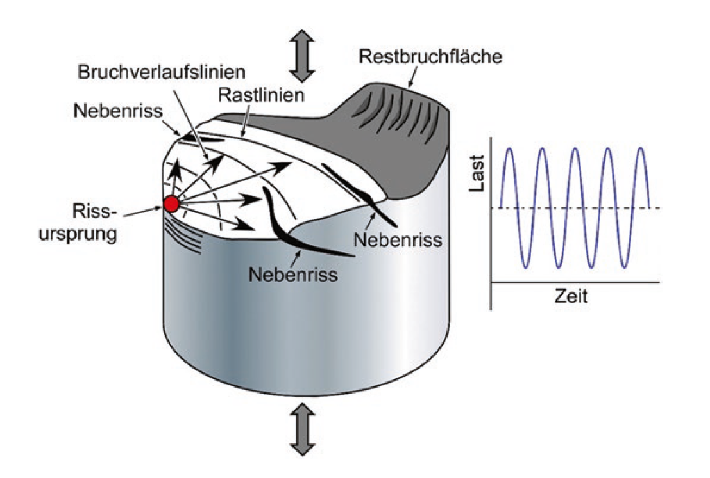
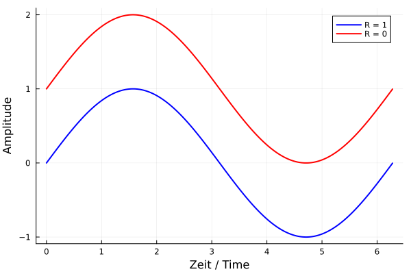
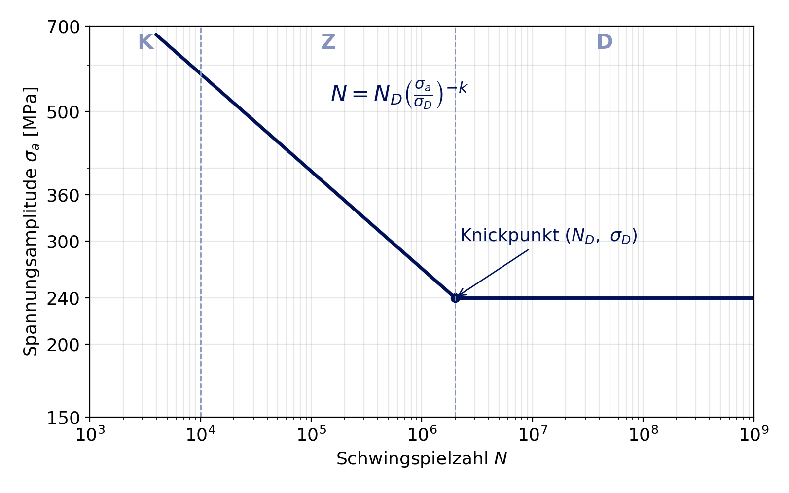
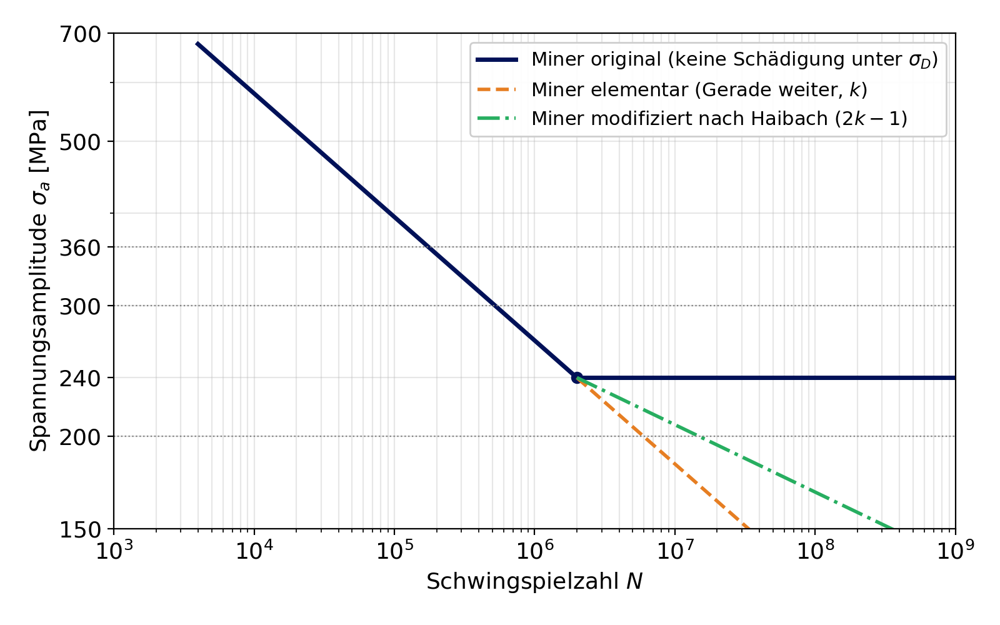
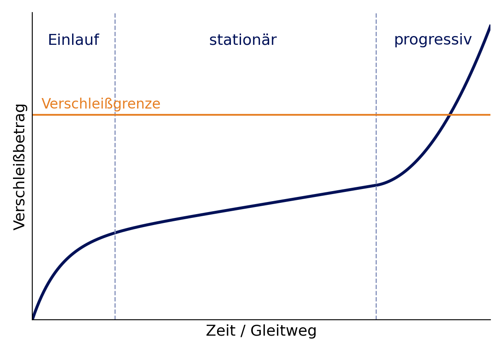

## Vorlesung MTI - Ermüdung und Verschleiß
Prof. Dr.-Ing.  Christian Willberg 

Kontakt: christian.willberg@h2.de
Teile des Skripts sind von \
Prof. Dr.-Ing. Jürgen Häberle übernommen

  <a href="https://doi.org/10.1007/s42102-021-00079-6" style="color: blue;">Bildreferenz</a>

---

<!--paginate: true-->

# Inhalte
- Ermüdung: Ablauf, Bruchfläche, Beanspruchungsgrößen
- Wöhlerlinie und Lebensdauer
- Mittelspannung und Kerben
- Lastkollektive und Miner-Regel
- Verschleiß: Mechanismen und Verschleißarten
- Verschleißrechnung nach Archard
- Rechenübungen

<!--
Zeitplan (130 min):
  5 min  Einstieg, Schadensfälle
 20 min  Ermüdung: Ablauf, Bruchfläche, Beanspruchung, Übung 1
 20 min  Wöhlerlinie, Übung 2, Mittelspannung, Übung 3
 10 min  Kerben, Übung 4, Gegenmaßnahmen
 25 min  Lastkollektiv, Miner, Übung 5 (Hauptübung)
 35 min  Verschleiß inkl. Übung 6
  5 min  Zusammenfassung
 10 min  Puffer / Pause
-->

---

# Ermüdung

Was ist Ermüdung?

---

## Ermüdung - Definition

**Ermüdung** ist die Schädigung eines Werkstoffs unter **zyklischer (wiederholter) Belastung**, die zum Bruch führt - obwohl die Spannung **deutlich unter der Zugfestigkeit**, oft sogar unter der Streckgrenze liegt.

- Tritt typischerweise bei zyklischer Belastung auf
  - Isotherme mechanische Ermüdung
    - [Oszillierende Last](https://www.youtube.com/watch?v=_qVXkAWtH60)
    - Flugzeugrümpfe (Druckaufbau und -abfall)
  - Thermische Ermüdung: Öfen, Heizelemente
  - Thermomechanische Ermüdung: Hochdruckbehälter, Turbinen
  - Elektrothermische Ermüdung: Stromleiter (Glühfäden)

---

---

## Warum ist Ermüdung so gefährlich?

<!-- _class: cols-2 -->

- ein Großteil (oft genannt: **rund 80 %**) aller Schadensfälle an Maschinenbauteilen sind Ermüdungsbrüche
- Bruch kommt **ohne Vorwarnung** - keine sichtbare plastische Verformung
- Lebensdauer **streut** stark

**Bekannte Schadensfälle**
- **de Havilland Comet (1954):** Risse an Fensterecken des Druckrumpfs
- **Aloha Airlines 243 (1988):** Rumpfdach abgerissen (→ Seminar MTI 17)
- **ICE Eschede (1998):** Ermüdungsbruch eines gummigefederten Radreifens, 101 Tote

Ermüdungsbruch eines Pedalarms. Wikimedia Commons

---

## Ermüdung - was passiert im Werkstoff?

- Die Belastung liegt unterhalb der Streckgrenze $R_{p0,2}$
  - _Erinnerung: Was bedeutet $R_{p0,2}$?_
- Spannungs-Konzentrationen entstehen an Materialfehlern (Poren, Einschlüsse, Mikrorisse) oder an Kerben
- Unter wechselnder Last bilden sich dort lokal **kleine plastische Zonen** - Versetzungen bewegen sich hin und her, aber nicht vollständig zurück
- An der Oberfläche entstehen **Gleitbänder** (Extrusionen/Intrusionen) → Mikroriss
- Der Riss wächst mit jedem Lastzyklus ein kleines Stück

[Erklärvideo](https://www.youtube.com/watch?v=o-6V_JoRX1g)

---

## Die drei Stadien des Ermüdungsbruchs

<!-- _class: cols-2 -->

**1. Rissinitiierung**
- meist an der **Oberfläche** oder an Kerben
- kann den größten Teil der Lebensdauer ausmachen

**2. Stabiles Risswachstum**
- Riss wächst pro Zyklus um nm ... µm
- **Rastlinien** (Muschellinien) markieren Laststillstände

**3. Restbruch (Gewaltbruch)**
- Restquerschnitt kann die Last nicht mehr tragen
- schlagartiges Versagen

Bild: <a href="https://doi.org/10.1007/978-3-658-36151-8">doi:10.1007/978-3-658-36151-8</a>

---

## Die Bruchfläche lesen

**Dauerbruchfläche**
- glatt, oft matt
- Rastlinien, die vom Rissursprung weg laufen
- zeigt, **wo** der Riss gestartet ist

**Restbruchfläche**
- zerklüftet, rau
- bei duktilen Werkstoffen mit Scherlippen

**Faustregel:** **Großer** Restbruchanteil → hohe Nennspannung. **Kleiner** Restbruchanteil → geringe Nennspannung, der Riss konnte lange wachsen.

---

## Beanspruchungsgrößen

<!-- _class: cols-2 -->

| Größe | Formel |
|---|---|
| Oberspannung | $\sigma_o$ |
| Unterspannung | $\sigma_u$ |
| Mittelspannung | $\sigma_m=\frac{\sigma_o+\sigma_u}{2}$ |
| Spannungsamplitude | $\sigma_a=\frac{\sigma_o-\sigma_u}{2}$ |
| Spannungsverhältnis | $R = \frac{\sigma_u}{\sigma_o}$ |

---

## Belastungsfälle

| Fall | Spannungsverhältnis | Mittelspannung | Beispiel |
|---|---|---|---|
| ruhend (statisch) | $R = 1$ | $\sigma_m = \sigma_o$ | Eigengewicht |
| schwellend (Zug) | $R = 0$ | $\sigma_m = \sigma_a$ | Schraube, Druckbehälter (Druck auf/ab) |
| wechselnd | $R = -1$ | $\sigma_m = 0$ | umlaufende Welle unter Biegung |
| allgemein | $-1 < R < 1$ | $\sigma_m \neq 0$ | Fahrwerk, Feder mit Vorspannung |

Die **Amplitude** $\sigma_a$ treibt die Ermüdung. Die **Mittelspannung** $\sigma_m$ verschiebt, wie viel Amplitude ertragen wird.

---

## Übung 1: Beanspruchung beschreiben

In einer Antriebswelle wird mit Dehnmessstreifen gemessen:
- größte Spannung $\sigma_o = 250$ MPa
- kleinste Spannung $\sigma_u = -50$ MPa

Bestimmen Sie $\sigma_m$, $\sigma_a$ und $R$. Um welchen Belastungsfall handelt es sich?

*Zeit: 3 Minuten*

---

## Lösung Übung 1

$$\sigma_m = \frac{250 + (-50)}{2} = 100 \text{ MPa} \qquad \sigma_a = \frac{250 - (-50)}{2} = 150 \text{ MPa}$$

$$R = \frac{-50}{250} = -0{,}2$$

Allgemeiner Fall zwischen wechselnd ($R=-1$) und schwellend ($R=0$), mit **Zug-Mittelspannung**.

Die Werte $\sigma_a = 150$ MPa und $\sigma_m = 100$ MPa brauchen wir in Übung 3 wieder.

---

# Wöhlerlinie

---

## Der Wöhlerversuch

<!-- _class: cols-2 -->

**August Wöhler** (1819-1914) untersuchte Brüche von Eisenbahnachsen

**Ablauf**
1. viele gleiche Proben
2. jede Probe mit **konstanter** Amplitude $\sigma_a$ belasten
3. Schwingspielzahl $N$ bis zum Bruch zählen
4. Ergebnisse doppelt-logarithmisch auftragen

Ergebnisse **streuen** - die Wöhlerlinie gilt für eine Überlebenswahrscheinlichkeit (meist 50 %)

---

## Bereiche der Wöhlerlinie

<!-- _class: cols-2 -->

| Bereich | Schwingspiele |
|---|---|
| **K**urzzeitfestigkeit (LCF) | $N < 10^4$ |
| **Z**eitfestigkeit (HCF) | $10^4 ... N_D$ |
| **D**auerfestigkeit | $N > N_D$ |

- $N_D$ = Ecklastspielzahl, bei Stahl $10^6 ... 10^7$
- $\sigma_D$ = Dauerfestigkeit
- Faustwert Stahl: $\sigma_W \approx 0{,}4 ... 0{,}5 \cdot R_m$ (wechselnd, glatte Probe)

**Achtung:** Al- und Cu-Legierungen haben **keine echte Dauerfestigkeit** - die Linie fällt weiter ab. Auch Korrosion hebt die Dauerfestigkeit von Stahl auf.

---

## Zeitfestigkeit rechnen (Basquin)

Im Zeitfestigkeitsbereich ist die Wöhlerlinie im doppelt-logarithmischen Diagramm eine **Gerade**:

$$N = N_D \cdot \left(\frac{\sigma_a}{\sigma_D}\right)^{-k} \qquad \text{für } \sigma_a > \sigma_D$$

- $k$ = **Neigungsexponent** - je größer $k$, desto flacher die Linie
- typische Werte: Schweißverbindungen $k = 3$, gekerbte Bauteile $k \approx 5$, glatte Proben $k \approx 8 ... 15$

**Merke:** Wegen des Exponenten wirkt sich eine kleine Spannungserhöhung **stark** aus: bei $k = 6$ halbieren schon **12 % mehr** Spannung die Lebensdauer ($1{,}12^6 \approx 2$).

---

## Übung 2: Lebensdauer berechnen

Für einen Vergütungsstahl ist bekannt:
- Dauerfestigkeit $\sigma_D = 240$ MPa bei $N_D = 2 \cdot 10^6$
- Neigungsexponent $k = 6$

a) Wie viele Schwingspiele erträgt ein Bauteil bei $\sigma_a = 300$ MPa?
b) ... und bei $\sigma_a = 360$ MPa?
c) Um welchen Faktor sinkt die Lebensdauer, wenn die Amplitude von 300 auf 360 MPa steigt (+20 %)?

*Zeit: 5 Minuten, Taschenrechner*

---

## Lösung Übung 2

a) $N = 2 \cdot 10^6 \cdot \left(\frac{300}{240}\right)^{-6} = \frac{2 \cdot 10^6}{1{,}25^6} = \frac{2 \cdot 10^6}{3{,}81} \approx 5{,}2 \cdot 10^5$

b) $N = \frac{2 \cdot 10^6}{1{,}5^6} = \frac{2 \cdot 10^6}{11{,}39} \approx 1{,}76 \cdot 10^5$

c) $\frac{5{,}24 \cdot 10^5}{1{,}76 \cdot 10^5} = 1{,}2^6 \approx 3$

**20 % mehr Spannung → nur noch ein Drittel der Lebensdauer.** Deshalb sind Spannungsspitzen an Kerben so gefährlich.

---

## Einfluss der Mittelspannung

<!-- _class: cols-2 -->

- **Zug-Mittelspannung** öffnet Risse → ertragbare Amplitude **sinkt**
- **Druck-Mittelspannung** schließt Risse → ertragbare Amplitude steigt (Grund für Kugelstrahlen!)

**Haigh-Diagramm:** ertragbare Amplitude $\sigma_a$ über Mittelspannung $\sigma_m$

**Einfachste Abschätzung - Goodman-Gerade:**

$$\sigma_{a,zul} = \sigma_W \cdot \left(1 - \frac{\sigma_m}{R_m}\right)$$

$\sigma_W$: Wechselfestigkeit ($R = -1$)

Bild: tec-science.com

---

## Smith-Diagramm

<!-- _class: cols-2 -->

- gleiche Information wie das Haigh-Diagramm, andere Darstellung
- aufgetragen: $\sigma_o$ und $\sigma_u$ über $\sigma_m$
- im deutschsprachigen Maschinenbau (Normen, Tabellenbücher) verbreitet
- nach oben begrenzt durch die Streckgrenze

---

## Übung 3: Ist die Welle dauerfest?

Die Welle aus Übung 1 ($\sigma_a = 150$ MPa, $\sigma_m = 100$ MPa) besteht aus einem Stahl mit
- Wechselfestigkeit $\sigma_W = 240$ MPa
- Zugfestigkeit $R_m = 600$ MPa

a) Welche Amplitude ist nach Goodman bei $\sigma_m = 100$ MPa dauerhaft ertragbar?
b) Ist die Welle dauerfest? Wie groß ist die Sicherheit?
c) Wie ändert sich das Ergebnis, wenn die Mittelspannung auf 150 MPa steigt?

---

## Lösung Übung 3

a) $\sigma_{a,zul} = 240 \cdot \left(1 - \frac{100}{600}\right) = 240 \cdot 0{,}833 = 200$ MPa

b) $\sigma_a = 150 \text{ MPa} < 200$ MPa → **dauerfest**, Sicherheit $S = \frac{200}{150} \approx 1{,}33$

c) $\sigma_{a,zul} = 240 \cdot \left(1 - \frac{150}{600}\right) = 180$ MPa → $S = 1{,}2$

Ohne Berücksichtigung der Mittelspannung hätte man $S = 240/150 = 1{,}6$ gerechnet - **zu optimistisch**.

---

## Einflussfaktoren auf die Bauteil-Dauerfestigkeit

Die Werte aus dem Wöhlerversuch gelten für **glatte, polierte Proben**. Das Bauteil ist fast immer schwächer:

| Einfluss | Wirkung |
|---|---|
| **Kerben** (Absätze, Bohrungen, Nuten, Gewinde) | Spannungsspitze → oft der wichtigste Faktor |
| **Oberfläche** (Rauheit) | Riefen wirken wie Mikrokerben |
| **Größe** | größeres Volumen → mehr Fehlstellen |
| **Umgebung** (Korrosion) | keine Dauerfestigkeit mehr |
| **Temperatur** | Festigkeit sinkt, Kriechen |
| **Eigenspannungen** | Druck günstig, Zug ungünstig |

---

## Kerbwirkung

<!-- _class: cols-2 -->

An einer Kerbe ist die örtliche Spannung höher als die Nennspannung:

$$\sigma_{max} = K_t \cdot \sigma_n$$

$K_t$ = **Formzahl**, hängt nur von der Geometrie ab

| Kerbe | $K_t$ (ca.) |
|---|---|
| Wellenabsatz mit großem Radius | 1,3 ... 1,6 |
| Wellenabsatz mit kleinem Radius | 2 ... 3 |
| Querbohrung in Platte (Zug) | ~3 |
| Gewindegrund | 3 ... 5 |

Bei Schwingbelastung wirkt die Kerbe meist etwas schwächer als $K_t$ (**Stützwirkung**): Kerbwirkungszahl $\beta_k \leq K_t$. Für eine sichere Abschätzung rechnet man mit $K_t$.

**Übung 4:** Eine Welle mit Absatz ($K_t = 2{,}5$) hat eine Nennspannungsamplitude von 100 MPa. Der Werkstoff hat $\sigma_D = 240$ MPa. Hält der Absatz dauerhaft?

---

## Lösung Übung 4

$$\sigma_{max,a} = K_t \cdot \sigma_{n,a} = 2{,}5 \cdot 100 = 250 \text{ MPa} > \sigma_D = 240 \text{ MPa}$$

→ **nicht dauerfest** (konservativ gerechnet mit $K_t$)

**Was hilft?**
- größerer Übergangsradius → $K_t$ von 2,5 auf z. B. 1,8: $\sigma_{max,a} = 180$ MPa → dauerfest
- Absatz polieren oder festwalzen
- Werkstoff mit höherer Festigkeit

Die Geometrie zu ändern ist oft **billiger und wirksamer** als ein besserer Werkstoff.

---

## Gegenmaßnahmen gegen Ermüdung

**Konstruktion**
- Kerben vermeiden, große Radien
- Kraftfluss „glätten"
- Schweißnähte aus hochbelasteten Zonen heraus

**Werkstoff**
- hohe Reinheit (wenig Einschlüsse)
- feines Korn

**Oberfläche**
- polieren, feinschleifen
- **Kugelstrahlen, Festwalzen** → Druckeigenspannungen
- Einsatz-/Randschichthärten

**Betrieb**
- regelmäßige **Inspektionen** (Risse finden, bevor sie kritisch sind)
- Korrosionsschutz

---

# Lastkollektive und Schadensakkumulation

---

## Reale Belastung ist nicht konstant

<!-- _class: cols-2 -->

- Wöhlerversuch: **eine** konstante Amplitude
- Realität: Fahrbahn, Wind, Wellengang, Start/Landung ... → **viele verschiedene** Amplituden

**Lastkollektiv**
- gemessene Belastung wird in **Klassen** eingeteilt
- für jede Klasse: Amplitude $\sigma_{a,i}$ und Anzahl $n_i$
- Zählverfahren: z. B. **Rainflow-Zählung**

| Stufe | $\sigma_{a,i}$ [MPa] | $n_i$ pro Jahr |
|---|---|---|
| 1 | 360 | 1 000 |
| 2 | 300 | 20 000 |
| 3 | 200 | 1 000 000 |

*Beispiel: wenige große, viele kleine Lasten - typisch für fast alle Bauteile*

---

## Lineare Schadensakkumulation nach Palmgren-Miner

$$D = \sum_i \frac{n_i}{N_i} \qquad \text{Versagen bei } D = 1$$

- $n_i$ = tatsächlich aufgebrachte Schwingspiele auf Stufe $i$
- $N_i$ = ertragbare Schwingspiele auf Stufe $i$ (aus der Wöhlerlinie)
- jede Stufe „verbraucht" einen Anteil $n_i / N_i$ der Lebensdauer - wie ein **Konto**, das abgebucht wird

**Beispiel:** 50 % der Schwingspiele bei Stufe A ($n_A/N_A = 0{,}5$) und 50 % bei Stufe B ($n_B/N_B = 0{,}5$) → $D = 1$ → Bruch.

**Lebensdauer:** Wenn ein Jahr die Schädigung $D_{Jahr}$ erzeugt, hält das Bauteil $L = 1 / D_{Jahr}$ Jahre.

---

## Was passiert unterhalb der Dauerfestigkeit?

<!-- _class: cols-2 -->

| Variante | Amplituden unter $\sigma_D$ |
|---|---|
| **Miner original** | schädigen **nicht** ($N = \infty$) |
| **Miner elementar** | Wöhlerlinie läuft mit $k$ weiter |
| **Miner modifiziert** (Haibach) | flacher weiter, mit $2k-1$ |

**Warum schädigen kleine Lasten doch?**
Große Lasten erzeugen Risse - ein vorhandener Riss wächst dann **auch** unter kleinen Lasten weiter.

---

## Grenzen der Miner-Regel

- **Reihenfolge** wird ignoriert: hoch → niedrig ist meist schädlicher als niedrig → hoch
- reale Bruchsummen streuen stark ($D$ = 0,1 ... 10)
- deshalb in Richtlinien oft eine **zulässige Schadenssumme** $D_{zul} < 1$, z. B. 0,3 ... 0,5

Trotzdem ist Miner **das** Standardwerkzeug in der Praxis (Fahrzeugbau, Windenergie, Luftfahrt, Kranbau) - einfach, nachvollziehbar und mit $D_{zul}$ ausreichend sicher.

---

## Übung 5: Wie lange hält das Bauteil?

Ein Bauteil aus dem Stahl von Übung 2 ($\sigma_D = 240$ MPa, $N_D = 2 \cdot 10^6$, $k = 6$) erfährt pro Jahr das Lastkollektiv:

| Stufe | $\sigma_{a,i}$ [MPa] | $n_i$ pro Jahr |
|---|---|---|
| 1 | 360 | 1 000 |
| 2 | 300 | 20 000 |
| 3 | 200 | 1 000 000 |

a) Berechnen Sie $N_1$ und $N_2$ (Ergebnisse aus Übung 2 nutzen!).
b) Berechnen Sie die Schädigung pro Jahr nach **Miner original** und die Lebensdauer in Jahren.
c) Wiederholen Sie b) nach **Miner elementar** (Stufe 3 mit $k = 6$ weiterrechnen).
d) Welche Lebensdauer würden Sie angeben?

*Zeit: 15 Minuten, in Gruppen*

---

## Lösung Übung 5 a), b)

a) aus Übung 2: $N_1 = 1{,}76 \cdot 10^5$ (360 MPa), $N_2 = 5{,}24 \cdot 10^5$ (300 MPa)

b) **Miner original:** Stufe 3 liegt unter $\sigma_D$ → keine Schädigung

$$D_{Jahr} = \frac{1\,000}{1{,}76 \cdot 10^5} + \frac{20\,000}{5{,}24 \cdot 10^5} + 0 = 0{,}0057 + 0{,}0381 = 0{,}0438$$

$$L = \frac{1}{0{,}0438} \approx 22{,}8 \text{ Jahre}$$

Auffällig: Die **mittlere** Stufe schädigt am meisten - nicht die höchste. Viele mittlere Lasten wiegen schwerer als wenige große.

---

## Lösung Übung 5 c), d)

c) **Miner elementar:** $N_3 = 2 \cdot 10^6 \cdot \left(\frac{200}{240}\right)^{-6} = 2 \cdot 10^6 \cdot 2{,}99 \approx 5{,}97 \cdot 10^6$

$$D_{Jahr} = 0{,}0438 + \frac{10^6}{5{,}97 \cdot 10^6} = 0{,}0438 + 0{,}1674 = 0{,}211 \quad\Rightarrow\quad L \approx 4{,}7 \text{ Jahre}$$

| Variante | $D_{Jahr}$ | Lebensdauer |
|---|---|---|
| Miner original | 0,044 | 22,8 Jahre |
| Miner modifiziert ($k_2 = 11$) | 0,111 | 9,0 Jahre |
| Miner elementar | 0,211 | 4,7 Jahre |

d) Die Varianten unterscheiden sich um den **Faktor 5**. Original ist hier gefährlich optimistisch - die vielen kleinen Lasten tragen viel bei. Mit $D_{zul} = 0{,}5$ und Miner modifiziert: $L \approx 4{,}5$ Jahre.

---

# Verschleiß

---

## Verschleiß - Definition

- infolge Reibung eintretende bleibende Form- und Stoffveränderung an der Oberfläche von Festkörpern
- ist technologisch nicht beabsichtigt und eine Form des funktionellen Versagens
- Beeinflusst durch
  - Reibkörperpaarung
  - Beschaffenheit der Grenzschichten und des Zwischenstoffes
  - Art des Bewegungsablaufes
  - Höhe der Belastung

Verschleiß verursacht in Industrieländern Kosten in der Größenordnung von **einigen Prozent des Bruttoinlandsprodukts** (Ersatzteile, Stillstand, Energie).

---

## Das tribologische System

<!-- _class: cols-2 -->

**Struktur**
1. **Grundkörper** (z. B. Welle)
2. **Gegenkörper** (z. B. Lagerschale)
3. **Zwischenstoff** (Schmierstoff, Partikel)
4. **Umgebungsmedium** (Luft, Wasser, Staub)

**Beanspruchung**
- Normalkraft, Geschwindigkeit
- Bewegungsart (Gleiten, Rollen, Stoßen, Strömen)
- Temperatur, Dauer

**Merke:** Verschleiß ist eine **Systemeigenschaft**, keine Werkstoffeigenschaft. Derselbe Werkstoff kann in einem System kaum verschleißen und in einem anderen sehr schnell.

**Reibung** ($F_R = \mu \cdot F_N$) und **Verschleiß** hängen zusammen, sind aber **nicht** dasselbe: Ein System kann hohe Reibung und geringen Verschleiß haben (z. B. Bremse mit gutem Belag).

---

## Reibungszustände

| Zustand | Was passiert? | Reibungszahl $\mu$ (ca.) | Verschleiß |
|---|---|---|---|
| Festkörperreibung | direkter Kontakt, kein Schmierstoff | 0,1 ... 1 | hoch |
| Grenzreibung | nur molekulare Schmierschicht | 0,05 ... 0,15 | mittel |
| Mischreibung | Rauheitsspitzen berühren sich teilweise | 0,01 ... 0,1 | gering - mittel |
| Flüssigkeitsreibung | Schmierfilm trennt die Flächen vollständig | 0,001 ... 0,01 | ~0 |

Beim **Anfahren** einer Maschine läuft jedes Gleitlager durch Festkörper- und Mischreibung - deshalb verschleißen Lager vor allem bei vielen Start-Stopp-Zyklen.

---

## Verschleißmechanismen

**Adhäsion**
Mikroverschweißen von Rauheitsspitzen, Abscheren

**Abrasion**
Ritzen, Furchen, Mikrozerspanen durch harte Teilchen

**Oberflächenzerrüttung**
Ermüdung der Randschicht durch wechselnde Kontaktspannungen

**Tribochemische Reaktion**
Reaktionsschichten (Oxide) bilden sich und werden abgetragen

---

## Adhäsiver Verschleiß

<!-- _class: cols-2 -->

- tritt bei mangelnder Schmierung auf
- bei hoher Flächenpressung haften Rauheitsspitzen aneinander („Mikroverschweißung")
- bei Gleiten werden Randschichtteilchen herausgerissen
- es entstehen Löcher und schuppenartige Teilchen, die oft am **härteren** Partner haften bleiben
- Extremfall: **Fressen** (Kolben im Zylinder)

**Gegenmaßnahmen:** Schmierung, ungleiche Werkstoffpaarung (nicht Stahl auf Stahl gleicher Härte), Beschichtungen

Rauheitsprofil: nur die Spitzen tragen. Wikimedia Commons

---

## Abrasiver Verschleiß

<!-- _class: cols-2 -->

- harte Teilchen (Sand, Abrieb, Zunder) oder Rauheitsspitzen eines härteren Partners dringen in die Randschicht ein
- es kommt zu **Ritzen, Furchen und Mikrozerspanen**
- Furchungs- oder Erosionsverschleiß

**Gegenmaßnahmen**
- Oberfläche **härter** als das abrasive Teilchen
- Filter, Dichtungen
- Werkstoffpaarung: Metall-Kunststoff, Metall-Keramik

**Beispiel Windenergie:**
- Sand und Regen im Wind „schmirgeln" die Vorderkante der Rotorblätter ab
- Wirkungsgrad sinkt

---

## Oberflächenzerrüttung und Tribooxidation

**Oberflächenzerrüttung**
- wechselnde oder schwellende Kontaktspannungen an der Oberfläche
- **Ermüdung** der Randschicht → Risse unter der Oberfläche → Ausbrüche
- typisch: Zahnflanken, Wälzlager (**Pittings**)
- Gegenmaßnahme: Härte, Reinheit, Oberflächengüte, Schmierfilm

**Tribochemische Reaktion / Tribooxidation**
- Bildung von Zwischenschichten (Oxide) durch chemische Reaktion und ihre mechanische Zerstörung durch Bewegung
- tritt fast immer zusammen mit adhäsivem Verschleiß auf
- Beispiel: **Passungsrost** an Wellen
- Gegenmaßnahme: Relativbewegung verhindern (Passung, Vorspannung)

---

## Verschleißarten (nach Bewegung)

| Verschleißart | Erscheinung | Primäres Vorkommen |
|---|---|---|
| Gleitverschleiß | Rillen oder Riefen durch Abrieb, Materialübertragung oder lokales Schmelzen | ungeschmierte Lager, Kupplungen, Bremsen |
| Rollverschleiß | Abblättern durch Ermüdungsrisse | Rad/Schiene, Wälzlager |
| Pittings | Grübchenbildung | Wälzkörper, speziell Zahnräder |
| Abrasivverschleiß | Plastische Verformung, Erosion | Bagger, Schüttguttransport, Partikelaufprall |
| Kavitation | Oberflächenschädigung durch implodierende Dampfblasen | Wasserturbinen, Pumpen, Schiffsschrauben |
| Tribooxidation (Reibkorrosion) | loses Oxidationsprodukt | Maschinenelemente mit form- oder kraftschlüssigen Verbindungen |

---

## Wälzverschleiß

- [Wälzen](https://link.springer.com/chapter/10.1007/978-3-658-17851-2_6) ist eine Beanspruchungsart, bei der Gleitanteile (Schlupf) den reinen Rollvorgang überlagern
- kleine Kontaktfläche; hohe Flächenpressung
- Oberflächenzerrüttung (plastische Verformung, Gefügeänderungen, usw.)
- durch Schmierung deutlich reduzierbar $\rightarrow$ spezifische Schmierfilmdicke $\lambda$

---

## Kavitation

[Video](https://www.youtube.com/watch?v=J0H0Nw44oA4)

Physikalische Ursache?

- statischer Druck ist abhängig von der Geschwindigkeit eines Fluids
- bei Unterschreitung des Verdampfungsdrucks bilden sich Dampfblasen
- diese Blasen laufen in Bereiche mit höherem Druck und kondensieren schlagartig
- Druck- und Temperaturspitzen treten auf

---

## Kavitation - Folgen

- lokale Belastungen an der Oberfläche
- diese Bereiche ermüden und platzen ab
- Beeinträchtigt die Oberfläche
  - Wirkungsgradreduktion
  - Korrosion
  - Bereiche wo Risse initiieren können

---

## Reibkorrosion

- Gleitbewegungen im µm-Bereich zwischen zwei hochbelasteten Bauteilen
- meist bei zu geringem Übermaß $\rightarrow$ Passungen
- gefährlich: Reibkorrosion ist oft der **Startpunkt eines Ermüdungsrisses**

---

## Verschleißverlauf über die Zeit

<!-- _class: cols-2 -->

1. **Einlaufphase:** Rauheitsspitzen werden abgetragen, hoher Verschleiß am Anfang
2. **Stationäre Phase:** konstante, geringe Verschleißrate - der eigentliche Betrieb
3. **Progressive Phase:** Verschleiß beschleunigt sich (Spiel, Schwingungen, Schmierfilm reißt) → Ausfall

**Konsequenz:** Bauteile tauschen, **bevor** Phase 3 beginnt → Verschleißgrenze, Wartungsintervalle

---

## Verschleiß berechnen: Gleichung nach Archard

Für Gleitverschleiß (stationäre Phase) gilt näherungsweise:

$$V = k \cdot F_N \cdot s$$

| Größe | Bedeutung | Einheit |
|---|---|---|
| $V$ | Verschleißvolumen | mm³ |
| $k$ | spezifischer Verschleißkoeffizient (aus Versuch, systemabhängig!) | mm³/(N·m) |
| $F_N$ | Normalkraft | N |
| $s$ | Gleitweg | m |

Verschleißhöhe: $h = V / A$ (Volumen verteilt auf die Kontaktfläche)

Typisch: geschmierte Metallpaarungen $k \approx 10^{-8} ... 10^{-6}$, ungeschmiert $k \approx 10^{-5} ... 10^{-3}$ mm³/(N·m)

---

## Übung 6: Wann muss die Lagerbuchse getauscht werden?

Eine Welle ($d = 40$ mm, $n = 300$ min⁻¹) läuft in einer geschmierten Bronze-Gleitbuchse (Breite $b = 40$ mm).
- Lagerkraft $F_N = 500$ N
- Verschleißkoeffizient $k = 1 \cdot 10^{-7}$ mm³/(N·m)
- zulässige Verschleißhöhe der Buchse: $h_{zul} = 0{,}2$ mm
- vereinfachend: Verschleiß verteilt sich auf die projizierte Fläche $A = d \cdot b$

a) Wie groß ist die Gleitgeschwindigkeit $v$ und der Gleitweg pro Stunde?
b) Welches Verschleißvolumen entsteht pro Stunde?
c) Nach wie vielen Betriebsstunden muss die Buchse getauscht werden?

*Zeit: 10 Minuten*

---

## Lösung Übung 6

a) $v = \pi \cdot d \cdot n = \pi \cdot 0{,}04 \text{ m} \cdot \frac{300}{60 \text{ s}} = 0{,}628$ m/s → $s = 0{,}628 \cdot 3600 \approx 2\,262$ m pro Stunde

b) $V = k \cdot F_N \cdot s = 10^{-7} \cdot 500 \cdot 2\,262 \approx 0{,}113$ mm³ pro Stunde

c) $A = 40 \cdot 40 = 1\,600$ mm² → $h = \frac{0{,}113}{1\,600} \approx 7{,}1 \cdot 10^{-5}$ mm pro Stunde

$$t = \frac{0{,}2}{7{,}1 \cdot 10^{-5}} \approx 2\,800 \text{ h}$$

Bei 8 h/Tag sind das gut **ein Jahr**. Steigt $k$ durch schlechte Schmierung um den Faktor 10, sind es nur noch ~280 h - **die Schmierung entscheidet**.

---

## Gegenmaßnahmen gegen Verschleiß

| Mechanismus | Maßnahme |
|---|---|
| Adhäsion | Schmierung, ungleiche Werkstoffpaarung, Beschichtung (z. B. DLC), glatte Oberflächen |
| Abrasion | Oberfläche härter als Abrasivteilchen, Härten/Hartauftrag, Filter, Dichtungen |
| Oberflächenzerrüttung | hohe Härte und Reinheit (Einsatzhärten, 100Cr6), Oberflächengüte, ausreichender Schmierfilm |
| Tribooxidation | Mikrobewegungen verhindern (Übermaß, Vorspannung), Beschichtung |
| Kavitation | Druckabfall vermeiden (Strömungsführung), zähe/harte Werkstoffe |

Die Verbindung zu MTI 07: **Einsatzstähle, Wälzlagerstähle und Werkzeugstähle** sind genau für Verschleiß und Oberflächenzerrüttung gemacht.

---

## Zusammenfassung

**Ermüdung**
- Bruch unter zyklischer Last weit unter $R_m$, in 3 Stadien
- Kennwerte: $\sigma_a$, $\sigma_m$, $R$
- Wöhlerlinie: $N = N_D (\sigma_a / \sigma_D)^{-k}$
- Zug-Mittelspannung und Kerben senken die ertragbare Amplitude
- Palmgren-Miner: $D = \sum n_i / N_i$, Versagen bei $D = 1$ (bzw. $D_{zul}$)

**Verschleiß**
- Systemeigenschaft des tribologischen Systems
- 4 Mechanismen: Adhäsion, Abrasion, Zerrüttung, Tribochemie
- Archard: $V = k \cdot F_N \cdot s$
- Schmierung, Härte und Werkstoffpaarung sind die wichtigsten Stellschrauben

---

## Referenzen

- Haibach, E.: Betriebsfestigkeit. Springer
- FKM-Richtlinie: Rechnerischer Festigkeitsnachweis für Maschinenbauteile. VDMA
- Radaj, D.; Vormwald, M.: Ermüdungsfestigkeit. Springer
- Sommer, K.; Heinz, R.; Schöfer, J.: Verschleiß metallischer Werkstoffe. Springer Vieweg, [doi:10.1007/978-3-658-17851-2](https://doi.org/10.1007/978-3-658-17851-2)
- Czichos, H.; Habig, K.-H.: Tribologie-Handbuch. Springer Vieweg
- [BASF: Reibung und Verschleiß bei Polymerwerkstoffen](https://download.basf.com/p1/8a8081c57fd4b609017fd66047f138c3/de/Reibung_und_Verschlei%25C3%259F%250Abei_Polymerwerkstoffen)
- Vorlesung Werkstofftechnik II: Ermüdung und Rissbildung
