

## Vorlesung MTI - Werkstoffprüfung
Prof. Dr.-Ing.  Christian Willberg 

Kontakt: christian.willberg@h2.de

---

<!--paginate: true-->

# Inhalte

- Warum prüfen? Modelle, Prüfpyramide, Normen
- Zerstörende Prüfung: Zug, Druck, Biegung, Torsion
- Bruchmechanik und Kerbschlagbiegeversuch
- Schwingfestigkeit und Kriechen
- Härteprüfung
- Zerstörungsfreie Prüfung: VT, PT, MT, ET, RT, UT, Thermografie
- Structural Health Monitoring, Mikroskopie
- Rechenübungen

<!--
Umfang: ca. 2 x 90 min. Sinnvolle Trennung vor "Zerstörungsfreie Prüfung".
Teil 1 (90 min): Einführung 10, Zugversuch inkl. Übung 1 25, Druck/Biege/Torsion inkl. Übung 2 15,
                 Bruchmechanik + Übung 3 15, Kerbschlag + Übung 4 15, Ermüdung/Kriechen 10
Teil 2 (90 min): Härte + Übung 5 15, ZfP-Grundlagen/POD 10, VT/PT/MT/ET + Übung 6 20,
                 RT + Übung 7 10, UT + Übung 8/9 20, Verfahrensauswahl Übung 10 10, SHM/Mikroskopie 5
-->

---

## Lernziele

Nach dieser Vorlesung können Sie ...

- erklären, **welche Kennwerte** welcher Versuch liefert und wofür man sie braucht
- ein **Spannungs-Dehnungs-Diagramm** auswerten ($E$, $R_{p0,2}$, $R_m$, $A$, $Z$)
- Kerbschlagarbeit, Härte und kritische Risslängen **berechnen**
- die wichtigsten **ZfP-Verfahren** nach Prinzip, Fehlerlage und Werkstoff einordnen
- für ein Bauteil ein **geeignetes Prüfverfahren auswählen** und begründen

---

# Warum prüfen?

---

## Aufgaben der Werkstoffprüfung

**Kennwerte ermitteln**
- Festigkeit, Steifigkeit, Zähigkeit, Härte
- Grundlage jeder Auslegung (Datenblatt!)

**Qualität sichern**
- Wareneingang, Abnahmeprüfung (Prüfzeugnis nach EN 10204)
- Fertigungskontrolle (z. B. Schweißnaht)

**Sicherheit im Betrieb**
- wiederkehrende Prüfung (Flugzeug, Druckbehälter, Brücke)
- Restlebensdauer bewerten

**Schadensanalyse**
- Warum ist das Bauteil versagt?
- Bruchfläche, Gefüge, Werkstoffverwechslung

---

## Modelle

Was sind Modelle und wozu braucht man sie?

---

---

---

---

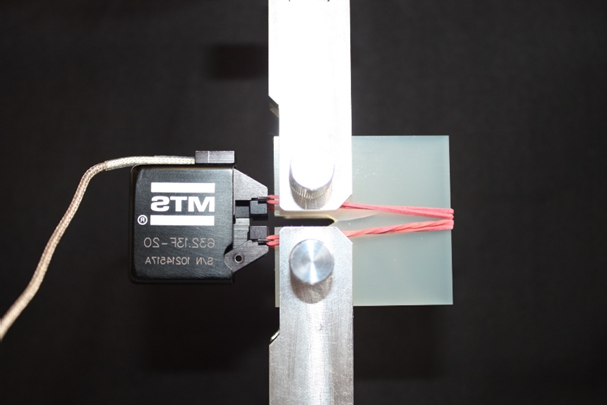

---

[Simulationsbeispiel](https://perilab-results.nimbus-extern.dlr.de/models/ForgedCT?step=65&variable=von%20Mises%20Stress&displFactor=20)

---

## Prüfpyramide

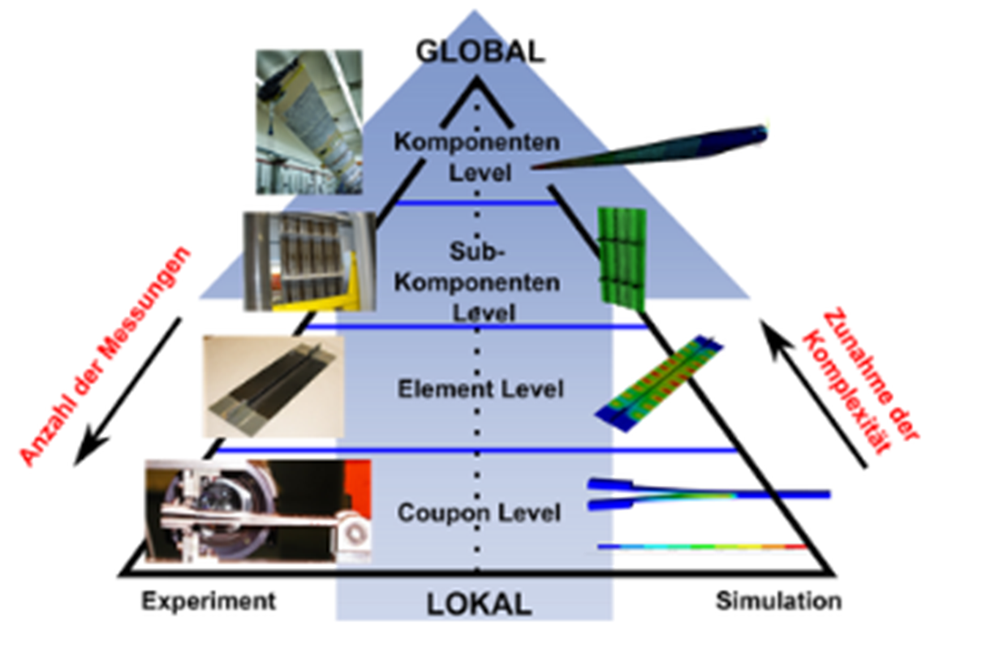

<!--
Von unten nach oben: viele billige Coupon-Tests, wenige teure Bauteil- und Gesamtstrukturversuche.
Je höher, desto realistischer, aber desto weniger Versuche.
-->

---

## Einteilung der Prüfverfahren

| | zerstörend | bedingt zerstörungsfrei | zerstörungsfrei (ZfP) |
|---|---|---|---|
| Probe/Bauteil | wird zerstört | kleiner Eindruck | bleibt unversehrt |
| Beispiele | Zug-, Biege-, Kerbschlag-, Schwingversuch | Härteprüfung | Ultraschall, Röntgen, Eindring-, Magnetpulverprüfung |
| Ergebnis | Kennwerte, Grenzwerte | Härte, Festigkeits-abschätzung | Fehler: Lage, Größe, Art |
| Prüfumfang | Stichprobe | Stichprobe bis 100 % | bis 100 %, auch im Betrieb |

---

## Normen - damit Kennwerte vergleichbar sind

| Versuch | Norm |
|---|---|
| Zugversuch Metalle | DIN EN ISO 6892-1 |
| Kerbschlagbiegeversuch (Charpy) | DIN EN ISO 148-1 |
| Härte Brinell / Vickers / Rockwell | DIN EN ISO 6506 / 6507 / 6508 |
| Härte-Umwertung | DIN EN ISO 18265 |
| Biegeversuch (Kunststoffe / Keramik) | DIN EN ISO 178 / DIN EN 843-1 |
| Bruchzähigkeit $K_{Ic}$ | ASTM E399, ISO 12737 |
| Qualifizierung ZfP-Personal (Stufe 1-3) | DIN EN ISO 9712 |
| Prüfbescheinigungen | DIN EN 10204 (z. B. Abnahmeprüfzeugnis 3.1) |

Normen legen Probe, Prüfgeschwindigkeit, Temperatur und Auswertung fest. Ohne Norm sind zwei Werte **nicht vergleichbar**.

---

# Zerstörende Prüfung

Bestimmte Kennwerte oder Aussagen über ein Material oder ein Bauteil können nur getroffen werden, wenn bis zum Versagen belastet wird.

---

## Zugversuch

- Bestimmung von
  - elastischer Steifigkeit (E-Modul)
  - Streckgrenze bzw. Dehngrenze
  - Zugfestigkeit, Bruchdehnung
  - jeweils **in einer Richtung**
- der wichtigste Versuch überhaupt: liefert die Kennwerte im Datenblatt

Annahme: konstante Spannung im Querschnitt

$\sigma = \frac{F}{S_0} = E\varepsilon = E\frac{\Delta L}{L_0}$

---

## Ablauf und Prüfmaschine

- Probe in Spannköpfe einspannen, Traverse fährt mit **konstanter Geschwindigkeit** (dehnungs- oder weggeregelt)
- gemessen werden **Kraft** $F$ (Kraftmessdose) und **Verlängerung** $\Delta L$ (Ansetzextensometer oder optisch)
- Prüfgeschwindigkeit ist genormt: Dehngrenzen hängen von der Dehnrate ab
- Ergebnis: Kraft-Verlängerungs-Kurve → umrechnen in **Spannung-Dehnung**

$$\sigma = \frac{F}{S_0} \qquad \varepsilon = \frac{\Delta L}{L_0}$$

$S_0$: Anfangsquerschnitt, $L_0$: Anfangsmesslänge. Beide werden **vor** dem Versuch gemessen. Darum heißt das Ergebnis *technische* Spannung.

---

## Probengeometrie

[Video 1](https://eng.libretexts.org/Bookshelves/Materials_Science/TLP_Library_II/5%3A_Mechanical_Testing_of_Metals/5.5%3A_Tensile_Testing_-_Practical_Basics)

---

## Proportionalstab

- Die Bruchdehnung hängt von der Messlänge ab: die Einschnürung ist lokal, ihr Anteil ist bei kurzer Messlänge größer
- Darum: Messlänge **proportional** zum Querschnitt

$L_0 = k\sqrt{S_0}$ mit $k = 5{,}65$ (kurzer Proportionalstab) → Bruchdehnung $A$ (früher $A_5$)
$k = 11{,}3$ (langer Proportionalstab) → Bruchdehnung $A_{11,3}$

Für Rundproben gilt bei $k = 5{,}65$: $L_0 = 5\,d_0$

$A_{11,3} < A$ für denselben Werkstoff. Bruchdehnungen nur bei gleicher Probenform vergleichen!

---

## Spannungs-Dehnungs-Diagramm

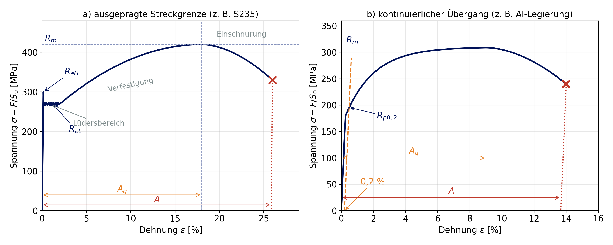

---

## Kennwerte des Zugversuchs

| Kennwert | Bedeutung |
|---|---|
| $E$ | E-Modul, Steigung der Hookeschen Geraden |
| $R_{eH}$, $R_{eL}$ | obere / untere Streckgrenze (nur bei ausgeprägter Streckgrenze, z. B. Baustahl) |
| $R_{p0,2}$ | 0,2 %-Dehngrenze: Spannung bei 0,2 % **bleibender** Dehnung (Parallele zur Hookeschen Geraden) |
| $R_m = F_{max}/S_0$ | Zugfestigkeit |
| $A_g$ | Gleichmaßdehnung: bis $F_{max}$ dehnt sich die Probe gleichmäßig |
| $A = \frac{L_u - L_0}{L_0}$ | Bruchdehnung: **bleibende** Verlängerung nach dem Bruch ($L_u$: Messlänge nach Bruch) |
| $Z = \frac{S_0 - S_u}{S_0}$ | Brucheinschnürung: Maß für die Duktilität ($S_u$: kleinster Querschnitt nach Bruch) |

Streckgrenze: Grenze, bis zu der ein Werkstoff (praktisch) elastisch verformbar ist. Sie ist **der** Auslegungskennwert für statisch belastete Bauteile.

---

## Einschnürung und duktiler Bruch

- bis $F_{max}$: gleichmäßige Dehnung über die ganze Messlänge
- danach: **Einschnürdehnung** nur noch in der Einschnürzone
- Kraft fällt, obwohl die lokale Spannung weiter steigt
- duktiler Bruch: Hohlräume bilden sich, wachsen und vereinigen sich → Trichter-Kegel-Bruch

---

## Technische und wahre Spannung

- technisch: bezogen auf $S_0$, $L_0$
- wahr: bezogen auf den **aktuellen** Querschnitt $S$

$$\sigma_w = \frac{F}{S} = \sigma\,(1+\varepsilon)$$
$$\varepsilon_w = \ln\frac{L}{L_0} = \ln(1+\varepsilon)$$

(gilt bis $A_g$, Volumenkonstanz)

- wahre Spannung steigt bis zum Bruch: der Werkstoff verfestigt weiter
- wichtig für Umformtechnik und Simulation (Fließkurve)

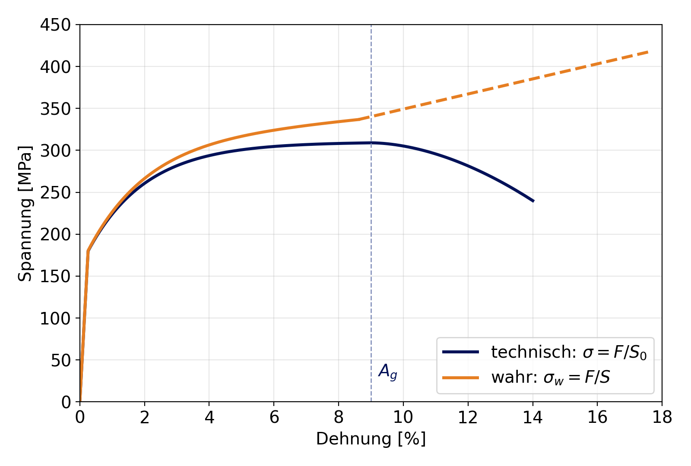

---

## Typische Kennwerte

| Werkstoff | $E$ [GPa] | $R_{p0,2}$ / $R_{eH}$ [MPa] | $R_m$ [MPa] | $A$ [%] |
|---|---|---|---|---|
| S235JR (Baustahl) | 210 | ≥ 235 | 360-510 | ≥ 26 |
| C45 vergütet | 210 | ≈ 430 | ≈ 650-800 | ≥ 16 |
| 42CrMo4 vergütet | 210 | ≥ 650 | 900-1100 | ≥ 12 |
| X5CrNi18-10 (1.4301) | 200 | ≥ 230 | 540-750 | ≥ 45 |
| EN AW-6082 T6 | 70 | ≥ 260 | ≥ 310 | ≥ 6 |
| Ti-6Al-4V | 114 | ≈ 880 | ≈ 950 | ≥ 10 |
| PA6 (trocken) | 3 | - | ≈ 80 | > 50 |

Werte typisch, je nach Erzeugnisform und Dicke. Maßgeblich ist immer das Datenblatt bzw. die Norm.

---

## Übung 1 - Zugversuch auswerten

Rundprobe aus Vergütungsstahl, $d_0 = 10$ mm, kurzer Proportionalstab. Gemessen wurde:
- im elastischen Bereich: $F = 15{,}7$ kN bei $\Delta L = 0{,}0476$ mm
- Kraft bei 0,2 % bleibender Dehnung: $F_{p0,2} = 33{,}8$ kN
- Höchstkraft: $F_{max} = 51{,}05$ kN
- nach dem Bruch: Messlänge $L_u = 60{,}0$ mm, kleinster Durchmesser $d_u = 6{,}5$ mm

Bestimmen Sie $S_0$, $L_0$, $E$, $R_{p0,2}$, $R_m$, $A$ und $Z$.

*Zeit: 8 Minuten, Taschenrechner*

---

## Lösung Übung 1

$S_0 = \frac{\pi \cdot 10^2}{4} = 78{,}5\ \text{mm}^2 \qquad L_0 = 5{,}65\sqrt{78{,}5} = 50\ \text{mm}$

$E = \frac{F/S_0}{\Delta L/L_0} = \frac{15700/78{,}5}{0{,}0476/50} = \frac{200\ \text{MPa}}{0{,}000952} \approx 210\,000\ \text{MPa} = 210\ \text{GPa}$

$R_{p0,2} = \frac{33800}{78{,}5} \approx 430\ \text{MPa} \qquad R_m = \frac{51050}{78{,}5} \approx 650\ \text{MPa}$

$A = \frac{60 - 50}{50} = 20\ \% \qquad S_u = \frac{\pi \cdot 6{,}5^2}{4} = 33{,}2\ \text{mm}^2 \qquad Z = \frac{78{,}5 - 33{,}2}{78{,}5} \approx 58\ \%$

Streckgrenzenverhältnis $R_{p0,2}/R_m = 0{,}66$: ausreichend Reserve bis zum Bruch.

---

## Einflussgrößen und Anisotropie

**Einflussgrößen**
- Temperatur: Festigkeit sinkt, Duktilität steigt (meist)
- Dehnrate: schnelle Belastung → höhere Festigkeit
- Schlupf bei der Einspannung
- Probengeometrie und -entnahme
- Oberflächenzustand

**Anisotropie**
- Bleche (Walzrichtung), Faserverbunde, 3D-Druck
- Messung unter verschiedenen Winkeln (0°, 45°, 90°)
- Kennwerte gelten nur für die geprüfte Richtung

---

## Parameter Druck

Quetschgrenze
  - oberhalb der Grenze setzt plastische Verformung ein (duktiles Material)
  - bei sprödem Material entstehen Risse und dann [Bruch](https://youtu.be/Fjgpvi8igbE?si=ptlpAR_vQfDV_qYW&t=36)
  - Druckfestigkeit spröder Werkstoffe (Grauguss, Beton, Keramik) ist **ein Vielfaches** der Zugfestigkeit

Stabilität
  - Knicken
  - [Beulen](https://www.youtube.com/watch?v=ZYfLLozCNbw)

---

## Druckverformung

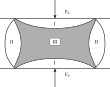

I - geringe Verformung (Reibbehinderung)
II - mäßige Zugverformung
III - hohe Schubverformung

Reibung an den Druckplatten → Probe wird **tonnenförmig**. Schmierung oder Proben mit $h/d \approx 1{,}5 \dots 2$ verringern den Effekt.

---

## Biegeversuch

- in der Regel Flachproben mit Rechteckquerschnitt
- vor allem für **spröde** Werkstoffe (Keramik, Glas, Grauguss, Faserverbunde): Zugproben wären schwer einzuspannen
- Annahmen der Bernoulli-Balkentheorie müssen gelten: schlanke Probe, $l > 20\,h$

| Größe | Bedeutung |
|---|---|
| $F$ | Prüfkraft |
| $u$ | Durchbiegung (an der Krafteinleitung) |
| $h$, $b$ | Höhe, Breite des Rechteckquerschnitts |
| $l_b$ | Stützweite bzw. Länge des Kragarms |

---

## 2-Punkt-Biegeversuch (Kragbalken)

$u = \frac{F l_b^3}{3EI}$ mit $I = \frac{bh^3}{12}$ $\quad\Rightarrow\quad E=\frac{4\,l_b^3 F}{u\,b\,h^3}$

---

## 3-Punkt-Biegeversuch

$u = \frac{F l_b^3}{48EI} \Rightarrow E=\frac{l_b^3 F}{4\,u\,b\,h^3}$ $\qquad$ Biegefestigkeit: $\sigma_{bB} = \frac{M_{max}}{W} = \frac{3\,F_{max}\,l_b}{2\,b\,h^2}$

---

## 4-Punkt-Biegeversuch

Ziel ist ein querkraftfreier Bereich und daraus resultierend ein konstantes Biegemoment

$E=\frac{l_a^2(2l_a+3l_b) F}{u\,b\,h^3}$

$l_a$ Abstand zwischen Auflagepunkt und näher gelegenem Druckpunkt des Prüfstempels, $l_b$ Abstand der Druckpunkte, $u$ Durchbiegung an den Druckpunkten

---

## Spannungsverläufe

[Video](https://www.tec-science.com/wp-content/uploads/2021/03/de-animation-biegeversuch-spannungsverlauf-mit-verfestigung.mp4)

- Biegespannung
  - $\sigma_b = \frac{M_b}{I_{yy}}\,z$, maximal am Rand: $\sigma_{b,max} = \frac{M_b}{W}$
  - Spannungsnulllinie in der Mitte
- ENF (End-Notched Flexure) Versuch nutzt die Spannungsnulllinie gezielt aus

---

## Übung 2 - Biegefestigkeit einer Keramik

Eine Al₂O₃-Probe ($b = 4$ mm, $h = 3$ mm) wird im 3-Punkt-Biegeversuch mit der Stützweite $l_b = 40$ mm geprüft. Sie bricht bei $F_{max} = 200$ N.

a) Wie groß ist die Biegefestigkeit $\sigma_{bB}$?
b) Warum prüft man Keramik nicht im Zugversuch?

a) $\sigma_{bB} = \frac{3 \cdot 200 \cdot 40}{2 \cdot 4 \cdot 3^2} = \frac{24000}{72} \approx 333\ \text{MPa}$

b) Spröde, kerbempfindlich: an der Einspannung entstehen Spannungsspitzen, die Probe bricht dort. Biegeproben sind einfach und billig.

---

## Torsionsversuch

- Rundprobe wird durch ein Torsionsmoment $M_t$ verdreht, gemessen wird der Verdrehwinkel $\varphi$
- liefert den **Schubmodul** $G$ und die **Torsionsfestigkeit**
- reiner Schub: keine Einschnürung, große Verformungen messbar (Umformtechnik)

$$\tau_{max} = \frac{M_t}{W_t},\quad W_t = \frac{\pi d^3}{16} \qquad G = \frac{M_t\,L}{\varphi\,I_p},\quad I_p = \frac{\pi d^4}{32}$$

Kontrolle für isotrope Werkstoffe: $G = \frac{E}{2(1+\nu)}$, für Stahl $G \approx 81$ GPa

---

## Bestimmung der Zähigkeit

- Widerstand eines Werkstoffs gegen Bruch oder Rissausbreitung
- Fähigkeit zur Absorption von mechanischer Energie bei plastischer Verformung

$Z = \int_0^{\varepsilon_{B}}\sigma\, d \varepsilon$

- Energiefreisetzungsrate $G = \frac{Z}{A_{Bruch}}$
- Einfluss der Belastungsgeschwindigkeit

    <a href="https://doi.org/10.1007/s00466-021-02017-1" style="color: blue;">Bildreferenz</a>

---

## Exkurs Bruchmechanik

- Brüche lassen sich in diese Moden unterteilen
- für jede Mode gibt es spezifische Energiefreisetzungsraten

[Liste von Experimenten zur Bestimmung dieser Energien](https://wiki.polymerservice-merseburg.de/index.php/Pr%C3%BCfk%C3%B6rper_f%C3%BCr_bruchmechanische_Pr%C3%BCfungen)

---

## Spannungsintensitätsfaktor und Bruchzähigkeit

An der Rissspitze wird die Spannung theoretisch unendlich. Die **Stärke** des Spannungsfelds beschreibt

$K_I = Y\,\sigma\,\sqrt{\pi a}$

- $a$: Risslänge (Randriss) bzw. halbe Risslänge (Innenriss)
- $Y$: Geometriefaktor (Randriss in breiter Platte: 1,12)
- Bruch, wenn $K_I \geq K_{Ic}$ (**Bruchzähigkeit**)
- $K_{Ic}$ wird an CT-Proben mit Ermüdungsanriss bestimmt

| Werkstoff | $K_{Ic}$ [MPa√m] |
|---|---|
| Glas | 0,7 |
| PMMA | 1 |
| Al₂O₃ | 3-5 |
| Al 7075-T6 | 25-30 |
| Ti-6Al-4V | 50-90 |
| Vergütungsstahl | 50-150 |

---

## Übung 3 - Kritische Risslänge

Eine Platte mit Randriss ($Y = 1{,}12$) wird mit $\sigma$ auf Zug belastet. Ab welcher Risslänge $a_c$ bricht sie?

a) Al 7075-T6: $K_{Ic} = 29$ MPa√m, $\sigma = 250$ MPa
b) Vergütungsstahl: $K_{Ic} = 80$ MPa√m, $\sigma = 500$ MPa
c) Was folgt daraus für die zerstörungsfreie Prüfung?

$a_c = \frac{1}{\pi}\left(\frac{K_{Ic}}{Y\sigma}\right)^2$

a) $a_c = \frac{1}{\pi}\left(\frac{29}{1{,}12 \cdot 250}\right)^2 = 3{,}4$ mm $\qquad$ b) $a_c = \frac{1}{\pi}\left(\frac{80}{1{,}12 \cdot 500}\right)^2 = 6{,}5$ mm

c) Das Prüfverfahren muss Risse **deutlich kleiner als $a_c$** zuverlässig finden (POD, siehe ZfP), sonst gibt es keine Reserve bis zum Bruch.

---

## Kerbschlagbiegeversuch (Charpy)

- Pendelhammer schlägt eine gekerbte Probe durch
- gemessen wird die **verbrauchte Energie**:

$$KV = m\,g\,(h_0 - h_1)$$

- Normprobe: 10 × 10 × 55 mm, V-Kerb 2 mm tief
- schlagartige Belastung + Kerbe + tiefe Temperatur = ungünstigste Bedingungen für Zähigkeit
- je Temperatur mindestens 3 Proben

[Versuch](https://youtu.be/mpUdV2WHiEE?si=5jwBppXbsEsnqHsc&t=86) · [Erklärvideo](https://www.youtube.com/watch?v=Ll69bzegoNY)

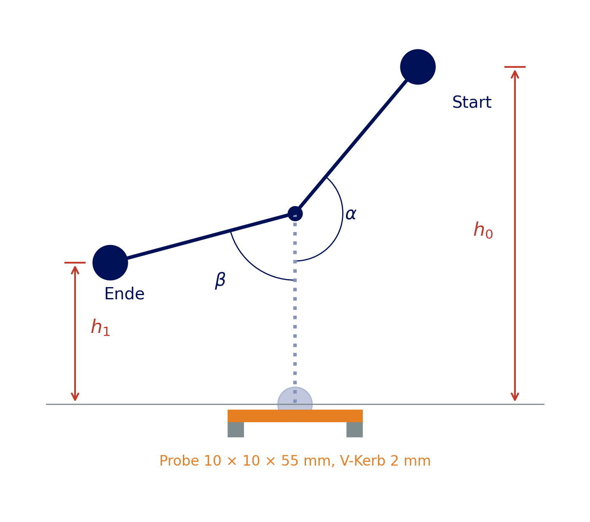

---

## Kerbschlagarbeit-Temperatur-Kurve

- **Hochlage**: Verformungsbruch (duktil, matt, faserig)
- **Steilabfall**: Mischbruch
- **Tieflage**: Trennbruch (spröde, glänzend, kristallin)
- krz-Metalle (Baustahl) zeigen einen Steilabfall, kfz-Metalle (Al, Cu, austenitischer Stahl) nicht
- Übergangstemperatur: Werkstoff unterhalb davon **nicht** einsetzen

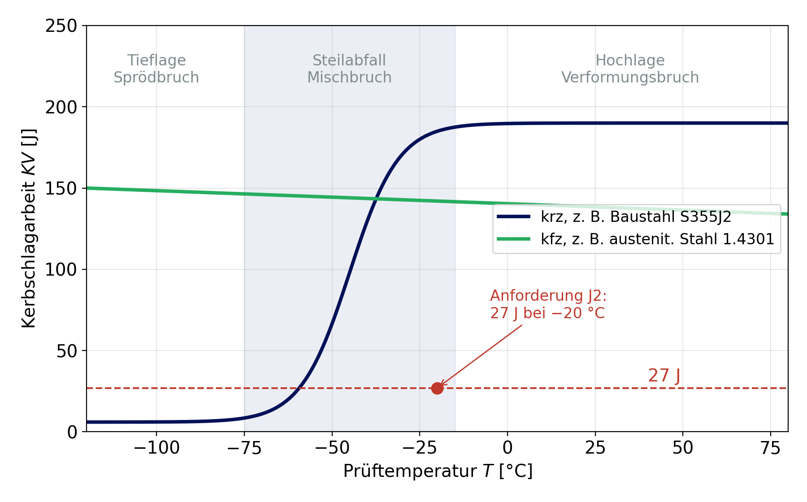

---

## Bedeutung des Kerbschlagversuchs

- $KV$ ist **kein Rechenkennwert** für die Auslegung (dafür: $K_{Ic}$)
- aber ein einfaches, billiges **Gütekriterium** bei Abnahme und Werkstoffauswahl
- steckt im Stahlnamen: S355**J2** = mindestens 27 J bei −20 °C

| Gütegruppe | JR | J0 | J2 | K2 |
|---|---|---|---|---|
| Mindest-$KV$ | 27 J | 27 J | 27 J | 40 J |
| bei | +20 °C | 0 °C | −20 °C | −20 °C |

Liberty-Frachter (1943) und Titanic: Stähle in der Tieflage, spröde Brüche bei kaltem Wasser. Seitdem ist die Kerbschlagprüfung Pflicht für Schiffbau- und Baustähle.

---

## Übung 4 - Pendelschlagwerk

Pendelmasse $m = 20$ kg, Fallhöhe $h_0 = 1{,}5$ m. Eine Probe aus S355J2 wird geprüft.

a) Welche Energie steht zur Verfügung?
b) Bei +20 °C steigt das Pendel nach dem Bruch auf $h_1 = 0{,}65$ m. Wie groß ist $KV$?
c) Bei −20 °C: $h_1 = 1{,}35$ m. Erfüllt der Stahl seine Gütegruppe?

a) $E_0 = 20 \cdot 9{,}81 \cdot 1{,}5 = 294$ J
b) $KV = 20 \cdot 9{,}81 \cdot (1{,}5 - 0{,}65) = 167$ J (Hochlage)
c) $KV = 20 \cdot 9{,}81 \cdot 0{,}15 = 29{,}4$ J ≥ 27 J → **erfüllt** (knapp, nahe am Steilabfall)

---

## Dauerschwingversuch nach Wöhler

- Versuchsaufbau
  - Umlaufbiegeversuch
  - Torsionsversuch
  - Zug-/Druckversuch (Resonanzpulsator, servohydraulisch)
- Ergebnis: Wöhlerlinie, Dauer- und Zeitfestigkeit (Details: Vorlesung Ermüdung und Verschleiß)

---

## Dauerschwingversuch nach Wöhler

Einflussgrößen
- Temperatur
- korrosive Medien
- Kerben
- Oberflächenbeschaffenheit
  - glatte Oberflächen sind günstiger
- Wärmebehandlung, Eigenspannungen
- Prüffrequenz

Wöhlerversuche **streuen stark**: viele Proben je Lasthorizont, statistische Auswertung (Ausfallwahrscheinlichkeit 10 %, 50 %, 90 %).

---

## Strukturermüdungsversuch

 
<iframe width="1150" height="500" src="https://www.youtube.com/embed/BOpBzKanX9k" title="Schwingversuch" frameborder="0" allow="accelerometer; autoplay; clipboard-write; encrypted-media; gyroscope; picture-in-picture; web-share" referrerpolicy="strict-origin-when-cross-origin" allowfullscreen></iframe>

---

Herausforderungen?

- repräsentative Lasten
- Erwärmung durch zu schnelle Belastung
- die Reihenfolge der Lasten beeinflusst die Lebensdauer
- Versuchsdauer: Monate bis Jahre für ein Flugzeug

---

## Kriech- und Zeitstandversuch

- konstante Last bei **hoher Temperatur**, Dehnung über der Zeit
- relevant ab $T \gtrsim 0{,}4\,T_S$ (Schmelztemperatur in K): Stahl ab ca. 400 °C, Blei und Kunststoffe schon bei Raumtemperatur
- Kennwerte: Zeitstandfestigkeit $R_{u/t/T}$, z. B. $R_{u/100000/550}$ = Spannung, die bei 550 °C nach 100 000 h zum Bruch führt
- Anwendung: Kraftwerk, Turbine, Abgasanlage, Kunststoffrohr
- Versuche dauern Jahre → Extrapolation (Larson-Miller)

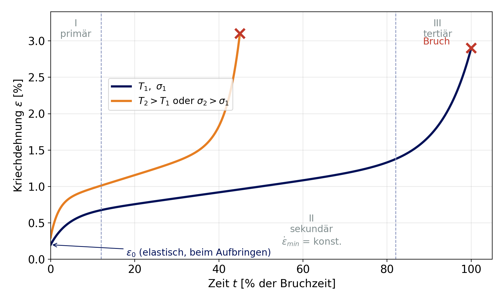

---

## Weitere Versuche

- Berstversuche (Rohre, Behälter)
- Scherversuche (Klebungen, Nieten)
- Ausziehversuche (Faser-Matrix, Dübel)
- Korrosionsversuche (Salzsprühnebel)
- Brennproben (Kunststoffe, Brandschutz)
- Tiefungsversuch nach Erichsen (Umformbarkeit von Blech)

---

## Härteprüfung

- Härte: Widerstand gegen das Eindringen eines härteren Körpers
- Probe oder Bauteil wird nicht vollständig zerstört → bedingt zerstörungsfrei
- schnell, billig, am fertigen Bauteil möglich
- am verbreitetsten: Rockwell (HR), Brinell (HBW), Vickers (HV), Shore (Kunststoffe, Gummi)
- Härte der Bauteiloberfläche beeinflusst Ermüdung und Verschleiß

---

## Härteprüfverfahren im Vergleich

| | Brinell | Vickers | Rockwell C |
|---|---|---|---|
| Eindringkörper | Hartmetallkugel $D$ = 1 … 10 mm | Diamantpyramide, 136° | Diamantkegel, 120° |
| Messgröße | Eindruckdurchmesser $d$ | Eindruckdiagonale $d$ | bleibende Eindringtiefe $t$ |
| Bereich | weiche bis mittelharte Werkstoffe, bis 650 HBW | alle Werkstoffe, auch dünne Schichten | gehärteter Stahl |
| Vorteil | großer Eindruck → mittelt über Gefüge (Guss) | ein Verfahren für alle Härten, Mikrohärte | direkt ablesbar, schnell, Fertigung |
| Nachteil | große Eindrücke, nicht für harte Werkstoffe | Probe muss poliert sein | geringe Genauigkeit |
| Angabe | 210 HBW 10/3000 | 640 HV 30 | 60 HRC |

Probendicke mindestens das **10-fache** der Eindringtiefe; Abstand zwischen Eindrücken mindestens $3d$.

---

## Rockwell

- die bleibende Eindringtiefe $t$ wird mit normierten Prüfkörpern gemessen
- Ablauf: Vorkraft → Prüfkraft → zurück auf Vorkraft → Tiefe messen

$\text{HR}=N-\frac{t}{s}$
- Skalen A, C, D: $N=100$, $s=0{,}002$ mm
- Skalen B, E-H, K: $N=130$, $s=0{,}002$ mm
- Skalen N, T: $N=100$, $s=0{,}001$ mm

---

## Brinell

- eine Hartmetallkugel wird mit festgelegter Kraft auf die Oberfläche gedrückt
- es wird der mittlere Eindruckdurchmesser bestimmt
- Härte = Kraft / Kalotten**oberfläche**

$\text{HBW}=\frac{0{,}102 \cdot 2F}{\pi D \left(D-\sqrt{D^2-d^2}\right)}$
mit $d=\frac{d_1+d_2}{2}$, $F$ in N, $D$, $d$ in mm

---

## Vickers

- ähnlich zu Brinell, aber statt einer Kugel eine gleichseitige Diamantpyramide (Flächenwinkel 136°)
- kleinere Eindrücke als bei Brinell, auch Mikrohärte (Gefügebestandteile, Schichten)

$\text{HV}=\frac{0{,}204\,F\cos 22°}{d^2} = 0{,}1891\,\frac{F}{d^2}$

mit $d=\frac{d_1+d_2}{2}$, $F$ in N, $d$ in mm

---

## Härte und Zugfestigkeit

- Härte und Zugfestigkeit hängen beide vom Widerstand gegen plastische Verformung ab
- für Stähle gilt näherungsweise (Umwertung nach DIN EN ISO 18265):

$R_m \approx 3{,}5 \cdot \text{HBW} \approx 3{,}3 \cdot \text{HV}$ (in MPa)

- nützlich, wenn keine Zugprobe entnommen werden kann (fertiges Bauteil, Wareneingang)
- **nur Näherung**: nicht für Kaltverfestigung, Guss, Nichteisenmetalle

---

## Übung 5 - Härteprüfung

a) Brinell an einer Stahlwelle: $D = 10$ mm, $F = 29{,}42$ kN (3000 kp), Eindruck $d_1 = 4{,}15$ mm, $d_2 = 4{,}25$ mm. Berechnen Sie HBW und schätzen Sie $R_m$.
b) Vickers HV 30 ($F = 294{,}2$ N): $d_1 = 0{,}52$ mm, $d_2 = 0{,}54$ mm. Berechnen Sie HV und schätzen Sie $R_m$.

a) $d = 4{,}2$ mm: $\text{HBW} = \frac{0{,}102 \cdot 2 \cdot 29420}{\pi \cdot 10\,(10-\sqrt{100-17{,}64})} = \frac{6002}{\pi \cdot 10 \cdot 0{,}925} \approx 207$ → **207 HBW 10/3000**, $R_m \approx 720$ MPa

b) $d = 0{,}53$ mm: $\text{HV} = 0{,}1891 \cdot \frac{294{,}2}{0{,}53^2} \approx 198$ → **198 HV 30**, $R_m \approx 650$ MPa

---

# Zerstörungsfreie Prüfung

---

## Ziele der zerstörungsfreien Prüfung (ZfP)

- Fehler finden, **ohne** das Bauteil zu beschädigen → 100 %-Prüfung möglich
- Fehler **beschreiben**: Lage, Größe, Art, Orientierung
- Bauteil **bewerten**: Ist der Fehler zulässig (Norm, Bruchmechanik)?
- in der Fertigung (Guss, Schweißen, Faserverbund) und im **Betrieb** (wiederkehrende Prüfung)
- Prüfpersonal ist nach DIN EN ISO 9712 qualifiziert (Stufe 1: prüfen, Stufe 2: bewerten, Stufe 3: Verfahren festlegen)

---

## Entwicklungsstufen

ZfP 1.0 – Werkzeuge (zur Schärfung der Sinne)
ZfP 2.0 – Analoge Systeme (zur Ansicht innerhalb der Komponenten)
ZfP 3.0 – Digitale Verarbeitung und Automatisierung
ZfP 4.0 – Transparenz von Informationen, technische & digitale Hilfsmittel und autonome und dezentralisierte Entscheidungen

---

## Verfahren

- jede messbare physikalische Größe kann im Prinzip genutzt werden
  - mechanisch
  - optisch
  - elektromagnetisch
  - elektrisch
  - thermisch
  - magnetisch

---

## Übersicht ZfP-Verfahren

| Kürzel | Verfahren | Prinzip | findet | Werkstoffe |
|---|---|---|---|---|
| VT | Sichtprüfung | Licht, Auge/Kamera | sichtbare Oberflächenfehler | alle |
| PT | Eindringprüfung | Kapillarwirkung | **offene** Oberflächenrisse | nicht porös |
| MT | Magnetpulverprüfung | magnetischer Streufluss | Risse an/dicht unter der Oberfläche | nur **ferromagnetisch** |
| ET | Wirbelstromprüfung | Induktion | oberflächennahe Risse, Leitfähigkeit, Schichtdicke | elektrisch leitend |
| RT | Durchstrahlungsprüfung | Schwächung von Röntgen-/Gammastrahlung | **Volumenfehler**: Poren, Lunker, Einschlüsse | alle |
| UT | Ultraschallprüfung | Reflexion von Schallwellen | innere Fehler, flächig (Risse, Bindefehler), Wanddicke | schalldurchlässig |
| TT | Thermografie | Wärmefluss | Delaminationen, Ablösungen nahe der Oberfläche | v. a. Faserverbund |
| AT | Schallemission | Schall aus wachsenden Rissen | **aktive** Schäden unter Last | alle |

---

## Probability of Detection

- Metrik, welche die Wahrscheinlichkeit der Detektion eines Fehlers einer bestimmten Größe angibt

- die zulässige Fehlergröße ist bekannt (z. B. aus $a_c$, Übung 3)
- Kennwert $a_{90/95}$: Fehler dieser Größe werden zu **90 %** gefunden, mit einer Konfidenz von **95 %**
- POD hängt von Verfahren, Bauteil **und Prüfer** ab

---

## Schadensgröße

- je nach Verfahren variiert die detektierbare Schadensgröße
- es gilt nicht immer _kleine Schadensgröße_ $=$ _besser_
- minimaler Schaden $l \approx \frac{\lambda}{2}$
$c = \lambda f$
- $c$ ist die Licht- oder Schallgeschwindigkeit

$\lambda = \frac{c}{f} = \frac{6000\ \text{m/s}}{10^6\ \text{1/s}} = 6\ \text{mm}$
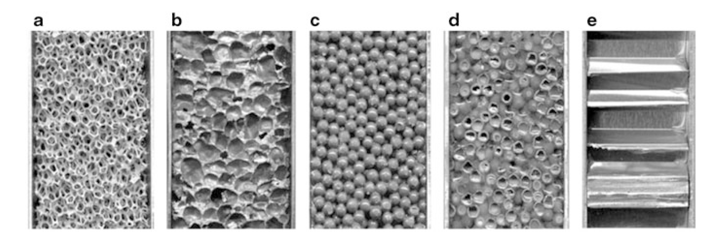

---

## Kompromiss

- kleine Wellenlänge = größere Auflösung = größere Interaktion = kleinere Reichweite

- große Wellenlänge = kleinere Auflösung = weniger Interaktion = größere Reichweite

- 5G vs. 4G, UKW vs. Langwelle, usw.

---

## Sichtprüfung (VT)

- kann mit verschiedenen Werkzeugen stattfinden und ist das **häufigste** Verfahren
- direkte Sichtprüfung
  - Auge, Lupe, Spiegel
  - Boroskope (Endoskope, Spiegelrohre, ...): Triebwerk, Rohrinneres
- indirekte Sichtprüfung
  - Kameras
  - Drohnen (Brücken, Windkraftanlagen)
- Voraussetzungen: Beleuchtung (≥ 500 lx), Sehvermögen des Prüfers (Sehtest), saubere Oberfläche

---

## Faktor Mensch

- Sichtprüfung ist billig, aber **stark vom Prüfer abhängig**: Ermüdung, Monotonie, Erwartung ("da ist nie etwas")
- Aloha Airlines Flug 243 (1988): Ermüdungsrisse an Nietreihen bei der Sichtprüfung übersehen → Rumpfdach abgerissen (Seminar MTI 17)
- Gegenmaßnahmen
  - Qualifikation und Sehtest (DIN EN ISO 9712)
  - Checklisten, Pausen, Vier-Augen-Prinzip
  - automatisierte Auswertung, KI-Bildanalyse, SHM

Ein Prüfverfahren ist nur so gut wie seine Anwendung: die POD gilt für Verfahren **und** Prüfer.

---

## Eindringprüfung (PT)

1. Reinigung, 2. Eindringmittel auftragen und eindringen lassen (Kapillarwirkung), 3. Überschuss abwischen, 4. Entwickler auftragen: saugt das Mittel aus dem Riss zurück

- Farbeindringmittel (rot, Tageslicht) oder fluoreszierend (UV-Licht, im Dunkeln, empfindlicher)
- findet nur **zur Oberfläche offene** Fehler, keine Information über die Tiefe

---

## Magnetpulverprüfung (MT)

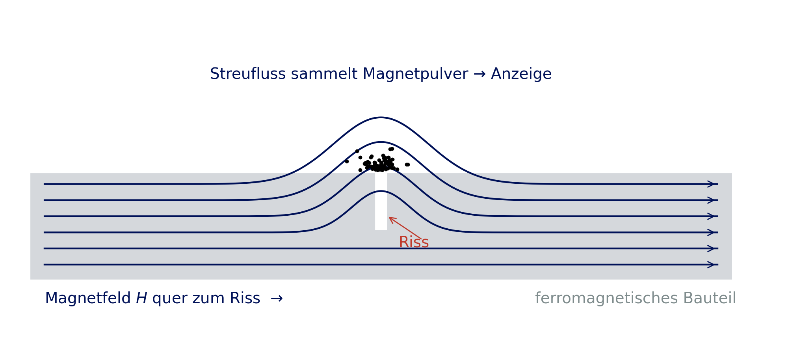

- Bauteil wird magnetisiert (Joch, Stromdurchflutung, Spule)
- an einem Riss tritt das Feld aus (**Streufluss**) und sammelt Eisenpulver: Anzeige deutlich breiter als der Riss
- Risse werden nur gefunden, wenn sie **quer** zum Feld liegen → in zwei Richtungen magnetisieren
- nur **ferromagnetische** Werkstoffe (Baustahl ja, austenitischer Stahl, Al, Ti nein); danach entmagnetisieren

---

## Wirbelstromprüfung (ET)

- Spule mit Wechselstrom erzeugt Wirbelströme im leitenden Bauteil
- ein Riss stört die Wirbelströme → Impedanz der Spule ändert sich
- berührungslos, schnell, automatisierbar (Rohre, Draht, Flugzeugniete)
- auch: Leitfähigkeit, Werkstoffverwechslung, Schichtdicke

$\delta = \frac{1}{\sqrt{\pi f \mu_0 \mu_r \sigma}}$

Hohe Frequenz → kleine Eindringtiefe → nur Oberfläche

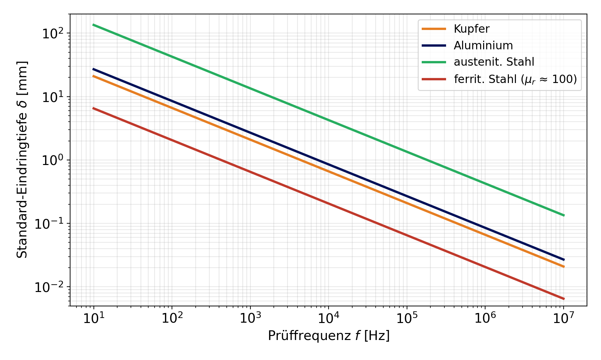

---

## Übung 6 - Eindringtiefe beim Wirbelstrom

$\mu_0 = 4\pi \cdot 10^{-7}$ Vs/(Am). Berechnen Sie die Eindringtiefe $\delta$ für
a) Aluminium ($\sigma = 35 \cdot 10^6$ S/m, $\mu_r = 1$) bei $f = 1$ kHz und $f = 100$ kHz
b) ferritischen Stahl ($\sigma = 6 \cdot 10^6$ S/m, $\mu_r \approx 100$) bei $f = 100$ kHz
c) Mit welcher Frequenz suchen Sie Risse in der **unteren** Lage einer 2 mm dicken Al-Nietverbindung?

a) 1 kHz: $\delta = 2{,}7$ mm $\qquad$ 100 kHz: $\delta = 0{,}27$ mm
b) $\delta = 0{,}065$ mm: in Stahl dringt der Wirbelstrom kaum ein
c) niedrige Frequenz (ca. 1 kHz), damit $\delta$ größer als die Blechdicke ist

---

## Durchstrahlungsprüfung (RT)

- Röntgen- oder Gammastrahlung, selten Synchrotronstrahlung
- Strahlung wird im Bauteil geschwächt; wo weniger Material ist (Pore, Lunker), kommt mehr an → dunkle Stelle auf Film/Detektor
- auch als **Computertomografie** (3D) nutzbar
- Strahlenschutz: Kontrollbereich, Dosisgrenzwerte, Fachkunde

---

## Schwächungsgesetz

$I = I_0\, e^{-\mu x}$

- $\mu$: Schwächungskoeffizient (Werkstoff, Strahlenenergie)
- Halbwertsschichtdicke: $x_{1/2} = \frac{\ln 2}{\mu}$
- flächige Fehler (Risse) sind nur sichtbar, wenn sie **parallel zum Strahl** liegen
- Volumenfehler (Poren, Schlacke) sind gut sichtbar

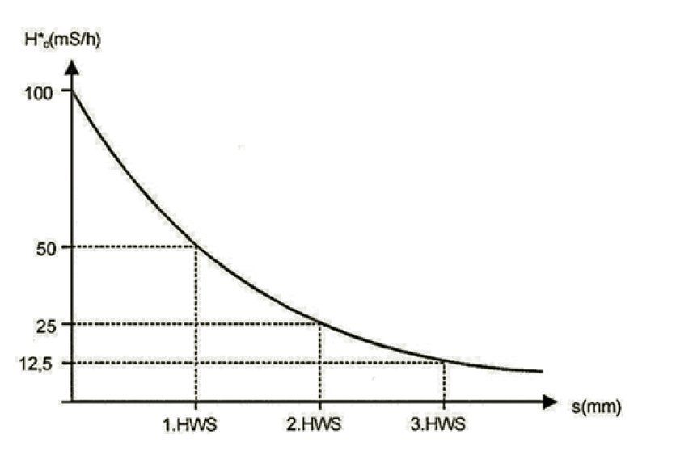

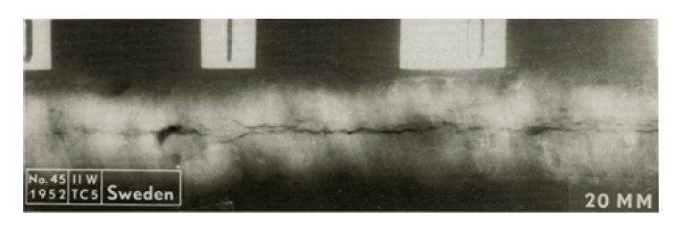

Längsriss in einer Schweißnaht im Röntgenbild

---

## Übung 7 - Röntgenprüfung einer Stahlplatte

Stahlplatte, $x = 20$ mm, Röntgenstrahlung mit $\mu = 1{,}15$ cm⁻¹.
a) Wie groß ist die Halbwertsschichtdicke?
b) Welcher Anteil der Strahlung kommt durch die Platte?
c) In der Platte liegt eine Pore mit 2 mm Durchmesser. Um wie viel Prozent ist die Intensität hinter der Pore größer?

a) $x_{1/2} = \frac{0{,}693}{1{,}15\ \text{cm}^{-1}} = 0{,}60$ cm = 6 mm
b) $I/I_0 = e^{-1{,}15 \cdot 2{,}0} = 0{,}100$ → 10 %
c) $I/I_0 = e^{-1{,}15 \cdot 1{,}8} = 0{,}126$ → 26 % mehr: die Pore ist gut sichtbar. Ein 0,1 mm breiter Riss quer zum Strahl ändert die Intensität nur um ca. 1 % und ist kaum zu sehen.

---

## Thermografie (TT)

**passive**
- Bauteil ist selbst warm (Betrieb, Fertigung) und wird mit einer IR-Kamera vermessen
- Unterschiede in der Temperaturverteilung zeigen Fehler (z. B. Wärmebrücken, heiße Lager)
- Prozessanpassungen sind möglich

**aktive**
- Bauteil wird angeregt (Blitzlampe, Halogenstrahler, Induktion, Ultraschall) und die Reaktion wird vermessen
- Delaminationen stören den Wärmefluss → "Hot Spot"
- induktive Erwärmung bei Kohlefaserverbundbauteilen

---

## Modalanalyse

$\mathbf{M}\ddot{\mathbf{u}}+\mathbf{Ku}=\mathbf{0}$

- Eigenformen
- Eigenfrequenzen

$(\mathbf{K}-\omega^2\mathbf{M})\hat{\mathbf{x}}=\mathbf{0}$

**Federpendel**
$m\ddot{u}+cu=0$

$c-\omega^2 m = 0$

$\omega = 2\pi f = \sqrt{\frac{c}{m}}$

---

## Modalanalyse

- Anregung mit einem Shaker oder Impulshammer
- Messpunkte mit Beschleunigungssensor oder Laser
- Ein Anregungspunkt -> viele Messpunkte
- Viele Anregungspunkte -> ein Messpunkt
- Schaden → Steifigkeit sinkt → Eigenfrequenz sinkt

---

## Ultraschallprüfung (UT)

**Wellenarten**
- Longitudinalwellen (P-Wellen)
- Transversalwellen (S-Wellen)
- Love-Wellen
- Rayleighwellen (Oberflächenwellen)
- Lambwellen, bzw. geführte Ultraschallwellen
  - symmetrische, antisymmetrische Moden und Schubwellen
- Torsionswellen (Rohre)

---

---

## Lambwellen - symmetrische und antisymmetrische Moden

- **symmetrisch** ($S_0$): Platte wird gestreckt und gestaucht, ähnlich einer Longitudinalwelle → [Video](../../assets/Videos/sym.avi)
- **antisymmetrisch** ($A_0$): Platte biegt sich, ähnlich einer Transversalwelle → [Video](../../assets/Videos/asym.avi)
- breiten sich in dünnen Platten und Rohren über große Strecken aus → SHM

---

## Schallgeschwindigkeiten

$c_{L}=\sqrt{\frac{E(1-\nu)}{\rho(1+\nu)(1-2\nu)}}$
$c_{T}= \sqrt{\frac{G}{\rho}}$

Stahl ($E = 210$ GPa, $\nu = 0{,}3$, $\rho = 7850$ kg/m³): $c_L \approx 5900\ \text{m/s}$, $c_T \approx 3200\ \text{m/s}$

Geführte Ultraschallwellen sind dispersiv: sie haben eine Gruppen- und eine Phasengeschwindigkeit

---

## Dispersion

- Gruppengeschwindigkeit - wie schnell bewegt sich die Hüllkurve
- Phasengeschwindigkeit - wie schnell bewegt sich die Phase (einzelne Frequenz)

- ohne Dispersion sind Gruppen- und Phasengeschwindigkeit identisch

- Für frequenzabhängige Phasengeschwindigkeiten verbreitert sich die Hüllkurve -> Dispersion

---

## Piezoelektrischer Effekt

- Aktuatoreffekt
- Sensoreffekt
- $d_{31}$; el. Spannung in 3-Richtung und Deformation in 1- bzw. 2-Richtung
- $d_{33}$; el. Spannung in 3-Richtung und Deformation in 3-Richtung

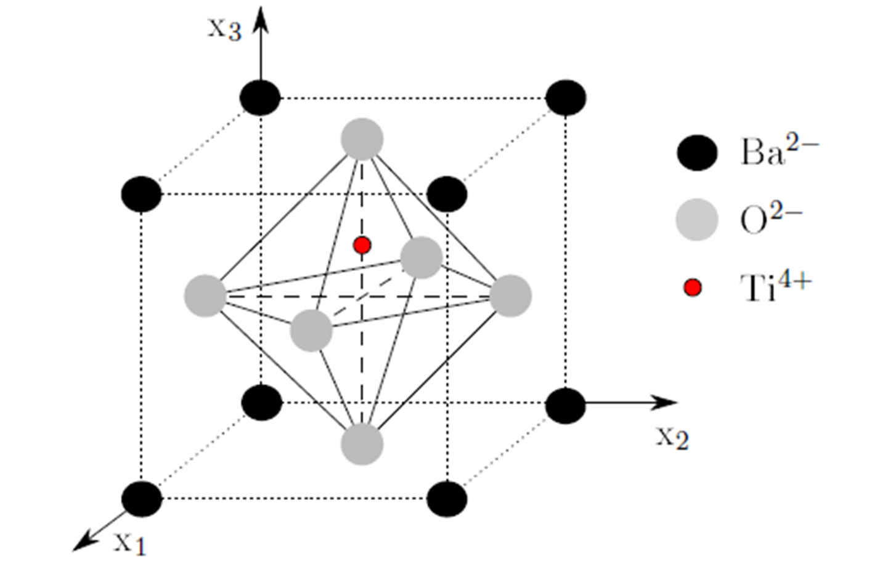

---

## Reflexionen an Grenzflächen
- Schallkennimpedanz $Z = \rho\, c_L$

_Reflektierter Schall_
$R = \frac{p_{r}}{p_{e}}=\frac{Z_2-Z_1}{Z_2+Z_1}$

_Durchgehender Schall_
$D = \frac{p_{d}}{p_{e}}=\frac{2Z_2}{Z_2+Z_1}$

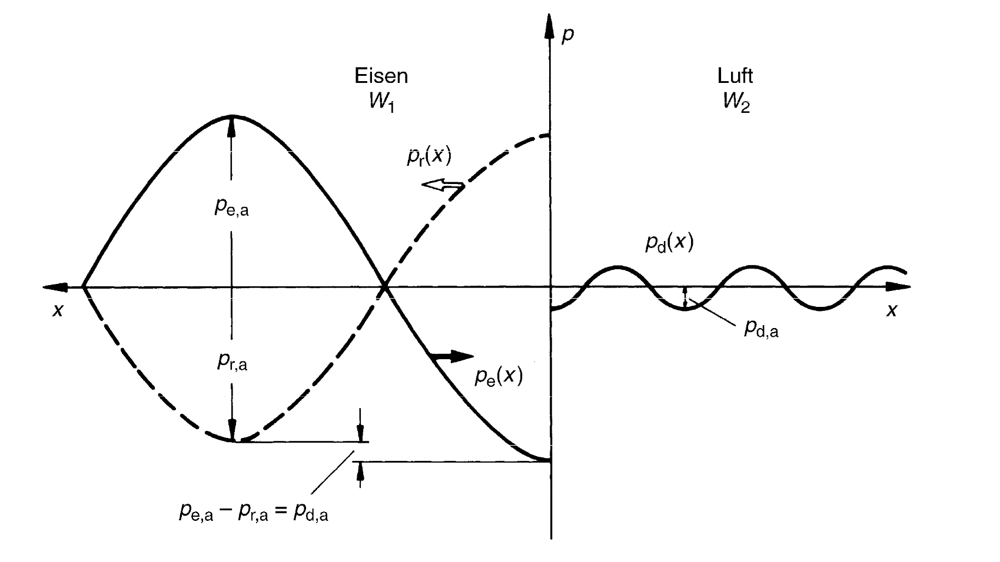

---

## Übung 8 - Reflexion an Grenzflächen

Berechnen Sie den Schalldruck-Reflexionsfaktor $R$ beim Übergang aus Wasser bzw. Luft in Stahl, Aluminium und PMMA. Warum braucht man ein Koppelmittel?

| | Luft | Wasser | Stahl | Aluminium | PMMA |
|---|---|---|---|---|---|
| $Z$ [10⁶ kg/(m²s)] | 0,0004 | 1,48 | 46,5 | 17,1 | 3,2 |

| $R$ | Stahl | Aluminium | PMMA |
|---|---|---|---|
| aus Wasser | 0,94 | 0,84 | 0,37 |
| aus Luft | 0,99998 | 0,99995 | 0,9997 |

Aus Luft wird praktisch **alles** reflektiert → Luftspalt zwischen Prüfkopf und Bauteil vermeiden: Koppelmittel (Wasser, Gel).

---

## Signal-Rausch-Verhältnis

$SNR = \frac{P_{Signal}}{P_{Rauschen}}$

- Mehrfachmessungen reduzieren den Rauschanteil (Mittelung über $n$ Messungen: SNR steigt mit $\sqrt{n}$)

---

## Messaufbau

- 1 - 2 Wandler
- Messverstärker
- Messaufnehmer

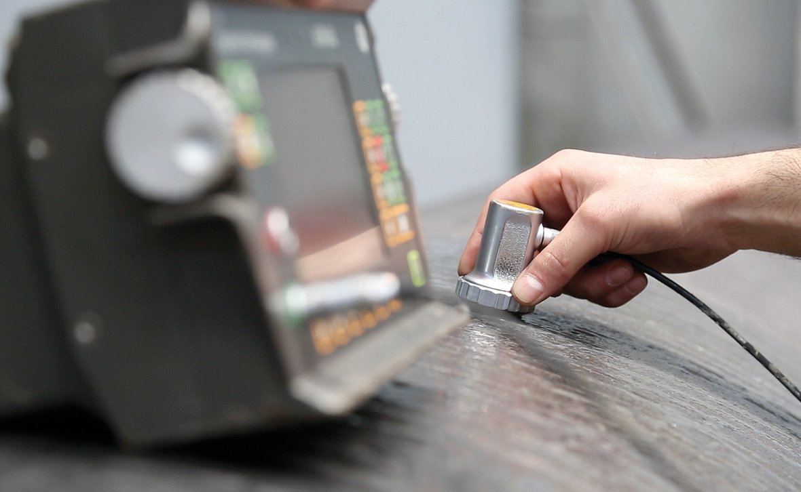

    <a href="http://std-partners.de/fileadmin/_processed_/csm_STD_HP_Ultraschall_03_18_07ef793d11.jpg" style="color: blue;">Bildreferenz</a>

---

## Anbindung des Prüfkopfs an die Oberfläche

Wasser
- billig
- gut automatisierbar (Tauchtechnik)

Motoröl, Schmierfett
- bereits vorhanden im Bauteil
- nicht optimiert auf Prüfung

Glycerin, Gel
- hohe Viskosität und hohe akustische Impedanz
- raue Oberflächen und stark dämpfende Werkstoffe (Schweißnahtprüfung)

Luft
- spart Koppelmedium
- viel Rauschen (siehe Übung 8)

---

## Impuls-Echo-Verfahren

- Prüfkopf sendet einen kurzen Impuls und empfängt die Echos
- Fehlertiefe aus der **Laufzeit**: $d = \frac{c\,t}{2}$ (Hin- und Rückweg)
- "Totzone" direkt unter der Oberfläche
  - Zeit für den Wechsel von Senden auf Empfangen
- Durchschallung mit zwei Prüfköpfen
  - Messung auf beiden Seiten
  - Zugänglichkeit und Aufwand

---

## Messbild

---

## Übung 9 - Wanddicke und Fehlertiefe

Ein Stahlbauteil ($c_L = 5920$ m/s) wird im Impuls-Echo-Verfahren geprüft. Das Rückwandecho kommt nach $t_R = 10{,}1\ \mu$s, ein Zwischenecho nach $t_F = 6{,}1\ \mu$s.

a) Wie dick ist das Bauteil?
b) In welcher Tiefe liegt der Fehler?
c) Welche Wellenlänge hat ein 4-MHz-Prüfkopf? Wie klein darf ein Fehler etwa sein?

a) $d = \frac{5920 \cdot 10{,}1 \cdot 10^{-6}}{2} = 29{,}9$ mm $\quad$ b) $d_F = \frac{5920 \cdot 6{,}1 \cdot 10^{-6}}{2} = 18{,}1$ mm
c) $\lambda = \frac{5920}{4 \cdot 10^6} = 1{,}48$ mm → Fehler ab ca. $\lambda/2 \approx 0{,}7$ mm

---

## Schweißnahtprüfung

- Schrägeinschallung mit Winkelprüfkopf (meist Transversalwellen unter 45°, 60°, 70°): Nahtüberhöhung verhindert senkrechte Ankopplung
- findet Bindefehler und Risse, die in der Durchstrahlung schlecht sichtbar sind

## Klebschichten

- werden ähnlich geprüft
- es kann sogenannte "kissing bonds" geben: Kontakt ohne Haftung, für Ultraschall fast unsichtbar

---

## Wanddickenmessung

---

## Bildgebung

- Messdaten können auf verschiedene Weise dargestellt werden

---

## A-Bild (Amplitude)

- Laufzeit vs. Amplitude
- bei konstanter Geschwindigkeit kann für einen Punkt eine Fehlstelle im Signal detektiert werden

---

## B-Bild (Brightness)

- Einzelpunkt ist nur eine andere Darstellung des A-Bildes (Intensität des Echos wird durch Helligkeit dargestellt)
- Durch die Erfassung der Schallrichtung können 2D oder 3D Bilder erzeugt werden

---

## C-Bild

- ein projiziertes Bild der Größen der Fehlstellen (Draufsicht)

---

## D-Bild

- flächiger Scan

---

## Dickenmessung mittels geführter Ultraschallwellen

- Die Geschwindigkeit der Lambwellen hängt vom Produkt Frequenz × Dicke ab
- gemessene Geschwindigkeit → Wanddicke (z. B. Korrosionsabtrag in Rohren)

---

## Schallemissionsprüfung (AT)

- **passives** Verfahren: das Bauteil sendet selbst
- wachsende Risse, Faserbrüche, Delaminationen setzen elastische Energie frei → Schallwellen
- mehrere Sensoren → Ortung über Laufzeitdifferenzen
- findet nur **aktive** Schäden, die unter der aktuellen Last wachsen
- Anwendung: Druckprüfung von Behältern, Überwachung von Brücken, Faserverbund-Versuche

---

## Übung 10 - Welches Prüfverfahren?

Wählen Sie ein geeignetes Verfahren und begründen Sie kurz:

1. Poren und Lunker in einem Aluminium-Gussgehäuse
2. Ermüdungsrisse an Bohrungen einer Kranhakenaufhängung aus Baustahl
3. Risse an der Oberfläche einer Turbinenschaufel aus Nickelbasislegierung
4. Bindefehler in einer 30 mm dicken Stumpfnaht an einem Druckbehälter
5. Delamination nach Schlag (Impact) in einer CFK-Platte
6. Risse in der unteren Blechlage einer Nietverbindung am Flugzeugrumpf (Al)

*Zeit: 8 Minuten, Diskussion zu zweit*

---

## Lösung Übung 10

1. **RT (Röntgen, CT)**: Volumenfehler, Aluminium gut durchstrahlbar
2. **MT**: Baustahl ist ferromagnetisch, Oberflächenrisse, schnell vor Ort
3. **PT** (oder ET): Nickelbasislegierung ist nicht ferromagnetisch, Risse offen zur Oberfläche
4. **UT** mit Winkelprüfkopf: flächige Fehler, große Wanddicke (ergänzend RT)
5. **UT** (C-Bild) oder **aktive Thermografie**: Delaminationen liegen parallel zur Oberfläche
6. **ET** mit niedriger Frequenz: durch die obere Lage hindurch, ohne Demontage (Übung 6)

Verfahrenswahl: **Werkstoff** (magnetisch? leitend? schalldurchlässig?) + **Fehlerlage** (Oberfläche oder Volumen) + **Fehlerorientierung** + **Zugänglichkeit**

---

# Structural Health Monitoring

- Überwachung einer Struktur während des Betriebs mit fest installierten Sensoren
- verwandt mit dem Condition Monitoring
  - bspw. Getriebeüberwachung -> Detektion von Lagerschäden

---

Ziele:
- Wartungskosten senken
  - weniger Reparaturen
  - einfachere Prüfung
  - rechtzeitige Wartung
- Lastanpassung bei Schäden
- Lebensdauer verlängern
- Sicherheit erhöhen

---

## Es gibt 4 Stufen

**Stufe 1** - Ein System kann feststellen, dass ein Event passiert ist

**Stufe 2** - ... und wo es stattfand

**Stufe 3** - ... und was stattgefunden hat (Typ des Events)

**Stufe 4** - ... und wie schädlich dieses Event für die Struktur ist

---

## Verfahren

- Modalanalyse
- Geführte Ultraschallwellen
- Akustische Emission
- Lastpfadanalysen
  - Beispiel Parallelfeder rechnen
- Dehnungsmessung
- Modellbasierte Ansätze

---

## Technische Anwendungen

### Brücken
- Second Penang Bridge - Penang, Malaysia
  

---

### Pipelines / Rohrleitungen
- Nutzung von Torsionswellen
- in der chemischen Industrie existieren Rohrleitungslängen > 40000 km pro Standort

%20system%20for%20on-board%20localization%20of%20defects%20in%20pipes%20using%20torsional%20ultrasonic%20guided%20waves.png)

    Bild aus S. Patil et al. "Smart structural health monitoring (SHM) system for on-board localization of defects in pipes using torsional ultrasonic guided waves"; arXiv:2403.11110v1

---

## Technische Anwendungen

Flugzeug
- Lastpfadanalyse
- Überwachung von Anbindungen
- Sicherheit ist nicht der Hauptfokus in der Luftfahrt

---

Windenergie

---

## Modalanalyse im SHM

$(\mathbf{K}-\omega^2\mathbf{M})\mathbf{\hat{x}}=0$

- Eigenfrequenz $\omega=2\pi f$
- Eigenformen $\mathbf{\hat{x}}$
  - [MAC](https://community.sw.siemens.com/s/article/modal-assurance-criterion-mac) Kriterium
  - Winkelberechnung zwischen Eigenformen

---

$MAC=\frac{\left|\mathbf{\hat{x}}_i^T\mathbf{\hat{x}}_{i, ref}\right|^2}{\left(\mathbf{\hat{x}}_i^T\mathbf{\hat{x}}_{i}\right)\left(\mathbf{\hat{x}}_{i,ref}^T\mathbf{\hat{x}}_{i, ref}\right)}$

- MAC = 1: Eigenformen identisch, MAC = 0: orthogonal

[Software](https://github.com/dagghe/pyOMA2?tab=readme-ov-file)

---

## Geführte Ultraschallwellen

- Anregung über Piezokomposite
- Empfang mit Piezokompositen oder Faser-Bragg-Gittern

---

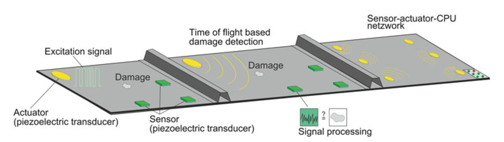

---

## Herausforderungen
- Temperatur
- Feuchte
- innere Struktur des Materials
- Modenkonversion
- Spannungen in der Struktur
- Alterung

---

## Potentiale
Beispiel Flugzeug
- BVID (barely visible impact damage)
- Größe ist durch Sichtbarkeit definiert
  - am Leitwerk ist der Schaden größer als am Flügel

- SHM-Systeme erlauben kleinere Schäden bei der Auslegung

- Abgeschätzt könnten [1 - 5 %](https://elib.dlr.de/123946/1/1475921718813279.pdf) Strukturmasse reduziert werden

---

## Mikroskopie

- Analyse der Mikrostruktur von Werkstoffen
- Lokale Analyse der Werkstoff- oder Kornzusammensetzung
- Präparation der Probe: Trennen, Einbetten, Schleifen, Polieren, **Ätzen** (macht Korngrenzen sichtbar)
- Lichtquellen beeinflussen maßgeblich den Kontrast
- Filter

---

## Lichtmikroskopie

- Korngrößenanalyse von Metallen und Legierungen
- Flächenzählverfahren
- Linienschnittverfahren (Korngrenzenschnitte mit durch den Prüfer in das Bild definierten Linienzug)
- Gefügeanteile (Ferrit, Perlit, Martensit), Einschlüsse, Schichtdicken

---

## Rasterelektronenmikroskop (REM)

- nutzt Elektronenstrahlen zum Abtasten
- Auflösung hierdurch deutlich erhöht: $1 \dots 2$ nm
- Vergrößerung bis ca. 1 000 000 : 1 (Lichtmikroskop ca. 2000 : 1)
- große Schärfentiefe → ideal für **Bruchflächen** (Schwingstreifen, Waben beim duktilen Bruch)
- mit EDX: chemische Zusammensetzung

---

## Rastersondenmikroskopie

- Abtasten der Struktur mit einer Nadel
- Wechselwirkung ist nicht mechanisch und unterscheidet sich je nach Mikroskop
  - Tunnelstrom
  - Van-der-Waals-Kräfte (korreliert mit Federsteifigkeit)
  - magnetische Kräfte

---

## Zusammenfassung

- **Zugversuch**: $E$, $R_{p0,2}$/$R_{eH}$, $R_m$, $A$, $Z$ - die Basis jedes Datenblatts
- **Biegeversuch** für spröde Werkstoffe, **Torsion** für Schub
- **Bruchzähigkeit** $K_{Ic}$ → kritische Risslänge $a_c$; **Kerbschlagarbeit** $KV$ als Gütekriterium (Steilabfall!)
- **Schwing-** und **Kriechversuche** für zeitabhängiges Versagen
- **Härte**: schnell, am Bauteil, Abschätzung von $R_m$
- **ZfP**: Verfahren nach Werkstoff, Fehlerlage und Orientierung wählen; POD bestimmt, was sicher gefunden wird
- **SHM**: Prüfen im Betrieb mit fest eingebauten Sensoren

---

## Kontrollfragen

1. Warum gibt man bei Baustahl $R_{eH}$, bei Aluminium aber $R_{p0,2}$ an?
2. Warum sinkt die Kraft im Zugversuch nach $F_{max}$, obwohl der Werkstoff weiter verfestigt?
3. Warum wählt man für einen Einsatz bei −20 °C S235J2 statt S235JR?
4. Warum findet die Magnetpulverprüfung keine Risse in Aluminium?
5. Ein Riss liegt senkrecht zum Röntgenstrahl. Warum sieht man ihn kaum?
6. Warum braucht die Ultraschallprüfung ein Koppelmittel?

---

## Vielen Dank für die Aufmerksamkeit
