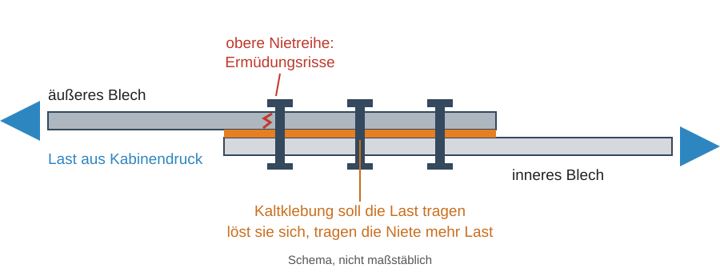
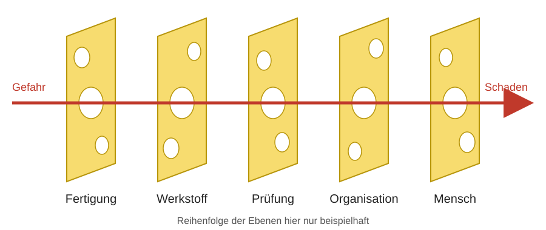

## MTI - Seminar: Der Schadensfall Aloha 243
Warum wurde der Riss nicht gefunden?

Prof. Dr.-Ing.  Christian Willberg 

Kontakt: christian.willberg@h2.de

---

<!--paginate: true-->

# Inhalte
- Der Fall
- Etwas Theorie
- Gruppenarbeit
- Auflösung
- Handouts

 

---

## Ablauf (135 min)

| Minuten | Phase | Sozialform |
|:---|:---|:---|
| 5 | Einstieg: Der Fall | alle |
| 25 | Etwas Theorie | alle |
| 25 | Expertenphase: eine Ebene verstehen | fünf Gruppen |
| 15 | Pause | |
| 25 | Puzzlephase: Fehlerkette bauen | gemischte Gruppen |
| 20 | Gegenmaßnahmen entwickeln | gemischte Gruppen |
| 15 | Vorstellen | Gruppen |
| 5 | Auflösung und Abschluss | alle |

<!-- Material: Handouts 1-5 je 5x ausdrucken, A3-Papier, Stifte. Expertengruppen je 4-5 Personen. Gemischte Gruppen: aus jeder Expertengruppe mindestens eine Person. Der Fall ist ein realer Unfall mit einem Todesopfer und Verletzten: sachlich bleiben. -->

---

## 28. April 1988

- Boeing 737-200, Aloha Airlines, Flug 243 von Hilo nach Honolulu
- In 24 000 ft reißt ein rund **5,5 m langes Stück** der Rumpfoberseite ab
- Eine Flugbegleiterin wird aus dem Flugzeug gerissen, sie kommt ums Leben
- Die Crew landet die Maschine auf Maui

**Ihre erste Einschätzung per Handzeichen:** Wer oder was ist schuld?

Werkstoff · Fertigung · Prüfer · Fluggesellschaft · Behörde

<!-- Ergebnis notieren und am Ende vergleichen. -->

---

# Etwas Theorie

---

## Ermüdung in Kürze

- Ein Bauteil kann brechen, obwohl **jede einzelne Last ungefährlich** ist
- Die Spannung liegt unter der Streckgrenze $R_{p0,2}$, aber sie wiederholt sich sehr oft
- Ablauf
  1. **Anriss** an einer Stelle mit hoher lokaler Spannung
  2. **Risswachstum**: bei jedem Lastwechsel ein kleines Stück
  3. **Restbruch**: Der Restquerschnitt trägt die Last nicht mehr

Ermüdung kündigt sich kaum an: Das Bauteil verformt sich nicht sichtbar, nur der Riss wächst.

---

## Flugzeugrumpf: eine Druckdose

Bei jedem Flug wird der Rumpf aufgepumpt und wieder entlastet. Das ist **ein Flugzyklus**.

Spannung in Umfangsrichtung: $\sigma_t = \dfrac{p \cdot r}{t}$

**Beispiel mit runden Annahmen:** $p = 0{,}05$ MPa (0,5 bar), $r = 1\,900$ mm, $t = 1$ mm

$$\sigma_t = \frac{0{,}05 \cdot 1\,900}{1} = 95 \text{ MPa}$$

Das ist weit unter der Streckgrenze üblicher Aluminiumlegierungen. **Also harmlos?**

<!-- Größenordnung für die Einordnung, kein Nachrechnen des realen Rumpfes. Streckgrenze hochfester Al-Legierungen grob 300 MPa. -->

---

## Warum Bohrungen gefährlich sind

- Um ein Loch muss die Kraft herumfließen
- Am Rand eines kleinen Lochs in einem gezogenen Blech steigt die Spannung auf rund das **Dreifache**
- Aus 95 MPa werden lokal rund 285 MPa
- Jetzt liegen wir nahe an der Streckgrenze: **Hier startet der Riss**

**Spannungsverhältnis** (aus MTI 10): $R = \dfrac{\sigma_u}{\sigma_o}$

Beim Druckzyklus ist $\sigma_u \approx 0$, also $R \approx 0$.

Ein Flugzeugrumpf hat sehr viele Nietlöcher. Alle sitzen in einer Reihe.

---

## Bleche verbinden: die Überlappnaht

- Rumpfbleche werden überlappt und vernietet
- Bei diesem Flugzeug kam eine **Kaltklebung** dazu
- Hält die Klebung, werden die Niete entlastet. Löst sie sich, steigt die Last an den Bohrungen

---

## Wie findet man Risse?

**Sichtprüfung**
- Auge, Lampe, Lupe
- schnell und günstig
- nur was an der Oberfläche sichtbar ist
- abhängig vom Menschen

**Wirbelstromprüfung**
- Spule erzeugt im Metall kreisende Ströme
- Ein Riss stört diese Ströme
- Das Messgerät zeigt die Störung an
- findet auch kleine Risse

Keine Prüfung findet alles. Kleine Risse werden seltener gefunden als große (*Probability of Detection*, MTI 11).

---

## Der Mensch als Prüfgerät

Menschen sind schlecht darin, lange nach **seltenen** Ereignissen zu suchen.

- Die Aufmerksamkeit lässt nach, schon nach kurzer Zeit (*Vigilanz*)
- Wer lange nichts findet, erwartet auch nichts mehr
- Nachts sinkt die Leistungsfähigkeit
- Zeitdruck verkürzt die Suche

**Frage:** Wann haben Sie zuletzt einen Fehler in Ihrem eigenen Text übersehen, obwohl Sie ihn zweimal gelesen haben?

---

## Fehler haben zwei Sorten

| | Aktiver Fehler | Latenter Fehler |
|:---|:---|:---|
| Wer | Person direkt an der Aufgabe | Planung, Führung, Konstruktion |
| Wann | im Moment | oft Jahre vorher |
| Sichtbar | meist sofort | erst beim Unfall |
| Beispiel | Riss übersehen | Prüfung nachts ohne Zeitreserve |

Wer nur aktive Fehler sucht, findet einen Schuldigen, aber nicht die Ursache.

---

## Das Schweizer-Käse-Modell

Jede Schutzschicht hat Lücken. Ein Unfall entsteht, wenn sie zusammentreffen (James Reason).

---

## Begriffe für heute

| Begriff | Bedeutung |
|:---|:---|
| Flugzyklus | ein Flug: Rumpf unter Druck setzen und wieder entlasten |
| Stringer | Längsversteifung im Rumpf, S-10L ist eine Position |
| D-Prüfung | größte planmäßige Prüfung des Flugzeugs |
| NTSB | US-Behörde, die Unfälle untersucht |
| FAA | US-Luftfahrtbehörde, Aufsicht und Zulassung |
| AD | verbindliche Prüf- oder Reparaturanweisung der FAA |

---

# Gruppenarbeit

---

## Aufgaben: Expertenphase (25 min)

Jede Gruppe bekommt ein Handout zu einer Ebene.

1. Lesen Sie das Handout und lösen Sie die Aufgabe
2. Halten Sie die **drei wichtigsten Fakten** fest
3. Klären Sie: Was hätte auf Ihrer Ebene den Unfall verhindern können?

**Gruppen:** 1 Werkstoff und Ermüdung · 2 Fertigung · 3 Prüfung · 4 Organisation · 5 Mensch

---

## Aufgabe: Puzzlephase (25 min)

Neue Gruppen: In jeder sitzt mindestens eine Person aus jeder Expertengruppe.

1. Alle erklären ihre Ebene in maximal 3 Minuten
2. Zeichnen Sie auf A3 die **Fehlerkette**: Was führte wozu?
3. Markieren Sie, wo die Kette hätte reißen können
4. Welche Fehler waren aktiv, welche latent?

---

## Aufgabe: Gegenmaßnahmen (20 min)

Wählen Sie **drei** Gegenmaßnahmen:

- eine technische
- eine organisatorische
- eine, die die Arbeit des Menschen erleichtert

Nur gültig, wenn sie konkret ist.
*„Besser aufpassen“* und *„mehr schulen“* zählen nicht ohne Angabe, was genau sich ändert.

Danach: 3 min Vorstellung je Gruppe

---

# Auflösung

---

## Offizielle Ursache

**NTSB:** Das Wartungsprogramm von Aloha Airlines hat erhebliche Klebeablösungen und Ermüdungsschäden nicht erkannt.

**Mitursächlich:** unzureichende Aufsicht über die Wartung, unzureichende Bewertung durch die FAA, eine zu eng gefasste Prüfanweisung und keine abschließende Lösung des bekannten Problems der Klebung.

- Ein Mitglied des Boards widersprach: Es sei ein Versagen des *Gesamtsystems* gewesen
- Vergleichen Sie mit Ihrer ersten Einschätzung: Hat sie sich geändert?

---

## Abschluss

**Die Frage „Wer ist schuld?“ hilft selten weiter.** Besser: Warum war der Fehler für die Beteiligten naheliegend, und was verhindert ihn beim nächsten Mal?

- Ermüdung ist ein Werkstoffthema, ihr Entdecken ein Mensch-Technik-Thema
- Menschliche Prüfung ist keine perfekte Sicherheitsschicht
- Der Mensch ist auch Schutzschicht: Die Crew brachte die Maschine zu Boden

**Transferfrage:** Welche Prüfaufgabe in einer Fertigung hat ähnliche Bedingungen wie die Nietprüfung?

---

## Referenzen

- NTSB, Safety Recommendation A-89-73, 21.07.1989: [Brief](https://ntsb.gov/safety/safety-recs/recletters/A89_73.pdf)
- NTSB, AAR-89/03: [Fallseite DCA88MA054](https://www.ntsb.gov/investigations/pages/dca88ma054.aspx)
- [Aloha Airlines Flight 243, Wikipedia](https://en.wikipedia.org/wiki/Aloha_Airlines_Flight_243): Flugzeug- und Konstruktionsdetails
- J. Reason: Human error: models and management, BMJ 320 (2000), 768-770

Die Rumpfwerte in der Beispielrechnung sind runde Annahmen.

---

# Handouts

---

## Handout 1: Werkstoff und Ermüdung

- Das Flugzeug war von 1969 und hatte **35 496 Flugstunden** und **89 680 Flugzyklen**
- Das NTSB sagt: Bei Ermüdungsrissen im Rumpf zählen vor allem die *Flugzyklen*
- In einer Überlappnaht (Position S-10L) wuchsen viele Risse zu einem großen Riss zusammen
- Die Risse begannen an den Bohrungen der oberen Nietreihe
- Salzhaltige, feuchte Küstenluft förderte Korrosion zwischen den Blechen

**Aufgabe:**
(a) Wie lang war ein Flug im Mittel?
(b) Warum ist es gefährlich, wenn viele kleine Risse in einer Reihe liegen?
(c) Warum hilft es hier wenig, nur die Spannung im Blech zu berechnen?

<!-- Lösung: (a) 35496/89680 = 0,40 h, rund 24 min, also sehr viele Zyklen je Flugstunde. (b) Sie wachsen zusammen, der Reststeg zwischen den Löchern versagt schlagartig. (c) Die lokale Spannung an Bohrung und Korrosion entscheidet, und die Zahl der Lastwechsel. -->

---

## Handout 2: Fertigung

- Die Rumpfbleche wurden überlappt, genietet **und kalt geklebt**
- Das mit Epoxid getränkte Gewebe sollte Gewicht und Kosten sparen
- Schon früh gab es Probleme: Die Klebung hielt nicht lange, dazu Korrosion und frühe Risse
- Spätere Flugzeuge erhielten ein geändertes Design, eine abschließende Lösung für ältere blieb aus

**Aufgabe:**
(a) Was muss beim Kleben stimmen, damit die Verbindung hält?
(b) Was ändert sich für die Niete, wenn sich die Klebung löst?
(c) Warum sieht man das von außen kaum?

<!-- Lösung: (a) saubere Oberfläche, richtige Vorbereitung, Klebstoffzustand, Umgebung. Vorgriff auf Fügen in MTI 09. (b) Niete tragen mehr Last, Bohrungen werden stärker belastet. (c) Fehler liegt zwischen den Blechen. -->

---

## Handout 3: Prüfung

- Eine AD verlangte die Prüfung bestimmter Überlappnähte
- **Sichtprüfung** von rund 1 300 Nieten, bei Befund **Wirbelstromprüfung** von rund 360 Nieten je Blechfeld
- Gearbeitet wurde auf Gerüsten und auf dem Rumpf, mit Lampe und Messgerät, teils am Sicherungsseil
- Mehrere Lackschichten erschwerten die Sicht
- An einer Naht fanden Prüfer Risse und reparierten zwei Stellen
- Direkt daneben blieben weitere Risse unentdeckt, obwohl zwei Prüfer unabhängig hinsahen
- Boeing hatte die Prüfung aller Überlappnähte vorgeschlagen, die FAA verlangte das nicht

**Aufgabe:**
(a) Wie lange dauert die Sichtprüfung bei 5 s je Niet?
(b) Warum sind zwei Prüfer keine doppelte Sicherheit?

<!-- Lösung: (a) 1300 * 5 s = 6500 s, rund 1,8 h ohne Pause. 5 s ist eine Annahme. (b) Gleiche Bedingungen, gleiche Erwartung, gleiche Schulung: Die Fehler sind nicht unabhängig. -->

---

## Handout 4: Organisation

- Die D-Prüfung war auf **52 einzelne Arbeitspakete** verteilt, über 8 Jahre
- So sah niemand den Gesamtzustand eines Flugzeugs. Die FAA akzeptierte das ohne Analyse
- Geplant wurde nach Flugstunden. Kurze Flüge brachten bis zu 1,5-mal so viele Zyklen vor der Prüfung
- Reserveflugzeuge gab es meist nicht, gewartet wurde nachts
- Morgens musste jede Maschine wieder fliegen
- Die komplexe Prüfanweisung kam ohne Erläuterung ins Postfach der Prüfer

**Aufgabe:**
(a) Warum sehen 52 kleine Prüfungen weniger als eine große?
(b) Welches Ziel stand im Alltag in Konkurrenz zur Sicherheit?
(c) Warum passt die Planung nach Flugstunden nicht zur Ermüdung?

<!-- Lösung: (a) Schäden werden nicht im Zusammenhang gesehen. (b) Flugplan und Auslastung. (c) Ermüdung folgt Lastwechseln, nicht Stunden. -->

---

## Handout 5: Mensch

Das NTSB nennt menschliche Grenzen bei wiederholter Sichtprüfung:

- **Erwartung, Langeweile, Dauer, Isolation, Umgebung** senken die Zuverlässigkeit
- Wer viele Niete ohne Befund prüft, erwartet bald keine Risse mehr
- Nachtarbeit fällt in die ungünstigste Zeit für die Leistung
- Zwei Prüfer hatten als formale Schulung nur eine 2-stündige Einheit
- Das Personal arbeitete unter Zeitdruck
- Ein Fluggast bemerkte beim Einsteigen einen Riss, meldete ihn aber nicht

**Aufgabe:**
(a) Warum genügt „mehr Motivation“ hier nicht?
(b) Warum ist seltenes Finden selbst ein Problem?
(c) Was müsste sich an der Aufgabe ändern, nicht an der Person?

<!-- Lösung: (a) Die Grenzen sind menschlich und systematisch. (b) Erwartung sinkt, Aufmerksamkeit nimmt ab. (c) Pausen, Tageszeit, Teilaufgaben, Hilfsmittel, Rückmeldung, Schulung. -->
